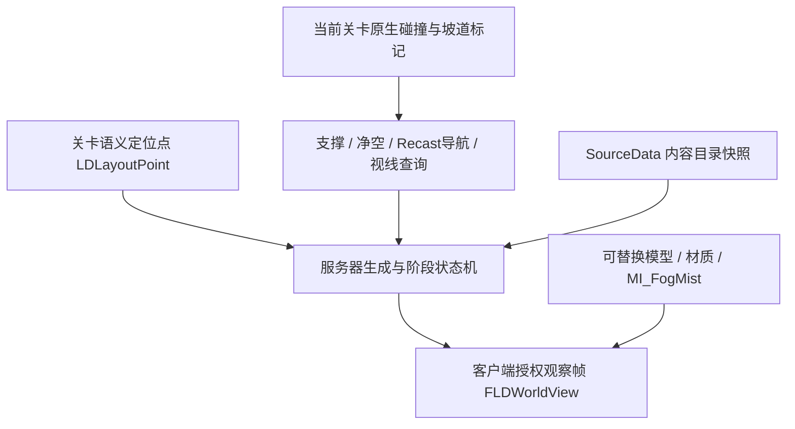

# 关卡创作自由与开发约束

本文件是修改关卡、场景、生成、碰撞、导航、镜头、视野、材质、特效与编辑器工具时的硬性工程约束：**程序适应场景编辑，依赖维护由开发者承担，严禁因代码偷懒限制地编/美术/TA 自由改图。**

## 1. 十条核心铁律

1. **装饰零逻辑耦合**：普通静态网格体、植被、铺地、灯光、后期与装饰 Actor 的增删改查不得影响开局、附身、镜头或阶段推进。
2. **只认语义定位点**：玩法位置一律通过 `LDLayoutPoint` / `LDSceneAnchor:<id>` 等显式语义身份解析，严禁按模型资产名、Outliner 显示名、数组下标或写死坐标猜身份。
3. **地面与碰撞实时生效**：支撑、阻挡、视线与弹道查询直接读取当前关卡原生物理体（`WorldStatic` + 阻挡 `Pawn`），不依赖特定 `demo_ground` Actor；删除或移动物体后不得残留隐形碰撞或旧视线缓存。
4. **逻辑与外观解耦**：替换或隐藏旗杆、出生点、营地、假人的预览/外观组件不得注销其玩法能力。
5. **编辑器预览纯表现化**：`LDLayoutPoint` 预览网格无碰撞、不进导航、不挡视线，在 `-game` 与打包版中安全忽略。
6. **尊重美术调参**：材质、雾效、灯光与特效参数须暴露在资产/Details 中持久化，运行时代码只写自身拥有的动态输入，严禁每帧重置美术调好的颜色或噪声参数。
7. **导航自动派生**：角色胶囊半径 `40 cm`、可行走坡度 `<= 50°`、台阶 `<= 35 cm`、禁止主动跳崖；高低台通过可行走坡道连接（`LDSceneAuthoringLibrary::BakeNavigation`）。
8. **视野与迷雾表现分离**：服务器 `LDVisionDirector` 决定唯一可见授权；客户端 `256 × 128` 距离场与 `/Game/Lockdown/Art/Fog/MI_FogMist`（含独立验证关卡 `/Game/FogMistPreview/L_FogMistLab`）仅负责视觉渲染，改雾效参数绝不改变逻辑可见性或暴露隐藏单位。
9. **可诊断错误**：缺少必需语义点、无地面支撑或路径不可达时，必须输出含逻辑 ID、对象路径与位置的可执行错误，严禁崩溃或卡在默认原点镜头冒充成功。
10. **保护人工关卡资产**：`Content/.../Generated/Maps/L_Demo.umap` 支持直接编辑保存即 Play；任何同步/生成脚本不得用旧模板覆盖人工摆放、缩放或材质。

## 2. 当前语义对象能力与现存限制（如实报告，不假装支持任意删除）

| 语义对象 / 范围 | 当前已支持编辑自由 | 现存硬限制（删改会明确报错拒绝） |
| --- | --- | --- |
| 普通建筑、地面、植被、灯光 | 自由增删、拆分多块地面、替换模型与材质，保存即 Play；`LDDemoTerrain` / `LDIndependentRamp` 跟随实例实时碰撞生效 | 必需玩法点脚下须有可行走支撑、胶囊净空及通往中心旗杆的完整路径；暂不支持上下双层重叠可走桥洞或局内动态拆墙导航 |
| 野外出生点 / 主旗杆 / 躺平角 / 空投 | 可在关卡中移动位置，站立高度自动贴合地面；可选锚点 `mini_flag_*`（`>= 2`）、`locker_*`（`>= 4`）可增删移动 | 12 个野外出生点、主旗杆 `capture`、躺平角 `dorm_*`（`1..8`）、4 个空投点与 Boss 巡逻点 `boss_patrol_1..4` 属必需语义角色，缺失或重名冲突会拒绝开局 |
| 34 处野怪营地 | 整组营地可移动、复制或调整成员槽位；模板决定档位，开局与刷新自动按档抽种 | 至少保留 1 组有效营地且总实体数在观察容量内；显式运行 `SyncDemoMap.ps1` 导出时仍核对目录名册（18 小 / 10 中 / 4 大 / 2 远古） |
| 终局入场口与中场 PK 点 | `final_spawn_0..7`（兼作私人旗杆立杆点）及 `pk_signup_0..7`、`pk_spawn_0..7`、`pk_throw` 均可移动并自动贴地 | 8 个终局点与 17 个 PK 点逐项必需，缺失或放进 `PK.ArenaRadiusCm` 外无净空处会明确报错或判该场 PK 无效 |
| 休息室训练假人 | 8 个专属假人槽可移动；复制训练点可新增任意个共享假人（`Shared Training Dummy`），也可随时删除新增实例 | 8 个保留槽位不可删除；共享假人身份当前由保存的 Actor 对象名派生（重命名视为换身份），观察总数受休息室名单上限约束 |

## 3. 相关系统入口与检查

- 实现手册：[世界与数据管线](systems/WORLD_AND_DATA_PIPELINE.md)、[移动、输入与镜头](systems/MOVEMENT_INPUT_AND_CAMERA.md)、[视野与界面](systems/VISION_AND_UI.md)。
- 最小验证：`Lockdown.Rules.StaticScene.*`、`Lockdown.Rules.Vision.FogDistanceField`、`Lockdown.Rules.Minimap.StaticInvalidation`。
