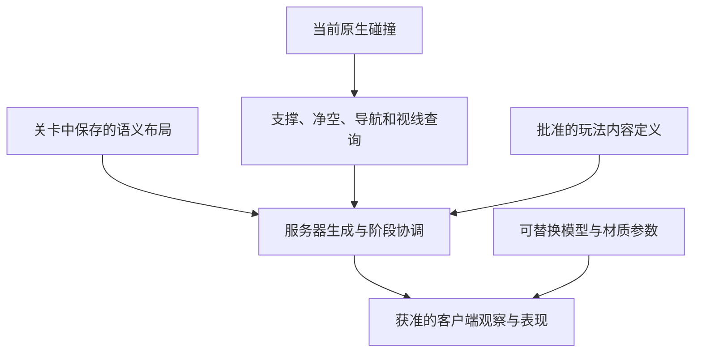

# 关卡创作自由与开发约束

## 1. 适用范围与优先目标

本文是开发者与 AI 修改关卡、玩法、碰撞、导航、视野、材质、特效和编辑器工具时必须遵守的工程约束。
关卡创作者同时承担地编、关卡设计、美术和 TA 工作，需要持续拆分地面、替换模型、调整空间、移动交互点和迭代表现。
开发实现必须为这些操作保留余地，不能要求场景长期保持生成器最初的对象、名字、数量和摆法。

**首要约束：其他开发者交付的程序、玩法、效果和工具，不得妨碍关卡作者编辑关卡。程序适应场景编辑，依赖维护由开发者承担。**

**核心目标：场景外观可以大改；物理环境随编辑真实变化；玩法通过明确的语义布局运行；服务器继续拥有游戏状态。**

“可自由编辑”包括合理的删除、复制、替换、重命名、移动、旋转、缩放和重新组织，不只是在原位置换一张材质。
碰撞编辑可以改变路线和视线，这正是关卡设计的一部分。开发者负责让系统理解新环境，不能以保留旧模型解决系统依赖。

本文中“必须／不得”为后续开发和评审要求；“当前”为已经核对的实现；“尚未支持”为明确的能力边界。
后续要求不表示相应重构已经完成。产品规则与数值仍由 [App Spec](APP_SPEC.md) 和内容定义维护；
遇到既有实现与本文目标的差距，应说明差距并在相关功能中消除依赖，不得通过关闭权威校验伪造成功。

### 作者的编辑权与开发者的交付责任

- 新功能不得缩小作者已经拥有的移动、删除、复制、替换、重组和调参能力。不得让作者记住一份不断增长的“这个不能动、那个不能删”名单。
- 程序修改、生成器、同步、构建和运行初始化不得擅自覆盖人工布局、模型选择、碰撞设置、材质参数或灯光设置。
- 新功能需要位置、范围、交互或生成能力时，开发者应提供清楚、可移动、可替换的语义入口，并承担依赖迁移与失效处理。
- 必要的玩法限制应尽量表达为“仍有合法出生位置”“服务可达”等功能条件，不能表达为“必须保留旧 Actor／旧模型／旧坐标”。
- 修复场景适配问题时，开发者应修复依赖与工具；不能把恢复旧布景、删除作者新增内容或每次手改代码作为长期工作方式。
- 因任务确需修改人工资产时，仅修改明确相关的部分；结构迁移须保护作者变换、外观与调参，并能说明具体差异。

## 2. 开发者与 AI 必须先记住的规则

1. 普通静态网格体、花草、铺地、灯光、雾、后期和装饰 Actor，不得成为对局状态机、玩家生成或摄像机附身的隐含前提。
2. 玩法身份属于明确的逻辑定位点或内容定义。不得根据模型名、Actor 显示名、材质、文件夹、数组顺序或旧坐标猜测用途。
3. 地面提供实际碰撞与可行走支撑。不得要求必须保留某一块原始地板、Landscape、固定名字或固定网格体资产。
4. 移动、阻挡、落地和寻路必须基于当前环境；删除或移动几何后，不得留下旧位置的隐形碰撞、路径或视线缓存。
5. 玩法布局与外观分别可编辑。换旗杆模型不能移除争旗规则，换商人模型不能移除服务，换出生点标志不能移除出生能力。
6. 编辑器可见预览不能冒充可攻击实体；真正的怪物、假人、交互和战斗继续走现有权威系统。
7. 外观参数须能在 UE 资产或 Details 中调整并保存；运行时不得每帧用代码默认值覆盖美术调参。
8. 复制对象必须处理身份；删除可选对象必须撤销相应注册；不得把少一个装饰或多一个通用假人当成整局无法启动的理由。
9. 只保留确实必需的语义前提。缺少必需角色时给出可定位、可修复的说明；不得崩溃、静默停住或让镜头留在旗子处冒充开局成功。
10. 验证真实编辑行为：删掉旧资产、放入替代品、重开关卡、正常 Play、经过阶段切换。不能只证明旧地图和代码常量互相匹配。

## 3. 责任分层与数据归属

| 层 | 拥有什么 | 主要编辑者 | 不应承担什么 |
| --- | --- | --- | --- |
| 场景与表现 | 模型、材质、灯光、雾、后期、植被、布景和美术层级 | 地编、美术、TA | Match/Life、胜负、服务是否存在、实体生命值 |
| 物理环境 | 模型实际碰撞、移动阻挡、可行走面、导航与视线输入 | 关卡设计、地编、TA | 根据网格体名字授予玩法身份 |
| 语义布局 | 出生位置、营地、服务点、争旗位置、巡逻路线、生成区域 | 关卡设计 | 自己维护另一份伤害、奖励或对局状态 |
| 玩法定义与权威运行 | 类型、规则、数值、名册、生成与退役、战斗、阶段、观察权限 | 程序、内容设计 | 写死美术摆放、依赖某个装饰组件存活 |

允许一个 UE Actor 方便地组合逻辑定位、可替换外观和碰撞组件，不要求每个道具都拆成多个 Actor。
关键是依赖方向：玩法依赖语义能力；外观由语义对象展示。替换或移除外观组件不能注销仍然存在的逻辑能力。
整个碰撞物件被删除时，其物理阻挡也应消失；不能暗中保留旧阻挡来维持旧地图。

保存的关卡负责作者布局和场景；内容目录负责正式类型与规则；导航、索引、缓存和运行时实体属于派生结果。
同一坐标、开关或数值只能有一个作者入口。不得要求地编在关卡、JSON 和 C++ 中同步手改三遍。

## 4. 对象的编辑与删除约定

| 对象 | 应允许的操作 | 合理的结果与边界 |
| --- | --- | --- |
| 纯装饰、花草、灯光、普通后期 | 自由增删改、替换、重组 | 只改变表现；不得阻止开局或改变规则 |
| 地板、墙壁、树干、岩石等碰撞物件 | 替换模型、拆分合并、移动、缩放、删除 | 碰撞、可走路线和遮挡随新环境变化；真实缺支撑或路线被堵须可诊断 |
| 逻辑对象的外观子组件 | 替换、隐藏或删除 | 保留逻辑角色；外观缺失可提示，但不能通过外观存在性决定阶段能否推进 |
| 逻辑定位点、路线与区域 | 移动和组织；按该类型的复制／删除语义编辑 | 改变实际生成或交互位置，不能继续读取旧坐标 |
| 额外通用假人、后续设计为可选的生成组 | 增加、复制、移动、删除 | 数量来自启用的作者布局；删除对应项不影响其他组或核心对局 |
| 必需角色与系统入口 | 可以迁移或替换等价提供者 | 必需的是能力及合法配置；不能把某个外观 Actor 永久指定为不可删除对象 |

可选与必需必须由类型／配置明确声明，不能依据“生成器最早创建的对象”判断。
删除必需角色的最后一个提供者，与删除它的外观，是两件事：前者须提供明确诊断，后者不应损坏玩法。
当前不能删除的布局项见第 11 节；不得把本表的后续目标误报成所有旧定位点已可任意删除。

对于新增类型，提交前必须回答：

- 移动整个对象时，哪些生成点、半径、子点和运行时位置随之变化？旋转、缩放是否有意义？
- 换模型、换材质、移除外观和删除整个逻辑对象分别会发生什么？
- 复制是在添加新实例，还是在复制一个全局唯一角色？冲突如何在编辑器中暴露？
- 零个、一个、多个该类型是否有效？删除一项是否会让其他项继续引用它？

## 5. 地面、碰撞、导航和空间范围

### 5.1 地面不拥有对局逻辑

地面可以来自普通静态网格体、多个拼接模块或其他已经接入同一查询合同的原生碰撞组件。
不能把出生名单、休息区状态、营地数量、争旗时间、摄像机目标或迷雾材质绑在“那一块地面”的组件上。
地图定义、玩法边界和初始化入口应有独立、可辨认的配置；地面被拆成十块不应要求复制十份游戏逻辑。

当前正式关卡的支撑查询使用可查询的 `WorldStatic` 碰撞，并要求其阻挡 `Pawn`、具有有效原生物理体；
可行走法线、身体胶囊净空和实际路径仍须通过。鼠标地面落点与落地检查复用原生碰撞，
不要求保留 `demo_ground` Actor，也不要求模型响应 `LDGroundAim` 才能作为地面。
视觉贴片若没有碰撞或忽略 Pawn，就不应成为支撑；薄贴片若启用真实阻挡，则可能改变实际落地高度。

移动阻挡、站立支撑、视线遮挡、镜头遮挡和纯装饰应分别表达。不能把“看上去像墙”直接推导成全部通道都阻挡。
当前正式视线通过 `LDVision` 查询障碍物，并单独保留地形层级遮挡规则；标记为 `LDDemoTerrain` 的高台／坡道使用当前原生碰撞投影，移动或删除后旧位置不继续遮挡。
地面本身不要求该语义标记；更换模型必须检查所需响应，
不能因为地面已不依赖旧地面通道，就把视线输入也当成不存在。若调整通道合同，须统一修改消费者和验证。

### 5.2 导航是环境的派生结果

当前方案是编辑器自动更新导航，完成碰撞编辑后构建路径并保存，运行时使用静态 Recast 数据。
不得为每块新地板增加私有寻路代码，也不得为绕过一堵移动后的墙，写死一串避让坐标。

开发者必须保证：

- 导航包围范围覆盖实际玩法区域；范围调整有可编辑入口，不被某块地板的组件身份控制。
- 导航 agent 与正式角色胶囊一致；新增地面之间的接缝、台阶、坡度按实际角色验证。
- 开局、重生、休息返回和 PK 入场使用合法支撑、净空及相应目标的完整路径，不能只看网格上有一层绿色。
- 移动或删除碰撞后重建受影响的派生数据。临时动态占位走既有等待／重试协议，不能留下半完成的玩家生命。

编辑器构建入口是 `LDSceneAuthoringLibrary::BakeNavigation`，落地诊断入口是 `GroundValidationError`。
它们是现有基础能力，不代表已经有一套完整的关卡编辑检查面板。
运行时拆墙、建造、升降平台和流送引起的导航变化需要显式接入；静态编辑后可 Play 不等于局内动态改图已经受支持。

### 5.3 地图尺寸与多层空间

不得假定地图以原点为中心、宽高相等，或只允许原始场地尺寸。单位使用 UE 世界厘米，转换、缓存和纹理采样须使用实际范围。
地图的玩法边界与导航覆盖应逐步成为独立可编辑定义；远处一件装饰不应改变玩法边界。
当前运行投影会从符合条件的原生碰撞推导边界，新增碰撞物件可能扩大范围；这项实现不能扩散成新的美术约束。

当前地面定位以 XY 查询支撑，视野也有既有层高规则。桥面和桥下同时可走、洞穴叠层、任意垂直地图等能力尚未因此获得。
需要这些结构时，应设计明确的层／支持面解析并接通移动、出生和视线，不能加一个写死名称的特殊地板分支。

## 6. 布局身份、生成与生命周期

### 6.1 用语义定位，不识别装饰

可以通过 `Spawn`、`Capture`、`RestService`、营地成员等明确角色及其稳定 ID 查找布局。
不得使用 `StaticMeshActor_55`、Outliner 显示名、`Actors[0]`、固定组件序号、模型路径或“离原点最近的旗子”识别玩法角色。
资产路径可作为集中配置的默认值；场景中具体网格体资产不能成为服务、胜负或生命身份。

位置、朝向、范围、子点和可选启用状态应按类型需要暴露为 UE 可编辑数据，带清楚的单位与作用说明。
移动一组布局时，子点必须按明确的相对变换跟随；不得把原始世界坐标另存进隐藏数组。
不要为了实现一个物件就引入通用脚本解释器、第二套注册表或第二套战斗系统；先复用已有组件和数据入口。

### 6.2 复制、重命名与删除

普通复制不能让两个实际对象争用同一个运行身份。作者实例与每局生成的实体身份须区分，
新局／新生命继续遵守现有 Match、Life 和回执去重规则。
正常复制、复制粘贴、PIE 世界复制、保存重开及跨关卡复制必须分别处理：PIE 复制不能把原始必需点变成另一种角色。

当前额外通用假人的身份从保存的 Actor 对象名派生，复制训练定位点会启用 `Shared Training Dummy`；
这是已有的限定实现，不是许可其他系统依赖 Actor 显示名。当前观察投影上限为 58 个单位；准备区按其他参赛者、每人一个专属假人和全部通用假人共同计算，六人名册最多支持 47 个额外通用假人。开局前检查容量并明确报告，不能生成一半后在发布观察时卡住。对象名参与派生身份的类型，必须说明真正重命名／重建对象会改变身份。
后续需要跨地图或长期引用的类型，应使用独立、可校验的作者身份，复制时生成新身份，不能复用显示标签。

可选布局的注册与撤销须成对，删除或停用后不能留下强引用、碰撞、视线缓存、计时器、生成任务或幽灵实体。
作者在停止 Play 后删除物件，至少应在下一次正常 Play 正确生效；局内卸载／删除的支持范围须另行声明。
唯一角色冲突、身份冲突和悬空引用须在进入对局前给出对象路径与修复方法，不得静默选第一个对象。

### 6.3 生成与阶段推进继续由权威系统协调

怪物、假人和服务实体的生成、战斗、退役与阶段清理由既有系统负责。装饰 Actor 的 BeginPlay 不得直接决定对局是否开始。
更换场景外观不能重置生命、奖励、回执或胜负，也不能让一个物件各自计时后私下推进阶段。

任何准备区、野外、PK、死亡重生、重开或地图切换，都必须核对实际 Pawn、附身关系、视角目标与 HUD 状态。
正式摄像机从当前获准的玩家／观战状态解析；不得依赖场景里某台测试 Camera 或旗杆 Actor 恰好先初始化。
缺少合法身体或等待放置时应显示明确状态，不能把镜头留在默认观察点作为正常运行结果。

## 7. 编辑器预览与 TA 工作入口

局内生成对象必须有方便地编使用的预览或调试显示：位置、方向、范围、所属组及可编辑数据要可辨认。
预览应有清楚的对象命名和参数说明，让作者可以选中和移动整个逻辑定位点，不必从脚本常量反推坐标。

当前 `LDLayoutPoint` 提供角色、怪物、假人、道具和范围预览；移动根定位点改变布局。
`Layout Preview` 外观参数只改变预览，不会自动修改正式内容目录中的外观、数量或技能范围；
当前布局主要消费 XY，运行站立高度按实际地面解析，不能把预览子网格的局部位移当成正式出生位置。
后续如开放正式朝向或外观覆盖，必须把字段的真实作用接入运行系统，不能只做看起来可编辑的参数。

预览树必须全部属于编辑器表现：无碰撞、不参与导航、不影响视线、不保存另一份游戏状态，不泄漏到正式局内。
`-game`、独立客户端和 cook 中编辑器专用子对象可能为空，构造、注册和销毁必须安全。
不得只在编辑器视口验证通过，就认定独立游戏也能启动。

材质、特效、灯光、后期及调试参数应集中、可发现、带单位和安全范围。项目可提供默认资产，TA 应能沿正式资产入口调整。
替换材质或特效时尽量通过配置／资产引用进行；改名、移动资产必须更新绑定或保留有效重定向，不得散落硬编码路径。
不用为未实现的能力暴露无效开关，也不应要求作者靠 Python 每次重开后重新设置外观。

## 8. 雾气视野遮挡的专门约束

### 8.1 玩法授权与雾的外观分开

正式链路是：服务器视野判断 → 本连接获准的覆盖与单位信息 → 客户端表现。
雾变淡、变厚、流动、换颜色、扩大视觉渐变带或更换噪声纹理，都不能改变谁能发现、选择、攻击或追踪隐藏单位。
不能先复制全部敌人到客户端，再靠后处理遮住；不能从隐藏单位的位置驱动雾或道具淡化。
覆盖纹理只用于环境表现，不能从某个像素的明暗反推单位授权、可选中状态或攻击资格。

当前客户端把本人授权帧中的 128×128 `CurrentBits` 转换成世界厘米单位的有符号距离场，再用材质表现平滑边界和流动噪声。
它不增加正式客户端视线查询，也不授予新的观察权限。覆盖和范围不变时复用距离场，变化时做短时表现平滑；
死亡、无身体、观察失效与重开时必须及时清理权限和旧表现，不能因雾的渐变继续保留敌人代理、可选目标或旧句柄。

提高后处理分辨率或增加噪声不能被描述成提高了服务器视野精度。
地图缩放、平移或更换范围后，距离场、世界坐标映射、缓存失效与非正方形单元尺寸必须保持一致。

### 8.2 正式材质与可调参数

正式游戏与 Lab 共用 `/Game/Lockdown/Art/Fog/MI_FogMist`，父材质为 `M_FogMist`，在景深前合成。
渐变带从不可视区域的外侧颜色连续过渡，向可视区内侧逐渐消散；噪声使用世界坐标，避免雾随镜头缩放或拖动滑动。

| 参数 | 作者可调的表现 |
| --- | --- |
| `BandWidthCm` | 雾气渐变带的世界宽度 |
| `FadePower` | 渐变分布与消散曲线 |
| `NoiseAmount`、`NoiseScaleCm`、`DetailWeight` | 扰动强度、云团尺寸与细节比例 |
| `FlowSpeedCmPerSec`、`FlowDirection`、`SwirlStrength` | 流速、方向与旋涡强度 |
| `OutsideBrightness`、`HiddenDesaturation` | 不可视区域的明暗与褪色 |
| `FogColorStrength`、`FogColor` | 雾色与混合强度 |

`OcclusionDistance`、`FieldWorldMin`、`FieldWorldSpan`、`CoverageOnly`、`CoverageActive` 是运行时输入／模式参数，
不能当成改变正式视野范围的美术开关。正式玩法半径来自服务器规则；`RadiusCm` 和 `ObserverPosition` 的作者调节属于 Lab 预览用途。
动态材质实例应继续继承正式材质实例的外观参数，代码只更新自己拥有的输入，不能把调好的颜色和流速逐帧覆盖回默认值。

效果资产可以迭代和替换，但须保持运行时输入合同或同步提供迁移。缺少表现资产时须明确报告并安全处理，
不能崩溃，也不能通过“显示全部单位”补救。噪声与艺术层次的开销应主要留在表现侧，避免为每层雾增加 CPU 射线和网络字段。
性能验证要区分 CPU 覆盖更新、纹理上传与 GPU 后处理成本，使用相同镜头、地图和负载比较，不能只看静态截图。

### 8.3 Lab 的保留与隔离

保留 `/Game/FogMistPreview/L_FogMistLab`：可直接 Play 跑图，右键寻路、WASD 移动、滚轮缩放，加载营地怪物供视野表现检查，不运行完整战斗对局。
运行中可以释放鼠标后调整正式 `MI_FogMist` 实时观察；停止 Play 后保存资产、切换关卡，确认重新打开仍生效。

Lab 的简化入口、可调观察者和本地可见性只属于实验环境。`FogMistLab` 插件对 GameInstance 的临时选择必须在结束／取消时还原，
不得修改正式地图的入口、服务器授权或默认规则。Lab 需要显式提供自己的地形与初始化数据，不能依赖正式地图先运行一次。
不得把 Lab 的怪物加载数、站位或预览半径扩散为正式对局的固定常量。

## 9. 同步、生成器与协作边界

`Content/.../Generated` 的目录名不意味着可以覆盖其中的人工关卡编辑。
日常地编以保存的关卡为作者入口；装饰派生索引不逐项一致不能成为普通 Play 的拒绝理由。
内容摘要、schema 和权威协议仍须正常校验，不能把允许编辑场景解释成可以手改哈希。

生成器、导出和同步工具必须说明输入、输出以及覆盖范围。重生成前检查并保护人工改动，提供可审查的差异，
不能用旧坐标或模板重建整个关卡来修复一处布局错误，也不能把新模型换回旧模型当成修复完成。
正式同步接口尚不支持的作者能力，应明确报告；不能暗中丢掉新增对象或改写它们的身份。

同一 `.umap`、材质、材质实例与其他二进制资产不并行写入。多个开发者／AI 使用独立分支和工作区，
操作 UE 前确认工程路径、实例和目标关卡；未协调时不关闭、重载或改写别人正在使用的编辑器。
Windows 命令使用后台终端；UE Python 使用已核对目标工程的后台 runner；共享桌面不抢鼠标和焦点。
可交互编辑器不得因自动化启动参数而阻断用户保存与切关卡。

## 10. 诊断、测试与交付标准

检查应回答“场景是否仍满足玩法语义与物理条件”，而不是“它是否还长得像原地图”。
错误至少给出：逻辑角色／ID、对象路径、问题位置、原因和可执行的修复操作。
应能区分缺少必需角色、真实无支撑、胶囊阻挡、路径不可达、临时占位、身份重复、导航过期和外观资产缺失。
普通外观警告不能升级为整局硬门槛；必需条件真的不满足时，也不能吞错后让游戏卡在半启动状态。

新增或修改相关功能时，按影响范围覆盖下面的最小集合；这不是要求每次改灯光都跑完整对局：

| 变更 | 必须验证的行为 |
| --- | --- |
| 装饰、灯光、材质 | 增删／替换与保存重开；无新增玩法依赖；参数未被重置 |
| 地面与墙壁 | 删除旧件、多个替代件、接缝／贴片、支撑与净空、实际路径；确认旧碰撞与缓存已消失 |
| 玩法定位点 | 移动根与整组、正常复制和粘贴、删除可选项、重复必需身份诊断、撤销重做和保存重开 |
| 生成与阶段 | 正常入口开局、实际附身和镜头、相关准备区／PK／野外切换；无重复实体或遗留目标 |
| 编辑器预览 | 编辑器、PIE、独立 `-game`、受影响的 cook 边界；预览树不参与游戏 |
| 雾效表现 | 实时调参、持久保存、镜头移动与缩放、地图范围变化、过期／死亡／重开、Lab 与正式关卡切换 |
| 观察、多人共享目标 | 真实拥有连接看到同一个获准实体与实际状态；隐藏目标与旧句柄不可恢复 |

自动化测试应使用隔离夹具并覆盖编辑行为。涉及正式规则的数量从内容与启用布局推导，
不得把某张美术地图里的树、地板或怪物总数写成永久断言；规则确实要求的数量仍应严格验证。
测试夹具可以固定其自身对象数，但不能把夹具坐标当成正式运行依赖，或为满足断言删除作者新增内容。

沿用 [验证手册](systems/VERIFICATION.md) 的最小验证原则与 `Scripts/Verify.ps1`。
现有入口包括 `Lockdown.Rules.StaticScene.*`、`Lockdown.Rules.Vision.FogDistanceField`，以及与实际变更相关的拥有连接场景。
已通过、失败、未运行和未支持要分别报告；Lab 跑动、Host 截图或测试的一部分通过，都不能代替正式多人流程验收。

### 代码评审的完成条件

- [ ] 普通环境对象被删除或替换，不会破坏注册、开局、附身或阶段状态机。
- [ ] 所有场景依赖能说明语义用途、作者入口、必需性，以及移动／复制／删除行为。
- [ ] 没有引入固定网格体、显示名、旧坐标、容器顺序或装饰数量的玩法依赖。
- [ ] 碰撞、导航、视线和表现缓存跟随编辑更新，缺失引用与编辑器专用对象安全处理。
- [ ] 作者能在 UE 中发现、调整和保存实际生效的参数；运行时写入不覆盖艺术调参。
- [ ] 可选内容缺失不会拖死整局；必需条件缺失有可定位的诊断。
- [ ] 必要的行为测试通过，现存限制与未覆盖范围已如实说明。

## 11. 当前实现基线与尚未消除的限制

| 范围 | 当前能力 | 尚未获得的自由／后续开发要求 |
| --- | --- | --- |
| 普通静态网格体与装饰 | 普通编辑不要求装饰索引逐项同步；真实碰撞参与支撑与视线 | 新类型不得恢复这种索引硬门槛；资产本身仍须有效且可用 |
| 替换地面 | 不依赖原 `demo_ground` Actor，可用多个原生碰撞模型 | 必需定位点仍须有支撑、净空和路径；多层支持面与动态导航需要专项接入 |
| 核心地图绑定 | 正式世界仍要求唯一地图定义入口和 PlayerStart | 正式运行入口仍针对 Demo 世界；本文件不表示任意新地图已能直接进入完整对局 |
| 原有布局点 | 位置可编辑，站立高度跟随地面；营地子点可随组移动 | 原内容声明的出生、服务、营地成员等点仍逐项必需；任意删除或复制它们仍可能拒绝启动，后续需按类型减少固定名册耦合 |
| 训练假人 | 原有六个槽位按参赛者生成；额外通用假人可复制、移动和删除，复用真实战斗 | 原有六个保留槽位不能作为普通通用副本任意删改身份；额外实例当前使用 Actor 对象名派生身份 |
| 布局预览 | 编辑器可见，正式运行不把预览当实体 | 预览的 `CharacterId`、`PropId` 等并非正式外观覆盖合同；不能承诺改预览就改正式内容 |
| 显式作者源导出 | 有既定关卡→world→content 同步链 | `SyncDemoMap` 的矩形地面、姿态与作者格式限制仍在；通用假人导出尚未支持，不能把它当任意改图后必跑的无损同步按钮 |
| 雾气表现 | 正式可调材质、距离场渐变、流动噪声、共享材质的 Lab | 不提高服务器覆盖精度，不引入探索层，也不自动支持多层空间的视野规则 |

这些限制需要沿现有系统演进，不能通过扩大场景禁改范围解决。
新增系统不得把上表中的历史约束继续复制到新功能；涉及必需数量或玩法删减的变化仍须明确其产品含义。

## 12. 实施入口与可复用任务说明

实现细节以以下入口为准，本文维护开发边界，各系统手册维护接口与行为，避免另存一份数值或状态机：

- [AI 协作入口](../AGENTS.md)、[开发指南](DEVELOPMENT.md)。
- [世界与数据管线](systems/WORLD_AND_DATA_PIPELINE.md)：`LDStaticScene`、`LDMapRegistry`、`LDNativeGround`、`LDLayoutPoint`、`LDSceneAuthoringLibrary`。
- [移动、输入与镜头](systems/MOVEMENT_INPUT_AND_CAMERA.md)：CharacterMovement、导航订单、放置和视角规则。
- [视野与 UI](systems/VISION_AND_UI.md)：`LDVisionDirector`、`LDWorldViewRelay`、`LDFogDistanceField`、正式雾材质及 Lab。
- [战斗与成长](systems/COMBAT_AND_GROWTH.md)、[架构与网络](systems/ARCHITECTURE_AND_NETWORKING.md)：正式生成、战斗、生命周期和权威边界。

可直接把下面的说明交给后续开发 AI：

> 开始前阅读 AGENTS.md、docs/LEVEL_AUTHORING_CONTRACT.md 及相关系统手册。此项目需要让关卡设计、美术和 TA 持续替换与重组场景。不得让普通模型、材质、Actor 显示名、固定坐标或装饰数量成为玩法前提。先识别真正需要的语义角色和原生物理能力，再实现逻辑。明确对象移动、复制、替换、删除和保存重开时的行为；参数须能在 UE 中实际编辑生效。保留服务器权威与观察边界。提交时给出实际验证结果，以及当前仍不能自由编辑的具体依赖；不要通过回滚作者场景、保留旧地板或绕过校验掩盖问题。
