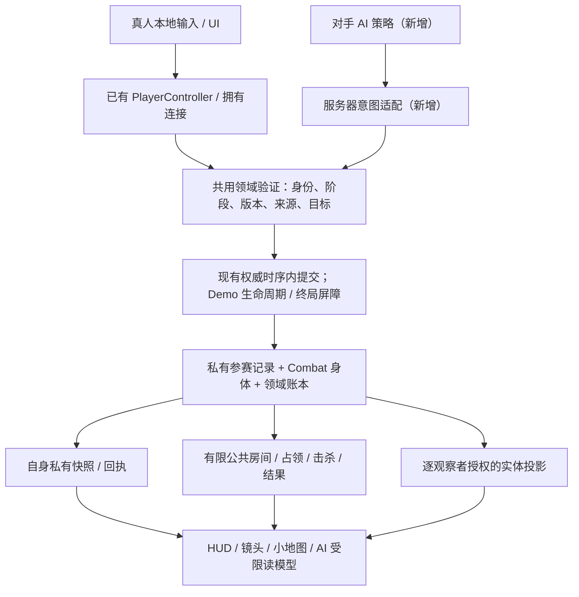

# Demo 总体架构、复用边界与共享契约

**目标：v0.10.0 Demo · 模块：总体架构 · 引擎：Unreal 5.8.4**

本报告把 [App Spec](../APP_SPEC.md) 转成可分派的架构工作，不重新定义玩法。
**现有事实**只由本基线源码支持；**建议**是尚未实施、需在对应模块落地并验收的设计。
明确标注的**已确认决定**是实施约束，其余建议不是已批准的产品变更。
文中的逻辑契约、任务和后续模块名称不是已有 API，文档修订也不表示运行代码已收敛。
组件接口仍以 [系统手册](../DEVELOPMENT.md#按任务读取系统手册) 和实际代码为准。

## 1. 结论与范围

**用户已确认：直接收敛现有运行入口，只维护 Demo 一条流程，并裁剪代码库至 Demo 实际需要的依赖。**
现有前端、开发启动、服务初始化、打包及包内启动收敛到同一套 Demo 流程。
Demo 不需要的旧模式、政策、代码、输入、资产、脚本、测试与过期说明按依赖清单删除；
完成状态不包含兼容壳、注释掉的旧实现、备用旧目录、备份分支或已放弃方案文档。
已有 Git 历史不改写，本任务也不清理本机历史构建。

复用只针对 Demo 确需的 CharacterMovement、战斗、事务、身份与观测能力，
不代表保留其整个历史模块。混合文件先抽取/改造必要能力，再删除旧调用、政策和剩余部分；
不以“以后可能需要”保留代码，也不因单一入口而全库改名或全盘重写。
现有前端仍进入 V05，仅作为收敛前的依赖审计事实；本轮只形成删除/新增/复用计划，
不实施代码或资产删除，不宣称裁剪已经完成。

本模块只覆盖总体架构、共享接口、复用审计、实施依赖和验收设计。
不实现游戏，不生成地图，不选技能/装备目录，不填写伤害、价格、时长、概率或公式。
后续模块清单是当前选定 Demo 的分工建议，不是长期路线图，也不授权同时启动所有模块。
首批入口/基础裁剪的具体范围和门槛见 §8.2，不要求等全套技能、装备或数值设计；
资产删除仍须引用核验，内容相关保留集合仍须对应决定，不能把“可以开工”解释为直接盲删。

范围以 Spec §1、§2、§9–11 为锚：

| 必须支持 | 本 Demo 不启用 |
| --- | --- |
| 自由混战；Listen Host 也是玩家，最多另有两名真人、三个独立参赛 AI；不补满空位 | 队伍、共享胜利、专服/匹配平台、重连、Host 迁移、自动 NAT 穿透 |
| 单图、一个圈、五组两档野怪、一个商店、十个等概率且可重复抽取的出生点 | 全城模拟、多地图、额外目标路线、钥匙/授权/站桩前置、超时积分胜利 |
| 普攻起步；最后一击独占经验和金币；升级三选一、Q/W、两装备与 1/2 | 职业起始技能、加点/读书代替三选一、额外背包、银行/采集/制作/玩家交易 |
| 局部视野；死亡保留局内成长与财产；连续独占获胜；回 Lobby 开新局 | 共享塔视野/全知 AI、死亡扣金掉装、跨局战力、世界检查点冒充新局 |

最小**完整 Demo**仍是“进入房间 → 从零打野/对抗 → 成长/购物 → 争圈 → 唯一胜者
→ 结算/新局”。可以先做无完整成长内容的集成骨架验证胜负和生命周期，
但它只能是工程检查，不能称为可交付 Demo；测试夹具也不能成为未批准的产品默认数值。

## 2. 审计基线与证据边界

- 基线提交：`fa11d09a762bccadf495191072e222dd158fc014`；研究前 fetch 后工作区
  HEAD 与 `origin/main` 相同。以下源码行号固定于此提交，描述收敛前的实现，
  不构成继续支持旧模式的承诺。
- 阅读顺序：README → App Spec → DEVELOPMENT → 六份系统手册 → 相关原生代码、
  只读配置/SourceData 和检查入口。Spec 是需求；手册是组件知识；旧输入不是新玩法授权。
- 代码核验覆盖 Framework、Character、Navigation、Combat、Development、Inventory、
  Economy、Objectives、World、Vision、UI、Population、Region、Editor Bootstrap、
  相关 Tests 和 Scripts。缺失结论结合入口、生产者/消费者与跨 Source 搜索，
  不是“某个文件没找到某个名字”。
- **本次为静态研究和文档审核。** 未运行 Unreal、构建、生成器、Bootstrap、原生测试、
  联机场景或发布构建；未加载二进制地图/Blueprint。不能由此宣称资产视觉、寻路、
  延迟体验或目标 Demo 已通过。源码缺少接线也不等于引擎缺少该基础能力。
- 所谓“可复用”指已存在且有价值的机制，不表示整个旧服务可直接启用，更不表示
  其原有数值、容量、地图形状或旧测试断言适用于 Demo。

## 3. 现有实现与复用矩阵

以下链接是仓库内真实源码位置；Windows 操作路径以 `Source\...` 为根。
“新增”行中的名称是职责描述，不冒充已存在的类。

### 3.1 复用清单：原样、改造、抽取

“原样”只指列出的局部机制，**不是整文件或历史模块原样保留**。
保留理由必须是当前 Demo 消费者；同文件剩余旧政策按 D 清单删除。

| ID/类别 | 保留能力、真实落点与证据 | 当前用途与必须剥离的内容 |
| --- | --- | --- |
| R01 原样机制 | `FLDSavedMove::CanCombineWith/SetMoveFor`、`FLDNetworkMoveData::Serialize`：[LDCharacterMovementComponent.cpp:22–67](../../Source/Lockdown/Private/Character/LDCharacterMovementComponent.cpp#L22-L67)；`FLDMoveIdentity`：[LDNavigationComponent.h:7–16](../../Source/Lockdown/Public/Navigation/LDNavigationComponent.h#L7-L16) | 原生预测和 Match/Life/Order/Epoch；删除 sprint、B91 搬运速度/全图分派及旧 profile 门槛，不另写位置积分器。 |
| R02 原样机制 | `FViewCursor::Accept`：[LDRules.h:71–86](../../Source/Lockdown/Public/Core/LDRules.h#L71-L86)；`LDCommandLiveness::Fresh`：[LDCommandLiveness.h:5–12](../../Source/Lockdown/Public/Framework/LDCommandLiveness.h#L5-L12) | 拒绝旧代次/旧发布和失联旧订单；同文件 DeathCost/HeartAccess/deadline、`ForProfile` 旧选择器不随之保留。 |
| R03 原样工具函数 | `CatalogTools` 的严格 JSON/schema/ID/确定性编码：[CatalogTools.py:1–95](../../Scripts/CatalogTools.py#L1-L95)；引擎/工作区解析：[Common.ps1:25–54](../../Scripts/Common.ps1#L25-L54) | 服务当前唯一数据管线与 UE 5.8.4；删除无消费者的旧生成器/目录假设，不保留历史载荷版本作为工具输入。 |
| R04 改造 | `ALDCharacter`、`ULDHumanoidVisualComponent`：[LDCharacter.cpp:17–85](../../Source/Lockdown/Private/Character/LDCharacter.cpp#L17-L85)、[LDHumanoidVisualComponent.cpp:9–41](../../Source/Lockdown/Private/Character/LDHumanoidVisualComponent.cpp#L9-L41) | 同基础身体/碰撞/镜头/身份表现；删除 Resident、旧工具灯光/机构动画/职业 cue 与旧 tuning。Host 原生表现和观测代理须协调，不能盲删 authority 身体。 |
| R05 改造 | Navigation 的 `Plan/ServerOrder/ServerStop/ClientOrder/TickComponent`：[LDNavigationComponent.cpp:70–230](../../Source/Lockdown/Private/Navigation/LDNavigationComponent.cpp#L70-L230)、[237–319](../../Source/Lockdown/Private/Navigation/LDNavigationComponent.cpp#L237-L319) | 合法路径、取消、ACK、目标接近/AI 适配；剥离 B91 Cast、旧 site/pickup/服务和 local-only 提交假设。已有范围内持续普攻在 [LDContentLifecycle.cpp:35–39](../../Source/Lockdown/Private/Combat/LDContentLifecycle.cpp#L35-L39)，不是完整右键追击或 A 攻击移动。 |
| R06 改造 | `ALDGameMode::StateFor/ContenderId/SyncOwner/EndContenderLife/ReturnDueContenders`：[LDGameMode.cpp:378–453](../../Source/Lockdown/Private/Framework/LDGameMode.cpp#L378-L453) | 单一私有参赛记录、owner 投影、生命换代；删四人/职业、死亡税/掉落、安全出生策略和旧世界指针，不给 Record/OwnerState/Ledger 三处独立写权限。 |
| R07 改造/抽取 | Combat 的 `Queue/RequestBody/RequestEquipped/Sample/Die/Sync`：[LDCombatDirector.cpp:66–203](../../Source/Lockdown/Private/Combat/LDCombatDirector.cpp#L66-L203)、[206–388](../../Source/Lockdown/Private/Combat/LDCombatDirector.cpp#L206-L388)；`LDTactical::Allows/Damage/Apply/Dispel/Regenerate`：[LDTacticalRules.cpp:8–55](../../Source/Lockdown/Private/Combat/LDTacticalRules.cpp#L8-L55) | 唯一战斗/控制/来源/死亡时序；删除旧暗杀/居民/职业任务、全图物件反应及不受终局闸约束的副作用。具体效果/公式保留集受 C1 约束，不默认保留完整 Combat。 |
| R08 抽取/改造 | `FLedger::Commit/Receipt/Reconcile`：[LDEconomyLedger.cpp:36–100](../../Source/Lockdown/Private/Economy/LDEconomyLedger.cpp#L36-L100)，归属精简后的现有 EconomyDirector | 保留预期版本、溢出拒绝、同条款幂等、全量验证后提交和独立复算；删除 BankTransaction、居民 endowment、制作血缘/quality、旧预算。Ledger 不含 XP/三选一，复合奖励还须 N03/N04 协调。 |
| R09 抽取/改造 | `LDV08::ItemSource/InvalidateSources/Project`：[LDV08Loadout.cpp:22–77](../../Source/Lockdown/Private/Development/LDV08Loadout.cpp#L22-L77)；Inventory 的 `Owned/HasSpace/Changed/Adopt/Remove`：[LDInventoryDirector.cpp:39–76](../../Source/Lockdown/Private/Inventory/LDInventoryDirector.cpp#L39-L76)；Vendor 会话/报价/请求/回执：[LDVendorDirector.cpp:19–92](../../Source/Lockdown/Private/Inventory/LDVendorDirector.cpp#L19-L92) | 真实两装备、来源失效、同一账本买卖；删十一绑定/六共享动作、重量/背包/quick/掉落、售书/安静准备附加条件。装备主动仍属 Combat，不属于商店事务。 |
| R10 改造 | `ALDWorldDirector` 的合法寻路、身体 life/credit 和一次奖励入口：[LDWorldDirector.cpp:35–110](../../Source/Lockdown/Private/World/LDWorldDirector.cpp#L35-L110)；Objective 的单结果所有者：[LDObjectiveDirector.cpp:345–360](../../Source/Lockdown/Private/Objectives/LDObjectiveDirector.cpp#L345-L360) | 改为五组两档野怪与连续独占；删 Boss/Tower/探索奖励/有限刷新预算、Heart 授权/路线/站桩及先清理后锁结果的旧顺序。 |
| R11 抽取/改造 | `LDGround::MapSurface/ClearSegment`：[LDGroundQueries.cpp:5–35](../../Source/Lockdown/Private/Core/LDGroundQueries.cpp#L5-L35)；现有 RegionNavBounds 与 Editor 几何生成/保存/校验：[LDRegionBootstrap.cpp:38–76](../../Source/LockdownEditor/Private/ScaffoldBootstrap/LDRegionBootstrap.cpp#L38-L76) | 一个当前地图的地面、阻挡/LOS 和导航；删 B91/full-map 分派、旧 city/route/sentinel 输入和缺图默认位置。C2 决定实际几何，不保留两套地图定义。 |
| R12 改造 | `CanSee/CanObserve/ResolveObserved`：[LDVisionDirector.cpp:117–186](../../Source/Lockdown/Private/Vision/LDVisionDirector.cpp#L117-L186)；relay 快照/隐藏/清理：[LDWorldViewRelay.cpp:96–128](../../Source/Lockdown/Private/Vision/LDWorldViewRelay.cpp#L96-L128)、[158–169](../../Source/Lockdown/Private/Vision/LDWorldViewRelay.cpp#L158-L169) | 唯一观测格式、逐观察者句柄/游标；删旧 sources/kinds/提示旁路与 B91 分派，改 Host 呈现和当前 DTO 白名单。 |
| R13 改造 | UI/世界输入独占：[LDPlayerInput.cpp:88–208](../../Source/Lockdown/Private/Framework/LDPlayerInput.cpp#L88-L208)；`Rebind/Save`：[LDControlSettings.cpp:40–92](../../Source/Lockdown/Private/UI/LDControlSettings.cpp#L40-L92)；owner 快照拒旧：[LDPlayerController.cpp:194–205](../../Source/Lockdown/Private/Framework/LDPlayerController.cpp#L194-L205) | Q/W、1/2、P、镜头、Esc、真实状态和本地设置；删除旧 profile 映射迁移、银行/交易/职业服务页签/Delegate，不留空旧面板方法。 |
| R14 改造 Editor/资产 | Bootstrap 的严格读取、Signature、SaveAsset、WBP 编译/Fog 生成：[LDScaffoldBootstrapCommandlet.cpp:57–88](../../Source/LockdownEditor/Private/ScaffoldBootstrap/LDScaffoldBootstrapCommandlet.cpp#L57-L88)、[165–237](../../Source/LockdownEditor/Private/ScaffoldBootstrap/LDScaffoldBootstrapCommandlet.cpp#L165-L237) | 生成唯一 Demo 根资源；删固定旧 MapNames/十三输入/V07 全目录/多图重生。`WBP_UIRoot`、`M_Character`、`M_Fog`、`T_FogClosed` 有当前消费者，先按 C3 查引用再精简，不能因是占位素材盲删。 |
| R15 原样职责/按依赖精简 | 当前 Game/Editor 目标：[Lockdown.Target.cs:8–11](../../Source/Lockdown.Target.cs#L8-L11)、[LockdownEditor.Target.cs:8–12](../../Source/LockdownEditor.Target.cs#L8-L12)；两个 Build.cs、`.gitattributes`/`.gitignore` | 保留 Runtime/Editor 隔离、当前 UE/Win64/LFS/本地输出规则；删除失去实际消费者的模块/插件启用/staging，不新增旧模式目标。C4 不授权修改共享引擎/插件安装。 |

### 3.2 删除清单与依赖前提

下表是**最终必须删除的闭包或混合文件中的旧部分**，不是现在即可按通配符执行删除的授权。
`{A,B}` 表示有限文件名/目录枚举，`*` 只限所写目录和前缀；实施前展开为实际文件名单。
省略根的 `Public\…`/`Private\…` 均从 `Source\Lockdown` 展开，不指另一个目录。
混合文件只删除列明的旧函数/字段/分支，保留能力见 R 表。步骤 P0–P5 见 §8；
C1 内容、C2 几何、C3 二进制引用、C4 模块/插件依赖的条件项也在 §8 明确。

#### 3.2.1 Source：领域删除与混合文件裁剪

| ID/删除落点 | 为什么删除 | 当前依赖、先替代/抽取什么 | 顺序 |
| --- | --- | --- | --- |
| D01 `Source\Lockdown\{Public,Private}\Framework\LDGameMode.*` 的 `IsDevelopmentProfile/IsTacticalProfile/IsV08Profile/IsEnvironmentProfile/IsPopulationProfile`、`bScaffoldProfile`、旧 GameState 路线/经济字段 | 多运行组合、职业 Lobby、旧容量/截止时间/debug Host 特免不是 Demo | Host 固定 V05：[LDUIRoot.cpp:368–387](../../Source/Lockdown/Private/UI/LDUIRoot.cpp#L368-L387)；分派/服务：[LDGameMode.cpp:144–179](../../Source/Lockdown/Private/Framework/LDGameMode.cpp#L144-L179)、[211–310](../../Source/Lockdown/Private/Framework/LDGameMode.cpp#L211-L310)、[490–519](../../Source/Lockdown/Private/Framework/LDGameMode.cpp#L490-L519)。保留 R06，先改所有调用者及默认 mode；不留恒真旧 predicate。 | P1 唯一调用/服务 → P2 默认配置/资产 → P3 真删分派 |
| D02 `Source\Lockdown\{Public,Private}\Economy\LD{BankDirector,CommerceDirector,ProductionDirector,InstitutionSite,EconomyCatalog}.*`；`Source\Lockdown\Private\Economy\LD{ProductionPlan,EconomyCharter,EconomyCommerce,EconomyInstitutions,EconomyProduction}.cpp` | 银行、多城市场、机构/生产/采购循环全部不需要 | GameMode 创建、Combat 采样、Controller RPC 与 UI 服务页持有类型：[LDPlayerController.h:49–86](../../Source/Lockdown/Public/Framework/LDPlayerController.h#L49-L86)、[LDInventoryServices.cpp:12–33](../../Source/Lockdown/Private/UI/LDInventoryServices.cpp#L12-L33)。先将 Demo 买卖/奖励接回 R08/R09，不保留整个市场。 | P1 消费者改接 → P3 领域/反射/UI → D28/D33/D34 |
| D03 `Source\Lockdown\{Public,Private}\Economy\LDEconomy{Ledger,Director}.*` 内银行/endowment、居民钱袋、旧 Catalog、有限预算、制作 quality/transient/parents 等无当前消费者字段 | 同名账本可复用，不等于旧经济模型可保留 | [LDEconomyDirector.cpp:19–45](../../Source/Lockdown/Private/Economy/LDEconomyDirector.cpp#L19-L45)、[111–142](../../Source/Lockdown/Private/Economy/LDEconomyDirector.cpp#L111-L142)；先列 N03/N05 实际账户/物品操作集，保留 R08 的 Commit/Receipt/Reconcile/溢出与恰一次，不保留旧预算。 | P1 当前提交使用集 → P3 混合字段/分支 → P4 复算 |
| D04 `Source\Lockdown\{Public,Private}\Inventory\LDTradeDirector.*`、`Source\Lockdown\Public\Inventory\LDTradeTypes.h`、`Source\Lockdown\Private\Framework\LDPlayerTrade.cpp`、`Source\Lockdown\Private\UI\LDInventoryTradePanel.cpp` | 玩家交易不属于 Demo | Controller 的 `ServerTradeCommand/TradeView`、Panel、GameMode Trade、Combat/Navigation/Development/Vendor 的取消和 Pending 引用：[LDPlayerController.h:42–47](../../Source/Lockdown/Public/Framework/LDPlayerController.h#L42-L47)、[LDInventoryPanel.h:43–119](../../Source/Lockdown/Public/UI/LDInventoryPanel.h#L43-L119)。将必要幂等/隐私断言归入现有 Ledger/Vendor/Inventory，删 Trade 类型而非空实现。 | P1 断 RPC/聚合/取消/UI → C3 反射核验 → P3 → D28/D33/D34 |
| D05 `Source\Lockdown\{Public,Private}\Inventory\LD{AcquisitionCatalog,AcquisitionDirector,SupplyRequest,LoadoutRequest}.*`、`Source\Lockdown\Private\Inventory\LDAcquisitionContract.h`、`Source\Lockdown\Private\Framework\LDPlayer{Production,Bank,Commerce}.cpp` | 书籍、采购、制作/质量、旧绑定/排序不是两装备商店/三选一 | Controller/Panel 和 GameMode 消费；**SyncB84 还读 acquisition.cpp**：[SyncB84Data.py:45–60](../../Scripts/SyncB84Data.py#L45-L60)。先把必需分配失败前置、来源/提交机制接到现有 Vendor/Ledger/Development，并改 compiler 输入依赖。 | P1 R09/N04/N05 → P2 compiler → P3 整链 |
| D06 `Source\Lockdown\{Public,Private}\Population\LDB92*`、`Source\Lockdown\{Public,Private}\Economy\LDB92*` | 全城人口/日程、犯罪/目击、居民钱包、席位接管/离线转 AI 不需要 | [LDB92Roster.cpp:117–199](../../Source/Lockdown/Private/Population/LDB92Roster.cpp#L117-L199)；B92 Controller 继承 B91，Combat/Inventory/UI/数据也调用其服务。保留 GameMode Session 的原所有者，N06 接真正参赛 AI，不把 Transfer/Release 当 AI 骨架。 | P1 AI/账号消费者 → P2 反射引用 → P3 → D19/D22/D27/D31/D32 |
| D07 `Source\Lockdown\{Public,Private}\Development\LDWorldChecks.*`、`Source\Lockdown\{Public,Private}\Region\LDRegionDirector.*`；`ALDResident`（Character 文件）、`ALDWildSentinel/ALDWatchControl`、`RegisterSkillTask` 旧链 | 居民/职业任务、访问/说服/偷窃、watch sensor、第二种旧怪/奖励政策不需要 | [LDSkillExecution.cpp:36–53](../../Source/Lockdown/Private/Combat/LDSkillExecution.cpp#L36-L53)、[133–146](../../Source/Lockdown/Private/Combat/LDSkillExecution.cpp#L133-L146)、[185–193](../../Source/Lockdown/Private/Combat/LDSkillExecution.cpp#L185-L193)。先让 Demo 野怪使用现有 WorldPawn/Combat，保留真正需要的 RegisterNPCBuild/RequestBody 等局部能力。 | P1 N03 → P3 类/回调/呈现 kind → P4 |
| D08 `Source\Lockdown\{Public,Private}\World\LDWorldDirector.*` 的旧营地/Boss/Tower/探索奖励/授权字段；整删 `Source\Lockdown\Private\World\LDWorld{Leases,Claims}.cpp`、旧 WorldSite shrine/antechamber | 三营地/有限刷新、Relic/Keys/Artifact/HeartFragment、旧 PvP 限额不需要 | Combat/Objective/Vision/旧 clock 调用；[LDWorldDirector.cpp:35–110](../../Source/Lockdown/Private/World/LDWorldDirector.cpp#L35-L110)、[LDWorldDirector.h:79–84](../../Source/Lockdown/Public/World/LDWorldDirector.h#L79-L84)。先完成 R10/N03 的当前营地与致死信用，删 LastOwner 无主兜底。 | P1 野怪/时序/奖励 → P3 旧世界字段与 leases/claims |
| D09 `Source\Lockdown\{Public,Private}\Objectives\LDObjectiveDirector.*`、`Source\Lockdown\Public\Objectives\LDObjectiveRules.h` 的 Seal、路线、hold/contract/window/deadline | 站桩/授权/门票/旧胜负条件删除 | [LDObjectiveDirector.cpp:93–171](../../Source/Lockdown/Private/Objectives/LDObjectiveDirector.cpp#L93-L171)、[234–360](../../Source/Lockdown/Private/Objectives/LDObjectiveDirector.cpp#L234-L360)；WorldClaims、Context RPC、Vision/HUD。N02 在同一 Objective 所有者接圈 reducer/结果闸，不保留旧 Claim fallback。 | P1 N02 → P3 旧类型/规则/UI/RPC → P4 |
| D10 `Source\Lockdown\Private\World\LDWorldClock.cpp` 及 Combat `Sample/FlushPastCommand/AdvanceAuthority` 中旧调度政策 | WorldRuntime gating、stationary hold、旧生产/环境/截止事件及回填历史姿态必须删除 | [LDWorldClock.cpp:9–28](../../Source/Lockdown/Private/World/LDWorldClock.cpp#L9-L28)。保留重入/到期/统一提交机制，按 §4.5/N02 接实际事件时间和水位；不是原样搬旧函数。 | P1 事件提供者/消费屏障 → P3 旧政策/无消费者文件 → P4 |
| D11 `Source\Lockdown\{Public,Private}\World\LD{EnvironmentDirector,WorldObjects,PortableTools,B91Forest}.*`；Private World 的 `LDB91{Controller,NetClient,ObjectsClient,SourceControls,SourceHUD,SurfaceClient}.cpp`、`LDWorld{Tools,Traversal,Forestry,Grass,Ignition}.cpp`、`LDSaplings.cpp` 及对应 B91 contract | 全图物件/门锁/搬运/工具/林业/稀疏视图/专用 HUD 与模式不需要 | 核心仍有 B91 Cast/ForceDrop/surface/visibility 引用：[LDCharacterMovementComponent.cpp:98–121](../../Source/Lockdown/Private/Character/LDCharacterMovementComponent.cpp#L98-L121)、[LDNavigationComponent.cpp:30–33](../../Source/Lockdown/Private/Navigation/LDNavigationComponent.cpp#L30-L33)；B92/Editor 图也依赖。只抽当前静态地面/LOS 到 Ground/Region/Vision；效果按 C1，不能保留全世界体系。 | P0 C3 → P1 核心去耦 → P2 地图 mode/资产 → P3 整组 |
| D12 `Source\Lockdown\Private\World\LDB91Checkpoint.*`、`LDWorldCheckpoint.cpp`、`LDCheckpointGeometry.cpp`；`Source\Lockdown\Private\Combat\LDCombatCheckpoint.cpp`、`EnvironmentSettled`、WorldObjects 检查点成员/`LD.B91.Checkpoint` | 世界持久恢复不是新局隔离或本地设置 | [LDWorldCheckpoint.cpp:23–29](../../Source/Lockdown/Private/World/LDWorldCheckpoint.cpp#L23-L29)、[95–125](../../Source/Lockdown/Private/World/LDWorldCheckpoint.cpp#L95-L125)；[LDCombatCheckpoint.cpp:5–15](../../Source/Lockdown/Private/Combat/LDCombatCheckpoint.cpp#L5-L15)。静态搜索 `EnvironmentSettled` 只有声明/实现/此调用；删 console/automatic restore/相关 probe 一整链，保留 `ULDControlSettings::Save`。 | P1 断调用/成员/命令 → P3 serializer/helper → D27/D31/D34 |
| D13 `Source\Lockdown\{Public,Private}\Region\LD{B90Preview,MapDefinition,MapRegistry,MapApproaches,MapSurfaceSubsystem}.*`；Editor `LDB90BootstrapCommandlet.h/.cpp` | 全图预览模式、固定城市/路线/建筑/出生形状及第二地图系统删除 | [LDMapSurfaceSubsystem.cpp:11–15](../../Source/Lockdown/Private/Region/LDMapSurfaceSubsystem.cpp#L11-L15)；[LDB90BootstrapCommandlet.cpp:236–240](../../Source/LockdownEditor/Private/ScaffoldBootstrap/LDB90BootstrapCommandlet.cpp#L236-L240) 将旧 mode 存入地图。只抽 R11 当前图确需查询/几何；不保留 B90 图壳。 | P1 当前地图接口 → C2/C3/P2 → P3 runtime/editor 类与独占资产 |
| D14 Combat 的 `LDSkillExecution.cpp`、`LDContent{Actions,Release,Lifecycle,Geometry}.cpp`、`LDTactical{Execution,Fields,Geometry,Rules}.cpp`、`LDV08{Catalog,Modifiers}.cpp`、`LDRiver*.cpp`、`LD{EnvironmentRules,ElementContact,FullMapSurfaces,IgnitionEnvironment}.cpp` 及相关头/Director 字段 | 确定删职业任务、世界操作、旧暗杀/sprint 捷径、自动 Footstep/Scramble/旧 sensor/default；未选效果/状态/handler 后续全部删 | [LDContentLifecycle.cpp:20–42](../../Source/Lockdown/Private/Combat/LDContentLifecycle.cpp#L20-L42)、[LDContentActions.cpp:82–117](../../Source/Lockdown/Private/Combat/LDContentActions.cpp#L82-L117)。保留 R07；C1 批准定义逐项映射 handler/状态/serializer/表现/测试后才确定剩余效果集。 | 已定旧政策 P1→P3；效果部分 C1→P2/P3，不阻塞独立基础批次 |
| D15 Development/Inventory 的 `LDCharacterBuild.*`、`LDDevelopmentDirector.*`、`LDV08Loadout.*`、`LDGearTypes.h/LDGearRules.cpp`、`LDInventoryTypes.*`、`LDInventoryDirector.*` 内旧模型 | 职业/六维公式、点数/书籍、背包/重量/十一绑定/六共享动作/quick、掉落/制作元数据删除 | [LDCharacterBuild.cpp:98–120](../../Source/Lockdown/Private/Development/LDCharacterBuild.cpp#L98-L120)、[163–208](../../Source/Lockdown/Private/Development/LDCharacterBuild.cpp#L163-L208)；[LDDevelopmentDirector.cpp:121–207](../../Source/Lockdown/Private/Development/LDDevelopmentDirector.cpp#L121-L207)。先 N04/N05，保留 revision/来源/有效投影；旧 constructor 数值不得继续替 Demo 赋值。 | P1 当前 provider/窄请求 → C1/P2 → P3 旧字段/操作 → P4 |
| D16 `Source\Lockdown\{Public,Private}\Framework\LDPlayer{Controller,Input,Development,Inventory,Vendor}.*` 和 UI 的 `LD{UIRoot,HUD,HUDModel,V08HUDModel,DevelopmentPanel,InventoryPanel,Minimap}.*` 旧分派；整删 `Source\Lockdown\Private\UI\LDInventory{Acquisition,Bank,Commerce,Production}Panel.cpp`、`LDInventoryServices.cpp` | 旧服务页签、职业/Trade/Book/Charter/Ruin/结果、旧映射迁移/debug fixture UI 删除 | Controller 持有领域类型/反射 RPC，Panel 同时拥有旧页签：[LDPlayerController.h:3–12](../../Source/Lockdown/Public/Framework/LDPlayerController.h#L3-L12)、[116–130](../../Source/Lockdown/Public/Framework/LDPlayerController.h#L116-L130)、[LDInventoryPanel.h:5–30](../../Source/Lockdown/Public/UI/LDInventoryPanel.h#L5-L30)。先接当前窄 DTO/动作，连 Delegate/Pending/成员一起删，不改为空实现。 | P1 R13/当前 UI → P2 WBP/IMC → P3 → P4 |
| D17 `Source\Lockdown\{Public,Private}\Vision\LD{VisionDirector,ViewTypes,WorldViewRelay}.*`、`Source\Lockdown\{Public,Private}\Character\LD{Character,HumanoidVisualComponent}.*` 的旧来源/kinds/旁路和 B91 格式 | tower/public/Heart sensor、ward、未许可 Trail/Footstep、Seal/Cargo/Institution/Production kinds 与旧居民/工具呈现删除 | [LDVisionDirector.cpp:87–150](../../Source/Lockdown/Private/Vision/LDVisionDirector.cpp#L87-L150)、[240–322](../../Source/Lockdown/Private/Vision/LDVisionDirector.cpp#L240-L322)；[LDViewTypes.cpp:22–25](../../Source/Lockdown/Private/Vision/LDViewTypes.cpp#L22-L25)。先 R12/N07；同步删产生端、授权例外、发布端、proxy/HUD 和 wire 白名单五处。 | P1 当前观测/Host呈现 → C3/P2 → P3 kinds/FX/分派 → P4 |

D07、D14–D17 中按职责简写的文件，分别位于 `Source\Lockdown\{Public,Private}`
下同名 `Character/Combat/Development/Inventory/Framework/UI/Vision` 目录；
Editor 文件位于 `Source\LockdownEditor\Private\ScaffoldBootstrap`。这些是明确文件/符号组，
不是删除整个父目录。存活声明、include、RPC、friend、Delegate、序列化与取消回调都属于依赖检查。

#### 3.2.2 Config、Content、SourceData、模块与打包

本节资产项均须 C3；静态文件名枚举和 C++/脚本引用不等于已验证二进制引用。

| ID/删除落点 | 为什么删除及当前依赖 | 先替代/抽取与顺序 |
| --- | --- | --- |
| D18 `Content\Lockdown\Generated\Maps\L_{MigrationSandbox,FunctionalTests,RegionAlternate,V07Region,V08Region}.umap`；`Generated\Data\DA_{AlternateRegion,TacticalRegion,ElementalRegion}.uasset` | 旧流程图/固定规则资产。Scaffold MapNames 和 RegionBootstrap 会重新生成多图：[LDRegionBootstrap.cpp:79–95](../../Source/LockdownEditor/Private/ScaffoldBootstrap/LDRegionBootstrap.cpp#L79-L95)。 | 沿现有 `L_Frontend`、`L_DevelopmentRegion`、`DA_CivicRegion` 身份改成当前前端/唯一图/定义，不继承旧布局数值。C2/C3→P2 修改 producer/根引用→P3 旧图及独占资产→P4 cook/脚本。 |
| D19 `Content\Lockdown\Generated\V09\L_V09Full.umap`、`DA_FullMap.uasset`、`Terrain\SM_Terrain_*.uasset`、`M_{River,Soil}Instanced.uasset`；`Content\Lockdown\Data\V09\*.json` | 旧 B90/B91/B92 全图、物件/工具/人口/经济载荷。Builder 生成网格/实例材质且存 mode：[LDB90BootstrapCommandlet.cpp:88–124](../../Source/LockdownEditor/Private/ScaffoldBootstrap/LDB90BootstrapCommandlet.cpp#L88-L124)；显式 staging 与 AlwaysCook 仍纳入。 | 仅抽 C2 证明被当前图使用的几何/材质引用；不能保留整组 tile 作备用。D11/D13、C3/P2 后删全部旧图闭包，不凭文本无命中直接删 uasset。 |
| D20 `Content\Lockdown\Data\V07\{combat,equipment,acquisition,world,b71_combat}.json`；`Data\V08\{combat,equipment}_b{81,82,83}.json`、`B81Manifest.json/B82Manifest.json/B83Manifest.json`、`catalog.json/ImportManifest.json`；`Source\Lockdown\Private\Development\LDB{81,82,83}Contract.h` | V07 仍有无条件 Bootstrap/native loader 消费；B81–83 历史载荷/contract 在本次 Source/Config/Scripts/docs 文本检索无消费者，但二进制/动态引用未证明为空。 | **先断 V07 四条边**：Bootstrap→loader fallback→Sync/native contract→RuntimeDependencies/cook；[LDScaffoldBootstrapCommandlet.cpp:254–272](../../Source/LockdownEditor/Private/ScaffoldBootstrap/LDScaffoldBootstrapCommandlet.cpp#L254-L272)、[LDTacticalCatalog.cpp:16–22](../../Source/Lockdown/Private/Combat/LDTacticalCatalog.cpp#L16-L22)。P2/C3 后真删，不保留历史版本目录。 |
| D21 `SourceData\Catalogs\V08\{abilities,items,starter_kits,acquisition,environment,modifier_contracts,native_ids,catalog.schema}.json` 的未选记录/旧形状；`Content\Lockdown\Data\V08\{combat_b84,equipment_b84,acquisition_b84,B84Manifest}.json` 与 `LDB84Contract.h` 对应部分 | 完整 B84 不等于 Demo 目录。旧 starter kits/制作机制确定删；具体能力/装备/modifier/环境效果集待 C1。SyncB84 固定目录数量并读 acquisition.cpp：[SyncB84Data.py:31–60](../../Scripts/SyncB84Data.py#L31-L60)。 | C1 形成批准 ID→handler/字段/资产/用例保留集；P1/P2 改同一 compiler/loader→P3 所有未选输入/输出/代码。无批准数值时不假定整目录存活，也不手改哈希。 |
| D22 `SourceData\Catalogs\V07\*`；`SourceData\World\{economy,population,npc_schedules,security,services,legacy_aliases,map_items,object_types,world_objects_rules,traversal_anchors,props}.json`；同目录 `rules/pois/routes/settlements/buildings/terrain/spawn_pads` 旧数组及 `travel_table.csv` | 旧完整世界/人口/物件与多路线输入，经 SyncV07/V09/B91/B92 和固定 map contract 消费；不是 Demo 的批准内容。 | P2 停读旧输入/修改生成依赖，C2 提供唯一当前地图定义后 P3 删除旧文件/数组/CSV。可原位使用必要技术文件名，但不并排留旧数组或整旧图。 |
| D23 `SourceData\Character\prototype_rules.json`、`Source\Lockdown\{Public,Private}\Core\LDPrototypeTuning.*` 的旧默认/字段；`Generated\Data\DA_{PrototypeTuning,CharacterCatalog}.uasset` 旧内容；`Generated\V07\DA_{CombatCatalog,EquipmentCatalog,AcquisitionCatalog,WorldCatalog}.uasset` | 每身体仍加载 tuning：[LDCharacter.cpp:66–74](../../Source/Lockdown/Private/Character/LDCharacter.cpp#L66-L74)；Bootstrap 生成这些 native assets：[LDScaffoldBootstrapCommandlet.cpp:228–272](../../Source/LockdownEditor/Private/ScaffoldBootstrap/LDScaffoldBootstrapCommandlet.cpp#L228-L272)。居民/暗杀/ward/courier/claim/职业默认删除。 | C1/C2/P2 后只留同基础角色和当前加载合同确需的字段/资产；无消费者 native 副本连同 loader 删除。不能先删必需 tuning 再给成功形状默认值。 |
| D24 `Generated\Input\IA_{Assassinate,Dash,Interact,Ward,Sprint}.uasset` 及旧 IMC 映射；其余 IA/IMC 与 `Generated\Materials\M_{Soil,Fuel,Metal,River,Stone,Tree}.uasset` 的无消费者部分 | 静态旧 IMC 与动态控制注册并存；Bootstrap 固定十三映射：[LDScaffoldBootstrapCommandlet.cpp:274–326](../../Source/LockdownEditor/Private/ScaffoldBootstrap/LDScaffoldBootstrapCommandlet.cpp#L274-L326)。材料来自旧 Geometry 名称策略。 | P1 唯一输入/当前图效果集→P2 重存 IMC/WBP/材质→C3/P3。删除的是旧动作，不是 Space 等仍需绑定的键；M_Character/Fog 等 R14 消费者不能盲删。 |
| D25 `Config\BaselineSnapshot.json`、空 `Config\DefaultEditor.ini`；`Config\{BootstrapLayout,RegionLayout,V07RegionLayout,V08RegionLayout}.json` 的旧多图内容；DefaultGame/DefaultEngine/DefaultInput/DefaultEditorPerProjectUserSettings 的无当前消费者节 | 旧基线备份、多图/旧容量/BookPrice、广域 cook、无用工具自动服务/非目标平台输入等删除；[DefaultGame.ini:25–33](../../Config/DefaultGame.ini#L25-L33) 仍将 Generated 广泛 cook。 | P0 核对消费者/合并后有效配置与 C3 redirect 引用；P2 当前默认地图/mode、输入/LDGroundAim/LDVision、Win64/UE锁定与单一布局→P3 旧文件/节。不因删除覆盖项意外恢复引擎旧默认。 |
| D26 `Source\Lockdown\Lockdown.Build.cs`、`Source\LockdownEditor\LockdownEditor.Build.cs`、`Lockdown.uproject`、`Source\*.Target.cs`、`.gitattributes`；PackageWin64/OpenStandalone/OpenPackaged/BootstrapAssets 的旧声明/参数 | [Lockdown.Build.cs:10–22](../../Source/Lockdown/Lockdown.Build.cs#L10-L22)、[PackageWin64.ps1:12–20](../../Scripts/PackageWin64.ps1#L12-L20) 显式纳入旧载荷/图；删无消费者 RuntimeDependencies、旧 map/profile/RebuildV08Region、多版本生成分派。 | C4 核对 B90 抽取后 MeshDescription/StaticMeshDescription/PhysicsCore 的真实使用，及项目工具插件/资产依赖；无用途才删声明/启用/配置。保留必要 Game/Editor 目标，不留空旧模块，不改共享安装或擅自重新启用受构建约束禁用的插件。 |

本表 `Generated\…` 均展开为 `Content\Lockdown\Generated\…`，
`Data\V08\…` 展开为 `Content\Lockdown\Data\V08\…`；省略目录的并列项沿用本格已指明目录。
沿用一个技术路径承载唯一当前实现可以避免无收益重命名，但不得保留其中的废弃记录、
旧 loader/handler/schema 分派或备用副本。

#### 3.2.3 测试、Scripts 与 docs

| ID/精确组或符号 | 删除/迁移范围与当前依赖 | 前提与顺序 |
| --- | --- | --- |
| D27 `Source\Lockdown\Public\Tests\LDB*Probe.h`、`Private\Tests\LDB*Probe.cpp` 及 B82–84 `*Boundaries/*Fields/*Catalog.cpp`、B92 `*ServicesClient.cpp`；`Private\World\LDB91*ProbeClient.cpp`；旧 probe RPC/flags/friends | 旧 probe 不只在 Tests：GameMode include/FParse/Spawn/dispatch、Controller `ServerProbeHello/ClientProbePhase`、GameInstance Evidence 指针也删除：[LDGameMode.cpp:4–92](../../Source/Lockdown/Private/Framework/LDGameMode.cpp#L4-L92)、[LDPlayerController.h:201–224](../../Source/Lockdown/Public/Framework/LDPlayerController.h#L201-L224)。删 `LDRemoteAuthority` 不参赛 Host 特免/旧席位政策。 | 先把仍有效身份/来源/隐私断言迁入当前组件或 Demo 场景；P3 probe/client helper/旁路一并删→P4。不是取消所有测试能力。 |
| D28 Public/Private Tests 中 `LD{Trade,Charter,Commerce,Production,Institution,Acquisition,WorldCheck,Seal}*`、`LDCargoRulesTests.cpp`、旧 `LDPreparationProbe/LDRegionProbe/LDReleaseProbe` 专属 helper；相应 RunTrade/Charter/Commerce/Production/Institution/Acquisition 检查 | 仅验证旧交易/职业/访问/授权/旧正常世界的场景删除；必要幂等/原子/分配失败断言迁到现有 Ledger/Vendor/Inventory/Development 测试。 | 随 D02/D04/D05/D07/D09 的闭包同批 P3/P4；不能保留旧领域只为测试编译。 |
| D29 `Source\Lockdown\Private\Tests` 中 Input/Economy/View/HUD/Combat/Tactical/Inventory/CharacterBuild/V08Loadout/Loadout/Preparation/Rules 的现有 `LD*Tests.cpp`；其余 `LDB*RulesTests`、River/Environment/Content/World/Region/Skill 等专测 | 前组按 R 的实际能力改造，不整文件原样保留；旧数量/职业/schema 分支断言删除或迁 Demo。后组先抽必要通用断言，再删除旧专属文件；未选效果用例随 C1 handler 删除。 | P1 当前使用集→P3/P4；新规未实现明确记缺口，不以旧测试数或旧结果充数。 |
| D30 `Scripts\Run{Movement,Navigation,Input,HUD,Combat,CombatNetwork,ViewNetwork,Inventory,Vendor,Loadout,Development,Objective,ObjectiveNetwork,Reset,Soak,Tactical,Geometry,Content,ContentNetwork,Economy,EconomyUI,World,WorldBoundary,WorldNetwork}Check.ps1` 中当前确需职责及对应 probe | 改造/替换为唯一 Demo 或无旧玩法组件夹具；重复/旧职责脚本删。删除旧 profile、Seal/Keys/Siege/Artifact/Charter 选择器及固定旧计数；不承诺列出的文件全都存活。 | 先按 §7 明确每个 runner 的保留验收目的，再 P3/P4；真实联机用参赛 Listen Host＋拥有客户端，不以诊断 Host 充当结果。 |
| D31 `Scripts\{OpenB90,OpenB91,BuildB90Map}.ps1`、`Scripts\RunB8{1,2,3,4,6}Check.ps1`、`Scripts\RunB{90,91,92}*.ps1`、`Scripts\CheckB{85,86,90,91,92}*.py`、`Scripts\CaptureB86UI.ps1`、`Scripts\{PlotB90Travel.py,requirements-b90-plots.txt,EncodeB91Videos.py,requirements-b91-videos.txt}` | 旧图/probe/输出复核/截图视频链删除，不保留备用脚本。真正用于当前 UI 验证的 CaptureInputUI 窗口/截图能力原位改造并删旧授予/参数，不保留两套场景。 | 随旧消费者 D13/D27/D28 删除；有当前必需能力先抽后删，P4 同步命令说明。 |
| D32 `Scripts\{SyncV07*,SyncV09Data,SyncB91*,SyncB92*}.py` 与 `Scripts\{TestV09Import,TestB91*Import}.py`；SyncB84Data/TestB84Import 的旧输入/数量分支 | 删除不再消费的完整世界/旧目录生成链；B84 只改造为批准目录唯一 compiler/拒绝测试，若更名则删旧文件。不能因 test setUp 复制旧数据而永久保留数据。 | D19/D22 的 producer/loader先断；保留 R03 的 ID/schema/未知操作/非法数值等有效测试→P3/P4。 |
| D33 `Scripts\RunTests.ps1` 的旧最低计数/TradePrivacy 指定项；`Scripts\CheckEconomyEvidence.py` 旧预算/制作操作/quality 分支 | [RunTests.ps1:19–21](../../Scripts/RunTests.ps1#L19-L21) 要求旧成功数/TradePrivacy；[CheckEconomyEvidence.py:1–71](../../Scripts/CheckEconomyEvidence.py#L1-L71) 含旧账务形状。保留 failed/notRun/inProcess/缺报告失败及当前账本独立复算。 | 先确定明确当前用例/操作集与应迁断言，再同批删除旧门槛；不能随意降门槛掩盖必要用例缺失。 |
| D34 `docs\systems\{ARCHITECTURE_AND_NETWORKING,INVENTORY_AND_TRANSACTIONS,VISION_AND_UI,WORLD_AND_DATA_PIPELINE,COMBAT_AND_GROWTH,MOVEMENT_INPUT_AND_CAMERA}.md` 的被删机制章节；README/DEVELOPMENT/本报告过时入口与引用 | 手册混合了可复用组件与 B92接管、多profile、银行/制作/交易、双观测格式、全城/检查点/旧 Sync、旧输入/成长政策；代码删改时对应旧章节必须删除或重写，不另存旧稿。当前未发现可凭空列出的旧版本文档树。 | 每个代码/数据批次同改手册和链接；APP_SPEC/AGENTS 的有效规则保留。完成的删除项及失效源码引用不作为长期档案留在当前报告，历史仅在 Git。 |

上述测试/脚本并列文件组只取所写目录内实际存在的匹配项；不是复制一个完整旧回归矩阵。
“退役/退出”在本计划中均指依赖关闭后**真删文件或旧分支**，不是 skip、禁用或留下空壳。

### 3.3 新增清单：补齐当前职责

以下均为**建议落点/缺失职责**，不声称已有同名新 API、测试或资产。
新增辅助文件仍隶属现有 Runtime/Editor 与同一权威所有者，不新建并行玩法、账本或运动系统。

| ID/建议落点 | 新增职责 | 依赖与验收 |
| --- | --- | --- |
| N01 `ALDGameMode/LDUIRoot/ULDGameInstance` 与现有启动/打包脚本 | 唯一房间/阶段/准入、有限 roster/Host/AI 数量、错误分类、回 Lobby/新 Match；旧运行选择明确拒绝 | R06/R13、拥有连接及当前图。3 真人/0–3 AI、不补位、开局锁名单、普通离局不奖励/自动胜、Host 失联回菜单。首批可先做合同/拒旧门禁，不等 C1。 |
| N02 现有 Combat/GameMode/Objective | 真实事件时间、来源身份/序号、提供者/消费水位、连续独占 reducer 和终局写闸 | R01/R07/R10/R11 与 §4.5；进入又退出/截止后进入/旧生命/重复事件正确，先锁结果再清理，后续零新副作用。一般调度不是待用户决定。 |
| N03 WorldDirector/Combat/GameMode/现有 Ledger 和 Development | 五组两档营地；按真实致死身份的金币/XP/机会复合提交；死亡保留、同十点随机返回与保护 | R06–R10；数值/实际图依 C1/C2。无主/自杀/离局/回位不发奖，仍在局的阵亡来源击杀别人仍获奖，重复死亡不重复提交。 |
| N04 `FLDCharacterBuild/ALDDevelopmentDirector/FLDOwnerState` 与成长 UI | 持久机会队列/候选 ID/revision、窄选择/替换确认及回执、Q/W/属性/被动构筑 | N03、R09、批准能力/属性和 Q4；最高10级/9次机会、逐次三合法不同项、关窗/死亡不重抽、替换遗忘等级但不洗冷却、被动无额外槽上限。 |
| N05 当前 Inventory/Vendor/Economy 与 Combat | 两装备原子买卖、当前目录报价/出售解绑和来源 readiness；装备主动独立走 Combat | R08/R09、批准价格/目录及 Q1；第三件拒绝、先卖后买、离距/死亡/终局不成交、重复不重结；商店外/圈内/满槽仍可用已有 1/2。 |
| N06 当前 Navigation/CharacterMovement/Combat 和服务器 AI 适配 | 右键合法接近后持续普攻、A 攻击移动；同规则受限 AI 意图/策略 | R01/R05/R07/R12、Q2；S 后迟到 ACK 不续走，失视野不读隐藏 Actor，人/AI 同资源/距离/来源约束。完整 AI 还依成长、商店、营地和圈，不阻塞首批框架裁剪。 |
| N07 Vision/Relay/HUD/角色表现 | 一组当前自身/公共/逐观察者 DTO；正常 Listen Host 原生与代理呈现协调 | R04/R12/R13、Q5；画面/面板/小地图/FX/声音/路径/AI 不透雾，公共圈/击杀不附隐藏构筑/坐标，删除 Footstep 等旧旁路。 |
| N08 现有 RegionDefinition/RegionBootstrap/ScaffoldBootstrap、CatalogTools 和 loader | 唯一当前地图/内容输入合同、批准定义→handler/资产映射、数量/ID/可兑现候选/依赖闭包校验 | R03/R11/R14、C1/C2/C3；1圈/5组两档/1店/10点、地面/LOS分开，未选条目/输出不存在；缺输入明确失败，不能使用旧默认或空成功对象。 |
| N09 现有组件测试/Demo runner 与包清单验证 | 删除闭包检查、当前 UHT/资产/生成/cook门禁、真实连接和完整对局场景 | 当前已接入 provider；旧类/RPC/图/数据/运行选择无存活消费者，必要单测迁完；完整玩法依 N01–N08，首批仅以其实际覆盖的结构/组件门槛交付。 |

## 4. 选定架构与共享契约

### 4.1 保留真实状态所有者，收紧唯一写入口

现有 `FLDContenderRecord.Session` 与 `FLDOwnerState`、Combat `Bodies`、
Inventory/Development、Ledger 各有领域职责；`SyncOwner` 是投影边界，不是另一本账。
**建议继续沿用这些所有者**，把 Demo 金币/物品统一到同一事务提交后投影，
不要同时开放“先改 OwnerState 再补账”和“先账本再复制”两种自由写法。
无需为了遵循 Unreal 通用类图把所有状态立即迁到 PlayerState；尤其不能把私有构筑
无条件复制出去。GameMode 服务端裁定、GameState 公开事实的分工与官方资料 U1/U2 一致。

| 生命周期 | 唯一所属事实 | 取消/保留规则 |
| --- | --- | --- |
| 本机/连接外偏好 | 名称、输入、画质/音量、镜头偏好 | 通过本地设置机制保存；不放入局内奖励/经济存储，不随新局清空。 |
| 整局参赛记录 | 等级、XP、金币、属性奖励的持久加成、已学主动/被动及等级、两件装备、待选次数及当前候选、应持续的来源冷却 | 死亡保留；正式新局全部重建。被动不占 Q/W，UI 格子不成为被动上限。离局后不再作为有效参赛者，不自动转 AI。 |
| 一次身体生命 | HP/MP、临时控制、身体 Identity、当前动作/目标/导航、保护状态 | 死亡取消旧动作；复活新 Life/身体身份、满血蓝、清临时控制。保护与普通技能 Guard 分开。 |
| 一次请求/交互 | 移动 Order/Epoch、报价会话、选择确认、事务/命中回执 | 旧生命请求不能作用新身体；已提交结果只读重放，不再产生副作用。候选内容不因请求取消消失。 |
| 整局终局 | 唯一结果/receipt、结束原因及公共结果 | 一次锁定，后续领域写入全部拒绝；Host 主动结束可以无胜者，不能变成超时胜利。 |

### 4.2 现有身份不可混用

以下是**现有准确名称**；右列是建议接线要求，不宣称已有统一 `MatchId` 类。

| 现有身份/版本 | 证据 | 共享要求 |
| --- | --- | --- |
| `FLDContenderRecord.Session` / `ContenderId` | [LDGameMode.h:78–93](../../Source/Lockdown/Public/Framework/LDGameMode.h#L78-L93)；[LDGameMode.cpp:346–358](../../Source/Lockdown/Private/Framework/LDGameMode.cpp#L346-L358) | 本局参赛者 FGuid，不是 NetConnection，也不等于局代次。真人从拥有连接解析，AI 从服务器分配的参赛记录解析，不信任调用方声称的别人的 ID。 |
| `FLDOwnerState.Match`、Vision `Generation`、`AuthorityGeneration` | [LDGameMode.cpp:223–226](../../Source/Lockdown/Private/Framework/LDGameMode.cpp#L223-L226)、[382–386](../../Source/Lockdown/Private/Framework/LDGameMode.cpp#L382-L386)；[LDGameInstance.h:12–13](../../Source/Lockdown/Public/Framework/LDGameInstance.h#L12-L13) | 当前随世界启动推进。若同世界重开，也必须显式推进；不能只清 phase。 |
| Ledger 私有 `FGuid Match` | [LDEconomyLedger.h:48–75](../../Source/Lockdown/Public/Economy/LDEconomyLedger.h#L48-L75) | 与网络 uint32 代次不同。**建议 Match context（逻辑契约）**明确两者映射和重置责任，而非强制同型转换。 |
| `Life`、`DeathSerial`、`ReturnAt`、`ProtectedUntil`；`FLDBodyCombatState.Identity` | [LDViewTypes.h:67–71](../../Source/Lockdown/Public/Vision/LDViewTypes.h#L67-L71)、[130–134](../../Source/Lockdown/Public/Vision/LDViewTypes.h#L130-L134)；[LDCombatDirector.h:14–49](../../Source/Lockdown/Public/Combat/LDCombatDirector.h#L14-L49) | owner Life 与身体 FGuid 均需保留；死亡 inactive 与成功复活增加 Life 分开，不能靠 Pawn 指针识别旧生命。 |
| `FLDMoveIdentity.Match/Life/Order/Epoch` | [LDNavigationComponent.h:7–16](../../Source/Lockdown/Public/Navigation/LDNavigationComponent.h#L7-L16) | 导航 Order/取消 Epoch 不是全领域版本；Stop 后迟到 ACK/saved move 不得复活旧订单。 |
| `FLDTacticalRequest.Token/BuildRevision/InventoryRevision/ItemRevision`；身体 `Order/LastCoreToken/CancelledCoreThrough` | [LDTacticalRequest.h:9–30](../../Source/Lockdown/Public/Combat/LDTacticalRequest.h#L9-L30)；[LDCombatDirector.h:24–43](../../Source/Lockdown/Public/Combat/LDCombatDirector.h#L24-L43) | 请求 token、命中排序、取消水位不同；构筑/物品按其领域 revision 校验，不用频繁变化的全体 OwnerState revision 代替。 |
| `FTransaction.Id/Cause`、`FReceipt.Transaction/Serial` | [LDEconomyLedger.h:36–62](../../Source/Lockdown/Public/Economy/LDEconomyLedger.h#L36-L62) | 同 key 同条款返回已有结果；同 key 改条款拒绝；无效/失败有明确原因。有限 UI/RPC 缓存不等于完整事务账本。 |
| `FLDObservedEntity.Id`、`FLDWorldView.Generation/Revision` | [LDVisionDirector.cpp:178–186](../../Source/Lockdown/Private/Vision/LDVisionDirector.cpp#L178-L186)、[285–300](../../Source/Lockdown/Private/Vision/LDVisionDirector.cpp#L285-L300) | 句柄是逐观察者授权引用，不是永久 Actor/参赛者 ID；执行时重新解析。B91 稀疏 DTO 与此协议不同，不混发。 |
| `ResultReceipt/ResultSerial/EndReason/MatchEndedAt` | [LDGameMode.h:39–43](../../Source/Lockdown/Public/Framework/LDGameMode.h#L39-L43)；[LDObjectiveDirector.cpp:345–359](../../Source/Lockdown/Private/Objectives/LDObjectiveDirector.cpp#L345-L359) | 保留一次结果语义；完整公共胜者身份/结束 DTO 和新终局屏障尚需增加。 |

### 4.3 命令、回执与 AI 共用验证

**建议的共同流程**：读取获准投影作预览 → 提交意图 → 服务器解析调用身份 →
校验局/生命/阶段/领域版本/来源/合法目标与资源 → 在相应领域提交一次 →
发布明确结果和版本。预览成功不是购买、命中、选择或胜利成功。

| 意图族 | 必要上下文 | 提交边界 |
| --- | --- | --- |
| 地面/目标移动、普攻/施法、S 取消 | 局/身体生命、订单/token、来源与相关 revision；地面合法性或当前观察句柄 | 重用 Navigation/CharacterMovement/Combat；隐藏目标不从权威 Actor 位置补齐。S 不能取消已完成命中，但必须使可中断旧工作及其迟到回包失效。 |
| 三选一/主动替换 | 当前持久候选 ID/版本、选择项、明确替换槽及其期望构筑版本；请求的局/生命上下文 | 候选属于整局，旧请求不因重生得到新执行权。一次确认原子消费一次机会并应用选择，随后才生成下一组；死亡期间是否允许确认见 Q4。 |
| 买入/卖出 | 服务器报价会话/目录版本、商品或实例、Inventory/Item revision、唯一请求条款 | 成交时重验存活、对局进行中、实际商店距离、余额/槽位/所有权；金币/实例/卖出解绑一致提交，不能客户端先行确认。 |
| 装备主动 | 局/生命/token、已装备实例及来源 revision、合法目标、冷却/资源/控制条件 | 属于 Combat 命令，与角色施法共用验证；不要求商店报价/距离、购买余额或空装备槽，不因释放移除装备。合法接受后先解除复活保护再执行效果。 |
| Ready/开始/AI 数量/返回 Lobby | 拥有连接、Host 权限、当前房间/阶段/名单版本 | 开始锁名单；中途加入拒绝；普通离开不是击杀/自动获胜。房间转换由 authority 协调，不由各 Widget 重置自己的数组。 |

装备主动与交易分离也有现成实现依据：战术物品动作验证来源、实例、readiness 与资源，
不以商店会话作为施法条件
（[LDContentActions.cpp:82–95](../../Source/Lockdown/Private/Combat/LDContentActions.cpp#L82-L95)）。
1/2 必须能在商店外和圈内使用；“两装备已满”只阻止继续购买，不阻止现有能力释放。

重复包必须区分“已提交重放”和“尚未执行但已过期”。
旧 Vendor 只有有界回执缓存，缓存外仍有 LastRequest 拒旧
（[LDVendorDirector.cpp:27–68](../../Source/Lockdown/Private/Inventory/LDVendorDirector.cpp#L27-L68)）。
因此建议明确查询/重放窗口与拒旧水位：过窗可以返回明确的过期结果并重新同步状态，
不能默认成功，也不能因清缓存而重新成交。无限对局不等于无限保存所有表现回包；
压缩回执时仍须保留不重复提交的不变量。

AI 直接调用服务器上相同的**领域验证入口**，不要求伪造客户端 RPC 或网络连接。
当前 seat 的 Tick 被禁用、Navigation 又依赖 local controller，不能直接实例化三个 seat
当成可玩 AI（[LDB92Roster.cpp:32–33](../../Source/Lockdown/Private/Population/LDB92Roster.cpp#L32-L33)；
[LDNavigationComponent.cpp:96–119](../../Source/Lockdown/Private/Navigation/LDNavigationComponent.cpp#L96-L119)）。
建议新增服务器路径/意图适配，仍复用合法路径、CharacterMovement 与同一资源/来源条件。
AI 策略只拿自身、合法观测和公共信息，不可遍历全身体表寻敌或直接修改余额/HP。

### 4.4 战斗、奖励、死亡与来源

**建议以一次权威致死事件作为奖励事实**：受害者局/身体生命身份、死亡序列、
真正致死效果的实际所有者和奖励回执构成去重/追责依据。
先判奖励对象/关系，再判所有者：只有野怪或**另一名参赛者**的合法死亡可奖励；
自杀、离局清理、野怪回位重置不发金币/XP/选择机会。保留现有 PvP 的
`Killer==Target` 拒绝（[LDWorldDirector.cpp:109–110](../../Source/Lockdown/Private/World/LDWorldDirector.cpp#L109-L110)），
不能把“存在 CreditOwner”单独当成奖励资格；无奖励的死亡也需记录已处理。
没有参赛者拥有该次致死伤害时记录“此死亡已处理、无获得者”，
不能沿用之前有主伤害的 LastOwner。一次死亡必须一致地完成金币、XP 和升级机会；
候选创建失败不能通过再次发金币重试。复用 Ledger 的原子校验，但新增复合提交协调，
不另开 XP 账本充当第二份金币真相。

死亡路径只取消生命期动作/临时状态、失效物理交互/旧报价并切换生命状态。
保留等级、XP、技能、装备、金币、未处理选择与仍应进行的冷却；
重复死亡回调/重复复活不得再发初始资源或奖励。弹体/持续效果需分别携带
受害者生命身份与实际来源所有者，不能用施法者当前 Pawn 指针替代；
已发出效果在施法者死亡/离局后的存续政策列入 Q2，而非隐式依赖 Actor 销毁。
若效果在所有者阵亡但仍在本局时实际造成击杀，奖励仍归实际所有者；
Spec 没有“死亡就丧失该次奖励”的例外，这不作为待决问题。

三选一的属性加成和已学被动也属于整局构筑，死亡保留、新局清空。
Q/W 限制的是角色主动入口，不是全部已学能力数量；被动没有额外槽位上限，
仍受实际选择机会和技能等级约束。装备被动不计角色学习，随对应实例生效/解绑。
被动 UI 可展开/滚动，不能用可见格子数缩小允许的构筑。

**冷却不是 UI 槽位状态。** 建议以服务器时间和来源 readiness 统一结算/展示：
沿用现有 learned cooldown、物品 readiness 等机制，但逐项区分局内持久冷却与身体瞬时字段。
仅使用新物品实例 ID 不能防止卖出重购洗冷却；遗忘技能等级也不等于遗忘未结束冷却。
升级、调槽、替换、重学、买卖、死亡均不得产生 Spec 禁止的重置捷径。
同来源离开期间流逝/冻结、同定义重购的继承方式、重复装备需 Q1 定案；
家族共享只在批准目录确实出现相关来源关系时讨论，
不从旧目录推导批准的规则。

### 4.5 同一结算边界的占领与终局

现有 `LDCombatDirector::Sample` 已按批次处理命中/死亡、服务、角色返回、区域和目标
（[LDCombatDirector.cpp:254–366](../../Source/Lockdown/Private/Combat/LDCombatDirector.cpp#L254-L366)）。
`AdvanceAuthority` 有到期边界/重入保护，但依赖旧 WorldRuntime，并带旧 hold 逻辑
（[LDWorldClock.cpp:9–28](../../Source/Lockdown/Private/World/LDWorldClock.cpp#L9-L28)）。
**建议抽离必要的时序依赖，不为一个圈启动整个旧世界。**

旧时钟会临时改写 World 时间，用已完成运动的当前姿态补算到期采样，不能提供圈内历史；
脱离 WorldRuntime 的路径也只采当前姿态
（[LDWorldClock.cpp:13–27](../../Source/Lockdown/Private/World/LDWorldClock.cpp#L13-L27)；
[LDCombatDirector.cpp:380–388](../../Source/Lockdown/Private/Combat/LDCombatDirector.cpp#L380-L388)）。
仅抽出该函数并在末尾数人数，不足以满足连续独占。

**建议的最低事件输入契约（逻辑字段，不是已有结构或通用事件平台）：**

| 提供者/消费者 | 必须承担的责任 |
| --- | --- |
| 服务器运动/位移落地、生命/离局/保护提交者 | 在真实变更发生时提供局代次、参赛者/身体生命、事件来源、本流单调序号、服务器实际发生时间及圈内/有效资格变更。进入/退出、死亡/离局、保护变化均接入；纯受伤/圈内控制不产生清零事件。 |
| 权威调度 | 实际事件时间与补算用的有效采样时间分开，不能用被回拨的 World 时间给后来运动打过去的戳。给同一时间的事件确定服务器提交次序，建立各提供者已发布到哪个边界的水位。 |
| 唯一占领 reducer | 只在相关提供者已发布到待判边界后消费该边界事件，保留进入又退出/离开又返回等中间变化；不把截止后姿态回填截止前。完成判定后推进消费水位并释放已消费记录，拒绝重复/旧局/旧生命事件。 |

事件必须保留到对应边界判定完成，不能先清空再用最终快照代替；
不要求永久事件日志、第二套位置积分器或网络回滚世界。
运动事件的生成和时间归属是 M3/M4/M5/M9G 提供者接线的一部分，不由占领 UI 猜测。

1. 用服务器已经执行的运动、碰撞、离局和到期事件推进边界；先处理应发生的命中/
   死亡、复活/保护变化和破坏连续独占的事件。不得以客户端报告的位置或时间补造历史。
2. 有效集合只含本局、存活、非保护的真人/参赛 AI；野怪/商店/特效不入集合。
   空集合/争夺/占领者变化清零；受伤、仍在圈内的控制/移动/战斗不清零。
   保护到期才开始获得资格，不能回算保护期间的时间。
3. 记录同一结算边界已发生的离圈/争夺/死亡，而不是只采最终快照。
   完成时重新验证连续独占；同刻已发生的破坏条件不能在结果之后补算。
   这直接来自 Spec §2.2，不是待批准的“死亡优先”新规则。
4. **先锁结果/关闭写闸，再执行取消与清理、发布结果。** 所有领域的延迟命中、
   交易、奖励、选择和占领提交都检查终局屏障；清理回调不得重新写入玩法状态。
   已完成事务只读重放不算再次提交。

一般命令受理序、领域提交阶段和消费水位是**工程需落实的确定性契约**，不是要求用户
先决定调度算法。实现负责人须明确并测试：终局前已提交事务保留真实回执，
锁定后尚未提交的操作拒绝；网络收包不能跳过 Spec 的同刻破坏条件，客户端 OnRep 顺序
不能决定成败。若另外引入宽限窗口、客户端回溯或特殊退款/优先权，才需提出具体产品选择。

不能把旧 Finish 原样视为这一屏障：它先取消服务再设置 EndReason；
而旧 Sample 在 Finished 检查前仍有环境工作，Finished 分支也会调用服务
（[LDObjectiveDirector.cpp:345–360](../../Source/Lockdown/Private/Objectives/LDObjectiveDirector.cpp#L345-L360)；
[LDCombatDirector.cpp:206–224](../../Source/Lockdown/Private/Combat/LDCombatDirector.cpp#L206-L224)）。
应逐入口证明终局后只有拒绝/清理，不是“结果 UI 出现就视为全部冻结”。
不同 Actor 的 RPC/OnRep 没有可依赖的全局顺序（U5），不能拿复制到达顺序实现原子胜负。

出生查询与圈内查询由地图模块统一定义；每次出生独立抽十点，碰巧同点只做必要的合法
落地/防重叠，不重抽安全点。现有 Pawn 碰撞对 Pawn 为 Ignore
（[LDCharacter.cpp:25–30](../../Source/Lockdown/Private/Character/LDCharacter.cpp#L25-L30)），
因此防重叠处理尚需实现/验收，不能假定引擎已自动解决。

### 4.6 三类投影与隐私

| 投影 | 允许信息 | 不能顺带放入 |
| --- | --- | --- |
| 自身私有 | 本人属性/构筑/资源、候选、装备/报价、冷却、失败原因和回执 | 其他参赛者私有资源/背包、服务器全实体表 |
| 明确公共 | 房间身份/真人或 AI/Host/准备；发育/开放/争夺/占领者/进度；参赛者击杀通知及结果 | 任何未获准的隐藏精确坐标（含圈内）、行为、资源/构筑；普通野怪击杀横幅；以占领播报授予视野 |
| 逐观察者合法实体 | 当前合法可见表现、用于目标命令的观察句柄及经批准的字段 | 已失去视野单位的实时位置、通过附属 Actor/特效/音效/寻路泄露的隐藏信息 |

GameState 不是所有玩家资源总表；OwnerState 不是任意目标面板的数据源。
新增字段须同时更新生产者、消费者、wire/目录兼容及隐私白名单，
保留 [LDViewTests.cpp:39–64](../../Source/Lockdown/Private/Tests/LDViewTests.cpp#L39-L64)
的检查目的，而不是为了 UI 删除断言。不同旧观测格式须选择/适配，不直接拼接。

视野迁移还要审查**实体种类/提示例外白名单**，不只改视野来源。
旧 `CanObserve` 对 Trail/Footstep 提前授权，发布端的 `AuthorizedCue` 还会跳过普通 mask；
战术路径自动产生的 Footstep 并不依赖玩家学会某个待停用技能
（[LDVisionDirector.cpp:137–150](../../Source/Lockdown/Private/Vision/LDVisionDirector.cpp#L137-L150)、
[288–294](../../Source/Lockdown/Private/Vision/LDVisionDirector.cpp#L288-L294)；
[LDContentLifecycle.cpp:41–42](../../Source/Lockdown/Private/Combat/LDContentLifecycle.cpp#L41-L42)、
[54–56](../../Source/Lockdown/Private/Combat/LDContentLifecycle.cpp#L54-L56)）。
Demo 未许可的提示必须同时约束产生端和发布端，不能绕过当前合法观测。
Trail 历史线索不等于实时跟踪，经过许可的历史已知信息与隐藏单位实时更新应分别处理；
不据旧代码自动批准新的侦察玩法。

Listen Host 虽持有权威世界，其正常**主画面、本体/附属表现、HUD 与目标解析**
都须遵守相同获准投影。不仅关闭开发全知模式，还需把非本地原生实体的可见呈现与观察代理
统一管理，覆盖 Mesh、阴影、名称、附属特效/灯光和声音，避免原生与代理双重输出。
保留服务器实体参与权威逻辑，不能用销毁实体“解决”显示问题。
AI 同样只读受限模型。普通可见性或距离 relevancy 不自动实现
战争迷雾（U4）；还须检查可访问载荷，不只是隐藏 Mesh。对恶意修改的受信任 Host
做反作弊防护不在本 Demo 范围，不能承诺客户端式的进程隔离。

### 4.7 入口、数据与新局隔离

**按已确认决定收敛现有入口，不新增与旧 profile 并行的 Demo mode/profile 运行选择。**
多个开发/打包工具脚本可以服务同一流程，但不能再选择另一套旧玩法。
引擎路径、端口、包位置或网络模拟参数是工具/环境参数，不是保留旧模式的理由。

| 现有待收敛表面 | 唯一维护目标与实施完成条件 |
| --- | --- |
| 前端 Host/IP Join、Lobby、结果返回 | 现有 `LDUIRoot`/GameMode 链路只进入 Demo；未实现能力或缺少必需输入明确失败，不回落旧玩法。 |
| 开发启动与旧专用启动脚本 | 收敛 [OpenStandalone.ps1](../../Scripts/OpenStandalone.ps1) 及旧模式专用入口；受支持默认启动走相同前端/房间/对局流程，旧 profile/旧地图运行选择明确不再支持，不保留暗门或静默回退。 |
| GameMode 初始化/服务创建 | 改造 `InitGame`、`StartPlay`、`StartDevelopmentMatch` 及其依赖，只创建 Demo 必需服务；公共组件不通过启动旧世界/经济/目标模式来获得。 |
| Bootstrap、cook、打包和包内启动 | `PackageWin64`/`OpenPackaged` 与开发入口使用同一规则/内容依赖；校验 Demo 所需前端、玩法地图、载荷及原生资产，不以旧模式仍能打包启动为门禁。 |
| 测试 runner 与开发说明 | 按 §7 拆出公共组件单测、迁移场景并退役旧玩法专测；同步 README/DEVELOPMENT 的实际运行命令。测试夹具可隔离输入，但不成为玩家可选旧流程。 |

上述是实施目标，不是本次已改动这些脚本的声明。
开发指南中的旧 profile 命令仍描述审计基线，不能把该现状转成继续维护它们的架构要求；
真正改入口时要同时更新说明和场景，不能用文档先假装 Demo 已可运行。
未知/不兼容输入、旧运行选择明确失败，不退回 V05 或任一旧大地图。
组件 schema/枚举/资产 ID 是否保留或迁移由依赖核验决定，不因产品版本 0.10.0 或单一入口
而全库改名；改变真实协议/输入形状时仍须同步生产者、消费者、生成器和有效校验。
项目版本、网络协议、内容摘要分别判兼容并给出可理解原因；
不能因没找到项目级握手就宣称 Unreal 没有网络版本检查。

地图/数值输入必须经批准、Sync、contract 与原生导入接线；正式开局前校验可消费。
缺值要报错，不能用 SourceData 旧价格/时间兜底。
完整 Demo 无超时胜利，营地可持续刷新；旧有限循环/预算需重做并保留溢出/重复拒绝，
不以任意巨大常量伪装解决。

返回 Lobby 由 Host 统一协调，保持房间语义、生成新 Match 映射并重置所有领域；
具体 UE 世界转换接线由 M1 验证落实，不另保留旧世界恢复流程。
旧 `RunResetCheck` 是本地重载夹具，不是该流程证明。
新局必须清掉旧候选、报价、命中、观测代理和结果回执的执行权，只保留明确允许的本地设置。

## 5. 后续模块与真实依赖

下表只建议下一个模块团队的边界；每个模块仍需独立研究/审核后才能形成实施方案。
依赖指**提供者契约或运行产物**，不要求前一模块全部 UI/内容完成才能开始研究。

| 模块 | 分工与可交付接口 | 真实依赖/集成条件 |
| --- | --- | --- |
| M1 现有入口收敛、会话与生命周期协调 | 将现有前端/开发启动/服务初始化/打包入口收敛为唯一 Demo；准入、名单/Host 权限、Match 映射、取消/终局/新局协议 | 单一流程方向已定，不再等待组合策略选择；先界定真实组件/载荷依赖与旧分派退出点，最终开发/包内入口闭环需 M9G 内容及各状态提供者，不以旧模式可运行为前提。 |
| M9G 地图/数据几何基础 | Demo contract、可行走/遮挡查询、固定地点、十出生点与圈边界接口 | 结构由 Spec 固定；实际布局/尺寸需批准内容。可与 M1 接口研究并行。 |
| M10 视野与观测 | 逐观察者授权、字段白名单、目标句柄、公共例外 | M1 身份/代次 + M9G 遮挡/地点；Q5 字段/死亡视野决定相关 UX。 |
| M3 移动、目标、输入与镜头 | 地面移动/S、合法目标意图、攻击移动、设置/输入所有权 | 地面移动依赖 M1/M9G；目标订单额外依赖 M10；攻击执行与 M4 接线，而非输入层自行伤害。 |
| M4 战斗、属性与效果 | 单一战斗提交、控制/资源/来源、致死事实、动作反馈 | M1、M9G、M10 和 M3 移动/目标契约；实际公式/能力内容需批准。 |
| M5 死亡、复活与保护 | 保留/取消边界、新身体、随机落地、保护事件 | M1 + M4 致死/身体 + M9G 落地查询；Q2–Q4 影响边界行为。 |
| M6 经验/金币与奖励 | 最后一击归属、金币/XP/升级机会复合提交、无主死亡去重 | M4 致死事实 + M5 生命身份 + M1 账本/回执协议；不另开金币写路径。 |
| M7 三选一与角色技能 | 候选队列/持久 offer、选择/替换遗忘、Q/W、属性持久加成、无独立槽上限的已学被动、来源 readiness | M6 机会 + M4 属性/技能来源；与 M8 共用 Q1 冷却契约，不能分别解释，装备被动不计角色学习。 |
| M8 装备与商店 | 两件容量、买卖、1/2 主动、派生属性与失败反馈 | M6 同一本金币账、M4 来源、M9G 商店范围、M1 事务协议；不依赖三选一界面完成。 |
| M9C 野怪与有限内容接线 | 五组两难度、回位、整组刷新、基础普攻可开始成长 | M9G + M4/M5/M6；不能称与战斗/奖励独立的完整地图模块。 |
| M2 占领与胜负 | 有效集合/连续独占 reducer、公共状态、唯一结果 | M1 + M4/M5 + M9G；规则测试不依赖 M7/M8 内容，但终局冻结验收必须覆盖成长/购物提供者。 |
| M12 对手 AI | 受限决策、自主发育/选奖励/买卖/战斗/复活/争圈 | M10 读模型、M3/M4 意图、M5/M6/M7/M8/M9C/M2 能力；适配契约可早做，完整 AI 验收不能提前。 |
| M11 UI/设置与反馈一致性 | 每个领域自带可操作 UI；最后核对完整界面、可辨识状态与本地偏好 | 随对应提供者增量接线，不把全部 UI 留到最后，也不把 UI 完成作为领域逻辑的前提。 |

运行集成主干是：`M1 + M9G → M10/地面移动 → 目标订单/M4 → M5`；
随后 `M5 → M2` 与 `M4/M5 → M6 → M7/M8` 分叉，
`M9G + M4/M5/M6 → M9C`，最终汇入 M12 和完整对局验收。
这里的先期胜负骨架不是完整 Demo；M2 不依赖金币计算，不代表最终结算可以忽略经济写闸。
地图、移动、视野的**研究**可并行，不等于它们的运行实现互不依赖。
依赖变化仅在维护/集成边界：移除“旧 profile 可运行/旧模式全套回归通过”的前置条件，
增加现有启动→服务→数据/cook→包内启动的一致性及旧检查迁移责任。
M1 可先完成入口/依赖契约，M9G 和领域提供者随后接入；不要求 M1 先完成全部玩法，
也不以旁边再留一套旧流程规避暂未接通的能力。M3–M12 的共享接口依赖和 Q1–Q5 不变。

## 6. 可分派的架构实施任务

以下为建议任务，不是本次已经实施，也不要求一次提交完成所有后续模块。
共享接口/核心配置/地图开始修改前需协调所有者；各任务以真实提供者逐步接入，
未实现能力明确拒绝，不做成功形状的空接口。

| 任务 | 产出与主要落点 | 先决条件 | 验收/完成证据 |
| --- | --- | --- | --- |
| T1 收敛现有入口与准入 | 现有前端/启动脚本/GameMode/打包的唯一流程、准入/错误；D01/D25/D26 和旧 RPC/probe/脚本的真实删除 | 方向已定，首批 B01 先做依赖合同/拒旧门禁，不等战斗数值；正常玩法成功进入需 T3/N08 实际输入 | 旧运行选择明确失败、无旧政策回退；删除旧分派/注册而不是恒真壳。最终开发/包内启动同一 Demo，3真人/可选0–3AI、不补人。 |
| T2 状态/身份/版本责任表与接线 | ContenderRecord、Combat、Ledger、Controller 投影；Match 映射、领域 revision、receipt/拒旧水位 | T1 的入口/依赖/兼容契约，不等待全部玩法或旧模式回归 | 单一金币/物品写路径；新命旧包拒绝；重复同条款不再执行、异条款拒绝；断言私有状态不进入公共复制。 |
| T3 地图/内容最小 contract | Region/地面/Builder/Sync 的 Demo 输入形状、固定地点查询、范围/落点验证；对齐 T1 的加载/cook 依赖 | Spec 已定结构；正式资源需内容批准；可与 T1 契约研究并行 | 恰 1 圈/5 组两档/1 店/10 点；缺输入、重复 ID、非法地面/不可达点显式失败；旧玩法数量断言迁移或退役，不跳过仍有效的组件/输入校验。 |
| T4 共享意图与读模型适配 | 真人拥有连接和 AI 服务器来源进入相同验证；静态地点 ID、动态观察句柄、有限公共 DTO、提示例外和 Host 原生表现接线 | T2；空间相关验证需 T3；Q5 | 人/AI 同条件结果等价；隐藏位置不经目标或 cue 泄露；UI 不穿透；无 probe flag 的正常 Listen Host 主画面/HUD/目标解析受限且不双重呈现；未实现命令不假成功。 |
| T5 生命周期/终局调度 | 复用 Combat 边界，分离旧时钟耦合；接入 §4.5 运动/生命/保护事件、实际时间、提供者/消费水位；死亡保留、圈 reducer 与终局闸 | T2/T3/T4 和事件提供者契约；Q2/Q3 只阻塞其相关行为；一般排序由工程落实 | 截止前进入又离开、离开又返回均不丢事件；截止后进入不回算；重复/旧生命事件无效；同刻死亡/争夺先纳入；结果一次，终局后排队副作用零提交。 |
| T6 成长/交易/来源复合操作 | 接入后续 M6/M7/M8；奖励、候选确认、两装备交易与同一 readiness；装备主动仍走 Combat 而非商店条件 | T2/T4/T5；批准内容；Q1/Q4 | 最多 9 次机会/技能 3 级/QW 两槽/两件装备；属性卡与已学被动死亡保留；被动 UI 不新增槽上限；候选不重抽；无冷却套利；无主致死/自杀不奖励；重复请求无额外收益；商店外/圈内能使用已有 1/2。 |
| T7 房间返回与新局隔离 | GameMode/GameInstance/前端协调；统一 reset/travel 和完整取消 | T1/T2/T5；所有已接入提供者声明重置 | Listen Host + 两真实客户端同房间回 Lobby 再开；新 Match、旧包/offer/quote/view/result 无执行权；仅名称/设置保留；普通离开/Host 失联有正确反馈。 |
| T8 删除闭包与当前门禁 | D27–D34：公共单测保留/改造、运行场景迁 Demo、旧专测/probe/脚本真删；同步手册/链接/实际用例集合 | 随对应闭包实施，不要求先完成全部 T3–T7/M12；第一批只验证自身覆盖，最终完整对局门槛不免除 | 存活调用/反射/资源/生成/cook无废弃依赖；不用旧计数、旧profile或删除有效失败断言换通过；没有兼容壳/注释实现/备份目录/失效文档。 |

T5 先以真实已接入提供者验证屏障/事件契约；T6 接入成长交易后补它们的终局回归，
T7/T8 再验证全体提供者的新局和完整对局。接口级阶段完成不等于全 Demo 通过，
也不反过来要求 T5 等待尚未实施的所有内容才能开始。
T1/T8 的入口和检查分类应同步准备；收敛最终验收在 T3–T7/M12 接线后执行。
暂时只通过公共单测不等于唯一 Demo 已可运行，但也不新增维护旧模式的中间里程碑。

## 7. 验收方案与现有检查的边界

### 7.1 当前检查的保留、迁移与退役

下表左列是**收敛前的真实入口/参数**，不是承诺继续支持旧运行模式。
保留的是公共组件不变量；依赖旧玩法环境的场景必须迁移或退役，
不能把旧 profile 仍能启动作为 Demo 的验收前提。

| 当前入口/参数证据 | 可复用内容 | 单一 Demo 下的处置 | 现状与限制 |
| --- | --- | --- | --- |
| [RunTests.ps1:2–21](../../Scripts/RunTests.ps1#L2-L21)，`-Suite Lockdown.Rules`；[LDInputRulesTests.cpp:6–29](../../Source/Lockdown/Private/Tests/LDInputRulesTests.cpp#L6-L29)、[LDEconomyRulesTests.cpp:15](../../Source/Lockdown/Private/Tests/LDEconomyRulesTests.cpp#L15)、[LDViewTests.cpp:39–64](../../Source/Lockdown/Private/Tests/LDViewTests.cpp#L39-L64) | 输入/取消、账本原子与幂等、字段隐私等公共不变量 | 保留或调整为不依赖旧运行模式的组件单测；DTO 白名单随 Demo 更新。旧成长/容量/目标专属断言改为 Demo 规则或退役；runner 的旧最低成功数/指定 TradePrivacy 等门槛按实际保留用例更新，不为它维持玩家交易。 | 现脚本没有任意 `-TestFilter`；不能假定已有可直接选择的 Demo 子套件。分类/迁移是实施任务，不是本次已改测试。 |
| [RunNavigationCheck.ps1:2–27](../../Scripts/RunNavigationCheck.ps1#L2-L27)、[RunInputCheck.ps1:2–27](../../Scripts/RunInputCheck.ps1#L2-L27)、[RunHUDCheck.ps1:2–27](../../Scripts/RunHUDCheck.ps1#L2-L27) | 拥有连接、RTT/jitter、导航身份/输入取消夹具 | 身份/取消规则可拆为组件单测；交互/网络场景迁到 Demo 的地图、按键和界面，不继续以 V05 可运行作前提。 | 现为旧 V05 Server+A+B，无 Demo profile 参数；nullrhi HUD 不证明可视交互，诊断 authority 不等于正常参赛 Listen Host。 |
| [RunCombatNetworkCheck.ps1:2–38](../../Scripts/RunCombatNetworkCheck.ps1#L2-L38)、[RunViewNetworkCheck.ps1:2–36](../../Scripts/RunViewNetworkCheck.ps1#L2-L36) | 战斗生命周期、受限客户端、观测传输/旧包拒绝 | 将旧生命/回执/观测断言保留为组件检查，网络场景迁成 Demo 的伤害/保护/Host 表现与新字段白名单；不保留旧 sensor/提示政策作为正确行为。 | View runner 不支持任意假定的 RTT 选项；Combat 可选择渲染角色，但仍需迁移后的正常 Listen Host 拓扑。 |
| [RunInventoryCheck.ps1:2–27](../../Scripts/RunInventoryCheck.ps1#L2-L27)、[RunVendorCheck.ps1:2–28](../../Scripts/RunVendorCheck.ps1#L2-L28)、[RunLoadoutCheck.ps1:2–27](../../Scripts/RunLoadoutCheck.ps1#L2-L27) | 实例/版本、来源失效、同条款重放及原子事务 | 保留共享身份/来源单测；旧 V05 库存/书店、V07 绑定场景迁为两装备商店/Combat 主动/冷却继承。旧多部位/旧槽位数量和书店玩法专测退役。 | 这里不是 V08 六动作检查；旧模式通过不证明两装备或三选一，不为迁移另留旧游戏入口。 |
| [RunObjectiveNetworkCheck.ps1:2–34](../../Scripts/RunObjectiveNetworkCheck.ps1#L2-L34)、[RunResetCheck.ps1:2–14](../../Scripts/RunResetCheck.ps1#L2-L14)、[LDResetProbe.cpp:32–90](../../Source/Lockdown/Private/Tests/LDResetProbe.cpp#L32-L90) | 单次终局、局代次/旧回包拒绝和清理断言 | 抽取公共时序/隔离单测；Heart 的 `All/Assault/Seal` 旧玩法场景退役，目标/重开场景改为连续独占与多人同房间回 Lobby/新局。 | 尚无连续独占 selector；本地重载十次不证明多人流程，不能要求继续可玩旧 Heart 才能验证隔离。 |
| [RunB92Roster.ps1:2–18](../../Scripts/RunB92Roster.ps1#L2-L18)、[LDB92Roster.cpp:145](../../Source/Lockdown/Private/Population/LDB92Roster.cpp#L145) | 若 Demo 实际复用，可提取参赛身份/控制器归属的局部断言 | 旧人口规模、居民日程、席位接管的专属检查退出门禁；Demo 另具 0–3 AI/三真人容量和自主核心循环场景，不维持 B92 运行环境。 | 现 Humans 仅 4/12，不可臆造 `-Humans 3`；旧 roster 不证明可玩参赛 AI。 |
| [SyncB84Data.py:109–132](../../Scripts/SyncB84Data.py#L109-L132)、[SyncV09Data.py:132–150](../../Scripts/SyncV09Data.py#L132-L150)、[BootstrapAssets.ps1:2–14](../../Scripts/BootstrapAssets.ps1#L2-L14) | `--check`、输入拒绝、ID/哈希与 Validate/Generate 分工 | 只保留 Demo 真实组件/载荷依赖所需的生成器与校验；把旧地图/目录形状改成对应 Demo contract 或退役不再消费的分支，稳定标识是否保留由依赖决定。 | 旧输入/资产一致不代表新内容批准/可玩；不能跳过有效校验、篡改哈希或用 Regenerate 掩盖错误。 |

组件单测可以使用隔离输入或无旧玩法的测试地图，但不发布成另一个可选游戏模式。
需真实场景的检查应改造现有 runner 或替换为 Demo 场景；迁移未完成记为未实现/未运行，
不能靠恢复旧 profile、维护两套玩法或删除仍有效的失败断言取得“通过”。
纯旧玩法专测退役要标明理由与是否有 Demo 替代用例，不把旧测试计数当永久指标。

实施时结合本表处置和 [开发指南](../DEVELOPMENT.md#最小验证选择) 选择最小检查：
数据先 Sync/输入拒绝；原生接口/资产再 Editor/Game 构建与 Bootstrap Validate；
网络、交易、成长、胜负必须到真实拥有连接。迁移前各 runner 的参数/profile 不通用，
不能直接假定已有 Demo 参数；迁移后的运行验收只针对唯一 Demo 流程，
并行运行需显式分配端口和隔离输出，不修改共享引擎/插件来掩盖项目问题。

### 7.2 必须具备的 Demo 场景（迁移或新增）

这些是**建议用例类别，不是现有测试名称**。精确时长、空间边界、公式与容差取自批准的
内容/数值方案；身份/次数/槽位等结构阈值直接取 Spec。纯规则可用明确标注的测试夹具，
但完整玩法验收必须使用批准的实际输入。

| 场景组 | 操作与预期 |
| --- | --- |
| 唯一入口/服务/打包 | 正常开发启动、前端建房/加入、包内默认启动与返回 Lobby/新局使用同一 Demo 规则/内容/服务组合；受支持入口拒绝旧 profile/旧模式运行选择且无静默回退，旧专属服务不被初始化；cook/包只保留 Demo 实际需要的依赖，不要求旧模式可启动或可打包。组件测试夹具不能出现在玩家可选流程中。 |
| 真实拓扑/会话 | 可见且正常参赛的 Listen Host + 两个独立拥有客户端 + 三 AI；另测单人、0 AI、不补满、超员、开局后加入、版本/地址失败；普通断线不算击杀/自动胜，Host 失联回菜单。LAN 与正确映射后的可达公网分别记录。 |
| 地图/营地 | 检查所有固定数量和地面/视线区别，正常寻路到出生/营地/店/圈；随机选择算法独立均匀且允许重复，同点只做合法去重叠；五组清空后刷新，回位不发奖，每只每生命一次。 |
| 从零成长 | 不用授予/传送，只靠普攻开始低档营地，获取最后一击 XP/金币，升级选卡及购买；高档营地风险收益由批准输入验证；未批准数值则该玩法验收未运行，而非填旧值。 |
| 三选一 | 连升多级逐个生成三张不同且合法候选；关窗/死亡/重复请求不重抽；最高 10 级、最多 9 次机会；满级仍可处理已有机会；满 Q/W 明确替换后才消费，旧等级遗忘、重学从一级。属性奖励死亡保留/新局清空；已学被动不占 Q/W，超过单屏格子仍生效且可展开查看，装备被动不计学习。 |
| 装备/来源/事务 | 服务端拒绝第三件装备；卖后才能买；属性/被动/1/2 主动真实生效；**两槽已满时仍能在商店外及圈内使用已有主动**，不需要报价，不因释放解绑。店内可被攻击、不授予免疫；离距/死亡/终局不能成交；重发或改条款无额外收益，换槽/升级/重学/重购不能洗冷却。 |
| 死亡/信用 | 技能/装备/持续效果致死归实际所有者；无主致死不继承前一攻击者；有主自杀不奖励，与“阵亡但仍在局内的来源击杀别人仍获奖励”作对照；重复死亡只结一次金币/XP/机会。死亡保留全部财产/候选、冷却继续；旧目标生命的弹体/命令不能伤新身体；Q2 定案后补效果存续/离局样例。 |
| 保护/圈/终局 | 未开放不能胜；保护者既不推进也不打断；合法进攻先解除保护。争夺/离圈/死亡/离局清零，争夺解除原占领者也从零；纯受伤/圈内移动/控制/战斗不清零。分别测进入又离开、离开又返回、截止后才进入、保护恰到期、重复/旧生命事件；结果一次，之后排队命中/奖励/买卖/选卡无新副作用。 |
| 视野/AI | 检查普通客户端可访问 DTO 和 AI 受限输入，不只比截图；个人合法视野小于旧 Footstep 范围时，隐藏移动也不能下发位置。无 probe flag 的可视 Listen Host 主画面、本体/附属表现、HUD/目标均做隐藏/重现检查，原生与代理不双重输出。公共圈/击杀不附无关隐藏数据；AI 自主选卡、购物、战斗、复活并同条件获胜。 |
| 真实输入/UI/新局 | UI 不穿透、不暂停/无敌；Esc 优先取消/关顶层面板；Q/W、1/2、P、攻击移动、镜头及保存/恢复设置可操作；状态非仅靠颜色；正常完整局后由 Host 回 Lobby 再开，所有局内状态及旧请求执行权清除，名称/设置仍在。 |

网络故障场景额外注入延迟、抖动、丢包、重复与乱序，分别检查服务器领域 receipt 和
客户端投影。官方网络模拟资料 U6 说明了理想回环/LAN 的不足；其示例网络数值不是
本项目自动批准的性能指标。旧包拒绝、无重复提交和隐私边界是确定性要求。

## 8. 裁剪实施原则与顺序

### 8.1 条件项不阻塞无关的基础裁剪

| 前提 | 只阻塞哪些删除/验收 | 明确不阻塞什么 |
| --- | --- | --- |
| C1：批准角色属性、技能/装备/营地、效果与数值集合 | D14/D15/D21/D23 的逐定义保留集、未选 handler/状态/表现删除和实际数值对局。每个批准 ID 要映射到原生处理器、来源/冷却、序列化/UI、图标/材质/音效及用例，存活集合取这些依赖的并集。 | 入口/身份合同、明确不在 Spec 的玩家交易/银行/制作/世界持久恢复政策、旧测试门槛清理。不得因 C1 未定默认保留完整旧目录，也不得填写旧值使新路径可玩。 |
| C2：唯一玩法图的实际几何/布局 | D13/D18/D19/D22/D24 中当前图确需的几何/材质、地图重生成和正常导航验收；不是尚待决定地图结构数量。 | 十点/五营地等已定结构合同、旧运行选择拒绝、交易/检查点闭包，以及资产引用调查本身。 |
| C3：当前资产/反射引用证明 | 涉及 UCLASS/USTRUCT/UFUNCTION、Blueprint/CDO/WorldSettings、DataAsset、IMC、材质和地图的物理删除/重存。未做此检查不能宣称资产或反射类型安全可删。 | 依赖清单展开、源调用改接、公共纯规则检查和准备迁移。C3 可以立即开展，不需要先决定全部数值。 |
| C4：模块/插件/合并后配置的真实消费 | D25/D26 具体 Build.cs/uproject/工具插件启用/ini 覆盖项删除。B90 抽取后的 MeshDescription 等依赖、存活资产的插件类和引擎默认回落都须核对。 | 其他无关源码闭包；不授权修改共享引擎/插件安装，不为可能使用保留整个插件/模块。 |

稳定编号可留空洞；删除未选命名成员/handler 后，存活成员保持明确编号，
decoder 改为当前支持集，不能仍以连续 `Kind <= Last` 接受废弃操作
（[LDViewTypes.cpp:22–25](../../Source/Lockdown/Private/Vision/LDViewTypes.cpp#L22-L25)）。
只支持当前合同，旧 schema/profile 明确拒绝。迁移存活资产后删除无用 redirector/旧类，
不留永久兼容壳；SourceData/载荷/contract 同步生成，`.gitattributes` 的实际路径/字节规则也同步。

### 8.2 第一批开工范围

**首批先做下面三个依赖闭包，不等 C1/C2；但每一行都须先完成所列检查，才执行删除。**
这不是全库一次性删除名单，也不是已经运行验证过的补丁。
代码实施需另行分派，本报告只提供已界定的范围与门槛。

| 批次/删除与新增落点 | 先替代或断开什么；具体复用 | 本批检查与完成边界 |
| --- | --- | --- |
| B01 现有入口/基础门禁：D01 的入口选择部分、D25/D26 的旧选择器/参数、D27 的对应入口接线；补 N01/N09 的唯一入口/准入/缺输入拒绝合同，不代表本批完成这些 D 项的全部裁剪 | 先展开 `LDUIRoot` Host/Join → GameMode InitGame/StartPlay/StartDevelopmentMatch → OpenStandalone/PackageWin64/OpenPackaged/Bootstrap 的真实边；保留 R06 的身份/owner投影与 R03/R15 工具/目标。旧服务依赖按后续 D 闭包改接，不用恒真 profile、空旧接口或旧数值 fallback。 | 入口/脚本解析、旧 profile/旧图选择拒绝、缺 Demo 输入明确失败；受影响 Editor/Game 构建与 UHT、配置实际值和反射根加载检查。**不以正常 Demo 对局通过作为本批前提，也不把拒绝路径称为可玩 Demo**；完整加载/cook仍待相应 N08/C1/C2。未完成的旧领域删除继续列为后续任务，不伪装已裁完。 |
| B02 玩家交易闭包：D04＋D28 交易专测/runner＋D33 TradePrivacy 旧强制项＋D16 对应页签/Delegate＋D34 相关章节 | 按 `ServerTradeCommand/TradeView`、GameMode Trade、InventoryPanel → Director/Types → Combat/Navigation/Development/Vendor 的 CancelFor/Pending 链逐项断开。保留 R08/R09 已有 Ledger/Vendor/Inventory 的身份、精确条款/回执/原子性；必要测试迁入这些现有组件，不依赖新价格/技能。 | 枚举存活 Trade 声明/成员/RPC/调用/面板引用为零；C3 检查受影响 WBP/反射引用后才删类型；构建/UHT及实际保留的账本/来源/隐私用例通过；RunTests 改明确当前用例集合，不只降低计数；旧脚本/手册同步删除。**没有数值设计前提。** |
| B03 世界检查点闭包：D12＋D27/D31 中只属于 checkpoint/restore 的 probe/flags/输出复核＋D34 对应说明 | 断 `LD.B91.Checkpoint`、AutomaticCheckpoint/Restore、WorldObjects 检查点成员 → LDB91Checkpoint/LDWorldCheckpoint/LDCheckpointGeometry → Combat EnvironmentSettled。当前局重置仍归 GameMode 的 Match/life 协议；保留 R13 本地设置 Save，不迁入另一套保存系统。 | 查旧 console/参数/serializer/helper/probe 消费为零；受影响反射引用按 C3 核验；构建、保留的旧包/局代次拒绝规则及本地设置保存检查。不声称已完成多人回 Lobby；该运行验收仍属 N01/T7。**不需要先确定技能/装备/地图尺度。** |

B01 是入口/依赖合同先行，不要求先实现全部 N01–N08；B02/B03 可在明确各自取消/身份
接口后分闭包推进。它们的交付不得带被删除能力的兼容壳/备用文件。
反之，以下**不纳入可直接执行的首批文件删除**：V07 无条件加载链、B84 未批准内容、
整图/terrain/material/IMC 资源、反射未核验的类以及不明插件依赖；先满足对应 C 条件。

### 8.3 每个闭包的删除顺序

P0–P5 是**各闭包各自执行的步骤**，不是先完成全套内容才允许任何删除的全局闸门。

| 步骤 | 实施动作与依赖闭合 |
| --- | --- |
| P0 定当前边界 | 将对应 D 项展开为真实文件/符号、include/调用/成员/RPC、配置/字符串路径、生成输入输出、资产/cook、测试与文档名单。只对本闭包检查 C1–C4；未知依赖列具体阻塞，不能直接删或永久保留。 |
| P1 接回必需能力 | 按 R/N 在原 GameMode/Combat/Inventory/Vendor/Ledger/Development/World/Objective 等所有者抽取/改造；当前调用者去掉对 Trade/B91/B92/Production 等依赖，包括取消、Pending、wire 和 tooltip。不存在“所有 N 完成才可断一个旧调用”的要求。 |
| P2 改生产/加载/持存边 | 在需要时同步唯一 compiler/loader/Bootstrap/地图定义；旧反射类仍可加载时先迁移并重存存活 Blueprint/DataAsset/map，改 WorldSettings/IMC/WBP/配置/cook 根。Generate 不得重新生成计划删除的旧物。 |
| P3 真删 | 删除已无当前消费者的文件/类/字段/分支/枚举成员、旧输入/输出/contract、独占资产、旧 launcher/probe/checker。既不注释留存，也不移到 Legacy/Archive/Backup 或建备份分支；不清 Git/LFS 历史和旧本机构建。 |
| P4 同步门禁/说明 | 迁当前必需单测和场景、删旧玩法专测及计数/selector；删失去消费者的 Build.cs/RuntimeDependencies/AlwaysCook/map列表项；同批删或重写六手册和入口说明，更新本报告仍有效的证据与未完成项。 |
| P5 本批证据/最终总门禁 | 本批提交其真实结构/生成/构建/UHT/资产/组件结果，未覆盖项目明确标记；全体 N/内容接线完成后再要求正常可玩、真实拥有连接、打包及新局的完整 Demo 门禁。小批通过不能代替最终总门禁。 |

例如 V07 删除必须一起断 Bootstrap 无条件读取、非当前 loader fallback、Sync/native contract、
RuntimeDependencies/AlwaysCook 四条边；不能只因前端不再传 V05 就删 Data/V07。
Footstep 删除必须覆盖产生→提前授权→AuthorizedCue 发布→代理/HUD→wire/隐私用例，
不能只隐藏客户端图像。这些闭包在 D 表有对应源码证据。

### 8.4 资产和最终裁剪证明

以下为实施时必须执行的验证，**本次文本研究均未执行，不能称为已验证可删资产**：

1. 以最终 Frontend、唯一玩法图、root widget、当前角色/能力/装备定义和显式加载资源为根，
   合并 AssetRegistry/Reference Viewer 的 hard/soft/management 引用与 C++/配置/Bootstrap
   的 `LoadObject/LoadClass/ConstructorHelpers`、拼接路径、CDO/组件模板引用。
   AssetRegistry 不能代替任意动态字符串加载的核验。
2. 明确检查 WBP_UIRoot 父类/事件、地图 WorldSettings、Region/MapAnchor 的 DataAsset、
   Character tuning、IMC→InputAction、M_Fog→T_FogClosed、实例材质→原材质。
   在必要旧反射类仍可加载时迁移/编译/重存当前资产；不以文本拼接修改 uasset/umap。
3. 对待删包证明没有当前根的硬/软/管理/动态引用，处理不再需要的 redirector，再删除类和包；
   重启 Editor 加载所有存活根。检查 Unreal 合并后的实际配置，避免删覆盖项反而恢复旧默认。
4. 改 `DirectoriesToAlwaysCook`、RuntimeDependencies 和 UAT map 列表，在新隔离输出里
   Bootstrap Validate、cook/package；读取新包 AssetRegistry/staged 清单确认无废弃图/载荷/
   独占依赖。只改 `-map=` 或只看源码 diff 变小都不足够。
5. 最终以正常入口完成参赛 Listen Host＋两拥有客户端＋0–3 AI、从零发育/购物/争圈/结果/
   同房间新局与网络失败场景；当前输入→载荷→contract一致、未知/缺失/非法输入拒绝，
   Editor/Game/UHT/Blueprint 无悬空类型/加载错误。不能恢复旧模块或修改共享插件来消错。

裁剪完成证据还包括：废弃符号/运行选择/资源路径在存活消费者中零引用；
稳定技术 ID 例外各有当前消费者；无空旧类/兼容壳/废弃生成输出/注释实现/备用目录；
README、DEVELOPMENT、系统手册与当前报告无失效链接或过期机制说明。
历史只留在已有 Git 历史，不创建额外备份。本模块文档交付不代表这些实施检查已经通过。

## 9. 待用户确认与内容设计输入

以下问题只阻塞相关行为的实现/验收，不阻塞本架构报告交付。
**建议不等于批准**；定案应回写 Spec 或对应模块的获准行为契约，而不是把本报告变成影子规格。

| 编号 | 真正未定的行为/取舍 | 建议与受影响范围 |
| --- | --- | --- |
| Q1 来源冷却与重复装备 | 卖出/遗忘期间继续流逝还是冻结；同定义重购/重学如何继承；能否同时持有相同装备。family 共享仅在目录确实出现相关设计时讨论 | 推荐统一服务器来源 readiness、在失去来源期间继续按时间流逝，并保留必要继承记录；仅是建议。**“新实例/重学立即清零”若可洗掉未结束冷却，已被 Spec 禁止，不是合法备选。** 影响 M4/M7/M8。 |
| Q2 失去目标、来源死亡/离局 | 目标消失后停止全部追击，还是只取消锁定并走向最后合法地面；已释放效果在来源死亡/离局后的存续，以及离局后的信用归属；离局身体如何移除 | 推荐先取消实时目标解析；离局从有效集合立即移除，身体清理不产生击杀。**仍在本局的阵亡所有者，若其效果造成击杀仍获奖励，已有 Spec 答案。** 离局后的效果/信用与身体清理需明确，不由 Actor 销毁偶然决定。影响 M1/M3/M4/M5/M6/M10。 |
| Q3 无效进攻与保护 | 无效目标/资源不足/来源失效的进攻意图是否解除保护，还是只有合法接受的进攻解除 | 推荐先完成准入，再在执行合法进攻前解除；无效输入不耗资源已由 Spec 固定。不能沿用现状“保护中全部拒绝”，也不能自行决定误点是否失去保护。影响 M3/M4/M5。 |
| Q4 死亡等待中的选择 | 死亡时可否确认三选一/主动替换，还是只能查看/保留并在复活后确认 | 两种都必须保留已生成候选、不自动选择/重抽、不丢机会；旧生命的确认不得应用到新身体。决定请求准入与死亡 UI，不决定是否保留成长。影响 M5/M7/M11。 |
| Q5 观察/死亡 UI 字段 | 可见对手的 HP/MP/等级/构筑显示白名单、死亡期间视野/镜头范围、结算“基本结果”具体字段 | 名称/头像/可辨识外观与公共占领已是要求；不因此公开全体资源。先确认最少必要字段和死亡体验，再改隐私 schema。影响 M10/M11及公共 DTO。 |

**不是歧义、但仍需批准的设计输入**：Spec §10 已明确留空的时长、初始资源/收益、
经验曲线、价格/卖价、属性/公式/上限、地图尺度/圈/射程/视野、具体技能/装备/野怪、
随机权重与叠加触发。应交对应模块形成数值/内容方案供用户批准，不要求用户现在
凭空给所有数字，也不把旧 SourceData 当作批准。此阶段不创建空 BALANCE。

无须再次问用户：保护者不能推进/打断圈；争夺后进度清零；单纯受伤不清零；
同刻已发生的死亡/离圈/争夺不能被完成判定跳过；开圈后仍可成长/购物；
普通离开不算击杀、不导致其他人自动胜；固定地点可公开。这些已有 Spec 答案。

## 10. 专家研究与独立审核

| 角色 | 独立职责 | 交付状态 |
| --- | --- | --- |
| 领域/产品系统研究专家 `demo-product-expert` | 独立阅读 Spec/手册，提取闭环、不变量、模块边界与行为歧义；不以手册替代代码证据 | 产品研究已完成。 |
| Unreal C++/联网工程研究专家 `demo-unreal-expert` | 独立审计实现、消费者和检查入口，并在同模块补充依赖级删除/新增/复用分析 | 实现与依赖级裁剪研究完成；未运行资产/构建验证。 |
| 独立 QA/集成审核专家 `demo-integration-auditor` | 未参与研究或整合稿写作；核对 Spec、源码、共享契约及所选方案的裁剪/实施依赖 | 完整裁剪稿复核完成，未发现高置信度必须修订项；B01–B03 具备规划开工条件。 |

审核仅针对静态架构报告，不代表游戏已实现或已通过运行 QA。
关键审核边界已直接纳入 §4/§7：装备主动与商店分离、Host 原生表现及提示权限、
真实事件时间与消费水位、奖励对象资格、属性/被动保留与来源冷却。
删除/新增/复用清单、条件项及首批依赖顺序已由原独立 QA 复核；
首批无需等待无关的技能/装备/数值设计，但资产/反射、有效配置/插件、构建/UHT、
当前组件用例及最终运行门槛均尚未执行，不能据此直接盲删。
最终报告不保留放弃的备选方案、撤回建议或逐轮审核记录。

未解风险仍是 Q1–Q5 的相关行为决定、批准内容/数值、尚未实现的事件/投影/复合提交接线，
以及 UE 5.8.4 下真实资产、正常可视 Host、远程拥有客户端与完整对局的运行证明。
静态审核不能证明二进制材质已经遮蔽 Host 原生表现，也不能证明事件水位或新局流程已运行。
专家原始研究/审核留在会话工件，不作为聊天全文或过程日志附入仓库。

## 11. 已核验公开资料

公开资料用于判断引擎机制与架构理由，不替代项目源码、Spec 或 UE 5.8.4 本机编译验证。
通过 Context7 官方 Unreal 文档集合检索，并读取以下 Epic 原文；检索未提供独立的
5.8.4 补丁文档集合，不据这些通用页面宣称该补丁 API 已通过。本地核验日期：2026-11-01。

| 编号 | 来源 | 本报告使用范围 |
| --- | --- | --- |
| U1 | [Epic：Game Mode and Game State](https://dev.epicgames.com/documentation/en-us/unreal-engine/game-mode-and-game-state-in-unreal-engine) | GameMode 服务端规则、GameState 公共复制；不推导项目必须迁移现有私有存储。 |
| U2 | [Epic：Actor Owner and Owning Connection](https://dev.epicgames.com/documentation/en-us/unreal-engine/actor-owner-and-owning-connection-in-unreal-engine) | 拥有连接、Controller/Pawn ownership、owner 定向复制/RPC；AI 不需假造连接。 |
| U3 | [Epic：Networked Movement in the Character Movement Component](https://dev.epicgames.com/documentation/en-us/unreal-engine/understanding-networked-movement-in-the-character-movement-component-for-unreal-engine) | ACharacter/CharacterMovement 的预测、saved move、服务器校正与代理；支持保留原生移动方案。 |
| U4 | [Epic：Actor Relevancy](https://dev.epicgames.com/documentation/en-us/unreal-engine/actor-relevancy-in-unreal-engine) | 逐连接相关性及 owner/always-relevant 等例外；距离相关性不等于游戏视野授权。 |
| U5 | [Epic：Replicated Object Execution Order](https://dev.epicgames.com/documentation/en-us/unreal-engine/replicated-object-execution-order-in-unreal-engine) | 跨 Actor RPC、多个 OnRep 的顺序限制；不能依赖客户端到达顺序保证领域原子性。 |
| U6 | [Epic：Network Emulation](https://dev.epicgames.com/documentation/en-us/unreal-engine/using-network-emulation-in-unreal-engine) | 理想本机/LAN 不足，需丢包/延迟/乱序检查；示例参数不作为产品默认数值。 |
