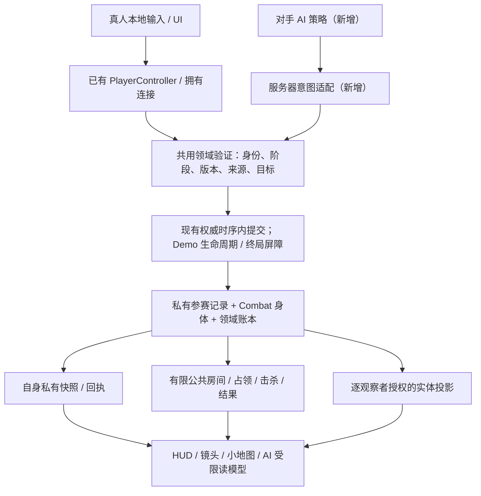

# Demo 总体架构、复用边界与共享契约

**目标：v0.10.0 Demo · 模块：总体架构 · 引擎：Unreal 5.8.4**

本报告把 [App Spec](../APP_SPEC.md) 转成可分派的架构工作，不重新定义玩法。
**现有事实**只由本基线源码支持；**建议**是尚未实施、需在对应模块落地并验收的设计。
文中的逻辑契约、任务和后续模块名称不是已有 API，也不是已批准的产品变更。
组件接口仍以 [系统手册](../DEVELOPMENT.md#按任务读取系统手册) 和实际代码为准。

## 1. 结论与范围

**推荐：显式组装一条 Demo 运行路径，复用原生移动、领域提交、身份与观测边界，
替换旧玩法政策；不复制第二套战斗、经济、寻路或状态系统。**
现有前端进入 V05，切到 V08/B92 或更改版本名均不能得到目标 Demo。
先固定跨模块契约和退出旧规则的边界，再逐模块研究、实施、接线。

本模块只覆盖总体架构、共享接口、复用审计、实施依赖和验收设计。
不实现游戏，不生成地图，不选技能/装备目录，不填写伤害、价格、时长、概率或公式。
后续模块清单是同一个 Demo 的分工建议，不是长期路线图，也不授权同时启动所有模块。

范围以 Spec §1、§2、§9–11 为锚：

| 必须支持 | 本 Demo 不启用 |
| --- | --- |
| 自由混战；Listen Host 也是玩家，最多另有两名真人、三个独立参赛 AI；不补满空位 | 队伍、共享胜利、专服/匹配平台、重连、Host 迁移、自动 NAT 穿透 |
| 单图、一个圈、五组两档野怪、一个商店、十个等概率且可重复抽取的出生点 | 全城模拟、多地图、额外目标路线、钥匙/授权/站桩前置、超时积分胜利 |
| 普攻起步；最后一击独占经验和金币；升级三选一、Q/W、两装备与 1/2 | 职业起始技能、加点/读书代替三选一、额外背包、银行/采集/制作/玩家交易 |
| 局部视野；死亡保留局内成长与财产；连续独占获胜；回 Lobby 开新局 | 共享塔视野/全知 AI、死亡扣金掉装、跨局战力、世界检查点冒充新局 |

最小**完整 Demo**仍是“进入房间 → 从零打野/对抗 → 成长/购物 → 争圈 → 唯一胜者
→ 结算/新局”。可以先做无完整成长内容的集成骨架验证胜负和生命周期，
但它只能是工程检查，不能称为可交付 Demo；测试夹具也不能成为未批准的产品默认数值。

## 2. 审计基线与证据边界

- 基线提交：`fa11d09a762bccadf495191072e222dd158fc014`；研究前 fetch 后工作区
  HEAD 与 `origin/main` 相同。以下源码行号固定于此提交。
- 阅读顺序：README → App Spec → DEVELOPMENT → 六份系统手册 → 相关原生代码、
  只读配置/SourceData 和检查入口。Spec 是需求；手册是组件知识；旧输入不是新玩法授权。
- 代码核验覆盖 Framework、Character、Navigation、Combat、Development、Inventory、
  Economy、Objectives、World、Vision、UI、Population、Region、Editor Bootstrap、
  相关 Tests 和 Scripts。缺失结论结合入口、生产者/消费者与跨 Source 搜索，
  不是“某个文件没找到某个名字”。
- **本次为静态研究和文档审核。** 未运行 Unreal、构建、生成器、Bootstrap、原生测试、
  联机场景或发布构建；未加载二进制地图/Blueprint。不能由此宣称资产视觉、寻路、
  延迟体验或目标 Demo 已通过。源码缺少接线也不等于引擎缺少该基础能力。
- 所谓“可复用”指已存在且有价值的机制，不表示整个旧服务可直接启用，更不表示
  其原有数值、容量、地图形状或旧测试断言适用于 Demo。

## 3. 现有实现与复用矩阵

以下链接是仓库内真实源码位置；Windows 操作路径以 `Source\...` 为根。
“新增”行中的名称是职责描述，不冒充已存在的类。

### 3.1 直接复用机制，但不继承旧政策

| 机制 | 源码证据 | Demo 边界 |
| --- | --- | --- |
| 单一角色身体与原生移动预测 | `ALDCharacter`：[Character/LDCharacter.cpp:17–58](../../Source/Lockdown/Private/Character/LDCharacter.cpp#L17-L58)；`FLDSavedMove`、`FLDNetworkMoveData::Serialize`、`MoveAutonomous`：[LDCharacterMovementComponent.cpp:22–88](../../Source/Lockdown/Private/Character/LDCharacterMovementComponent.cpp#L22-L88) | 复用 CharacterMovement、saved move、服务器校正及过期移动拒绝；不另写位置积分器，不把沿路径设置位置当正常移动。旧 sprint/速度不是批准值。 |
| 导航身份、取消和回执 | `FLDMoveIdentity`：[LDNavigationComponent.h:7–16](../../Source/Lockdown/Public/Navigation/LDNavigationComponent.h#L7-L16)；路径校验、Stop、回执：[LDNavigationComponent.cpp:70–152](../../Source/Lockdown/Private/Navigation/LDNavigationComponent.cpp#L70-L152)、[195–230](../../Source/Lockdown/Private/Navigation/LDNavigationComponent.cpp#L195-L230) | 保留 Match/Life/Order/Epoch 和完整合法路径；攻击追击/攻击移动还需接线。 |
| UI 输入独占、本地偏好、自身快照 | [LDPlayerInput.cpp:88–208](../../Source/Lockdown/Private/Framework/LDPlayerInput.cpp#L88-L208)；[LDControlSettings.cpp:40–92](../../Source/Lockdown/Private/UI/LDControlSettings.cpp#L40-L92)；`StateFor/SyncOwner`：[LDGameMode.cpp:378–386](../../Source/Lockdown/Private/Framework/LDGameMode.cpp#L378-L386)；快照拒旧：[LDPlayerController.cpp:194–205](../../Source/Lockdown/Private/Framework/LDPlayerController.cpp#L194-L205) | 复用 UI/世界输入分离、重获焦点的新手势、绑定保存反馈及 Match/Revision 拒旧；补齐目标按键、设置和 UI，而非把旧布局当完成品。 |
| 原子经济/物品账本 | `LDEconomy::FLedger::Commit`：[LDEconomyLedger.cpp:36–84](../../Source/Lockdown/Private/Economy/LDEconomyLedger.cpp#L36-L84)；事务/回执类型：[LDEconomyLedger.h:8–75](../../Source/Lockdown/Public/Economy/LDEconomyLedger.h#L8-L75) | 可复用同 ID 同条款重放、变条款拒绝、预期版本和全量校验后修改。账本不含 XP/三选一，不能据一次 Commit 成功宣称整个奖励复合操作已原子化。 |
| 来源/实例身份 | `FLDActionRef`：[LDCharacterBuild.h:12–21](../../Source/Lockdown/Public/Development/LDCharacterBuild.h#L12-L21)；物品身份/版本：[LDInventoryTypes.h:10–65](../../Source/Lockdown/Public/Inventory/LDInventoryTypes.h#L10-L65)；来源解绑：[LDV08Loadout.cpp:22–58](../../Source/Lockdown/Private/Development/LDV08Loadout.cpp#L22-L58) | 保留 learned/gear 来源、实例 ID、revision；UI 槽位不作为物品或冷却身份。 |
| 观察者隔离的传输纪律 | owner-only relay：[LDWorldViewRelay.h:43–50](../../Source/Lockdown/Public/Vision/LDWorldViewRelay.h#L43-L50)；快照/conceal/销毁：[LDWorldViewRelay.cpp:91–128](../../Source/Lockdown/Private/Vision/LDWorldViewRelay.cpp#L91-L128)、[158–169](../../Source/Lockdown/Private/Vision/LDWorldViewRelay.cpp#L158-L169)；游标：[LDRules.h:71–86](../../Source/Lockdown/Public/Core/LDRules.h#L71-L86) | 保留 generation/revision、可靠隐藏、非可靠全量快照、超时清理。权限来源与字段白名单仍需按 Demo 改造。 |
| 数据/资产生成纪律 | [CatalogTools.py:33–95](../../Scripts/CatalogTools.py#L33-L95)；[SyncB84Data.py:87–130](../../Scripts/SyncB84Data.py#L87-L130)；[SyncV09Data.py:127–140](../../Scripts/SyncV09Data.py#L127-L140)；Editor：[LDScaffoldBootstrapCommandlet.cpp:240–271](../../Source/LockdownEditor/Private/ScaffoldBootstrap/LDScaffoldBootstrapCommandlet.cpp#L240-L271) | 复用确定性载荷、schema/ID/哈希检查和 Editor 存包；增加 Demo 的真实输入形状，不关闭旧断言或直接改生成哈希。 |

### 3.2 必须改造的完整路径

| 路径 | 已证明的现状 | 必要改造 |
| --- | --- | --- |
| 前端/组合/Lobby | Host 固定 `listen?Profile=V05`：[LDUIRoot.cpp:368–387](../../Source/Lockdown/Private/UI/LDUIRoot.cpp#L368-L387)；profile 白名单：[LDGameMode.cpp:144–179](../../Source/Lockdown/Private/Framework/LDGameMode.cpp#L144-L179)；准入/开局：[315–358](../../Source/Lockdown/Private/Framework/LDGameMode.cpp#L315-L358)、[467–519](../../Source/Lockdown/Private/Framework/LDGameMode.cpp#L467-L519) | 从旧四真人/职业及聚合人数改为三真人、可选三 AI、同基础角色、完整身份/准备名单；明确 Demo 服务 allowlist 和版本失败原因。 |
| 右键目标与 A 操作 | [LDPlayerInput.cpp:142–178](../../Source/Lockdown/Private/Framework/LDPlayerInput.cpp#L142-L178)、[225–247](../../Source/Lockdown/Private/Framework/LDPlayerInput.cpp#L225-L247)；[LDNavigationComponent.cpp:154–193](../../Source/Lockdown/Private/Navigation/LDNavigationComponent.cpp#L154-L193)；`bAttackOrder`：[LDContentLifecycle.cpp:35–39](../../Source/Lockdown/Private/Combat/LDContentLifecycle.cpp#L35-L39) | **v07/v08 战术路径已有范围内持续普攻**，不表示默认 V05 已接通，也不是完整右键接近/追击普攻；A 不是目标攻击移动。统一订单与目标权限，不另写寻路或追踪隐藏 Actor。 |
| 战斗/属性/构筑 | 六维与旧槽位：[LDCharacterBuild.h:25–64](../../Source/Lockdown/Public/Development/LDCharacterBuild.h#L25-L64)、[101–104](../../Source/Lockdown/Public/Development/LDCharacterBuild.h#L101-L104)；旧加点/学习：[LDCharacterBuild.cpp:163–208](../../Source/Lockdown/Private/Development/LDCharacterBuild.cpp#L163-L208)；批次伤害：[LDCombatDirector.cpp:289–369](../../Source/Lockdown/Private/Combat/LDCombatDirector.cpp#L289-L369) | 用批准的 MOBA 属性/伤害/控制定义贯穿结算、来源和 HUD；新增三选一机会/候选/确认，替换遗忘，不能用旧点数/读书流程代替。 |
| 装备/商店 | 旧容量：[LDInventoryDirector.cpp:33–39](../../Source/Lockdown/Private/Inventory/LDInventoryDirector.cpp#L33-L39)；十一绑定/六动作：[LDV08Loadout.cpp:22–50](../../Source/Lockdown/Private/Development/LDV08Loadout.cpp#L22-L50)；书店及额外阻断条件：[LDVendorDirector.cpp:19–92](../../Source/Lockdown/Private/Inventory/LDVendorDirector.cpp#L19-L92)；另有设备服务：[LDB92Services.cpp:59–90](../../Source/Lockdown/Private/Economy/LDB92Services.cpp#L59-L90) | 服务端、派生属性、来源、RPC、投影、HUD、测试一起变为两件装备；统一金币/物品提交。商店受攻击不形成安全区，不无意继承受伤即关闭/安静准备等旧限制。不是“仓库完全没有买卖”。 |
| 死亡/复活/出生 | 开局抽后删除：[LDGameMode.cpp:182–209](../../Source/Lockdown/Private/Framework/LDGameMode.cpp#L182-L209)；扣金及安全择点：[388–453](../../Source/Lockdown/Private/Framework/LDGameMode.cpp#L388-L453)；旧掉落：[LDInventoryDirector.cpp:78–96](../../Source/Lockdown/Private/Inventory/LDInventoryDirector.cpp#L78-L96) | 把取消旧生命和旧损失政策分离；持久财产/选择/冷却不清除；正式开局及每次复活均从同一十点独立等概率抽取，允许重复，不按危险度筛选。 |
| 复活保护 | 目标过滤：[LDCombatDirector.cpp:130–138](../../Source/Lockdown/Private/Combat/LDCombatDirector.cpp#L130-L138)；进攻在保护中被拒：[LDContentActions.cpp:41–46](../../Source/Lockdown/Private/Combat/LDContentActions.cpp#L41-L46)；另一种 Guard：[LDTacticalExecution.cpp:44–80](../../Source/Lockdown/Private/Combat/LDTacticalExecution.cpp#L44-L80) | 同一保护状态服务伤害/控制、主动进攻、占领和 HUD；不要把技能 Guard 当复活保护。合法进攻应先解除保护再执行，不能沿用“保护时一律拒绝”。 |
| 奖励/野怪 | `LastOwner/LifeOwners/CreditOwner/Paid` 链：[LDWorldDirector.cpp:90–110](../../Source/Lockdown/Private/World/LDWorldDirector.cpp#L90-L110)；营地 AI/回位：[35–87](../../Source/Lockdown/Private/World/LDWorldDirector.cpp#L35-L87)；旧有限生命周期预算：[LDWorldDirector.h:79–84](../../Source/Lockdown/Public/World/LDWorldDirector.h#L79-L84) | 按真实致死事件确认最后一击，不能拿最近一次有主伤害兜底无主致死；金币/XP/升级机会恰一次。五组两档、整组清空后刷新、逐生命去重；无超时对局不能继承旧有限刷新预算。 |
| 圈与终局 | Heart 授权/静止交互/路线：[LDObjectiveDirector.cpp:234–360](../../Source/Lockdown/Private/Objectives/LDObjectiveDirector.cpp#L234-L360)；旧 claim：[LDWorldClaims.cpp:10–29](../../Source/Lockdown/Private/World/LDWorldClaims.cpp#L10-L29) | 不复用旧完成判据；以有效参赛者实际圈内状态作连续独占 reducer，在统一权威边界只提交一次结果。 |
| 视野/公开字段与提示例外 | 旧 sensor/塔/ward 与 Trail/Footstep 例外：[LDVisionDirector.cpp:87–150](../../Source/Lockdown/Private/Vision/LDVisionDirector.cpp#L87-L150)；`AuthorizedCue` 输出：[262–322](../../Source/Lockdown/Private/Vision/LDVisionDirector.cpp#L262-L322)；匿名八字段：[LDViewTypes.h:17–46](../../Source/Lockdown/Public/Vision/LDViewTypes.h#L17-L46)；HUD Unknown：[LDHUDModel.cpp:14–37](../../Source/Lockdown/Private/UI/LDHUDModel.cpp#L14-L37) | 同时约束视野来源、实体/提示类型例外及发布字段；不能只改 SourcesFor。公开占领不授予圈内隐藏精确位置，不能读取别人 OwnerState。 |
| Listen Host 原生表现 | authority 身体 cue/动画：[LDCharacter.cpp:77–85](../../Source/Lockdown/Private/Character/LDCharacter.cpp#L77-L85)；默认可见原生部件：[LDHumanoidVisualComponent.cpp:14–25](../../Source/Lockdown/Private/Character/LDHumanoidVisualComponent.cpp#L14-L25)；另有观察代理：[LDWorldViewRelay.cpp:19–31](../../Source/Lockdown/Private/Vision/LDWorldViewRelay.cpp#L19-L31)、[105–117](../../Source/Lockdown/Private/Vision/LDWorldViewRelay.cpp#L105-L117) | owner-only 网络复制不隔离 Host 进程内原生 Mesh/附属表现。需协调本地过滤与代理，避免透雾或双重呈现；保持 authority 实体参与逻辑。本次未实测漏图，现有材质/二进制是否另作遮蔽未验证。 |
| 地图/内容 | Region contract：[LDRegionDefinition.cpp:44–63](../../Source/Lockdown/Private/Region/LDRegionDefinition.cpp#L44-L63)；大图固定形状：[LDMapDefinition.cpp:112–158](../../Source/Lockdown/Private/Region/LDMapDefinition.cpp#L112-L158) | 复用地面/碰撞/导航/Builder 能力，显式提供 Demo 地图 contract；不把十出生点硬塞进旧二十四点形状后绕过校验。 |
| 对手 AI | 固定 24 席与 196 居民，`contenderPolicy=not_implemented`：[LDB92Roster.cpp:117–145](../../Source/Lockdown/Private/Population/LDB92Roster.cpp#L117-L145)；旧日程：[LDB92Routines.cpp:42–99](../../Source/Lockdown/Private/Population/LDB92Routines.cpp#L42-L99) | 有野怪/居民行为和席位，不等于自主参赛 AI。新增受限决策与服务器意图适配，不启用离线接管/居民经济来填满名额。 |
| UI/设置/房间返回 | 旧 HUD：[LDHUD.cpp:114–193](../../Source/Lockdown/Private/UI/LDHUD.cpp#L114-L193)；[LDControlsPanel.cpp:29–62](../../Source/Lockdown/Private/UI/LDControlsPanel.cpp#L29-L62)；Leave 只是本地前端：[LDUIRoot.cpp:390–396](../../Source/Lockdown/Private/UI/LDUIRoot.cpp#L390-L396) | 补三选一/替换、两装备、占领、击杀/结算、完整设置和名称保存；新增 Host 带房间回 Lobby 协调。引擎有相关能力不等于项目已接线。 |

### 3.3 新增与停用边界

**建议新增的最小职责**：Demo 组合入口；Match 身份映射；持久三选一候选与回执；
AI 受限读模型/意图适配；连续独占 reducer；终局写闸；有限公共 DTO；
同房间回 Lobby/新局协调；Demo 地图/内容输入 contract。
这些职责优先落在现有 GameMode、领域服务、Controller/投影和生成管线，
不要求每个职责新增一个 Subsystem，也不创建通用可插拔游戏模式平台。

**只在 Demo 路径停用，不删除可复用旧代码**：Heart 多路线/门票/站桩、旧总时限，
职业起始学习、加点/读书、死亡税与掉落、多部位背包、多城生产/银行/采购/玩家交易、
24 席位/居民模拟/断线转 AI、塔/公共 sensor/ward 等未批准视野来源，以及未许可的
Trail/Footstep 等提示权限旁路、世界持久恢复。
启动耦合可见 [LDGameMode.cpp:229–266](../../Source/Lockdown/Private/Framework/LDGameMode.cpp#L229-L266)
和 [496–518](../../Source/Lockdown/Private/Framework/LDGameMode.cpp#L496-L518)；
不能通过只隐藏按钮阻止这些服务继续修改状态。

## 4. 推荐架构与共享契约

### 4.1 保留真实状态所有者，收紧唯一写入口

现有 `FLDContenderRecord.Session` 与 `FLDOwnerState`、Combat `Bodies`、
Inventory/Development、Ledger 各有领域职责；`SyncOwner` 是投影边界，不是另一本账。
**建议继续沿用这些所有者**，把 Demo 金币/物品统一到同一事务提交后投影，
不要同时开放“先改 OwnerState 再补账”和“先账本再复制”两种自由写法。
无需为了遵循 Unreal 通用类图把所有状态立即迁到 PlayerState；尤其不能把私有构筑
无条件复制出去。GameMode 服务端裁定、GameState 公开事实的分工与官方资料 U1/U2 一致。

| 生命周期 | 唯一所属事实 | 取消/保留规则 |
| --- | --- | --- |
| 本机/连接外偏好 | 名称、输入、画质/音量、镜头偏好 | 通过本地设置机制保存；不放入局内奖励/经济存储，不随新局清空。 |
| 整局参赛记录 | 等级、XP、金币、属性奖励的持久加成、已学主动/被动及等级、两件装备、待选次数及当前候选、应持续的来源冷却 | 死亡保留；正式新局全部重建。被动不占 Q/W，UI 格子不成为被动上限。离局后不再作为有效参赛者，不自动转 AI。 |
| 一次身体生命 | HP/MP、临时控制、身体 Identity、当前动作/目标/导航、保护状态 | 死亡取消旧动作；复活新 Life/身体身份、满血蓝、清临时控制。保护与普通技能 Guard 分开。 |
| 一次请求/交互 | 移动 Order/Epoch、报价会话、选择确认、事务/命中回执 | 旧生命请求不能作用新身体；已提交结果只读重放，不再产生副作用。候选内容不因请求取消消失。 |
| 整局终局 | 唯一结果/receipt、结束原因及公共结果 | 一次锁定，后续领域写入全部拒绝；Host 主动结束可以无胜者，不能变成超时胜利。 |

### 4.2 现有身份不可混用

以下是**现有准确名称**；右列是建议接线要求，不宣称已有统一 `MatchId` 类。

| 现有身份/版本 | 证据 | 共享要求 |
| --- | --- | --- |
| `FLDContenderRecord.Session` / `ContenderId` | [LDGameMode.h:78–93](../../Source/Lockdown/Public/Framework/LDGameMode.h#L78-L93)；[LDGameMode.cpp:346–358](../../Source/Lockdown/Private/Framework/LDGameMode.cpp#L346-L358) | 本局参赛者 FGuid，不是 NetConnection，也不等于局代次。真人从拥有连接解析，AI 从服务器分配的参赛记录解析，不信任调用方声称的别人的 ID。 |
| `FLDOwnerState.Match`、Vision `Generation`、`AuthorityGeneration` | [LDGameMode.cpp:223–226](../../Source/Lockdown/Private/Framework/LDGameMode.cpp#L223-L226)、[382–386](../../Source/Lockdown/Private/Framework/LDGameMode.cpp#L382-L386)；[LDGameInstance.h:12–13](../../Source/Lockdown/Public/Framework/LDGameInstance.h#L12-L13) | 当前随世界启动推进。若同世界重开，也必须显式推进；不能只清 phase。 |
| Ledger 私有 `FGuid Match` | [LDEconomyLedger.h:48–75](../../Source/Lockdown/Public/Economy/LDEconomyLedger.h#L48-L75) | 与网络 uint32 代次不同。**建议 Match context（逻辑契约）**明确两者映射和重置责任，而非强制同型转换。 |
| `Life`、`DeathSerial`、`ReturnAt`、`ProtectedUntil`；`FLDBodyCombatState.Identity` | [LDViewTypes.h:67–71](../../Source/Lockdown/Public/Vision/LDViewTypes.h#L67-L71)、[130–134](../../Source/Lockdown/Public/Vision/LDViewTypes.h#L130-L134)；[LDCombatDirector.h:14–49](../../Source/Lockdown/Public/Combat/LDCombatDirector.h#L14-L49) | owner Life 与身体 FGuid 均需保留；死亡 inactive 与成功复活增加 Life 分开，不能靠 Pawn 指针识别旧生命。 |
| `FLDMoveIdentity.Match/Life/Order/Epoch` | [LDNavigationComponent.h:7–16](../../Source/Lockdown/Public/Navigation/LDNavigationComponent.h#L7-L16) | 导航 Order/取消 Epoch 不是全领域版本；Stop 后迟到 ACK/saved move 不得复活旧订单。 |
| `FLDTacticalRequest.Token/BuildRevision/InventoryRevision/ItemRevision`；身体 `Order/LastCoreToken/CancelledCoreThrough` | [LDTacticalRequest.h:9–30](../../Source/Lockdown/Public/Combat/LDTacticalRequest.h#L9-L30)；[LDCombatDirector.h:24–43](../../Source/Lockdown/Public/Combat/LDCombatDirector.h#L24-L43) | 请求 token、命中排序、取消水位不同；构筑/物品按其领域 revision 校验，不用频繁变化的全体 OwnerState revision 代替。 |
| `FTransaction.Id/Cause`、`FReceipt.Transaction/Serial` | [LDEconomyLedger.h:36–62](../../Source/Lockdown/Public/Economy/LDEconomyLedger.h#L36-L62) | 同 key 同条款返回已有结果；同 key 改条款拒绝；无效/失败有明确原因。有限 UI/RPC 缓存不等于完整事务账本。 |
| `FLDObservedEntity.Id`、`FLDWorldView.Generation/Revision` | [LDVisionDirector.cpp:178–186](../../Source/Lockdown/Private/Vision/LDVisionDirector.cpp#L178-L186)、[285–300](../../Source/Lockdown/Private/Vision/LDVisionDirector.cpp#L285-L300) | 句柄是逐观察者授权引用，不是永久 Actor/参赛者 ID；执行时重新解析。B91 稀疏 DTO 与此协议不同，不混发。 |
| `ResultReceipt/ResultSerial/EndReason/MatchEndedAt` | [LDGameMode.h:39–43](../../Source/Lockdown/Public/Framework/LDGameMode.h#L39-L43)；[LDObjectiveDirector.cpp:345–359](../../Source/Lockdown/Private/Objectives/LDObjectiveDirector.cpp#L345-L359) | 保留一次结果语义；完整公共胜者身份/结束 DTO 和新终局屏障尚需增加。 |

### 4.3 命令、回执与 AI 共用验证

**建议的共同流程**：读取获准投影作预览 → 提交意图 → 服务器解析调用身份 →
校验局/生命/阶段/领域版本/来源/合法目标与资源 → 在相应领域提交一次 →
发布明确结果和版本。预览成功不是购买、命中、选择或胜利成功。

| 意图族 | 必要上下文 | 提交边界 |
| --- | --- | --- |
| 地面/目标移动、普攻/施法、S 取消 | 局/身体生命、订单/token、来源与相关 revision；地面合法性或当前观察句柄 | 重用 Navigation/CharacterMovement/Combat；隐藏目标不从权威 Actor 位置补齐。S 不能取消已完成命中，但必须使可中断旧工作及其迟到回包失效。 |
| 三选一/主动替换 | 当前持久候选 ID/版本、选择项、明确替换槽及其期望构筑版本；请求的局/生命上下文 | 候选属于整局，旧请求不因重生得到新执行权。一次确认原子消费一次机会并应用选择，随后才生成下一组；死亡期间是否允许确认见 Q4。 |
| 买入/卖出 | 服务器报价会话/目录版本、商品或实例、Inventory/Item revision、唯一请求条款 | 成交时重验存活、对局进行中、实际商店距离、余额/槽位/所有权；金币/实例/卖出解绑一致提交，不能客户端先行确认。 |
| 装备主动 | 局/生命/token、已装备实例及来源 revision、合法目标、冷却/资源/控制条件 | 属于 Combat 命令，与角色施法共用验证；不要求商店报价/距离、购买余额或空装备槽，不因释放移除装备。合法接受后先解除复活保护再执行效果。 |
| Ready/开始/AI 数量/返回 Lobby | 拥有连接、Host 权限、当前房间/阶段/名单版本 | 开始锁名单；中途加入拒绝；普通离开不是击杀/自动获胜。房间转换由 authority 协调，不由各 Widget 重置自己的数组。 |

装备主动与交易分离也有现成实现依据：战术物品动作验证来源、实例、readiness 与资源，
不以商店会话作为施法条件
（[LDContentActions.cpp:82–95](../../Source/Lockdown/Private/Combat/LDContentActions.cpp#L82-L95)）。
1/2 必须能在商店外和圈内使用；“两装备已满”只阻止继续购买，不阻止现有能力释放。

重复包必须区分“已提交重放”和“尚未执行但已过期”。
旧 Vendor 只有有界回执缓存，缓存外仍有 LastRequest 拒旧
（[LDVendorDirector.cpp:27–68](../../Source/Lockdown/Private/Inventory/LDVendorDirector.cpp#L27-L68)）。
因此建议明确查询/重放窗口与拒旧水位：过窗可以返回明确的过期结果并重新同步状态，
不能默认成功，也不能因清缓存而重新成交。无限对局不等于无限保存所有表现回包；
压缩回执时仍须保留不重复提交的不变量。

AI 直接调用服务器上相同的**领域验证入口**，不要求伪造客户端 RPC 或网络连接。
当前 seat 的 Tick 被禁用、Navigation 又依赖 local controller，不能直接实例化三个 seat
当成可玩 AI（[LDB92Roster.cpp:32–33](../../Source/Lockdown/Private/Population/LDB92Roster.cpp#L32-L33)；
[LDNavigationComponent.cpp:96–119](../../Source/Lockdown/Private/Navigation/LDNavigationComponent.cpp#L96-L119)）。
建议新增服务器路径/意图适配，仍复用合法路径、CharacterMovement 与同一资源/来源条件。
AI 策略只拿自身、合法观测和公共信息，不可遍历全身体表寻敌或直接修改余额/HP。

### 4.4 战斗、奖励、死亡与来源

**建议以一次权威致死事件作为奖励事实**：受害者局/身体生命身份、死亡序列、
真正致死效果的实际所有者和奖励回执构成去重/追责依据。
先判奖励对象/关系，再判所有者：只有野怪或**另一名参赛者**的合法死亡可奖励；
自杀、离局清理、野怪回位重置不发金币/XP/选择机会。保留现有 PvP 的
`Killer==Target` 拒绝（[LDWorldDirector.cpp:109–110](../../Source/Lockdown/Private/World/LDWorldDirector.cpp#L109-L110)），
不能把“存在 CreditOwner”单独当成奖励资格；无奖励的死亡也需记录已处理。
没有参赛者拥有该次致死伤害时记录“此死亡已处理、无获得者”，
不能沿用之前有主伤害的 LastOwner。一次死亡必须一致地完成金币、XP 和升级机会；
候选创建失败不能通过再次发金币重试。复用 Ledger 的原子校验，但新增复合提交协调，
不另开 XP 账本充当第二份金币真相。

死亡路径只取消生命期动作/临时状态、失效物理交互/旧报价并切换生命状态。
保留等级、XP、技能、装备、金币、未处理选择与仍应进行的冷却；
重复死亡回调/重复复活不得再发初始资源或奖励。弹体/持续效果需分别携带
受害者生命身份与实际来源所有者，不能用施法者当前 Pawn 指针替代；
已发出效果在施法者死亡/离局后的存续政策列入 Q2，而非隐式依赖 Actor 销毁。
若效果在所有者阵亡但仍在本局时实际造成击杀，奖励仍归实际所有者；
Spec 没有“死亡就丧失该次奖励”的例外，这不作为待决问题。

三选一的属性加成和已学被动也属于整局构筑，死亡保留、新局清空。
Q/W 限制的是角色主动入口，不是全部已学能力数量；被动没有额外槽位上限，
仍受实际选择机会和技能等级约束。装备被动不计角色学习，随对应实例生效/解绑。
被动 UI 可展开/滚动，不能用可见格子数缩小允许的构筑。

**冷却不是 UI 槽位状态。** 建议以服务器时间和来源 readiness 统一结算/展示：
沿用现有 learned cooldown、物品 readiness 等机制，但逐项区分局内持久冷却与身体瞬时字段。
仅使用新物品实例 ID 不能防止卖出重购洗冷却；遗忘技能等级也不等于遗忘未结束冷却。
升级、调槽、替换、重学、买卖、死亡均不得产生 Spec 禁止的重置捷径。
同来源离开期间流逝/冻结、同定义重购的继承方式、重复装备需 Q1 定案；
家族共享只在批准目录确实出现相关来源关系时讨论，
不从旧目录推导批准的规则。

### 4.5 同一结算边界的占领与终局

现有 `LDCombatDirector::Sample` 已按批次处理命中/死亡、服务、角色返回、区域和目标
（[LDCombatDirector.cpp:254–366](../../Source/Lockdown/Private/Combat/LDCombatDirector.cpp#L254-L366)）。
`AdvanceAuthority` 有到期边界/重入保护，但依赖旧 WorldRuntime，并带旧 hold 逻辑
（[LDWorldClock.cpp:9–28](../../Source/Lockdown/Private/World/LDWorldClock.cpp#L9-L28)）。
**建议抽离必要的时序依赖，不为一个圈启动整个旧世界。**

旧时钟会临时改写 World 时间，用已完成运动的当前姿态补算到期采样，不能提供圈内历史；
脱离 WorldRuntime 的路径也只采当前姿态
（[LDWorldClock.cpp:13–27](../../Source/Lockdown/Private/World/LDWorldClock.cpp#L13-L27)；
[LDCombatDirector.cpp:380–388](../../Source/Lockdown/Private/Combat/LDCombatDirector.cpp#L380-L388)）。
仅抽出该函数并在末尾数人数，不足以满足连续独占。

**建议的最低事件输入契约（逻辑字段，不是已有结构或通用事件平台）：**

| 提供者/消费者 | 必须承担的责任 |
| --- | --- |
| 服务器运动/位移落地、生命/离局/保护提交者 | 在真实变更发生时提供局代次、参赛者/身体生命、事件来源、本流单调序号、服务器实际发生时间及圈内/有效资格变更。进入/退出、死亡/离局、保护变化均接入；纯受伤/圈内控制不产生清零事件。 |
| 权威调度 | 实际事件时间与补算用的有效采样时间分开，不能用被回拨的 World 时间给后来运动打过去的戳。给同一时间的事件确定服务器提交次序，建立各提供者已发布到哪个边界的水位。 |
| 唯一占领 reducer | 只在相关提供者已发布到待判边界后消费该边界事件，保留进入又退出/离开又返回等中间变化；不把截止后姿态回填截止前。完成判定后推进消费水位并释放已消费记录，拒绝重复/旧局/旧生命事件。 |

事件必须保留到对应边界判定完成，不能先清空再用最终快照代替；
不要求永久事件日志、第二套位置积分器或网络回滚世界。
运动事件的生成和时间归属是 M3/M4/M5/M9G 提供者接线的一部分，不由占领 UI 猜测。

1. 用服务器已经执行的运动、碰撞、离局和到期事件推进边界；先处理应发生的命中/
   死亡、复活/保护变化和破坏连续独占的事件。不得以客户端报告的位置或时间补造历史。
2. 有效集合只含本局、存活、非保护的真人/参赛 AI；野怪/商店/特效不入集合。
   空集合/争夺/占领者变化清零；受伤、仍在圈内的控制/移动/战斗不清零。
   保护到期才开始获得资格，不能回算保护期间的时间。
3. 记录同一结算边界已发生的离圈/争夺/死亡，而不是只采最终快照。
   完成时重新验证连续独占；同刻已发生的破坏条件不能在结果之后补算。
   这直接来自 Spec §2.2，不是待批准的“死亡优先”新规则。
4. **先锁结果/关闭写闸，再执行取消与清理、发布结果。** 所有领域的延迟命中、
   交易、奖励、选择和占领提交都检查终局屏障；清理回调不得重新写入玩法状态。
   已完成事务只读重放不算再次提交。

一般命令受理序、领域提交阶段和消费水位是**工程需落实的确定性契约**，不是要求用户
先决定调度算法。实现负责人须明确并测试：终局前已提交事务保留真实回执，
锁定后尚未提交的操作拒绝；网络收包不能跳过 Spec 的同刻破坏条件，客户端 OnRep 顺序
不能决定成败。若另外引入宽限窗口、客户端回溯或特殊退款/优先权，才需提出具体产品选择。

不能把旧 Finish 原样视为这一屏障：它先取消服务再设置 EndReason；
而旧 Sample 在 Finished 检查前仍有环境工作，Finished 分支也会调用服务
（[LDObjectiveDirector.cpp:345–360](../../Source/Lockdown/Private/Objectives/LDObjectiveDirector.cpp#L345-L360)；
[LDCombatDirector.cpp:206–224](../../Source/Lockdown/Private/Combat/LDCombatDirector.cpp#L206-L224)）。
应逐入口证明终局后只有拒绝/清理，不是“结果 UI 出现就视为全部冻结”。
不同 Actor 的 RPC/OnRep 没有可依赖的全局顺序（U5），不能拿复制到达顺序实现原子胜负。

出生查询与圈内查询由地图模块统一定义；每次出生独立抽十点，碰巧同点只做必要的合法
落地/防重叠，不重抽安全点。现有 Pawn 碰撞对 Pawn 为 Ignore
（[LDCharacter.cpp:25–30](../../Source/Lockdown/Private/Character/LDCharacter.cpp#L25-L30)），
因此防重叠处理尚需实现/验收，不能假定引擎已自动解决。

### 4.6 三类投影与隐私

| 投影 | 允许信息 | 不能顺带放入 |
| --- | --- | --- |
| 自身私有 | 本人属性/构筑/资源、候选、装备/报价、冷却、失败原因和回执 | 其他参赛者私有资源/背包、服务器全实体表 |
| 明确公共 | 房间身份/真人或 AI/Host/准备；发育/开放/争夺/占领者/进度；参赛者击杀通知及结果 | 任何未获准的隐藏精确坐标（含圈内）、行为、资源/构筑；普通野怪击杀横幅；以占领播报授予视野 |
| 逐观察者合法实体 | 当前合法可见表现、用于目标命令的观察句柄及经批准的字段 | 已失去视野单位的实时位置、通过附属 Actor/特效/音效/寻路泄露的隐藏信息 |

GameState 不是所有玩家资源总表；OwnerState 不是任意目标面板的数据源。
新增字段须同时更新生产者、消费者、wire/目录兼容及隐私白名单，
保留 [LDViewTests.cpp:39–64](../../Source/Lockdown/Private/Tests/LDViewTests.cpp#L39-L64)
的检查目的，而不是为了 UI 删除断言。不同旧观测格式须选择/适配，不直接拼接。

视野迁移还要审查**实体种类/提示例外白名单**，不只改视野来源。
旧 `CanObserve` 对 Trail/Footstep 提前授权，发布端的 `AuthorizedCue` 还会跳过普通 mask；
战术路径自动产生的 Footstep 并不依赖玩家学会某个待停用技能
（[LDVisionDirector.cpp:137–150](../../Source/Lockdown/Private/Vision/LDVisionDirector.cpp#L137-L150)、
[288–294](../../Source/Lockdown/Private/Vision/LDVisionDirector.cpp#L288-L294)；
[LDContentLifecycle.cpp:41–42](../../Source/Lockdown/Private/Combat/LDContentLifecycle.cpp#L41-L42)、
[54–56](../../Source/Lockdown/Private/Combat/LDContentLifecycle.cpp#L54-L56)）。
Demo 未许可的提示必须同时约束产生端和发布端，不能绕过当前合法观测。
Trail 历史线索不等于实时跟踪，经过许可的历史已知信息与隐藏单位实时更新应分别处理；
不据旧代码自动批准新的侦察玩法。

Listen Host 虽持有权威世界，其正常**主画面、本体/附属表现、HUD 与目标解析**
都须遵守相同获准投影。不仅关闭开发全知模式，还需把非本地原生实体的可见呈现与观察代理
统一管理，覆盖 Mesh、阴影、名称、附属特效/灯光和声音，避免原生与代理双重输出。
保留服务器实体参与权威逻辑，不能用销毁实体“解决”显示问题。
AI 同样只读受限模型。普通可见性或距离 relevancy 不自动实现
战争迷雾（U4）；还须检查可访问载荷，不只是隐藏 Mesh。对恶意修改的受信任 Host
做反作弊防护不在本 Demo 范围，不能承诺客户端式的进程隔离。

### 4.7 入口、数据与新局隔离

建议显式登记 Demo mode/profile、地图 contract、能力目录及必需服务；
未知/不兼容输入明确失败，不退回 V05 或任一旧大地图。
保留现有旧检查入口，但其 schema/枚举/资产 ID 不因产品版本 0.10.0 被全库改名。
项目版本、网络协议、内容摘要分别判兼容并给出可理解原因；
不能因没找到项目级握手就宣称 Unreal 没有网络版本检查。

地图/数值输入必须经批准、Sync、contract 与原生导入接线；正式开局前校验可消费。
缺值要报错，不能用 SourceData 旧价格/时间兜底。
完整 Demo 无超时胜利，营地可持续刷新；旧有限循环/预算需重做并保留溢出/重复拒绝，
不以任意巨大常量伪装解决。

返回 Lobby 的网络 travel/同世界 reset 是工程备选，不应决定产品是否保留房间。
推荐由 Host 协调，保持房间语义、生成新 Match 映射并重置所有领域；
物理是否换世界由该模块验证后选定。旧 `RunResetCheck` 是本地重载夹具，不是该流程证明。
新局必须清掉旧候选、报价、命中、观测代理和结果回执的执行权，只保留明确允许的本地设置。

## 5. 后续模块与真实依赖

下表只建议下一个模块团队的边界；每个模块仍需独立研究/审核后才能形成实施方案。
依赖指**提供者契约或运行产物**，不要求前一模块全部 UI/内容完成才能开始研究。

| 模块 | 分工与可交付接口 | 真实依赖/集成条件 |
| --- | --- | --- |
| M1 会话、身份与生命周期协调 | Demo 入口、准入、名单/Host 权限、Match 映射、领域取消/终局/新局协议 | 以本报告的已确认部分为输入；房间再开局最终验收需所有状态提供者参与，不可仅验证 phase。 |
| M9G 地图/数据几何基础 | Demo contract、可行走/遮挡查询、固定地点、十出生点与圈边界接口 | 结构由 Spec 固定；实际布局/尺寸需批准内容。可与 M1 接口研究并行。 |
| M10 视野与观测 | 逐观察者授权、字段白名单、目标句柄、公共例外 | M1 身份/代次 + M9G 遮挡/地点；Q5 字段/死亡视野决定相关 UX。 |
| M3 移动、目标、输入与镜头 | 地面移动/S、合法目标意图、攻击移动、设置/输入所有权 | 地面移动依赖 M1/M9G；目标订单额外依赖 M10；攻击执行与 M4 接线，而非输入层自行伤害。 |
| M4 战斗、属性与效果 | 单一战斗提交、控制/资源/来源、致死事实、动作反馈 | M1、M9G、M10 和 M3 移动/目标契约；实际公式/能力内容需批准。 |
| M5 死亡、复活与保护 | 保留/取消边界、新身体、随机落地、保护事件 | M1 + M4 致死/身体 + M9G 落地查询；Q2–Q4 影响边界行为。 |
| M6 经验/金币与奖励 | 最后一击归属、金币/XP/升级机会复合提交、无主死亡去重 | M4 致死事实 + M5 生命身份 + M1 账本/回执协议；不另开金币写路径。 |
| M7 三选一与角色技能 | 候选队列/持久 offer、选择/替换遗忘、Q/W、属性持久加成、无独立槽上限的已学被动、来源 readiness | M6 机会 + M4 属性/技能来源；与 M8 共用 Q1 冷却契约，不能分别解释，装备被动不计角色学习。 |
| M8 装备与商店 | 两件容量、买卖、1/2 主动、派生属性与失败反馈 | M6 同一本金币账、M4 来源、M9G 商店范围、M1 事务协议；不依赖三选一界面完成。 |
| M9C 野怪与有限内容接线 | 五组两难度、回位、整组刷新、基础普攻可开始成长 | M9G + M4/M5/M6；不能称与战斗/奖励独立的完整地图模块。 |
| M2 占领与胜负 | 有效集合/连续独占 reducer、公共状态、唯一结果 | M1 + M4/M5 + M9G；规则测试不依赖 M7/M8 内容，但终局冻结验收必须覆盖成长/购物提供者。 |
| M12 对手 AI | 受限决策、自主发育/选奖励/买卖/战斗/复活/争圈 | M10 读模型、M3/M4 意图、M5/M6/M7/M8/M9C/M2 能力；适配契约可早做，完整 AI 验收不能提前。 |
| M11 UI/设置与反馈一致性 | 每个领域自带可操作 UI；最后核对完整界面、可辨识状态与本地偏好 | 随对应提供者增量接线，不把全部 UI 留到最后，也不把 UI 完成作为领域逻辑的前提。 |

运行集成主干是：`M1 + M9G → M10/地面移动 → 目标订单/M4 → M5`；
随后 `M5 → M2` 与 `M4/M5 → M6 → M7/M8` 分叉，
`M9G + M4/M5/M6 → M9C`，最终汇入 M12 和完整对局验收。
这里的先期胜负骨架不是完整 Demo；M2 不依赖金币计算，不代表最终结算可以忽略经济写闸。
地图、移动、视野的**研究**可并行，不等于它们的运行实现互不依赖。

## 6. 可分派的架构实施任务

以下为建议任务，不是本次已经实施，也不要求一次提交完成所有后续模块。
共享接口/核心配置/地图开始修改前需协调所有者；各任务以真实提供者逐步接入，
未实现能力明确拒绝，不做成功形状的空接口。

| 任务 | 产出与主要落点 | 先决条件 | 验收/完成证据 |
| --- | --- | --- | --- |
| T1 显式 Demo 组合与准入 | GameMode/前端的组合入口和服务清单；3 真人/可选 0–3 AI/开局锁定/错误分类 | 确认采用该组合策略；不需先定战斗数值 | 缺 Demo 输入或未知 profile 明确失败；0 AI 不补人；超员/已开局/不兼容被服务端拒绝；旧回归入口仍可选。 |
| T2 状态/身份/版本责任表与接线 | ContenderRecord、Combat、Ledger、Controller 投影；Match 映射、领域 revision、receipt/拒旧水位 | T1 兼容边界 | 单一金币/物品写路径；新命旧包拒绝；重复同条款不再执行、异条款拒绝；断言私有状态不进入公共复制。 |
| T3 地图/内容最小 contract | Region/地面/Builder/Sync 的 Demo 输入形状、固定地点查询、范围/落点验证 | Spec 已定结构；正式资源需内容批准 | 恰 1 圈/5 组两档/1 店/10 点；缺输入、重复 ID、非法地面/不可达点显式失败；不能松掉旧断言让新图勉强通过。 |
| T4 共享意图与读模型适配 | 真人拥有连接和 AI 服务器来源进入相同验证；静态地点 ID、动态观察句柄、有限公共 DTO、提示例外和 Host 原生表现接线 | T2；空间相关验证需 T3；Q5 | 人/AI 同条件结果等价；隐藏位置不经目标或 cue 泄露；UI 不穿透；无 probe flag 的正常 Listen Host 主画面/HUD/目标解析受限且不双重呈现；未实现命令不假成功。 |
| T5 生命周期/终局调度 | 复用 Combat 边界，分离旧时钟耦合；接入 §4.5 运动/生命/保护事件、实际时间、提供者/消费水位；死亡保留、圈 reducer 与终局闸 | T2/T3/T4 和事件提供者契约；Q2/Q3 只阻塞其相关行为；一般排序由工程落实 | 截止前进入又离开、离开又返回均不丢事件；截止后进入不回算；重复/旧生命事件无效；同刻死亡/争夺先纳入；结果一次，终局后排队副作用零提交。 |
| T6 成长/交易/来源复合操作 | 接入后续 M6/M7/M8；奖励、候选确认、两装备交易与同一 readiness；装备主动仍走 Combat 而非商店条件 | T2/T4/T5；批准内容；Q1/Q4 | 最多 9 次机会/技能 3 级/QW 两槽/两件装备；属性卡与已学被动死亡保留；被动 UI 不新增槽上限；候选不重抽；无冷却套利；无主致死/自杀不奖励；重复请求无额外收益；商店外/圈内能使用已有 1/2。 |
| T7 房间返回与新局隔离 | GameMode/GameInstance/前端协调；统一 reset/travel 和完整取消 | T1/T2/T5；所有已接入提供者声明重置 | Listen Host + 两真实客户端同房间回 Lobby 再开；新 Match、旧包/offer/quote/view/result 无执行权；仅名称/设置保留；普通离开/Host 失联有正确反馈。 |
| T8 契约场景与集成门禁 | 复用现有 runner 运输/断言模式，新增真实 Demo 测试，不改旧断言冒充通过 | T2 后可先写场景；执行依赖被测 T3–T7/M12 | 每项有来源版本、拓扑、前置输入、动作、预期、实际结果；分别记录通过/失败/未运行/未实现。完整对局不得用授予/传送/强制判胜代替。 |

T5 先以真实已接入提供者验证屏障/事件契约；T6 接入成长交易后补它们的终局回归，
T7/T8 再验证全体提供者的新局和完整对局。接口级阶段完成不等于全 Demo 通过，
也不反过来要求 T5 等待尚未实施的所有内容才能开始。

## 7. 验收方案与现有检查的边界

### 7.1 当前入口：存在，不代表本次运行或已覆盖 Demo

| 当前入口/参数证据 | 可复用证据 | 不能据此宣称 |
| --- | --- | --- |
| [RunTests.ps1:2–21](../../Scripts/RunTests.ps1#L2-L21)，`-Suite Lockdown.Rules` | 现有原生规则；可参考 [LDInputRulesTests.cpp:6–29](../../Source/Lockdown/Private/Tests/LDInputRulesTests.cpp#L6-L29)、[LDEconomyRulesTests.cpp:15](../../Source/Lockdown/Private/Tests/LDEconomyRulesTests.cpp#L15)、[LDViewTests.cpp:39–64](../../Source/Lockdown/Private/Tests/LDViewTests.cpp#L39-L64) | 脚本没有任意 `-TestFilter`；旧成长/容量/目标断言不是新三选一/两装备/独占规则。 |
| [RunNavigationCheck.ps1:2–27](../../Scripts/RunNavigationCheck.ps1#L2-L27)、[RunInputCheck.ps1:2–27](../../Scripts/RunInputCheck.ps1#L2-L27)、[RunHUDCheck.ps1:2–27](../../Scripts/RunHUDCheck.ps1#L2-L27) | 旧 V05 Server+A+B，拥有连接、RTT/jitter、输入与取消；按实际声明使用 `-EngineRoot/-PackageRoot/-Region/-Port` 等 | Headless/nullrhi HUD 不证明可视交互；诊断 authority 不等于正常参赛 Listen Host；无 Demo profile 参数。 |
| [RunCombatNetworkCheck.ps1:2–38](../../Scripts/RunCombatNetworkCheck.ps1#L2-L38)、[RunViewNetworkCheck.ps1:2–36](../../Scripts/RunViewNetworkCheck.ps1#L2-L36) | 战斗生命周期、两受限客户端、观察传输；Combat 可选择渲染角色 | View runner 并不支持任意假定的 RTT 选项；旧公开/观测字段不等于新协议隐私已通过。 |
| [RunInventoryCheck.ps1:2–27](../../Scripts/RunInventoryCheck.ps1#L2-L27)、[RunVendorCheck.ps1:2–28](../../Scripts/RunVendorCheck.ps1#L2-L28)、[RunLoadoutCheck.ps1:2–27](../../Scripts/RunLoadoutCheck.ps1#L2-L27) | 实例、来源、旧购买重放和网络夹具 | 旧 V05 库存/书店与 V07 装备绑定检查不证明两装备、卖后买回冷却或三选一；这里未列 V08 六动作检查。 |
| [RunObjectiveNetworkCheck.ps1:2–34](../../Scripts/RunObjectiveNetworkCheck.ps1#L2-L34)、[RunResetCheck.ps1:2–14](../../Scripts/RunResetCheck.ps1#L2-L14)、[LDResetProbe.cpp:32–90](../../Source/Lockdown/Private/Tests/LDResetProbe.cpp#L32-L90) | 旧 Objective 的 `All/Assault/Seal`；本地真实重载与旧请求拒绝 | 没有连续独占 selector；本地重载十次不证明多人保房间回 Lobby/新局。 |
| [RunB92Roster.ps1:2–18](../../Scripts/RunB92Roster.ps1#L2-L18)、[LDB92Roster.cpp:145](../../Source/Lockdown/Private/Population/LDB92Roster.cpp#L145) | 旧席位/居民检查 | Humans 参数是旧 4/12，不可臆造 `-Humans 3`；不能证明对手 AI 会自主发育/成长/购物/占领。 |
| [SyncB84Data.py:109–132](../../Scripts/SyncB84Data.py#L109-L132)、[SyncV09Data.py:132–150](../../Scripts/SyncV09Data.py#L132-L150)、[BootstrapAssets.ps1:2–14](../../Scripts/BootstrapAssets.ps1#L2-L14) | `--check`、输入拒绝测试、Bootstrap Validate/Generate/Regenerate 的明确分工 | 旧输入一致或资产已生成不代表新内容已批准/可玩；不能用 Regenerate 掩盖未知错误。 |

实施时从 [开发指南](../DEVELOPMENT.md#最小验证选择) 选择最小检查：
数据先 Sync/输入拒绝；原生接口/资产再 Editor/Game 构建与 Bootstrap Validate；
网络、交易、成长、胜负必须到真实拥有连接。不同 runner 的参数/profile 不通用，
并行运行需显式分配端口和隔离输出，不修改共享引擎/插件来掩盖项目问题。

### 7.2 必须新增的 Demo 场景

这些是**建议用例类别，不是现有测试名称**。精确时长、空间边界、公式与容差取自批准的
内容/数值方案；身份/次数/槽位等结构阈值直接取 Spec。纯规则可用明确标注的测试夹具，
但完整玩法验收必须使用批准的实际输入。

| 场景组 | 操作与预期 |
| --- | --- |
| 真实拓扑/会话 | 可见且正常参赛的 Listen Host + 两个独立拥有客户端 + 三 AI；另测单人、0 AI、不补满、超员、开局后加入、版本/地址失败；普通断线不算击杀/自动胜，Host 失联回菜单。LAN 与正确映射后的可达公网分别记录。 |
| 地图/营地 | 检查所有固定数量和地面/视线区别，正常寻路到出生/营地/店/圈；随机选择算法独立均匀且允许重复，同点只做合法去重叠；五组清空后刷新，回位不发奖，每只每生命一次。 |
| 从零成长 | 不用授予/传送，只靠普攻开始低档营地，获取最后一击 XP/金币，升级选卡及购买；高档营地风险收益由批准输入验证；未批准数值则该玩法验收未运行，而非填旧值。 |
| 三选一 | 连升多级逐个生成三张不同且合法候选；关窗/死亡/重复请求不重抽；最高 10 级、最多 9 次机会；满级仍可处理已有机会；满 Q/W 明确替换后才消费，旧等级遗忘、重学从一级。属性奖励死亡保留/新局清空；已学被动不占 Q/W，超过单屏格子仍生效且可展开查看，装备被动不计学习。 |
| 装备/来源/事务 | 服务端拒绝第三件装备；卖后才能买；属性/被动/1/2 主动真实生效；**两槽已满时仍能在商店外及圈内使用已有主动**，不需要报价，不因释放解绑。店内可被攻击、不授予免疫；离距/死亡/终局不能成交；重发或改条款无额外收益，换槽/升级/重学/重购不能洗冷却。 |
| 死亡/信用 | 技能/装备/持续效果致死归实际所有者；无主致死不继承前一攻击者；有主自杀不奖励，与“阵亡但仍在局内的来源击杀别人仍获奖励”作对照；重复死亡只结一次金币/XP/机会。死亡保留全部财产/候选、冷却继续；旧目标生命的弹体/命令不能伤新身体；Q2 定案后补效果存续/离局样例。 |
| 保护/圈/终局 | 未开放不能胜；保护者既不推进也不打断；合法进攻先解除保护。争夺/离圈/死亡/离局清零，争夺解除原占领者也从零；纯受伤/圈内移动/控制/战斗不清零。分别测进入又离开、离开又返回、截止后才进入、保护恰到期、重复/旧生命事件；结果一次，之后排队命中/奖励/买卖/选卡无新副作用。 |
| 视野/AI | 检查普通客户端可访问 DTO 和 AI 受限输入，不只比截图；个人合法视野小于旧 Footstep 范围时，隐藏移动也不能下发位置。无 probe flag 的可视 Listen Host 主画面、本体/附属表现、HUD/目标均做隐藏/重现检查，原生与代理不双重输出。公共圈/击杀不附无关隐藏数据；AI 自主选卡、购物、战斗、复活并同条件获胜。 |
| 真实输入/UI/新局 | UI 不穿透、不暂停/无敌；Esc 优先取消/关顶层面板；Q/W、1/2、P、攻击移动、镜头及保存/恢复设置可操作；状态非仅靠颜色；正常完整局后由 Host 回 Lobby 再开，所有局内状态及旧请求执行权清除，名称/设置仍在。 |

网络故障场景额外注入延迟、抖动、丢包、重复与乱序，分别检查服务器领域 receipt 和
客户端投影。官方网络模拟资料 U6 说明了理想回环/LAN 的不足；其示例网络数值不是
本项目自动批准的性能指标。旧包拒绝、无重复提交和隐私边界是确定性要求。

## 8. 关键备选方案与理由

| 选择 | 推荐及原因 | 未选方案及风险 |
| --- | --- | --- |
| Demo 组合 | 明确入口/服务清单，复用现有机制并替换政策 | 原地把 V05 改名或启用整套 V08/B92：带入旧人物、预算、目标、视野和地图断言。 |
| 状态归属 | 留在现有私有参赛记录/Combat/领域账本，统一写入口与投影 | 新建另一套 Participant/Inventory/Gold 真相；或一次性迁移全部到 PlayerState：无必要扩大复制/迁移面。 |
| 移动/能力基础 | 保留 CharacterMovement/导航和现有战斗/来源机制，按批准模型改造 | 自写移动复制、为本模块重写为 GAS/新技术栈：没有证据证明必要，会引入双状态/结算风险。 |
| 占领调度 | reducer 可独立组织代码，但最终提交进入共同服务器边界 | 独立 Actor Tick/Timer 不经屏障直接判赢：可能漏同刻死亡/争夺。不是禁止 Timer 本身，而是禁止第二个胜负权威。 |
| AI 接口 | 共用服务器领域验证，独立受限读模型/意图适配 | 强迫 AI 伪造拥有连接，或直接改资源/读全图；前者依赖不成立，后者不符合同规则。 |
| 集成切法 | 先验证身份/生命周期/胜负骨架，同时增量接成长/装备/UI | 一次性做完所有模块再联调；或先做只含按钮的 UI：跨模块问题发现太迟或无法实际验收。 |
| 房间下一局 | Host 统一协调，先固定语义再选择 travel/reset 实现 | 各客户端各自 OpenLevel/清数组；旧 world checkpoint 恢复：不能保证同房间与新局隔离。 |

## 9. 待用户确认与内容设计输入

以下问题只阻塞相关行为的实现/验收，不阻塞本架构报告交付。
**建议不等于批准**；定案应回写 Spec 或对应模块的获准行为契约，而不是把本报告变成影子规格。

| 编号 | 真正未定的行为/取舍 | 建议与受影响范围 |
| --- | --- | --- |
| Q1 来源冷却与重复装备 | 卖出/遗忘期间继续流逝还是冻结；同定义重购/重学如何继承；能否同时持有相同装备。family 共享仅在目录确实出现相关设计时讨论 | 推荐统一服务器来源 readiness、在失去来源期间继续按时间流逝，并保留必要继承记录；仅是建议。**“新实例/重学立即清零”若可洗掉未结束冷却，已被 Spec 禁止，不是合法备选。** 影响 M4/M7/M8。 |
| Q2 失去目标、来源死亡/离局 | 目标消失后停止全部追击，还是只取消锁定并走向最后合法地面；已释放效果在来源死亡/离局后的存续，以及离局后的信用归属；离局身体如何移除 | 推荐先取消实时目标解析；离局从有效集合立即移除，身体清理不产生击杀。**仍在本局的阵亡所有者，若其效果造成击杀仍获奖励，已有 Spec 答案。** 离局后的效果/信用与身体清理需明确，不由 Actor 销毁偶然决定。影响 M1/M3/M4/M5/M6/M10。 |
| Q3 无效进攻与保护 | 无效目标/资源不足/来源失效的进攻意图是否解除保护，还是只有合法接受的进攻解除 | 推荐先完成准入，再在执行合法进攻前解除；无效输入不耗资源已由 Spec 固定。不能沿用现状“保护中全部拒绝”，也不能自行决定误点是否失去保护。影响 M3/M4/M5。 |
| Q4 死亡等待中的选择 | 死亡时可否确认三选一/主动替换，还是只能查看/保留并在复活后确认 | 两种都必须保留已生成候选、不自动选择/重抽、不丢机会；旧生命的确认不得应用到新身体。决定请求准入与死亡 UI，不决定是否保留成长。影响 M5/M7/M11。 |
| Q5 观察/死亡 UI 字段 | 可见对手的 HP/MP/等级/构筑显示白名单、死亡期间视野/镜头范围、结算“基本结果”具体字段 | 名称/头像/可辨识外观与公共占领已是要求；不因此公开全体资源。先确认最少必要字段和死亡体验，再改隐私 schema。影响 M10/M11及公共 DTO。 |

**不是歧义、但仍需批准的设计输入**：Spec §10 已明确留空的时长、初始资源/收益、
经验曲线、价格/卖价、属性/公式/上限、地图尺度/圈/射程/视野、具体技能/装备/野怪、
随机权重与叠加触发。应交对应模块形成数值/内容方案供用户批准，不要求用户现在
凭空给所有数字，也不把旧 SourceData 当作批准。此阶段不创建空 BALANCE。

无须再次问用户：保护者不能推进/打断圈；争夺后进度清零；单纯受伤不清零；
同刻已发生的死亡/离圈/争夺不能被完成判定跳过；开圈后仍可成长/购物；
普通离开不算击杀、不导致其他人自动胜；固定地点可公开。这些已有 Spec 答案。

## 10. 专家研究与独立审核

| 角色 | 独立职责 | 交付状态 |
| --- | --- | --- |
| 领域/产品系统研究专家 `demo-product-expert` | 独立阅读 Spec/手册，提取闭环、不变量、模块切分与行为歧义；未审计源码，不以手册替代代码证据 | 研究完成；原作者确认撤回冷却清零备选并校准研究/运行依赖。 |
| Unreal C++/联网工程研究专家 `demo-unreal-expert` | 独立审计实际代码、数据消费者和检查入口；区分机制复用、政策改造与原生接线缺口 | 静态研究完成；无运行通过声明。 |
| 独立 QA/集成审核专家 `demo-integration-auditor` | 在两份研究和整合草稿形成后，独立回读 Spec/源码并审查共享契约、依赖和验收；不兼任前两份研究或整合稿作者 | 独立审核与闭环复核完成；一项文档阻塞、四项重要、三项建议共八项处置全部关闭。 |

研究整合已纠正的关键问题：冷却清零重购不是合法产品备选；地图/视野/导航的研究并行
不等于运行独立；已有范围内持续普攻不应被写成“没有自动攻击”；账本原子提交不等于
金币/XP/候选复合操作已原子化；无连接 seat 与旧人口日程不是可玩 AI。
两份独立研究的完整正文及产品研究纠正均已纳入审核；闭环复核未发现新增实质性契约矛盾，
本报告可作为该模块的静态架构研究交付，不代表 Demo 已通过运行 QA。
独立审核的主要发现与已复核处理如下。“处理”指报告中的建议/证据/验收已修正，
不表示对应游戏功能或现有代码已经修复。

| 发现 | 处理情况与实施责任 |
| --- | --- |
| QA-01：把装备主动错误放进商店交易条件，构成共享契约冲突 | §4.3 分离买卖与 Combat 装备主动；§7.2 要求商店外/圈内及装备满槽时正常使用已有 1/2。已有 Spec 答案，不待用户决定。 |
| QA-02：Host 原生身体/附属表现不能靠 owner-only 或只读 HUD 自动隔离 | 复用矩阵、§4.6、T4 和场景补原生表现/代理协调，覆盖可视正常 Listen Host；由表现/视野接线负责，本次不冒充已复现漏图。 |
| QA-03：Trail/自动 Footstep 与 AuthorizedCue 可能绕过来源/mask 策略 | 产生端、实体类型例外、发布端一起纳入 Demo allowlist；区分历史线索与实时信息，增加隐藏移动 DTO 拒绝；圈内精确隐藏坐标也不随公共占领广播。 |
| QA-04：仅说保留同刻事件不足以指导提供者接线 | §4.5/T5 明确实际事件时间、局/身体身份、序号、提供者/消费水位和记录寿命；禁止以最新姿态回填过去，不引入永久日志或第二运动权威。 |
| QA-05：奖励资格不能只有“有实际所有者” | §4.4 增加野怪/另一参赛者关系及自杀拒绝，保留现有 self-kill guard；自杀、无主死亡与阵亡来源击杀别人分别验收。 |
| QA-06：把普通调度算法过度列为用户阻塞 | 从待用户决定清单移除一般受理/提交排序，移入 T5 工程契约；仅新增宽限/回溯/特殊优先权等玩法政策才另行确认。 |
| QA-07：local-controller 门槛引用及 runner profile 覆盖不准确 | 改引 Navigation 96–119；区分 V05 库存/书店、V07 Loadout、V08 六动作；持续普攻明确属于战术路径。 |
| QA-08：持久成长摘要遗漏属性卡/被动容量边界 | 状态归属、M7/T6 和验收补属性奖励死亡保留/新局清空、被动无独立槽上限及装备被动随来源解绑。 |

未解风险仍是 Q1–Q5 的相关行为决定、批准内容/数值、尚未实现的事件/投影/复合提交接线，
以及 UE 5.8.4 下真实资产、正常可视 Host、远程拥有客户端与完整对局的运行证明。
静态审核不能证明二进制材质已经遮蔽 Host 原生表现，也不能证明事件水位或新局流程已运行。
专家原始研究/审核留在会话工件，不作为聊天全文或过程日志附入仓库。

## 11. 已核验公开资料

公开资料用于判断引擎机制与架构理由，不替代项目源码、Spec 或 UE 5.8.4 本机编译验证。
通过 Context7 官方 Unreal 文档集合检索，并读取以下 Epic 原文；检索未提供独立的
5.8.4 补丁文档集合，不据这些通用页面宣称该补丁 API 已通过。本地核验日期：2026-11-01。

| 编号 | 来源 | 本报告使用范围 |
| --- | --- | --- |
| U1 | [Epic：Game Mode and Game State](https://dev.epicgames.com/documentation/en-us/unreal-engine/game-mode-and-game-state-in-unreal-engine) | GameMode 服务端规则、GameState 公共复制；不推导项目必须迁移现有私有存储。 |
| U2 | [Epic：Actor Owner and Owning Connection](https://dev.epicgames.com/documentation/en-us/unreal-engine/actor-owner-and-owning-connection-in-unreal-engine) | 拥有连接、Controller/Pawn ownership、owner 定向复制/RPC；AI 不需假造连接。 |
| U3 | [Epic：Networked Movement in the Character Movement Component](https://dev.epicgames.com/documentation/en-us/unreal-engine/understanding-networked-movement-in-the-character-movement-component-for-unreal-engine) | ACharacter/CharacterMovement 的预测、saved move、服务器校正与代理；支持保留原生移动方案。 |
| U4 | [Epic：Actor Relevancy](https://dev.epicgames.com/documentation/en-us/unreal-engine/actor-relevancy-in-unreal-engine) | 逐连接相关性及 owner/always-relevant 等例外；距离相关性不等于游戏视野授权。 |
| U5 | [Epic：Replicated Object Execution Order](https://dev.epicgames.com/documentation/en-us/unreal-engine/replicated-object-execution-order-in-unreal-engine) | 跨 Actor RPC、多个 OnRep 的顺序限制；不能依赖客户端到达顺序保证领域原子性。 |
| U6 | [Epic：Network Emulation](https://dev.epicgames.com/documentation/en-us/unreal-engine/using-network-emulation-in-unreal-engine) | 理想本机/LAN 不足，需丢包/延迟/乱序检查；示例参数不作为产品默认数值。 |
