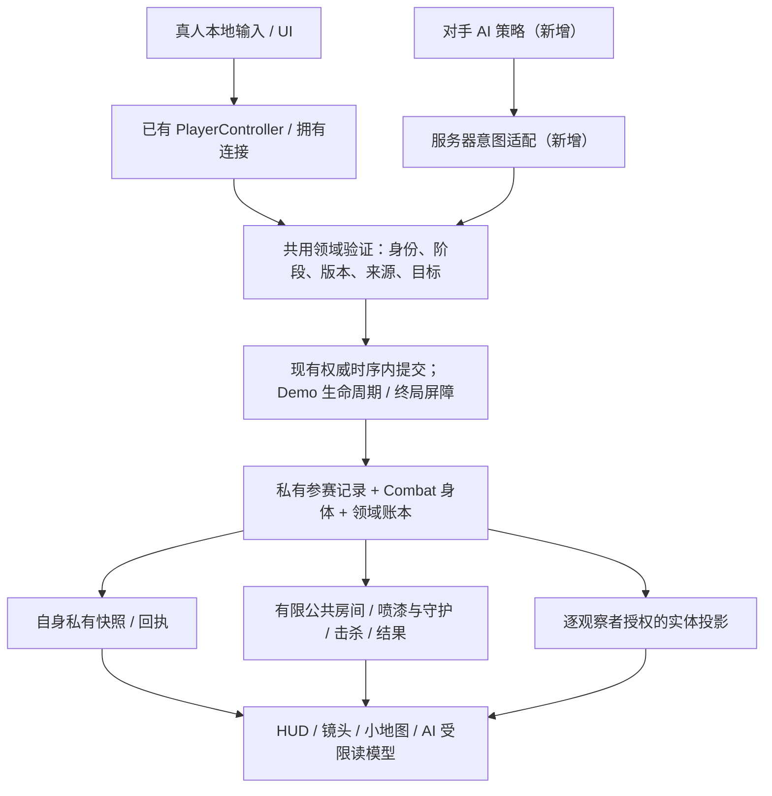

# Demo 总体架构、复用边界与共享契约

**目标：v0.10.0 Demo · 模块：总体架构 · 引擎：Unreal 5.8.4**

本报告把 [App Spec](../APP_SPEC.md) 转成架构工作，不重新定义玩法。
它记录收敛前基线的依赖审计、复用边界与删除闭包，以及之后任何裁剪仍须遵守的防回归约束；
§3.2 的删除闭包已经完成，运行代码已收敛为唯一 Demo 流程。
文中的模块名称（M1–M12、N01–N09 等）是分工标识，不是 API；
组件接口以 [系统手册](../DEVELOPMENT.md#按任务读取系统手册) 和实际代码为准，验收状态见[就绪评估](READINESS.md)。

## 1. 结论与范围

**用户已确认：直接收敛现有运行入口，只维护 Demo 一条流程，并裁剪代码库至 Demo 实际需要的依赖。**
现有前端、开发启动、服务初始化、打包及包内启动收敛到同一套 Demo 流程。
Demo 不需要的旧模式、政策、代码、输入、资产、脚本、测试与过期说明按依赖清单删除；
完成状态不包含兼容壳、注释掉的旧实现、备用旧目录、备份分支或已放弃方案文档。
已有 Git 历史不改写，本任务也不清理本机历史构建。

复用只针对 Demo 确需的 CharacterMovement、战斗、事务、身份与观测能力，
不代表保留其整个历史模块。混合文件先抽取/改造必要能力，再删除旧调用、政策和剩余部分；
不以“以后可能需要”保留代码，也不因单一入口而全库改名或全盘重写。
正式前端、原生 GameInstance/GameMode 与启动脚本已使用单一 Demo 入口并拒绝旧选择；
缺批准内容、世界生成或玩法提供者时不能开局。§3.2 的删除闭包已完成（见 §8），
下列依赖审计保留为裁剪依据与防回归约束。

本模块只覆盖总体架构、共享接口、复用审计、实施依赖和验收设计。
不实现游戏，不生成地图，不选技能/装备目录，不填写伤害、价格、时长、概率或公式。
后续模块清单是当前选定 Demo 的分工建议，不是长期路线图，也不授权同时启动所有模块。
首批入口/基础裁剪的具体范围和门槛见 §8.2，不要求等全套技能、装备或数值设计；
资产删除仍须引用核验，内容相关保留集合仍须对应决定，不能把“可以开工”解释为直接盲删。

范围以 Spec §1、§2、§9–11 为锚：

| 必须支持 | 本 Demo 不启用 |
| --- | --- |
| 自由混战；Listen Host 也是玩家，最多另有两名真人、三个独立参赛 AI；不补满空位 | 队伍、共享胜利、专服/匹配平台、重连、Host 迁移、自动 NAT 穿透 |
| 单图、一根旗杆（喷漆区）、五组两档野怪、一个商店、十个等概率且可重复抽取的出生点 | 全城模拟、多地图、额外目标路线、钥匙/授权/站桩前置、超时积分胜利 |
| 近战单体普攻起步，装备/属性可成长出群攻或增加攻击距离；野怪最后一击独占经验和金币、参赛者击杀另有助攻；升级三选一、Q/W、两装备与 1/2 | 职业起始技能、加点/读书代替三选一、额外背包、银行/采集/制作/玩家交易 |
| 局部视野；死亡保留局内成长与财产；喷上涂鸦并守护满时长获胜；回 Lobby 开新局 | 共享塔视野/全知 AI、死亡扣金掉装、跨局战力、世界检查点冒充新局 |

最小**完整 Demo**仍是“进入房间 → 从零打野/对抗 → 成长/购物 → 喷漆、守护与围攻 → 唯一胜者
→ 结算/新局”。可以先做无完整成长内容的集成骨架验证胜负和生命周期，
但它只能是工程检查，不能称为可交付 Demo；测试夹具也不能成为未批准的产品默认数值。

## 2. 审计基线与证据边界

- 基线提交：`fa11d09a762bccadf495191072e222dd158fc014`；研究前 fetch 后工作区
  HEAD 与 `origin/main` 相同。文中源码链接指向当前文件（审计时的行号已去掉）；
  描述收敛前实现的条目不构成继续支持旧模式的承诺。
- 阅读顺序：README → App Spec → DEVELOPMENT → 六份系统手册 → 相关原生代码、
  只读配置/SourceData 和检查入口。Spec 是需求；手册是组件知识；旧输入不是新玩法授权。
- 代码核验覆盖 Framework、Character、Navigation、Combat、Development、Inventory、
  Economy、Objectives、World、Vision、UI、Population、Region、Editor Bootstrap、
  相关 Tests 和 Scripts。缺失结论结合入口、生产者/消费者与跨 Source 搜索，
  不是“某个文件没找到某个名字”。
- 审计阶段是静态研究，没有运行 Unreal 或加载二进制资产；实施后的构建、资产引用审计、
  规则与场景验证见[就绪评估](READINESS.md)。源码缺少接线也不等于引擎缺少该基础能力。
- 所谓“可复用”指已存在且有价值的机制，不表示整个旧服务可直接启用，更不表示
  其原有数值、容量、地图形状或旧测试断言适用于 Demo。

## 3. 现有实现与复用矩阵

以下链接是仓库内真实源码位置；Windows 操作路径以 `Source\...` 为根。
“新增”行中的名称是职责描述，不冒充已存在的类。

### 3.1 复用清单：原样、改造、抽取

“原样”只指列出的局部机制，**不是整文件或历史模块原样保留**。
保留理由必须是当前 Demo 消费者；同文件剩余旧政策按 D 清单删除。

| ID/类别 | 保留能力、真实落点与证据 | 当前用途与必须剥离的内容 |
| --- | --- | --- |
| R01 原样机制 | `FLDSavedMove::CanCombineWith/SetMoveFor`、`FLDNetworkMoveData::Serialize`：[LDCharacterMovementComponent.cpp](../../Source/Lockdown/Private/Character/LDCharacterMovementComponent.cpp)；`FLDMoveIdentity`：[LDOrderTypes.h](../../Source/Lockdown/Public/Navigation/LDOrderTypes.h) | 原生预测和 Match/Life/Order/Epoch；删除 sprint、B91 搬运速度/全图分派及旧 profile 门槛，不另写位置积分器。 |
| R02 原样机制 | `LDCommandLiveness::Fresh`：[LDCommandLiveness.h](../../Source/Lockdown/Public/Framework/LDCommandLiveness.h)；视图拒旧由新 relay 的接收游标实现（`WORLD_CAMPS_AND_VISION.md` §7 W5） | 拒绝旧代次/旧发布和失联旧订单；`LDRules.h` 的 DeathCost/HeartAccess/deadline、`ForProfile` 旧选择器不保留。 |
| R03 原样局部编码机制/改造数值读取与校验 | `CatalogTools.encode` 的规范树确定性编码、稳定 ID 映射机制及引擎/工作区解析可复用：[CatalogTools.py](../../Scripts/CatalogTools.py)、[Common.ps1](../../Scripts/Common.ps1)；`read_json` 和 schema 数值谓词不能按原样承担新内容合同 | 由唯一 Demo compiler 按中央内容 §10.1 在任何 float 转换前保留十进制词法/Decimal，核对有限性、类型/范围和精确可表示性，再生成规范定点整数/有界比率树供 encode；不直接向旧 encode 传 Decimal。新拒绝测试覆盖超精度原文与指数溢出，不能只对已解析 float 做 IsFinite；旧 SyncB84/作者域/夹具退出，不保留第二生成路径。 |
| R04 改造 | `ALDCharacter`、`ULDHumanoidVisualComponent`：[LDCharacter.cpp](../../Source/Lockdown/Private/Character/LDCharacter.cpp)、[LDHumanoidVisualComponent.cpp](../../Source/Lockdown/Private/Character/LDHumanoidVisualComponent.cpp) | 同基础身体/碰撞/镜头/身份表现；删除 Resident、旧工具灯光/机构动画/职业 cue 与旧 tuning。Host 原生表现和观测代理须协调，不能盲删 authority 身体。 |
| R05 改造 | Navigation 的 `Plan/ClientOrderReceipt/TickComponent`：[LDNavigationComponent.cpp](../../Source/Lockdown/Private/Navigation/LDNavigationComponent.cpp)；订单簿 `ServerSubmitOrder/ServerStop/AdmitOrder/AdvanceActive/AcquireTarget/EngageTarget`：[LDNavigationOrders.cpp](../../Source/Lockdown/Private/Navigation/LDNavigationOrders.cpp)；攻击移动选敌 `LDOrderRules::NearestCandidate`：[LDOrderRules.cpp](../../Source/Lockdown/Private/Navigation/LDOrderRules.cpp) | 合法路径、取消、ACK、目标接近/AI 适配；右键追击、A 攻击移动与商店接近共用 `ELDSpatialOrderKind` 订单簿，到达射程后经 `ALDCombatDirector::StartNavAttack` 进入战斗准入。不恢复 B91 Cast、旧 site/pickup/服务或 local-only 提交假设。 |
| R06 改造 | `ALDGameMode::StateFor/ContenderId/SyncOwner`：[LDGameMode.cpp](../../Source/Lockdown/Private/Framework/LDGameMode.cpp)；生命换代 `EndContenderLife/SpawnInitialContenders/RespawnDueContenders`：[LDGameModeLife.cpp](../../Source/Lockdown/Private/Framework/LDGameModeLife.cpp)；死亡事实由 Combat 的 `LockDeath/RunDeaths` 提交（[LDCombatEffects.cpp](../../Source/Lockdown/Private/Combat/LDCombatEffects.cpp)、[LDCombatDriver.cpp](../../Source/Lockdown/Private/Combat/LDCombatDriver.cpp)） | 单一私有参赛记录、owner 投影、生命换代；不恢复四人/职业、死亡税/掉落、安全出生策略或旧世界指针，不给 Record/OwnerState/Ledger 三处独立写权限。 |
| R07 改造/抽取 | `ALDCombatDirector` 是唯一战斗实现：动作受理/释放 `SubmitAction/CancelAction/ReleaseBasic/ReleaseAbility`（[LDCombatActions.cpp](../../Source/Lockdown/Private/Combat/LDCombatActions.cpp)）；到期推进 `AdvanceAuthority/RunActions/RunEffects/RunDeaths/CommitReward`（[LDCombatDriver.cpp](../../Source/Lockdown/Private/Combat/LDCombatDriver.cpp)）；命中/状态/回复/死亡锁 `ApplyHit/ExpireStatuses/Regenerate/LockDeath`（[LDCombatEffects.cpp](../../Source/Lockdown/Private/Combat/LDCombatEffects.cpp)）；身体 `PrepareContenderBody/PrepareCampMemberBody/InstallCombatBody`（[LDCombatLife.cpp](../../Source/Lockdown/Private/Combat/LDCombatLife.cpp)）；来源/构筑 `ProjectBuild/PlanBindings/QueryAvailability`（[LDCombatSources.cpp](../../Source/Lockdown/Private/Combat/LDCombatSources.cpp)）；纯规则 `LDTactical::EvaluateDamage/ApplyRoot/DispelRoots/ApplyShield/IntegrateRegen/SettleRegen`：[LDTacticalRules.h](../../Source/Lockdown/Public/Combat/LDTacticalRules.h) | 唯一战斗/控制/来源/死亡时序；效果与公式只实现已批准中央内容定义（[内容报告](CONTENT_AND_BALANCE.md)），不恢复旧暗杀/居民/职业任务、全图物件反应或不受终局闸约束的副作用。 |
| R08 抽取/改造 | `FLedger::Prepare/ApplyPrepared/Reconcile`：[LDEconomyLedger.cpp](../../Source/Lockdown/Private/Economy/LDEconomyLedger.cpp)，归属精简后的现有 EconomyDirector | 保留预期版本、溢出拒绝、同条款幂等、全量验证后提交和独立复算；删除 BankTransaction、居民 endowment、制作血缘/quality、旧预算。Ledger 不含 XP/三选一，复合奖励还须 N03/N04 协调。 |
| R09 抽取/改造 | 装备来源与绑定 `ALDCombatDirector::ProjectBuild/ResolveEntry/PlanBindings/PreviewGearBinding/PrepareBuildChange/ApplyBuildChange`：[LDCombatSources.cpp](../../Source/Lockdown/Private/Combat/LDCombatSources.cpp)；Inventory 的 `ReadEquipment/ProjectObservedEquipment/EquippedItems`：[LDInventoryDirector.cpp](../../Source/Lockdown/Private/Inventory/LDInventoryDirector.cpp)；商店会话/报价/回执 `ALDVendorDirector::OpenPendingShop/CommitPendingShopCommand/QueryShopReceipt`：[LDVendorDirector.cpp](../../Source/Lockdown/Private/Inventory/LDVendorDirector.cpp) | 真实两装备、来源失效、同一账本买卖；不恢复十一绑定/六共享动作、重量/背包/quick、掉落或售书/安静准备附加条件。装备主动仍属 Combat，不属于商店事务。 |
| R10 改造 | 营地参数化追击、活动范围、成员回位与稳定选敌：纯值 [LDCampDecision.h](../../Source/Lockdown/Public/World/LDCampDecision.h)，由 `ALDCampDirector` 接线（[LDCampDirector.cpp](../../Source/Lockdown/Private/World/LDCampDirector.cpp)、[LDCampLifecycle.cpp](../../Source/Lockdown/Private/World/LDCampLifecycle.cpp)）；喷漆与守护归约 `FLDCaptureReducer`（[LDCaptureReducer.cpp](../../Source/Lockdown/Private/Framework/LDCaptureReducer.cpp)），恰一次结果与先锁写闸再清理由 GameMode `TryCloseMatch` 承担（[LDGameModeCapture.cpp](../../Source/Lockdown/Private/Framework/LDGameModeCapture.cpp)） | 五组两档野怪接核心身体/生命/DeathKey 与合法路径，喷漆与守护由核心归约；不恢复旧营地/目标 Actor、Boss/Tower/探索奖励、有限刷新预算、Heart 授权/路线/站桩或先清理后锁结果的旧顺序。 |
| R11 抽取/改造 | `LDGround::MapSurface/ClearSegment`：[LDGroundQueries.cpp](../../Source/Lockdown/Private/Core/LDGroundQueries.cpp)；`ALDRegionNavBounds`：[LDRegionNavBounds.cpp](../../Source/Lockdown/Private/Region/LDRegionNavBounds.cpp)；Editor 几何生成/保存/校验：[LDDemoWorldBuilder.cpp](../../Source/LockdownEditor/Private/ScaffoldBootstrap/LDDemoWorldBuilder.cpp)；`ULDMapDefinition` 只保存 Demo 世界字节与类型化投影（[LDMapDefinition.h](../../Source/Lockdown/Public/Region/LDMapDefinition.h)），由 `ULDMapRegistry`/`ALDMapAnchor` 加载 | 地面、阻挡/LOS、导航和加载统一绑定 D18 的 `L_Demo/DA_DemoWorld` 新根；旧 RegionDefinition/RegionAnchor 地址链、B91/full-map 分派、旧 city/route/river/service 字段与缺图默认位置已删除，不恢复，也不保留第二套地图定义。 |
| R12 改造 | `FLDSightGeometry::Trace/Coverage`、`FLDObserverLedger::Sample`：[LDVisionDirector.cpp](../../Source/Lockdown/Private/Vision/LDVisionDirector.cpp)；relay 接收/隐藏/终止/清理 `FLDObservedFrameReceiver::AcceptFull/AcceptConceal/AcceptTermination/Reset`：[LDWorldViewRelay.cpp](../../Source/Lockdown/Private/Vision/LDWorldViewRelay.cpp) | 唯一观测格式、逐观察者句柄/游标；删旧 sources/kinds/提示旁路与 B91 分派，改 Host 呈现和当前 DTO 白名单。 |
| R13 改造 | UI/世界输入独占 `IsWorldLifeValid/IsWorldInputSuppressed/ReleaseLocalInput`：[LDPlayerInput.cpp](../../Source/Lockdown/Private/Framework/LDPlayerInput.cpp)；`Rebind/SaveLocalSettings`：[LDControlSettings.cpp](../../Source/Lockdown/Private/UI/LDControlSettings.cpp)；owner 快照拒旧 `OnRep_OwnerState`：[LDPlayerController.cpp](../../Source/Lockdown/Private/Framework/LDPlayerController.cpp) | Q/W、1/2、P、镜头、Esc、真实状态和本地设置；删除旧 profile 映射迁移、银行/职业服务页签/Delegate，不留空旧面板方法。 |
| R14 改造 Editor/资产 | [LDScaffoldBootstrapCommandlet.cpp](../../Source/LockdownEditor/Private/ScaffoldBootstrap/LDScaffoldBootstrapCommandlet.cpp) 的 Demo 字节/原生根检查；[LDAssetReferenceAuditCommandlet.cpp](../../Source/LockdownEditor/Private/ScaffoldBootstrap/LDAssetReferenceAuditCommandlet.cpp) 的全包反射/资产审计；现有世界 Builder 的所需保存能力 | Bootstrap 不再生成旧 MapNames、固定旧输入或 V07 目录；Demo 内容、世界、音效与美术目录由 `LDDemoWorldBuilder` 与各导入器生成或校验。`WBP_UIRoot`、`M_Character`、`M_Fog`、`T_FogClosed` 有保留消费者，按 C3 与实际 Demo 依赖精简，不能因是占位素材盲删。 |
| R15 原样职责/按依赖精简 | 当前 Game/Editor 目标：[Lockdown.Target.cs](../../Source/Lockdown.Target.cs)、[LockdownEditor.Target.cs](../../Source/LockdownEditor.Target.cs)；两个 Build.cs、`.gitattributes`/`.gitignore` | 保留 Runtime/Editor 隔离、当前 UE/Win64/LFS/本地输出规则；删除失去实际消费者的模块/插件启用/staging，不新增旧模式目标。C4 不授权修改共享引擎/插件安装。 |

### 3.2 删除清单与防回归约束

D01–D32 的删除闭包已在当前集成分支完成：所列旧文件、旧反射类型/字段、旧资产、旧配置节与旧脚本均已真实删除；
反射与资产删除前做过 C3 引用审计，模块/插件/配置删除前做过 C4 消费核对。编号保留供其他文档引用，
各行只记录已退役范围、当前落点和不得恢复的内容；实施前的依赖与顺序不再保留，历史见 Git。
D34 的文档同步规则持续有效。后续任何删除仍须先做 C3/C4，不凭文件名或文本无命中判定。

世界生成/加载根以 M9G `WORLD_CAMPS_AND_VISION.md` §6.1–6.3 为准；
中央内容根以 `CONTENT_AND_BALANCE.md` §10.1/§11.2 为准。

#### 3.2.1 Source：领域删除与混合文件裁剪

| ID | 已退役范围 | 当前落点与不得恢复的内容 |
| --- | --- | --- |
| D01 | GameMode 旧 profile 查询、`bScaffoldProfile`、旧 GameState 路线/经济字段 | 唯一入口为 [LDDemoEntry.cpp](../../Source/Lockdown/Private/Framework/LDDemoEntry.cpp)；旧选择只显式拒绝，不改成恒真兼容谓词，不为 Demo 重开旧服务。 |
| D02 | 旧 Bank/Commerce/Production 的 Framework 文件、GameMode 分派、配置与 probe 调用 | 不留无服务的 Server 调用静默返回。 |
| D03 | 账本旧操作与字段：BankTransaction、居民 endowment、制作血缘/quality、旧预算 | 保留 R08 的 Commit/Receipt/Reconcile；操作集只含当前商店与奖励提交。 |
| D05 | `LDAcquisitionCatalog`、`LDLoadoutRequest`、`LDAcquisitionContract.h` 与旧获取/制作服务 | 装备定义只来自 `ULDDemoContentCatalog`（D21）。 |
| D06 | B92 人口/profile/RecordGold 分派与 Combat 的 RoleDied/Witness 旧调用 | 不保留人口空壳或恒真 profile。 |
| D07 | `ALDResident` 与 `RegisterSkillTask` 旧链 | 无居民或职业任务。 |
| D08 | 旧三营地 Actor/目录、旧站点 Actor、leases/claims 与固定奖励 | 营地见 R10；致死信用与一次奖励归核心 DeathKey，不从旧 Actor 恢复。 |
| D09 | 旧 Objective/Seal/站点、路线、hold/contract/window/deadline 与 Claim fallback | 唯一结果与先锁写闸再清理见 R10；不恢复 Claim/路线/RPC/旧 UI。 |
| D10 | `LDWorldClock.cpp` 与 Combat 旧 `Sample/FlushPastCommand` 调度政策 | 到期推进为 `ALDCombatDirector::AdvanceAuthority`（[LDCombatDriver.cpp](../../Source/Lockdown/Private/Combat/LDCombatDriver.cpp)）；不恢复 WorldRuntime gating、stationary hold 或回填历史姿态。 |
| D11 | B91 全图物件/环境/工具/林业/草丛、独立控制器/HUD/协议及 contract | 静态地面/LOS 只经 Ground/Registry/Vision 当前接口。 |
| D12 | 世界检查点、自动保存/恢复与专用序列化闭包 | 新局隔离靠 Match/Life 换代，不以世界文件恢复替代；本地设置仍由 `ULDControlSettings::Save` 保存。 |
| D13 | 地图类中的旧全图字段与政策：城市/路线/建筑/河流/服务/别名、旧高度场与查询 | `ULDMapDefinition` 只保存 Demo 世界字节与类型化投影（R11）；保留 MapDefinition/MapRegistry/ALDMapAnchor 加载链，不恢复第二套地图定义。 |
| D14 | Combat 旧 `LDSkillExecution`、`LDContent{Actions,Release,Lifecycle,Geometry}`、`LDTactical{Execution,Fields,Geometry}`、`LDV08{Catalog,Modifiers}`、`LDRiver*`、`LD{EnvironmentRules,ElementContact,FullMapSurfaces,IgnitionEnvironment}` 及未选效果/状态/handler | 唯一战斗实现见 R07：`ALDCombatDirector` 的 Actions/Driver/Effects/Life/Sources 与 `LDTacticalRules`；只实现已批准内容定义的效果。 |
| D15 | `LDCharacterBuild`、`LDV08Loadout`、`LDGearTypes/LDGearRules`、`LDInventoryTypes` 与 InventoryDirector 旧模型 | 成长规则见 [LDProgressionRules.cpp](../../Source/Lockdown/Private/Development/LDProgressionRules.cpp)，装备来源见 R09；旧 constructor 数值不得为 Demo 赋值。 |
| D16 | `LDPlayer{Bank,Commerce,Production,Development,Vendor,Inventory}.cpp`、旧背包面板与 UI 剩余服务分派 | 商店与成长 UI 只经窄 DTO（[LDShopPanel.cpp](../../Source/Lockdown/Private/UI/LDShopPanel.cpp)、[LDChoicesPanel.cpp](../../Source/Lockdown/Private/UI/LDChoicesPanel.cpp)）；不留空页签或不可执行按钮。 |
| D17 | Vision 旧来源/kinds/旁路：tower/public/Heart sensor、ward、Trail/Footstep、Seal/Cargo/Institution/Production 与 B91 格式 | 观测种类只有 `ELDObservedUnitKind::{Contender,CampMember}`（[LDViewTypes.h](../../Source/Lockdown/Public/Vision/LDViewTypes.h)）；新增种类须同改产生端、授权例外、发布端、HUD 与 wire 白名单。 |

#### 3.2.2 Config、Content、SourceData、模块与打包

本节资产项均须 C3；静态文件名枚举和 C++/脚本引用不等于已验证二进制引用。

| ID | 已退役范围 | 当前落点与不得恢复的内容 |
| --- | --- | --- |
| D18 | `Content\Lockdown\Generated\Maps\L_{MigrationSandbox,FunctionalTests,DevelopmentRegion,RegionAlternate,V07Region,V08Region}.umap`、`Content\Lockdown\Generated\Data\DA_{CivicRegion,AlternateRegion,TacticalRegion,ElementalRegion}.uasset` 与旧多图生成 | 唯一玩法包 `/Game/Lockdown/Generated/Maps/L_Demo`，其中一个 `ALDMapAnchor` 引用 `/Game/Lockdown/Generated/Data/DA_DemoWorld`；`L_Frontend` 仅作菜单。不保留 alias 或备用包。 |
| D19 | V09 全图资产 `L_V09Full`、`DA_FullMap`、`SM_Terrain_*`、`M_{River,Soil}Instanced` 与其独占 Builder | 新根只由 [LDDemoWorldBuilder.cpp](../../Source/LockdownEditor/Private/ScaffoldBootstrap/LDDemoWorldBuilder.cpp) 生成。 |
| D20 | `Content\Lockdown\Data\V07`、`Content\Lockdown\Data\V08` 历史载荷与 manifest，`LDB{81,82,83}Contract.h` | 只消费 Demo 内容/世界载荷与根 manifest。 |
| D21 | `SourceData\Catalogs\V08` 作者域、B84 运行产物/manifest 与 `LDB84Contract.h` | 唯一链：`SourceData\Demo\{content,content.schema,native_ids}.json` → `Scripts\SyncDemoContentData.py` → `Content\Lockdown\Data\Demo\{demo_content,manifest}.json` 与 `LDDemoContentContract.h` → `ULDDemoContentCatalog`。不并行生成，不手改哈希。 |
| D22 | `SourceData\Catalogs\V07` 与 `Scripts\SyncV07*.py` | 同 D21。 |
| D23 | `SourceData\Character\prototype_rules.json`、`LDPrototypeTuning`、`DA_CharacterCatalog`、`Generated\V07\DA_*Catalog` 与 `DA_PrototypeTuning` | 角色参数只来自 D21 的唯一内容域；缺必要输入显式失败，不以默认对象补位。 |
| D24 | 旧输入动作资产与 IMC，`M_{Soil,Fuel,Metal,River}` | `M_Ground/M_Stone/M_Tree` 只被旧 `L_Frontend` 占位场景使用，已随该场景删除（`L_Frontend` 现为空关卡）；保留有消费者的 `M_Character`（人形表现）、`M_Fog/T_FogClosed`（视野 relay）与 `WBP_UIRoot`。 |
| D25 | `Config\{RegionLayout,V07RegionLayout,V08RegionLayout}.json`、BootstrapLayout 旧图要求、DefaultGame 旧容量/书价与 CommonUI 无消费者配置 | 有效配置只含当前入口、GameMode/GI/Engine 类、网络、导航、渲染与打包所需节。 |
| D26 | Build.cs、uproject、Target、`.gitattributes` 与打包/启动脚本中的旧载荷、旧 map/profile、多版本生成分派 | RuntimeDependencies 只含 Demo 内容/世界载荷与根 manifest（[Lockdown.Build.cs](../../Source/Lockdown/Lockdown.Build.cs)）；Bootstrap 对 `RebuildRegionMaps/RebuildV08Region` 显式拒绝。 |

沿用一个技术路径承载唯一当前实现可以避免无收益重命名，但不得保留其中的废弃记录、
旧 loader/handler/schema 分派或备用副本。

#### 3.2.3 测试、Scripts 与 docs

| ID | 已退役范围 | 当前落点与不得恢复的内容 |
| --- | --- | --- |
| D27 | 旧 probe 的 RPC/flags/friends 与核心接线：`ServerProbeHello/ClientProbePhase`、GameInstance Evidence 指针、`LDRemoteAuthority` 不参赛 Host 特免 | DEV probe 只在 `WITH_DEV_AUTOMATION_TESTS` 下由命令行开关启用，经公开读接口观察，不给 Host 特免。 |
| D29 | 旧 Input/Economy/View/HUD/Combat/Tactical/Inventory/CharacterBuild/V08Loadout/Loadout/Preparation 专测与旧数量/职业/schema 断言 | 必需用例由 [CheckRuleReport.py](../../Scripts/CheckRuleReport.py) 的明确集合约束；不以旧测试数或旧结果充数。 |
| D30 | `Scripts\Run{Movement,Navigation,Input,HUD,Combat,CombatNetwork,Reset,Soak,Tactical,Geometry,Content,ContentNetwork}Check.ps1` 与对应 probe | 场景改为 `Scripts\RunDemo*Check.ps1`，见 §7.1 与[开发指南](../DEVELOPMENT.md#最小验证选择)。 |
| D31 | B81–B86、B90–B92 的旧 Open/Run/Check/Capture 截图链 | [CaptureInputUI.ps1](../../Scripts/CaptureInputUI.ps1) 只保留当前 `L_Frontend` 的窗口截图能力。 |
| D32 | `Scripts\{SyncV07*,SyncB84Data}.py`、`Scripts\TestB84Import.py` 与 V09/B91/B92 生成链 | 同 D21；世界几何由 `Scripts\SyncDemoWorldData.py` 产生。 |
| D34 | systems 手册、README、DEVELOPMENT 与本报告中已删机制的章节、入口与引用 | 持续规则：每个代码/数据批次同改手册和链接；APP_SPEC/AGENTS 的有效规则保留。完成的删除项及失效源码引用不作为长期档案留在当前报告，历史仅在 Git。 |

“退役/退出”均指依赖关闭后**真删文件或旧分支**，不是 skip、禁用或留下空壳。

### 3.3 新增清单：补齐当前职责

以下均为**建议落点/缺失职责**，不声称已有同名新 API、测试或资产。
新增辅助文件仍隶属现有 Runtime/Editor 与同一权威所有者，不新建并行玩法、账本或运动系统。

| ID/建议落点 | 新增职责 | 依赖与验收 |
| --- | --- | --- |
| N01 `ALDGameMode/LDUIRoot/ULDGameInstance` 与现有启动/打包脚本 | 唯一房间/阶段/准入、有限 roster/Host/AI 数量、错误分类、回 Lobby/新 Match；旧运行选择明确拒绝 | R06/R13、拥有连接及当前图。3 真人/0–3 AI、不补位、开局锁名单、普通离局不奖励/自动胜、Host 失联回菜单。首批可先做合同/拒旧门禁，不等 C1。 |
| N02 现有 Combat/GameMode 核心 | 真实事件时间、来源身份/序号、提供者/消费水位、喷漆与守护 reducer 和终局写闸 | R01/R07/R10/R11 与 §4.5；进入又退出/截止后进入/旧生命/重复事件正确，先锁结果再清理，后续零新副作用。一般调度不是待用户决定。 |
| N03 Combat/GameMode/现有 Ledger 和 Development，接营地纯决策 `LDCampDecision` | 五组两档营地；按真实致死身份的金币/XP/机会复合提交；死亡保留、同十点随机返回与保护 | R06–R10；数值/实际图依 C1/C2。无主/自杀/离局/回位不发奖，仍在局的阵亡来源击杀别人仍获奖，重复死亡不重复提交。 |
| N04 参赛成长提供者、`FLDCharacterBuild/FLDOwnerState` 与成长 UI | 持久机会队列/候选 ID/revision、窄选择/替换确认及回执、Q/W/属性/被动构筑；复用现存纯投影，不恢复旧准备 Actor | N03、R09、批准能力/属性及 SC-04/05 死亡期构筑提交；最高10级/10次机会（含开局一次）、逐次三合法不同项、关窗/死亡不重抽、替换遗忘等级但不洗冷却、被动无额外槽上限。 |
| N05 当前 Inventory/Vendor/Economy 与 Combat | 两装备原子买卖、当前目录报价/出售解绑和来源 readiness；装备主动独立走 Combat | R08/R09、批准价格/目录及 SC-06 来源约束；第三件拒绝、先卖后买、离距/死亡/终局不成交、重复不重结；商店外/喷漆区内/满槽仍可用已有 1/2。 |
| N06 当前 Navigation/CharacterMovement/Combat 和服务器 AI 适配 | 右键合法接近后持续普攻、A 攻击移动；同规则受限 AI 意图/策略 | R01/R05/R07/R12、SC-07；S 后迟到 ACK 不续走，失视取消锁定并停止该追击订单，不读隐藏 Actor；人/AI 同资源/距离/来源约束。完整 AI 还依成长、商店、营地和旗杆，不阻塞首批框架裁剪。 |
| N07 Vision/Relay/HUD/角色表现 | 一组当前自身/公共/逐观察者 DTO；正常 Listen Host 原生与代理呈现协调 | R04/R12/R13、SC-07 已定白名单/死亡观察/结果字段；画面/面板/小地图/FX/声音/路径/AI 不透雾，不保留 LastSeen，删除 Footstep 等旧旁路。 |
| N08 M9G 改造后的 `ULDMapDefinition`/MapRegistry、唯一 `ALDMapAnchor` 与世界 Builder；现有 ScaffoldBootstrap/CatalogTools 的所需机制及中央内容唯一 compiler/typed loader | 世界链：`SourceData\World\demo_world.json`→计划中的 `Scripts\SyncDemoWorldData.py`→`Content\Lockdown\Data\Demo\world.json`/`LDDemoWorldContract.h`→D18 的完整 `L_Demo/DA_DemoWorld` 运行包/对象路径。内容链：D21 的 `SourceData\Demo`→Demo 内容/root manifest/contract→计划中的 `ULDDemoContentCatalog`，不拥有第二份玩法状态。 | R03/R11/R14 与正式世界/中央内容合同；世界坐标仍归 M9G，不塞进中央内容文件。Bootstrap 验证新保存资产字段/签名；根 manifest 纳入内容与世界合同/子载荷摘要，启动和 Cook/stage 只消费这组当前根。旧 Region/Civic/V08/B84 根删除，无 fallback。 |
| N09 现有组件测试/Demo runner 与包清单验证 | 删除闭包检查、当前 UHT/资产/生成/cook门禁、真实连接和完整对局场景 | 当前已接入 provider；旧类/RPC/图/数据/运行选择无存活消费者，必要单测迁完；完整玩法依 N01–N08，首批仅以其实际覆盖的结构/组件门槛交付。 |

## 4. 选定架构与共享契约

跨模块共同语义集中维护于 [共享契约](SHARED_CONTRACTS.md)；
本节保留对应的源码证据、架构理由与接线约束。正式签名由领域报告定义，
八领域与下文 M 编号的覆盖关系见 [实施计划](IMPLEMENTATION_PLAN.md)。
修改共同边界时同时更新集中契约，不把本节维护成第二套不同的协议。

### 4.1 保留真实状态所有者，收紧唯一写入口

现有 `FLDContenderRecord.Session` 与 `FLDOwnerState`、Combat `Bodies`、
Inventory/Development、Ledger 各有领域职责；`SyncOwner` 是投影边界，不是另一本账。
**建议继续沿用这些所有者**，把 Demo 金币/物品统一到同一事务提交后投影，
不要同时开放“先改 OwnerState 再补账”和“先账本再复制”两种自由写法。
无需为了遵循 Unreal 通用类图把所有状态立即迁到 PlayerState；尤其不能把私有构筑
无条件复制出去。GameMode 服务端裁定、GameState 公开事实的分工与官方资料 U1/U2 一致。

| 生命周期 | 唯一所属事实 | 取消/保留规则 |
| --- | --- | --- |
| 本机/连接外偏好 | 名称、输入、画质/音量、镜头偏好 | 通过本地设置机制保存；不放入局内奖励/经济存储，不随新局清空。 |
| 整局参赛记录 | 等级、XP、金币、属性奖励的持久加成、已学主动/被动及等级、两件装备、待选次数及当前候选、应持续的来源冷却 | 死亡保留；正式新局全部重建。被动不占 Q/W，UI 格子不成为被动上限。离局后不再作为有效参赛者，不自动转 AI。 |
| 一次身体生命 | HP/MP、临时控制、身体 Identity、当前动作/目标/导航、保护状态 | 死亡取消旧动作；复活新 Life/身体身份、满血蓝、清临时控制。保护与普通技能 Guard 分开。 |
| 一次请求/交互 | 移动 Order/Epoch、报价会话、选择确认、事务/命中回执 | 旧生命请求不能作用新身体；已提交结果只读重放，不再产生副作用。候选内容不因请求取消消失。 |
| 整局终局 | 唯一结果/receipt、结束原因及公共结果 | 一次锁定，后续领域写入全部拒绝；Host 主动结束可以无胜者，不能变成超时胜利。 |

### 4.2 现有身份不可混用

以下是**现有准确名称**；右列是接线要求。局身份统一由 `FLDMatchContext`（`Generation` + `LedgerMatch`）携带。

| 现有身份/版本 | 证据 | 共享要求 |
| --- | --- | --- |
| `FLDContenderRecord.Session` / `ContenderId` | [LDGameMode.h](../../Source/Lockdown/Public/Framework/LDGameMode.h)；[LDGameMode.cpp](../../Source/Lockdown/Private/Framework/LDGameMode.cpp) | 本局参赛者 FGuid，不是 NetConnection，也不等于局代次。真人从拥有连接解析，AI 从服务器分配的参赛记录解析，不信任调用方声称的别人的 ID。 |
| `FLDMatchContext.Generation`（`FLDOwnerState.Match` 与观测 `Generation` 随之）、`ULDGameInstance::AuthorityGeneration` | [LDMatchLifecycleTypes.h](../../Source/Lockdown/Public/Framework/LDMatchLifecycleTypes.h)；[LDGameInstance.h](../../Source/Lockdown/Public/Framework/LDGameInstance.h)；[LDGameModeMatch.cpp](../../Source/Lockdown/Private/Framework/LDGameModeMatch.cpp) | 每局由 `AllocateMatchGeneration` 显式推进；同世界回 Lobby 再开也推进，不只清 phase。 |
| `FLDMatchContext.LedgerMatch` 与账本私有 `FAuditState.Match` | [LDEconomyLedger.h](../../Source/Lockdown/Public/Economy/LDEconomyLedger.h) | 与网络 uint32 代次不同；由同一 Match context 成对携带并随新局重置，不强制同型转换。 |
| `FLDOwnerState.Life/LifePhase/LifeRevision/RespawnAtMs/ProtectedUntilMs/BodyRef`；`FLDBodyCombatState.Identity` | [LDViewTypes.h](../../Source/Lockdown/Public/Vision/LDViewTypes.h)；[LDCombatDirector.h](../../Source/Lockdown/Public/Combat/LDCombatDirector.h) | owner Life 与身体 FGuid 均需保留；死亡 inactive 与成功复活增加 Life 分开，不能靠 Pawn 指针识别旧生命。 |
| `FLDMoveIdentity.Match/Life/Order/Epoch` | [LDOrderTypes.h](../../Source/Lockdown/Public/Navigation/LDOrderTypes.h) | 导航 Order/取消 Epoch 不是全领域版本；Stop 后迟到 ACK/saved move 不得复活旧订单。 |
| `FLDCombatActionRequest.ExpectedSourceRevision`、`FLDCombatRequestKey`；回执 `FLDCombatActionReceipt.CombatToken/ReceiptRevision/LifeRevision` | [LDCombatTypes.h](../../Source/Lockdown/Public/Combat/LDCombatTypes.h) | 请求键、命中排序、取消水位不同；构筑/物品按其领域 revision 校验，不用频繁变化的全体 OwnerState revision 代替。 |
| `FTransaction.BusinessKey/Terms/Cause`、`FJournalEntry.Serial` | [LDEconomyLedger.h](../../Source/Lockdown/Public/Economy/LDEconomyLedger.h) | 同 key 同条款返回已有结果；同 key 改条款拒绝；无效/失败有明确原因。有限 UI/RPC 缓存不等于完整事务账本。 |
| `FLDObservedUnitView.Handle/ObservationEpoch`、`FLDWorldView.Generation/Revision` | [LDViewTypes.h](../../Source/Lockdown/Public/Vision/LDViewTypes.h) | 句柄是逐观察者授权引用，不是永久 Actor/参赛者 ID；执行时重新解析。 |
| 公共结果 `FLDResultView.ResultId/ResultSerial/Reason/Winner/EndedAtMs`、`ALDGameMode::TryCloseMatch` | [LDCaptureTypes.h](../../Source/Lockdown/Public/Framework/LDCaptureTypes.h)；[LDGameMode.h](../../Source/Lockdown/Public/Framework/LDGameMode.h) | 一次结果语义归核心 GameMode：先锁定结果并关闭写闸，再发布公共结果；各领域写入口校验写许可。 |

### 4.3 命令、回执与 AI 共用验证

**共同边界**：读取获准投影作预览 → 提交意图 → 服务器验证身份、当前局/生命、
请求去重/拒旧及终局写闸 → 对进攻意图解除复活保护 → 校验具体动作的版本/来源/目标/资源 →
执行合法动作或明确拒绝 → 发布真实结果和版本。非进攻命令不执行保护解除步骤。
动作条件失败不会回滚保护解除；技术准入失败则不能修改角色。
预览成功不是购买、命中、选择或胜利成功。

| 意图族 | 必要上下文 | 提交边界 |
| --- | --- | --- |
| 地面/目标移动、普攻/施法、S 取消 | 局/身体生命、订单/token、来源与相关 revision；地面合法性或当前观察句柄 | 重用 Navigation/CharacterMovement/Combat；失视取消锁定并停止该追击，不走最后可见位置，不从隐藏 Actor 补齐目标。S 不能取消已完成命中，但必须使可中断旧工作及其迟到回包失效。 |
| 三选一/主动替换 | 当前持久候选 ID/版本、选择项、明确替换槽及其期望构筑版本；请求的局/生命上下文 | 候选属于整局，旧请求不因重生得到新执行权。一次确认原子消费一次机会并更新构筑，随后才生成下一组；死亡等待也可确认，但不复活、不治疗尸体或产生身体效果。 |
| 买入/卖出 | 服务器报价会话/目录版本、商品或实例、Inventory/Item revision、唯一请求条款 | 成交时重验存活、对局进行中、实际商店距离、余额/槽位/所有权；金币/实例/卖出解绑一致提交，不能客户端先行确认。 |
| 装备主动 | 局/生命/token、已装备实例及来源 revision、目标、冷却/资源/控制条件 | 属于 Combat 命令，不要求商店报价/距离、购买余额或空装备槽，不因释放移除装备。身份/代次/终局等准入后因进攻意图先解除保护，动作条件随后校验，失败也不恢复保护。 |
| Ready/开始/AI 数量/返回 Lobby | 拥有连接、Host 权限、当前房间/阶段/名单版本 | 开始锁名单；中途加入拒绝；普通离开不是击杀/自动获胜。房间转换由 authority 协调，不由各 Widget 重置自己的数组。 |

装备主动与交易分离已实现：装备主动由 `ALDCombatDirector::SubmitAction/ReleaseAbility` 按来源、实例、就绪与资源验证
（[LDCombatActions.cpp](../../Source/Lockdown/Private/Combat/LDCombatActions.cpp)），不以商店会话作为施法条件。
1/2 必须能在商店外和喷漆区内使用；“两装备已满”只阻止继续购买，不阻止现有能力释放。

重复包必须区分“已提交重放”和“尚未执行但已过期”。
商店请求流按序保存回执并支持查询（`ALDVendorDirector::QueryShopReceipt`，[LDVendorDirector.h](../../Source/Lockdown/Public/Inventory/LDVendorDirector.h)）。
查询/重放窗口与拒旧水位必须明确：过窗可以返回明确的过期结果并重新同步状态，
不能默认成功，也不能因清缓存而重新成交。无限对局不等于无限保存所有表现回包；
压缩回执时仍须保留不重复提交的不变量。

AI 直接调用服务器上相同的**领域验证入口**（[LDOpponentRequests.cpp](../../Source/Lockdown/Private/AI/LDOpponentRequests.cpp)），不伪造客户端 RPC 或网络连接；
移动与追击由服务器订单簿受理（R05），仍复用合法路径、CharacterMovement 与同一资源/来源条件。
AI 策略只拿自身、合法观测和公共信息（[LDOpponentFrame.cpp](../../Source/Lockdown/Private/AI/LDOpponentFrame.cpp)），不可遍历全身体表寻敌或直接修改余额/HP。

### 4.4 战斗、奖励、死亡与来源

初始近战单体普攻是开局形态，不是永久限制。装备或属性可以提供群攻/增加攻击距离，
具体首版来源、几何、伤害与触发路径由内容/战斗域接入同一结算链；
不能收窄为永远单体近战，也不能从增加射程推导必须新增投射物。

**建议以一次权威致死事件作为奖励事实**：受害者局/身体生命身份、死亡序列、
真正致死效果的实际所有者和奖励回执构成去重/追责依据。
先判奖励对象/关系，再判所有者：只有野怪或**另一名参赛者**的合法死亡可奖励；
自杀、离局清理、野怪回位重置不发金币/XP/选择机会。保留旧 PvP 的
`Killer==Target` 拒绝语义（由 N03 在核心 DeathKey 上实现），
不能把“存在 CreditOwner”单独当成奖励资格；无奖励的死亡也需记录已处理。
没有参赛者拥有该次致死伤害时记录“此死亡已处理、无获得者”，
不能沿用之前有主伤害的 LastOwner。一次死亡必须一致地完成金币、XP 和升级机会；
候选创建失败不能通过再次发金币重试。复用 Ledger 的原子校验，但新增复合提交协调，
不另开 XP 账本充当第二份金币真相。

死亡路径只取消生命期动作/临时状态、失效物理交互/旧报价并切换生命状态。
保留等级、XP、技能、装备、金币、未处理选择与仍应进行的冷却；
重复死亡回调/重复复活不得再发初始资源或奖励。弹体/持续效果需分别携带
受害者生命身份与实际来源所有者，不能用施法者当前 Pawn 指针替代；
已成功释放的独立效果在正常死亡或出售/遗忘来源后继续到原定结束，
未释放动作因死亡取消，持续绑定的光环/被动/引导在维持条件丢失时失效。
正式退出/断线时身体立即移除，未结束独立效果立即取消，不留可攻击或阻路身体，
也不让残留 tick/命中继续影响战斗；不回滚之前已提交的伤害和回执。
若效果在所有者阵亡但仍在本局时实际造成击杀，奖励仍归实际所有者；
Spec 没有“死亡就丧失该次奖励”的例外，这不作为待决问题。

三选一的属性加成和已学被动也属于整局构筑，死亡保留、新局清空。
死亡等待允许确认选择/替换，只更新保留构筑、机会和版本，不治疗尸体、不改变复活等待。
存活时升级/属性/装备引起血蓝上限变化，保持原生命/法力百分比；一次最终投影统一换算，
重复请求和无回复/战斗的往返变化不得因精度/取整获益。死亡期不套用身体资源更新，
正常复活仍使用最新构筑的上限补满；正式精度/取整由内容公式和战斗投影共同封口。
Q/W 限制的是角色主动入口，不是全部已学能力数量；被动没有额外槽位上限，
仍受实际选择机会和技能等级约束。装备被动不计角色学习，随对应实例生效/解绑。
被动 UI 可展开/滚动，不能用可见格子数缩小允许的构筑。

**冷却不是 UI 槽位状态。** 建议以服务器时间和来源 readiness 统一结算/展示：
沿用现有 learned cooldown、物品 readiness 等机制，但逐项区分局内持久冷却与身体瞬时字段。
仅使用新物品实例 ID 不能防止卖出重购洗冷却；遗忘技能等级也不等于遗忘未结束冷却。
升级、调槽、替换、重学、买卖、死亡均不得产生 Spec 禁止的重置捷径。
两个槽允许同时装备两件同款，基础属性加成相加、同名被动只生效一次；
两份主动各自独立冷却，正常条件满足时可连续使用两次，不以同款 family 的单个 `ReadyAt` 互相锁定。
每份装备需要独立持久来源身份及重购回绑，不能将独立冷却实现成卖买或换槽清零。
来源丢失期间继续按服务器时间计时，重新持有时沿用原结束时间，不冻结、不刷新。
正式持久身份与继承接口由战斗与成长域按 SC-06 共同封口，不从旧目录推导另一套规则。

### 4.5 同一结算边界的喷漆、守护与终局

统一结算由 `ALDCombatDirector::AdvanceAuthority` 在同一到期边界依次推进动作、效果、死亡与奖励
（[LDCombatDriver.cpp](../../Source/Lockdown/Private/Combat/LDCombatDriver.cpp)）；喷漆与守护由唯一的 `FLDCaptureReducer` 按事件归约
（[LDCaptureReducer.cpp](../../Source/Lockdown/Private/Framework/LDCaptureReducer.cpp)），完成提案经 GameMode `TryCloseMatch` 锁定唯一结果
（[LDGameModeCapture.cpp](../../Source/Lockdown/Private/Framework/LDGameModeCapture.cpp)）。旧 WorldRuntime 时钟、回拨 World 时间与当前姿态补算已随 D10 删除，不得恢复。

**事件输入契约（逻辑责任，不是通用事件平台）：**

| 提供者/消费者 | 必须承担的责任 |
| --- | --- |
| 服务器运动/位移落地、生命/离局/保护提交者 | 在真实变更发生时提供局代次、参赛者/身体生命、事件来源、本流单调序号、服务器实际发生时间及喷漆区内/有效资格变更。进入/退出、死亡/离局、保护变化均接入；Combat 在提交定身、眩晕、嘲讽（及击退）时经 `PublishCaptureInterrupt` 发布打断事实；普通受伤、减速、缴械不产生清零事件。 |
| 权威调度 | 实际事件时间与补算用的有效采样时间分开，不能用被回拨的 World 时间给后来运动打过去的戳。给同一时间的事件确定服务器提交次序，建立各提供者已发布到哪个边界的水位。 |
| 唯一喷漆与守护 reducer | 只在相关提供者已发布到待判边界后消费该边界事件，保留进入又退出/离开又返回等中间变化；不把截止后姿态回填截止前。完成判定后推进消费水位并释放已消费记录，拒绝重复/旧局/旧生命事件。 |

事件必须保留到对应边界判定完成，不能先清空再用最终快照代替；
不要求永久事件日志、第二套位置积分器或网络回滚世界。
运动事件的生成和时间归属是 M3/M4/M5/M9G 提供者接线的一部分，不由旗杆 UI 猜测。

1. 用服务器已经执行的运动、碰撞、离局和到期事件推进边界；先处理应发生的命中/
   死亡、控制、复活/保护变化和改变喷漆区状态的事件。不得以客户端报告的位置或时间补造历史。
2. 有效集合只含本局、存活、非保护的真人/参赛 AI；野怪/商店/特效不入集合。
   区内只有一名有效参赛者且他不是涂鸦主人时他喷漆；两名以上时所有人的喷漆进度暂停并保留，
   他恢复独自喷漆时从暂停值续计；他离区、死亡、离局或在施加瞬间受到定身/眩晕/嘲讽/击退即清零且无人继承；
   普通受伤、减速、缴械、区内移动/战斗不清零。喷满即喷上涂鸦，覆盖原涂鸦并从 0 开始守护；
   守护只在主人独自在区内时计时，主人受伤、受控不影响，主人在区外且区内无人时暂停在当前值、回区后续计（2026-11-07 用户决定）；
   主人以外有任一有效参赛者在区内时冻结、全部离开后主人独自在区内时续计，冻结期间主人走出喷漆区则守护清零、涂鸦保留（2026-11-07 用户决定）；
   主人死亡或离局清除涂鸦；守护累积满时长才获胜。
   保护到期才开始获得资格，不能回算保护期间的时间。
3. 记录同一结算边界已发生的离区/争夺/控制/死亡，而不是只采最终快照。
   同一时刻先处理死亡、离局和控制，再处理喷漆和守护；完成时重新验证条件；同刻已发生的破坏条件不能在结果之后补算。
   这直接来自 Spec §2.2，不是待批准的“死亡优先”新规则。
4. **先锁结果/关闭写闸，再执行取消与清理、发布结果。** 所有领域的延迟命中、
   交易、奖励、选择、喷漆和守护提交都检查终局屏障；清理回调不得重新写入玩法状态。
   已完成事务只读重放不算再次提交。

一般命令受理序、领域提交阶段和消费水位是**工程需落实的确定性契约**，不是要求用户
先决定调度算法。实现负责人须明确并测试：终局前已提交事务保留真实回执，
锁定后尚未提交的操作拒绝；网络收包不能跳过 Spec 的同刻破坏条件，客户端 OnRep 顺序
不能决定成败。若另外引入宽限窗口、客户端回溯或特殊退款/优先权，才需提出具体产品选择。

终局屏障由写许可实现：结果锁定后 `ALDGameMode::IsGameplayWriteOpen` 关闭，各领域写入口都校验 `FLDGameplayWritePermit`
（[LDMatchLifecycleTypes.h](../../Source/Lockdown/Public/Framework/LDMatchLifecycleTypes.h)）。
应逐入口证明终局后只有拒绝/清理，不是“结果 UI 出现就视为全部冻结”。
不同 Actor 的 RPC/OnRep 没有可依赖的全局顺序（U5），不能拿复制到达顺序实现原子胜负。

出生查询与喷漆区内查询由地图模块统一定义；每次出生从十个出生锚点无偏抽取，碰巧同点时按预留偏移做合法落地与占位检查，
不重抽安全点（[LDSpawnPlacement.cpp](../../Source/Lockdown/Private/World/LDSpawnPlacement.cpp)）。Pawn 对 Pawn 碰撞为 Ignore，防重叠只依赖该预留，不假定引擎自动解决。

### 4.6 三类投影与隐私

| 投影 | 允许信息 | 不能顺带放入 |
| --- | --- | --- |
| 自身私有 | 本人属性/构筑/资源、候选、装备/报价、冷却、失败原因和回执 | 其他参赛者私有资源/背包、服务器全实体表 |
| 明确公共 | 房间身份/真人或 AI/Host/准备；发育/开放/争夺/喷漆者/喷漆进度/涂鸦主人/守护进度；参赛者击杀通知及结果 | 任何未获准的隐藏精确坐标（含喷漆区内）、行为、资源/构筑；普通野怪击杀横幅；以喷漆或守护播报授予视野 |
| 逐观察者合法实体 | 当前合法可见表现、观察句柄；对手查看为名称/角色等级/血量/蓝量/状态/装备/Q/W 主动与等级 | 被动列表、冷却、完整属性、金币、LastSeen单位标记；失视后动态数据与附属表现/声音/寻路泄露 |

GameState 不是所有玩家资源总表；OwnerState 不是任意目标面板的数据源。
新增字段须同时更新生产者、消费者、wire/目录兼容及隐私白名单，
保留 [LDViewTests.cpp](../../Source/Lockdown/Private/Tests/LDViewTests.cpp)
的检查目的，而不是为了 UI 删除断言。不同旧观测格式须选择/适配，不直接拼接。

观测白名单已收敛：单位种类只有 `Contender/CampMember`；动作提示 `ELDObservedActionCue` 为 `None/Attack/Cast/Hit`，
由 Combat 产生、Vision 只对当前可见单位发布，可见飞行物另列为不可选中的 `Projectiles`
（[LDViewTypes.h](../../Source/Lockdown/Public/Vision/LDViewTypes.h)）；旧 Trail/Footstep 提前授权与 `AuthorizedCue` 旁路已删除。
新增任何提示都必须同时约束产生端和发布端，不能绕过当前合法观测。
首版不保留 LastSeen 单位标记，旧 Trail/Footstep 不能成为保留历史单位位置的理由。
内部拒旧游标与静态地形信息不等于可视单位标记；失视即清当前查看并停止该追击订单。
死亡可自由拖动镜头，但世界观察只含静态/既定公共信息，不新增活体视野或观察隐藏玩家。
终局才公开全体名称/击杀/死亡/最终等级及赢家、结束原因/用时，离局记录仍保留，
不为结果 UI 在局中广播隐藏等级或额外私有字段，统计不参与判胜。

Listen Host 虽持有权威世界，其正常**主画面、本体/附属表现、HUD 与目标解析**
都须遵守相同获准投影。不仅关闭开发全知模式，还需把非本地原生实体的可见呈现与观察代理
统一管理，覆盖 Mesh、阴影、名称、附属特效/灯光和声音，避免原生与代理双重输出。
保留服务器实体参与权威逻辑，不能用销毁实体“解决”显示问题。
AI 同样只读受限模型。普通可见性或距离 relevancy 不自动实现
战争迷雾（U4）；还须检查可访问载荷，不只是隐藏 Mesh。对恶意修改的受信任 Host
做反作弊防护不在本 Demo 范围，不能承诺客户端式的进程隔离。

### 4.7 入口、数据与新局隔离

**按已确认决定收敛现有入口，不新增与旧 profile 并行的 Demo mode/profile 运行选择。**
多个开发/打包工具脚本可以服务同一流程，但不能再选择另一套旧玩法。
引擎路径、端口、包位置或网络模拟参数是工具/环境参数，不是保留旧模式的理由。

M9G 已确认的运行包名是 `/Game/Lockdown/Generated/Maps/L_Demo`；
其中唯一 `ALDMapAnchor` 引用
`/Game/Lockdown/Generated/Data/DA_DemoWorld.DA_DemoWorld`，类型为改造后的 `ULDMapDefinition`。
这些 `/Game/…` 是 Unreal 包/对象名，不是 Windows 文件路径。
`L_Frontend` 只作菜单；`L_DevelopmentRegion/DA_CivicRegion` 只在 C3 迁移中作为旧输入，
不保留为终态、兼容别名或另一套可加载世界根。

| 现有待收敛表面 | 唯一维护目标与实施完成条件 |
| --- | --- |
| 前端 Host/IP Join、Lobby、结果返回 | 菜单、房间与开局的现有 `LDUIRoot`/GameMode 链路只选择上述 `L_Demo` 玩法包及其当前阶段，不再选择旧 DevelopmentRegion；缺少必需输入明确失败，不回落旧玩法。 |
| 开发启动与旧专用启动脚本 | 收敛 [OpenStandalone.ps1](../../Scripts/OpenStandalone.ps1) 及旧模式专用入口；受支持默认启动走相同前端/房间/对局流程，旧 profile/旧地图运行选择明确不再支持，不保留暗门或静默回退。 |
| GameMode 初始化/服务创建 | 改造 `InitGame`、`StartPlay`、`StartDevelopmentMatch` 及其依赖，只创建 Demo 必需服务；公共组件不通过启动旧世界/经济/目标模式来获得。 |
| Bootstrap、cook、打包和包内启动 | 世界 Sync/Builder 产出 D18 新根，中央内容 compiler/`ULDDemoContentCatalog` 接 D21 新域和载荷。先验证新资产字段/签名与根 manifest，再同步 `PackageWin64`/`OpenPackaged`、UAT maps、AlwaysCook、RuntimeDependencies；包内只包含这些根及实际共享依赖，不含旧 Region/Civic/V08/B84 根。 |
| 测试 runner 与开发说明 | 按 §7 拆出公共组件单测、迁移场景并退役旧玩法专测；同步 README/DEVELOPMENT 的实际运行命令。测试夹具可隔离输入，但不成为玩家可选旧流程。 |

上述是实施目标，不是本次已改动这些脚本的声明。
中央内容作者域固定为 `SourceData\Demo`，唯一内容 compiler 生成
`Content\Lockdown\Data\Demo\demo_content.json`、
`Content\Lockdown\Data\Demo\manifest.json` 和对应 contract；`ULDDemoContentCatalog`
只加载不可变定义，不创建第二份玩法状态。M9G 的几何作者域/世界 Sync 产生世界子载荷，
不是并行的旧内容目录。按中央内容 §10.1，根 manifest 覆盖内容及世界合同/子载荷摘要，
`CatalogDigest` 是该根 manifest 规范字节的 SHA-256；各子摘要不能替代同一个根身份，
manifest 内不放自身摘要。旧 SyncB84/旧作者域/旧 loader fallback 在消费者和 staging 切换后删除。
开发指南中的旧 profile 命令仍描述审计基线，不能把该现状转成继续维护它们的架构要求；
真正改入口时要同时更新说明和场景，不能用文档先假装 Demo 已可运行。
未知/不兼容输入、旧运行选择明确失败，不退回 V05 或任一旧大地图。
组件 schema/枚举/资产 ID 是否保留或迁移由依赖核验决定，不因产品版本 0.10.0 或单一入口
而全库改名；改变真实协议/输入形状时仍须同步生产者、消费者、生成器和有效校验。
项目版本、网络协议、内容摘要分别判兼容并给出可理解原因；
不能因没找到项目级握手就宣称 Unreal 没有网络版本检查。

地图/数值输入必须经批准、Sync、contract 与原生导入接线；正式开局前校验可消费。
缺值要报错，不能用 SourceData 旧价格/时间兜底。
完整 Demo 无超时胜利，营地可持续刷新；旧有限循环/预算需重做并保留溢出/重复拒绝，
不以任意巨大常量伪装解决。

返回 Lobby 由 Host 统一协调，保持房间语义、生成新 Match 映射并重置所有领域；
具体 UE 世界转换接线由 M1 验证落实，不另保留旧世界恢复流程。
旧 `RunResetCheck` 是本地重载夹具，不是该流程证明。
新局必须清掉旧候选、报价、命中、观测代理和结果回执的执行权，只保留明确允许的本地设置。

## 5. 后续模块与真实依赖

下表是实施时采用的模块边界，各模块已按此接入。
依赖指**提供者契约或运行产物**，不要求前一模块全部 UI/内容完成才能开始研究。

| 模块 | 分工与可交付接口 | 真实依赖/集成条件 |
| --- | --- | --- |
| M1 现有入口收敛、会话与生命周期协调 | 将现有前端/开发启动/服务初始化/打包入口收敛为唯一 Demo；准入、名单/Host 权限、Match 映射、取消/终局/新局协议 | 单一流程方向已定，不再等待组合策略选择；先界定真实组件/载荷依赖与旧分派退出点，最终开发/包内入口闭环需 M9G 内容及各状态提供者，不以旧模式可运行为前提。 |
| M9G 地图/数据几何基础 | Demo contract、可行走/遮挡查询、固定地点、十出生点与喷漆区边界接口 | 结构由 Spec 固定；实际布局/尺寸需批准内容。可与 M1 接口研究并行。 |
| M10 视野与观测 | 逐观察者授权、字段白名单、目标句柄、公共例外 | M1 身份/代次 + M9G 遮挡/地点；按 SC-07 接线可见白名单、无 LastSeen、死亡静态/公共观察。 |
| M3 移动、目标、输入与镜头 | 地面移动/S、合法目标意图、攻击移动、设置/输入所有权 | 地面移动依赖 M1/M9G；目标订单额外依赖 M10；攻击执行与 M4 接线，而非输入层自行伤害。 |
| M4 战斗、属性与效果 | 单一战斗提交、控制/资源/来源、致死事实、动作反馈 | M1、M9G、M10 和 M3 移动/目标契约；实际公式/能力内容需批准。 |
| M5 死亡、复活与保护 | 保留/取消边界、新身体、随机落地、保护事件 | M1 + M4 致死/身体 + M9G 落地查询；按 SC-04/06 接线正常死亡独立效果继续、离局取消/移除、死亡期选择与进攻意图解除保护。 |
| M6 经验/金币与奖励 | 最后一击归属与参赛者击杀助攻、金币/XP/升级机会复合提交、无主死亡去重 | M4 致死事实 + M5 生命身份 + M1 账本/回执协议；不另开金币写路径。 |
| M7 三选一与角色技能 | 候选队列/持久 offer、选择/替换遗忘、Q/W、属性持久加成、无独立槽上限的已学被动、来源 readiness | M6 机会 + M4 属性/技能来源；与 M8 共用 SC-06 来源契约，不能分别解释，装备被动不计角色学习。 |
| M8 装备与商店 | 两件容量、买卖、1/2 主动、派生属性与失败反馈 | M6 同一本金币账、M4 来源、M9G 商店范围、M1 事务协议；不依赖三选一界面完成。 |
| M9C 野怪与有限内容接线 | 五组两难度、回位、整组刷新、基础普攻可开始成长 | M9G + M4/M5/M6；不能称与战斗/奖励独立的完整地图模块。 |
| M2 喷漆、守护与胜负 | 有效集合/喷漆与守护 reducer、公共状态、唯一结果 | M1 + M4/M5 + M9G；规则测试不依赖 M7/M8 内容，但终局冻结验收必须覆盖成长/购物提供者。 |
| M12 对手 AI | 受限决策、自主发育/选奖励/买卖/战斗/复活/喷漆/守护/围攻 | M10 读模型、M3/M4 意图、M5/M6/M7/M8/M9C/M2 能力；适配契约可早做，完整 AI 验收不能提前。 |
| M11 UI/设置与反馈一致性 | 每个领域自带可操作 UI；最后核对完整界面、可辨识状态与本地偏好 | 随对应提供者增量接线，不把全部 UI 留到最后，也不把 UI 完成作为领域逻辑的前提。 |

运行集成主干是：`M1 + M9G → M10/地面移动 → 目标订单/M4 → M5`；
随后 `M5 → M2` 与 `M4/M5 → M6 → M7/M8` 分叉，
`M9G + M4/M5/M6 → M9C`，最终汇入 M12 和完整对局验收。
这里的先期胜负骨架不是完整 Demo；M2 不依赖金币计算，不代表最终结算可以忽略经济写闸。
地图、移动、视野的**研究**可并行，不等于它们的运行实现互不依赖。
依赖变化仅在维护/集成边界：移除“旧 profile 可运行/旧模式全套回归通过”的前置条件，
增加现有启动→服务→数据/cook→包内启动的一致性及旧检查迁移责任。
M1 可先完成入口/依赖契约，M9G 和领域提供者随后接入；不要求 M1 先完成全部玩法，
也不以旁边再留一套旧流程规避暂未接通的能力。M3–M12 已按共享接口依赖接入，§9 的已确认行为是其实施约束。

## 6. 可分派的架构实施任务

以下为建议任务，不是本次已经实施，也不要求一次提交完成所有后续模块。
共享接口/核心配置/地图开始修改前需协调所有者；各任务以真实提供者逐步接入，
未实现能力明确拒绝，不做成功形状的空接口。

| 任务 | 产出与主要落点 | 先决条件 | 验收/完成证据 |
| --- | --- | --- | --- |
| T1 收敛现有入口与准入 | 现有前端/启动脚本/GameMode/打包的唯一流程、准入/错误；D01/D25/D26 和旧 RPC/probe/脚本的真实删除 | 方向已定，首批 B01 先做依赖合同/拒旧门禁，不等战斗数值；正常玩法成功进入需 T3/N08 实际输入 | 旧运行选择明确失败、无旧政策回退；删除旧分派/注册而不是恒真壳。最终开发/包内启动同一 Demo，3真人/可选0–3AI、不补人。 |
| T2 状态/身份/版本责任表与接线 | ContenderRecord、Combat、Ledger、Controller 投影；Match 映射、领域 revision、receipt/拒旧水位 | T1 的入口/依赖/兼容契约，不等待全部玩法或旧模式回归 | 单一金币/物品写路径；新命旧包拒绝；重复同条款不再执行、异条款拒绝；断言私有状态不进入公共复制。 |
| T3 地图/内容最小 contract | Region/地面/Builder/Sync 的 Demo 输入形状、固定地点查询、范围/落点验证；对齐 T1 的加载/cook 依赖 | Spec 已定结构；正式资源需内容批准；可与 T1 契约研究并行 | 恰 1 个喷漆区/5 组两档/1 店/10 点；缺输入、重复 ID、非法地面/不可达点显式失败；旧玩法数量断言迁移或退役，不跳过仍有效的组件/输入校验。 |
| T4 共享意图与读模型适配 | 真人拥有连接和 AI 服务器来源进入相同验证；静态地点 ID、动态观察句柄、有限公共 DTO、提示例外和 Host 原生表现接线 | T2；空间相关验证需 T3；SC-07 | 人/AI 同条件结果等价；可见字段不越界、无 LastSeen；隐藏位置不经目标/cue泄露；UI不穿透；正常 Listen Host 受限且不双重呈现；死亡镜头不新增观察；未实现命令不假成功。 |
| T5 生命周期/终局调度 | 复用 Combat 边界，分离旧时钟耦合；接入 §4.5 运动/生命/保护事件、实际时间、提供者/消费水位；死亡保留、喷漆与守护 reducer 与终局闸 | T2/T3/T4 和事件提供者契约；效果/离局按 SC-04；一般排序由工程落实 | 截止前进出中间事件不丢失；无效进攻解除保护、同刻死亡/控制/争夺先纳入；离局立即移除身体并取消效果；截止后进入不回算；旧生命事件无效；结果一次，终局后无新副作用。 |
| T6 成长/交易/来源复合操作 | 接入后续 M6/M7/M8；奖励、候选确认、两装备交易与同一 readiness；装备主动仍走 Combat 而非商店条件 | T2/T4/T5；批准内容；SC-04/05/06 接线 | 最多10次机会（含开局一次）/技能3级/QW两槽/两件装备；死亡等待可确认构筑但不复活/治疗；上限变化保持血蓝百分比且往返不获益；属性卡/被动死亡保留，UI不新增被动上限；候选不重抽；无冷却套利，无主致死/自杀不奖励、重复请求无额外收益；商店外/圈内可用已有1/2。 |
| T7 房间返回与新局隔离 | GameMode/GameInstance/前端协调；统一 reset/travel 和完整取消 | T1/T2/T5；所有已接入提供者声明重置 | Listen Host + 两真实客户端同房间回 Lobby 再开；新 Match、旧包/offer/quote/view/result 无执行权；仅名称/设置保留；普通离开/Host 失联有正确反馈。 |
| T8 删除闭包与当前门禁 | D27–D34：公共单测保留/改造、运行场景迁 Demo、旧专测/probe/脚本真删；同步手册/链接/实际用例集合 | 随对应闭包实施，不要求先完成全部 T3–T7/M12；第一批只验证自身覆盖，最终完整对局门槛不免除 | 存活调用/反射/资源/生成/cook无废弃依赖；不用旧计数、旧profile或删除有效失败断言换通过；没有兼容壳/注释实现/备份目录/失效文档。 |

T5 先以真实已接入提供者验证屏障/事件契约；T6 接入成长交易后补它们的终局回归，
T7/T8 再验证全体提供者的新局和完整对局。接口级阶段完成不等于全 Demo 通过，
也不反过来要求 T5 等全部内容完成后才能开始。
T1/T8 的入口和检查分类应同步准备；收敛最终验收在 T3–T7/M12 接线后执行。
暂时只通过公共单测不等于唯一 Demo 已可运行，但也不新增维护旧模式的中间里程碑。

## 7. 验收方案与现有检查的边界

### 7.1 旧检查的迁移结果

旧检查已按下表迁移或退役；当前检查入口与覆盖范围以[开发指南](../DEVELOPMENT.md#最小验证选择)的验证表为准，
不能把旧 profile 仍能启动作为 Demo 的验收前提。

| 旧入口 | 保留的不变量 | 当前替代 |
| --- | --- | --- |
| `RunTests.ps1 -Suite Lockdown.Rules` 下的旧 Input/Economy/View/Inventory/V08Loadout 专测 | 输入/取消、账本原子与幂等、字段隐私、实例/来源失效 | [RunTests.ps1](../../Scripts/RunTests.ps1) 与 [CheckRuleReport.py](../../Scripts/CheckRuleReport.py) 的明确用例集合，例如 [LDInputRulesTests.cpp](../../Source/Lockdown/Private/Tests/LDInputRulesTests.cpp)、[LDViewTests.cpp](../../Source/Lockdown/Private/Tests/LDViewTests.cpp)、[LDGrowthRulesTests.cpp](../../Source/Lockdown/Private/Tests/LDGrowthRulesTests.cpp) |
| `RunNavigationCheck.ps1`、`RunInputCheck.ps1`、`RunHUDCheck.ps1`、`RunMovementCheck.ps1`（旧 V05 Server+A+B） | 拥有连接、导航身份、输入取消 | [RunDemoCoreCheck.ps1](../../Scripts/RunDemoCoreCheck.ps1)、[RunDemoCombatCheck.ps1](../../Scripts/RunDemoCombatCheck.ps1)、[RunDemoFrontendCheck.ps1](../../Scripts/RunDemoFrontendCheck.ps1) |
| `RunCombatNetworkCheck.ps1` 与旧 View runner | 战斗生命周期、受限客户端、观测传输与旧包拒绝 | [RunDemoCombatCheck.ps1](../../Scripts/RunDemoCombatCheck.ps1)、[RunDemoVisionCheck.ps1](../../Scripts/RunDemoVisionCheck.ps1) |
| `RunResetCheck.ps1` 与 `LDResetProbe.cpp`（旧 Heart All/Assault/Seal） | 单次终局、局代次与旧回包拒绝 | [RunDemoCaptureCheck.ps1](../../Scripts/RunDemoCaptureCheck.ps1)（喷漆、守护、唯一结果与回 Lobby）、[RunDemoSessionFaultCheck.ps1](../../Scripts/RunDemoSessionFaultCheck.ps1)（中途离开、Host 离开与失联、加入失败与拒绝） |
| `SyncB84Data.py` 与旧 Bootstrap 目录生成 | 输入拒绝、稳定 ID、哈希与 Validate/Generate | [SyncDemoContentData.py](../../Scripts/SyncDemoContentData.py)、[SyncDemoWorldData.py](../../Scripts/SyncDemoWorldData.py)、[TestDemoContentImport.py](../../Scripts/TestDemoContentImport.py)、[BootstrapAssets.ps1](../../Scripts/BootstrapAssets.ps1) |

组件单测可以使用隔离输入或无旧玩法的测试地图，但不发布成另一个可选游戏模式。
需真实场景的检查已由上表的 Demo 场景替代；以后新增检查同样改造现有 runner，
不能靠恢复旧 profile、维护两套玩法或删除仍有效的失败断言取得“通过”。
纯旧玩法专测退役要标明理由与是否有 Demo 替代用例，不把旧测试计数当永久指标。

实施时结合本表处置和 [开发指南](../DEVELOPMENT.md#最小验证选择) 选择最小检查：
数据先 Sync/输入拒绝；原生接口/资产再 Editor/Game 构建与 Bootstrap Validate；
网络、交易、成长、胜负必须到真实拥有连接。迁移前各 runner 的参数/profile 不通用，
不能直接假定已有 Demo 参数；迁移后的运行验收只针对唯一 Demo 流程，
并行运行需显式分配端口和隔离输出，不修改共享引擎/插件来掩盖项目问题。

### 7.2 必须具备的 Demo 场景（迁移或新增）

这些是**建议用例类别，不是现有测试名称**。精确时长、空间边界、公式与容差取自批准的
内容/数值方案；身份/次数/槽位等结构阈值直接取 Spec。纯规则可用明确标注的测试夹具，
但完整玩法验收必须使用批准的实际输入。

| 场景组 | 操作与预期 |
| --- | --- |
| 唯一入口/服务/打包 | 正常开发启动、前端建房/加入、包内默认启动与返回 Lobby/新局使用同一 Demo 规则/内容/服务组合；受支持入口拒绝旧 profile/旧模式运行选择且无静默回退，旧专属服务不被初始化；cook/包只保留 Demo 实际需要的依赖，不要求旧模式可启动或可打包。组件测试夹具不能出现在玩家可选流程中。 |
| 真实拓扑/会话 | 可见且正常参赛的 Listen Host + 两个独立拥有客户端 + 三 AI；另测单人、0 AI、不补满、超员、开局后加入、版本/地址失败；普通断线不算击杀/自动胜，Host 失联回菜单。LAN 与正确映射后的可达公网分别记录。 |
| 地图/营地 | 检查所有固定数量和地面/视线区别，正常寻路到出生/营地/店/喷漆区；随机选择算法独立均匀且允许重复，同点只做合法去重叠；五组清空后刷新，回位不发奖，每只每生命一次。 |
| 从零成长 | 不用授予/传送，只靠初始近战单体普攻开始低档营地，获取最后一击 XP/金币，升级选卡及购买；通过首版装备/属性路径验证群攻和攻击距离成长，不把起始形态当永久限制或强制投射物；高档营地风险收益由批准输入验证；未批准数值则该玩法验收未运行，而非填旧值。 |
| 三选一 | 开局即获一次机会，连升多级逐个生成三张不同且合法候选；关窗/死亡/重复请求不换组，只有本人显式免费重抽（4、7 级各得一次）换组；最高10级、最多10次机会（开局一次+每次升级一次）；满级仍可处理已有机会；满Q/W明确替换后才消费，新主动从 max(1, 旧等级−1) 级开始，旧技能遗忘、以后重学从一级。死亡等待可确认，只更新保留构筑而不治疗/复活；旧生命确认无效。属性奖励死亡保留/新局清空；已学被动不占Q/W，UI格子不设上限，装备被动不计学习；存活上限变化保持百分比，往返变化无净收益。 |
| 装备/来源/事务 | 服务端拒绝第三件装备；卖后才能买；属性/被动/1/2 主动真实生效；**两槽已满时仍能在商店外及喷漆区内使用已有主动**，不需要报价，不因释放解绑。店内可被攻击、不授予免疫；离距/死亡/终局不能成交；重发或改条款无额外收益，换槽/升级/重学/重购不能洗冷却。 |
| 死亡/信用 | 技能/装备/持续效果致死归实际所有者；无主不继承前一攻击者、自杀不奖励；重复死亡只结一次金币/XP/机会。正常死亡、出售/遗忘后已释放独立效果继续至原定结束，仍在局内的来源保留归属；未释放/持续绑定动作按失效条件取消。离局立即移除身体、取消独立效果，无新影响；死亡财产/候选保留、冷却继续，旧受害生命命中不转移新身体。 |
| 保护/喷漆/守护/终局 | 未开放不能喷漆或获胜；保护者不喷漆，也不暂停别人的喷漆或冻结守护；技术准入后的进攻意图即解除保护，目标/距离/蓝量无效也解除，不扣资源或启动失败动作的冷却。解除后的资格变化必须进入同刻喷漆区判定；旧局/旧生命/鉴权失败/终局包不能解除。争夺暂停所有人的喷漆进度、恢复独自喷漆续计；离区/死亡/离局/硬控施加清零且他人不继承；区内普通受伤/减速/缴械/移动/战斗不清零。喷上涂鸦覆盖原涂鸦并从 0 守护；守护只在主人独自在区内时计时，主人受伤/受控不影响，主人在区外且区内无人时暂停（2026-11-07 用户决定），主人以外有人在区内即冻结守护、全部离开后主人独自在区内时续计，冻结期间主人走出则清零、涂鸦保留；主人死亡/离局清除涂鸦；守护满时长唯一胜利。覆盖中间进出、截止后进入、保护到期与重复事件；终局后无新副作用。 |
| 视野/AI | 检查客户端DTO/AI受限输入；可见对手仅名称/等级/血蓝/状态/装备，不下发私有技能构筑/冷却/属性/金币（施法那一刻的技能显示名除外）；失视停该追击且不留LastSeen。覆盖旧Footstep旁路、正常可视Listen Host原生/代理不双重输出。死亡镜头只静态/公共，无新增活体视野；公共通知不附隐藏数据，AI仍需完整自主循环。 |
| 终局结果 | 全体参赛者名称/击杀/死亡/最终等级、赢家、结束原因/本局用时来自唯一权威结果；包括已离局记录，不局中广播隐藏等级，不额外公开私有字段，不用统计选赢家。 |
| 真实输入/UI/新局 | UI 不穿透、不暂停/无敌；Esc 优先取消/关顶层面板；Q/W、1/2、P、攻击移动、镜头及保存/恢复设置可操作；状态非仅靠颜色；正常完整局后由 Host 回 Lobby 再开，所有局内状态及旧请求执行权清除，名称/设置仍在。 |

网络故障场景额外注入延迟、抖动、丢包、重复与乱序，分别检查服务器领域 receipt 和
客户端投影。官方网络模拟资料 U6 说明了理想回环/LAN 的不足；其示例网络数值不是
本项目自动批准的性能指标。旧包拒绝、无重复提交和隐私边界是确定性要求。

## 8. 裁剪实施原则与顺序

**实施状态：** §3.2 的删除闭包已全部完成。本节保留为后续任何裁剪仍须遵守的原则与顺序。

### 8.1 条件项不阻塞无关的基础裁剪

| 前提 | 只阻塞哪些删除/验收 | 明确不阻塞什么 |
| --- | --- | --- |
| C1：批准角色属性、技能/装备/营地、效果与数值集合 | D14/D15/D21/D23 的逐定义保留集、未选 handler/状态/表现删除和实际数值对局。每个批准 ID 要映射到原生处理器、来源/冷却、序列化/UI、图标/材质/音效及用例，存活集合取这些依赖的并集。 | 入口/身份合同、明确不在 Spec 的玩家交易/银行/制作/世界持久恢复政策、旧测试门槛清理。不得因 C1 未定默认保留完整旧目录，也不得填写旧值使新路径可玩。 |
| C2：唯一玩法图的实际几何/布局 | D13/D18/D19/D22/D24 中当前图确需的几何/材质、地图重生成和正常导航验收；不是尚待决定地图结构数量。 | 十点/五营地等已定结构合同、旧运行选择拒绝、交易/检查点闭包，以及资产引用调查本身。 |
| C3：当前资产/反射引用证明 | 涉及 UCLASS/USTRUCT/UFUNCTION、Blueprint/CDO/WorldSettings、DataAsset、IMC、材质和地图的物理删除/重存。未做此检查不能宣称资产或反射类型安全可删。 | 依赖清单展开、源调用改接、公共纯规则检查和准备迁移。C3 可以立即开展，不需要先决定全部数值。 |
| C4：模块/插件/合并后配置的真实消费 | D25/D26 具体 Build.cs/uproject/工具插件启用/ini 覆盖项删除。B90 抽取后的 MeshDescription 等依赖、存活资产的插件类和引擎默认回落都须核对。 | 其他无关源码闭包；不授权修改共享引擎/插件安装，不为可能使用保留整个插件/模块。 |

稳定编号可留空洞；删除未选命名成员/handler 后，存活成员保持明确编号，
decoder 只接受当前支持集，不以连续 `Kind <= Last` 接受废弃操作
（例如观测单位只接受 Contender/CampMember：[LDViewTypes.cpp](../../Source/Lockdown/Private/Vision/LDViewTypes.cpp)）。
只支持当前合同，旧 schema/profile 明确拒绝。迁移存活资产后删除无用 redirector/旧类，
不留永久兼容壳；SourceData/载荷/contract 同步生成，`.gitattributes` 的实际路径/字节规则也同步。

### 8.2 第一批开工范围

以下是实施时的第一批闭包及当时的检查门槛，均已完成，保留为以后裁剪的范例：
基础闭包不等 C1/C2，但每一行都先完成所列检查才执行删除。

| 批次/删除与新增落点 | 先替代或断开什么；具体复用 | 本批检查与完成边界 |
| --- | --- | --- |
| B01 现有入口/基础门禁：D01 的入口选择部分、D25/D26 的旧选择器/参数、D27 的对应入口接线；补 N01/N09 的唯一入口/准入/缺输入拒绝合同，不代表本批完成这些 D 项的全部裁剪 | 先展开 `LDUIRoot` Host/Join → GameMode InitGame/StartPlay/StartDevelopmentMatch → OpenStandalone/PackageWin64/OpenPackaged/Bootstrap 的真实边；保留 R06 的身份/owner投影与 R03/R15 工具/目标。旧服务依赖按后续 D 闭包改接，不用恒真 profile、空旧接口或旧数值 fallback。 | 入口/脚本解析、旧 profile/旧图选择拒绝、缺 Demo 输入明确失败；受影响 Editor/Game 构建与 UHT、配置实际值和反射根加载检查。**不以正常 Demo 对局通过作为本批前提，也不把拒绝路径称为可玩 Demo**；完整加载/cook仍待相应 N08/C1/C2。其余旧领域随后按 D 项闭包删除完毕。 |
| B03 世界检查点闭包：D12＋D27/D31 中只属于 checkpoint/restore 的 probe/flags/输出复核＋D34 对应说明 | 断 `LD.B91.Checkpoint`、AutomaticCheckpoint/Restore、WorldObjects 检查点成员 → LDB91Checkpoint/LDWorldCheckpoint/LDCheckpointGeometry → Combat EnvironmentSettled。当前局重置仍归 GameMode 的 Match/life 协议；保留 R13 本地设置 Save，不迁入另一套保存系统。 | 查旧 console/参数/serializer/helper/probe 消费为零；受影响反射引用按 C3 核验；构建、保留的旧包/局代次拒绝规则及本地设置保存检查。不声称已完成多人回 Lobby；该运行验收仍属 N01/T7。**不需要先确定技能/装备/地图尺度。** |

B01 是入口/依赖合同先行，不要求先实现全部 N01–N08；B03 可在明确取消/身份
接口后分闭包推进。它们的交付不得带被删除能力的兼容壳/备用文件。
反之，以下**不纳入可直接执行的首批文件删除**：V07 无条件加载链、B84 未批准内容、
整图/terrain/material/IMC 资源、反射未核验的类以及不明插件依赖；先满足对应 C 条件。

### 8.3 每个闭包的删除顺序

P0–P5 是**各闭包各自执行的步骤**，不是先完成全套内容才允许任何删除的全局闸门。

| 步骤 | 实施动作与依赖闭合 |
| --- | --- |
| P0 定当前边界 | 将对应 D 项展开为真实文件/符号、include/调用/成员/RPC、配置/字符串路径、生成输入输出、资产/cook、测试与文档名单。只对本闭包检查 C1–C4；未知依赖列具体阻塞，不能直接删或永久保留。 |
| P1 接回必需能力 | 按 R/N 在原 GameMode/Combat/Inventory/Vendor/Ledger/Development/World 等所有者抽取/改造；当前调用者去掉对 Trade/B91/B92/Production 等依赖，包括取消、Pending、wire 和 tooltip。不存在“所有 N 完成才可断一个旧调用”的要求。 |
| P2 改生产/加载/持存边 | 在需要时同步唯一 compiler/loader/Bootstrap/地图定义；旧反射类仍可加载时先迁移并重存存活 Blueprint/DataAsset/map，改 WorldSettings/IMC/WBP/配置/cook 根。Generate 不得重新生成计划删除的旧物。 |
| P3 真删 | 删除已无当前消费者的文件/类/字段/分支/枚举成员、旧输入/输出/contract、独占资产、旧 launcher/probe/checker。既不注释留存，也不移到 Legacy/Archive/Backup 或建备份分支；不清 Git/LFS 历史和旧本机构建。 |
| P4 同步门禁/说明 | 迁当前必需单测和场景、删旧玩法专测及计数/selector；删失去消费者的 Build.cs/RuntimeDependencies/AlwaysCook/map列表项；同批删或重写六手册和入口说明，更新本报告仍有效的证据与未完成项。 |
| P5 本批证据/最终总门禁 | 本批提交其真实结构/生成/构建/UHT/资产/组件结果，未覆盖项目明确标记；全体 N/内容接线完成后再要求正常可玩、真实拥有连接、打包及新局的完整 Demo 门禁。小批通过不能代替最终总门禁。 |

例如 V07 删除必须一起断 Bootstrap 无条件读取、非当前 loader fallback、Sync/native contract、
RuntimeDependencies/AlwaysCook 四条边；不能只因前端不再传 V05 就删 Data/V07。
Footstep 删除必须覆盖产生→提前授权→AuthorizedCue 发布→代理/HUD→wire/隐私用例，
不能只隐藏客户端图像。这些闭包在 D 表有对应源码证据。

### 8.4 资产和最终裁剪证明

实施中已执行删除前的资产引用审计（`AuditAssetReferences.ps1`）、构建/UHT 与 Bootstrap Validate；
第 5 项的打包版场景结果见[就绪评估](READINESS.md)。以后的裁剪仍按这些步骤验证：

1. 以最终 Frontend、唯一玩法图、root widget、当前角色/能力/装备定义和显式加载资源为根，
   合并 AssetRegistry/Reference Viewer 的 hard/soft/management 引用与 C++/配置/Bootstrap
   的 `LoadObject/LoadClass/ConstructorHelpers`、拼接路径、CDO/组件模板引用。
   AssetRegistry 不能代替任意动态字符串加载的核验。
2. 明确检查 WBP_UIRoot 父类/事件、地图 WorldSettings、Region/MapAnchor 的 DataAsset、
   Character tuning、IMC→InputAction、M_Fog→T_FogClosed、实例材质→原材质。
   在必要旧反射类仍可加载时迁移/编译/重存当前资产；不以文本拼接修改 uasset/umap。
3. 对待删包证明没有当前根的硬/软/管理/动态引用，处理不再需要的 redirector，再删除类和包；
   重启 Editor 加载所有存活根。检查 Unreal 合并后的实际配置，避免删覆盖项反而恢复旧默认。
4. 改 `DirectoriesToAlwaysCook`、RuntimeDependencies 和 UAT map 列表，在新隔离输出里
   Bootstrap Validate、cook/package；读取新包 AssetRegistry/staged 清单确认无废弃图/载荷/
   独占依赖。只改 `-map=` 或只看源码 diff 变小都不足够。
5. 最终以正常入口完成参赛 Listen Host＋两拥有客户端＋0–3 AI、从零发育/购物/喷漆与守护/结果/
   同房间新局与网络失败场景；当前输入→载荷→contract一致、未知/缺失/非法输入拒绝，
   Editor/Game/UHT/Blueprint 无悬空类型/加载错误。不能恢复旧模块或修改共享插件来消错。

裁剪完成证据还包括：废弃符号/运行选择/资源路径在存活消费者中零引用；
稳定技术 ID 例外各有当前消费者；无空旧类/兼容壳/废弃生成输出/注释实现/备用目录；
README、DEVELOPMENT、系统手册与当前报告无失效链接或过期机制说明。
历史只留在已有 Git 历史，不创建额外备份。

## 9. 已确认行为与内容设计输入

装备/来源、上限变化保留比例、死亡期选择、进攻意图解除保护、失视停止追击、
当前可见白名单、无 LastSeen、死亡静态/公共镜头、独立效果存续、离局移除/取消及结算字段，
已经纳入 [App Spec](../APP_SPEC.md) 和共享契约 SC-04/06/07，不再保留为未决产品选项。
正式类型、来源绑定、效果独立性/结束条件、字段编码和统计口径仍由对应领域明确；
这些工程/内容定义不得偷偷改变已定行为，也不使未讨论的附带机制自动获批。
本报告保留源码依据与裁剪依赖，不另写一份产品规格或把待审数值当成事实。

**设计输入的批准状态**：Spec §10 留空的时长、初始资源/收益、经验曲线、价格/卖价、
属性/公式/上限、地图尺度/喷漆区/射程/视野、具体技能/装备/野怪、随机权重与叠加触发，
已由[内容报告](CONTENT_AND_BALANCE.md) §1–14 形成方案，并于 2026-11-02 获用户批准为首次试玩输入；
批准不是平衡测试结果，旧 SourceData 也不因此获批。此阶段不创建空 BALANCE。

无须再次问用户：保护者不能喷漆或暂停别人；争夺暂停所有人的喷漆进度；普通受伤、减速、缴械不清零喷漆，
硬控只在施加瞬间清零；涂鸦主人受伤受控不影响守护，但守护只在他独自在区内时计时；同刻已发生的死亡/离局/控制/离区/争夺不能被完成判定跳过；
旗杆开放后仍可成长/购物；
普通离开不算击杀、不导致其他人自动胜；固定地点可公开。这些已有 Spec 答案。

## 10. 专家研究与独立审核

| 角色 | 独立职责 | 交付状态 |
| --- | --- | --- |
| 领域/产品系统研究专家 `demo-product-expert` | 独立阅读 Spec/手册，提取闭环、不变量、模块边界与行为歧义；不以手册替代代码证据 | 产品研究已完成。 |
| Unreal C++/联网工程研究专家 `demo-unreal-expert` | 独立审计实现、消费者和检查入口，并在同模块补充依赖级删除/新增/复用分析 | 实现与依赖级裁剪研究完成；未运行资产/构建验证。 |
| 独立 QA/集成审核专家 `demo-integration-auditor` | 未参与研究或整合稿写作；核对 Spec、源码、共享契约及所选方案的裁剪/实施依赖 | 完整裁剪稿复核完成，未发现高置信度必须修订项；基础裁剪具备规划开工条件。 |

审核仅针对静态架构报告，不代表游戏已实现或已通过运行 QA。
关键审核边界已直接纳入 §4/§7：装备主动与商店分离、Host 原生表现及提示权限、
真实事件时间与消费水位、奖励对象资格、属性/被动保留与来源冷却。
删除/新增/复用清单、条件项及首批依赖顺序已由原独立 QA 复核；
审核当时资产/反射、有效配置/插件、构建/UHT、组件用例及运行门槛都还未执行，
此后涉及反射类型或资产的删除先做资产引用审计，每次合入都经构建/UHT 与规则检查。
最终报告不保留放弃的备选方案、撤回建议或逐轮审核记录。

审核时剩余的实施条件（内容/数值批准、领域正式定义、事件/投影/复合提交接线，
以及 UE 5.8.4 下真实资产、正常可视 Host、远程拥有客户端与完整对局的运行证明）
的当前状态见[就绪评估](READINESS.md)。
静态审核本身不能证明二进制材质已经遮蔽 Host 原生表现，也不能证明事件水位或新局流程已运行。
专家原始研究/审核留在会话工件，不作为聊天全文或过程日志附入仓库。

## 11. 已核验公开资料

公开资料用于判断引擎机制与架构理由，不替代项目源码、Spec 或 UE 5.8.4 本机编译验证。
通过 Context7 官方 Unreal 文档集合检索，并读取以下 Epic 原文；检索未提供独立的
5.8.4 补丁文档集合，不据这些通用页面宣称该补丁 API 已通过。本地核验日期：2026-11-01。

| 编号 | 来源 | 本报告使用范围 |
| --- | --- | --- |
| U1 | [Epic：Game Mode and Game State](https://dev.epicgames.com/documentation/en-us/unreal-engine/game-mode-and-game-state-in-unreal-engine) | GameMode 服务端规则、GameState 公共复制；不推导项目必须迁移现有私有存储。 |
| U2 | [Epic：Actor Owner and Owning Connection](https://dev.epicgames.com/documentation/en-us/unreal-engine/actor-owner-and-owning-connection-in-unreal-engine) | 拥有连接、Controller/Pawn ownership、owner 定向复制/RPC；AI 不需假造连接。 |
| U3 | [Epic：Networked Movement in the Character Movement Component](https://dev.epicgames.com/documentation/en-us/unreal-engine/understanding-networked-movement-in-the-character-movement-component-for-unreal-engine) | ACharacter/CharacterMovement 的预测、saved move、服务器校正与代理；支持保留原生移动方案。 |
| U4 | [Epic：Actor Relevancy](https://dev.epicgames.com/documentation/en-us/unreal-engine/actor-relevancy-in-unreal-engine) | 逐连接相关性及 owner/always-relevant 等例外；距离相关性不等于游戏视野授权。 |
| U5 | [Epic：Replicated Object Execution Order](https://dev.epicgames.com/documentation/en-us/unreal-engine/replicated-object-execution-order-in-unreal-engine) | 跨 Actor RPC、多个 OnRep 的顺序限制；不能依赖客户端到达顺序保证领域原子性。 |
| U6 | [Epic：Network Emulation](https://dev.epicgames.com/documentation/en-us/unreal-engine/using-network-emulation-in-unreal-engine) | 理想本机/LAN 不足，需丢包/延迟/乱序检查；示例参数不作为产品默认数值。 |
