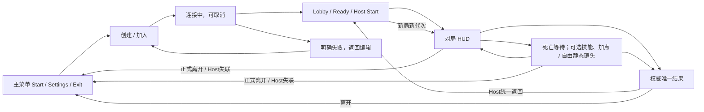

# Demo UI 与本地设置

**目标：v0.11.0 Demo · 职责：M11 · 引擎基线：Unreal 5.8.4**

本报告衔接 [App Spec](../APP_SPEC.md) 与[共享契约](SHARED_CONTRACTS.md) SC-01–09。
当前组件说明仍以 [视野与 UI](../systems/VISION_AND_UI.md)、
[移动与输入](../systems/MOVEMENT_INPUT_AND_CAMERA.md) 及实际源码为准。
本文是 Demo 界面与本地设置的行为合同。§2 列出当前实现组件，§3 起的行为、读取边界、
命令和设置已在这些组件中落地；组件级读取来源与检查入口以
[视野与 UI](../systems/VISION_AND_UI.md) 和源码为准，二者不一致时以代码为事实并修正文档。

## 1. 结论、已确认边界与就绪范围

沿现有 **native UMG/Slate、Controller、动态 Enhanced Input、owner 投影和唯一观测 Relay**
收敛一条界面流程，不引入第二套 UI 框架、成长状态、冷却表或视野系统。
一个 Root 管导航与输入层；HUD、属性/选择、设置和小地图各消费窄只读投影。
菜单、名单、本人 HUD、构筑选择卡、公开击杀、完整结果及设置均已按本文接线。

雾港换皮与规则术语改回通用词后的玩家可见中文术语与固定文案只引用 [App Spec §1.2](../APP_SPEC.md#12-玩家显示术语)，
角色/技能/状态名称只引用内容报告当前目录；下文 HP/MP、状态与拒绝码等技术标识不改。
玩家可见文案（标题、术语、按钮与提示）按 §1.2 表述：名称保留雾港的梗，规则、属性与状态用通用词；世界观术语在运行时只取自 `LDTerms` 术语表。

以下是**用户已确认规则**，不是本文的数值建议：

| 边界 | UI 必须表达的唯一行为 |
| --- | --- |
| 单一流程 | Start / Settings / Exit → Host 或 IP Join → Lobby / Ready / Host Start → 对局 → 唯一结果 → 同房间 Lobby / 新局或离开。真人含 Host，最多六人；零至三独立 AI 与真人共用六席，不自动补位。 |
| 战斗入口 | 开局近战单体普攻；属性、技能与构件可以改变普攻范围。Q/W/E 仅角色主动；没有装备系统，已持有构件显示在构件背包。 |
| 冷却 | 遗忘期间技能冷却继续计时，重新持有继承原结束时刻，UI 换图标/槽位不刷新冷却。 |
| 死亡选择 | 死亡等待可从当前主动候选选择并学到空槽、学图纸、加点与在构件库安装构件；校验当前 Life 和 `ExpectedLifePhase`。只更新持久构筑，不复活、不治疗尸体，阶段竞争拒绝也不丢 Offer。 |
| 保护与进攻 | 当前身份、请求新鲜性、消息形状及终局闸检查后，**发出进攻意图即解除保护**，之后目标、距离、蓝量或冷却失败也不恢复保护。纯本地 Armed、取消、移动、Stop 不解除。 |
| 资源上限 | 上限变化保持 HP/MP 原百分比，由 Combat 按 `FORMULA.ResourceMaxChange` 做一次最终投影；UI 不再次换算或额外回血，死亡不因此复活。 |
| 可见检查 | 可见对手显示名称、等级、血量/蓝量、获准状态，以及 Q/W/E 三块技能小卡（键位与技能名，空槽写“空槽”）；不显示其属性点、图纸、冷却、最终属性；施法那一刻在施法者身旁飘出该次技能的显示名，不含等级与冷却。观察 DTO 不携带私有修订或能力来源。 |
| 失视野与死亡镜头 | 失视野撤销目标并停止该追击订单，不转 LastSeen 移动、不保留单位标记。死亡可自由拖动镜头看静态地图与公共信息，无额外活体视野，不能跟随/观察隐藏玩家。 |
| 结果 | 终局显示所有参赛者名称、击杀、死亡、最终等级，标出唯一赢家，另有原因/本局用时；统计不判胜。对局中按住 Tab 另有局内排行榜（§3.2）。Host 主动结束可无赢家。 |
| 死亡与离局效果 | 留在局内的死亡取消未释放动作，已释放独立效果继续；正式离局/断线立即移除身体及未结束独立效果。关 UI 无权回滚已释放效果。 |

本模块需要产品选择的界面行为已收口。布局、错误映射和本地接口属于工程设计；
目录、公式和数值以 `CONTENT_AND_BALANCE.md` 为准，本文不批准数值。

## 2. 当前组件

| 组件 | 职责 |
| --- | --- |
| `ULDUIRoot`（`UI/LDUIRoot.*`） | 前端（主菜单/Start/连接/失败）、Lobby、局内菜单与确认、唯一主面板登记（`RegisterMainPanel/ShowMainPanel/ToggleMainPanel/CloseTopPanel`）、世界层（头顶标签与画面回馈）和文字缩放 |
| `ULDHUD`（`UI/LDHUD.*`） | 局内 HUD：旗杆喷漆/守护状态、左下小地图上方的事件播报（`LDHUD::FEventFeed`）、死亡/保护、目标卡、左下角小地图列（只有地图与对局用时）、底部带（本人身份、加点图标与属性视图切换、资源、Q/W/E 与 D）、右下角“构筑”按钮、结果；`NativePaint` 画射程圈、射程圈与方向预览；停靠构筑选择卡与工坊，处理死亡等待时工坊的自动打开与收起，工坊打开时收起底部带、小地图、事件播报与目标卡 |
| `ULDWorkshop`（`UI/LDWorkshop.*`） | 工坊：Choices 打开时的全屏或屏幕下方 46% 视图；阶段条、角色栏（五维加号经 `ULDStatBar::Allocate`）、容量条、规则板列头、构件库标题与用途标签筛选、待处理区与信息坞；把规则板与构件库的矩形交给 `ULDComponentStorage::SetWorkshop`、把待处理区交给 `ULDChoicesPanel::SetTrayInset`；读模型 `LDWorkshop::*`（`UI/LDWorkshopModel.h`），程序化形状 `LDUIShapes` |
| `LDHUD::*`（`UI/LDHUDModel.*`） | 纯格式化读模型：`ActionInput/Action -> FActionView`、`ObservedCard/ObservedUnit`、`Circle`、`TimelineBanner`、`RestReturnCountdown`、`TrainingResetText`、`ActiveCard`、`ActiveChoiceDetail`、`ComponentChoiceDetail`、`ChoiceTrayTiles`、`StatRow`、`BuildGate`、`GrowthPending`、`FChoicesFold`、`AbilityName`、`ContentText` 等；只读本人投影、公共状态与当前观察帧 |
| `ULDChoicesPanel` | 构筑选择卡（“构筑”按钮正上方一行一个待做决定：主动三选一、开局基础构件、精英二选一、有空槽时的待学图纸；卡上只有图标和名称，`Hovered` 把完整说明交给工坊的信息坞）、中央的选一个技能页与终局改装页（`GrowthStageBack` 回到工坊台，`GrowthFinalLock` 按住锁定），野外收起时的速选卡，以及靠近 NPC 时放在工坊对象上的休息服务（`GrowthRestNpc`、`GrowthRestRespec`、`GrowthRestForget<Q/W/E>`、`GrowthTrainerBlueprint<n>` 与 `GrowthLearn/GrowthReplace<n><Q/W/E>`、`GrowthRestFillGap`、`GrowthRestDismantle`，选择与确认行在信息坞位置）；加点与属性视图在 HUD 的 `ULDStatBar` 上；命令经 `SubmitBuild` 带所见版本提交，结果与拒绝经 `Notify` 进 HUD 提示行 |
| `ULDStatBar`（`UI/LDStatBar.*`） | HUD 底部带左块名称下方的五维属性图标与悬停时图标正上方的“+”：点一下立即发一点 `AllocatePoints`，在途时的连点在本地排队、等本人视图带上上一次的构筑版本后合并发送；读模型 `LDHUD::StatRow/StatPointsOf/BuildGate`；命令经同一 `SubmitBuild`，自持在途请求与回执 |
| `ULDComponentStorage`（`UI/LDComponentStorage.*`） | 构件库：`ULDHUD` 放在底部横条右侧的牌堆与悬停展开的图标网格和一排五列已装构件（本体在第一个 Q/W/E 格左边一格、Q/W/E、冲刺(D)），拖放、单击拿起再放下与右键快装/拆下、搬动与 B18 元素、C12 基础构件选择；工坊打开时同一套状态排成工坊的构件库分组与规则板列，并向工坊报告悬停或拿着的构件（`Focus`）；读模型 `LDHUD::ComponentStorage/ComponentDrops/FindDrop/DetachedWith` 与 `EStorageColumn`（`UI/LDHUDModel.h`）；命令经同一 `SubmitBuild`，自持在途请求与回执 |
| `ULDMinimap`（`UI/LDMinimap.*`） | 地面、阻挡、地点、当前覆盖与可见单位；三种朝向共用 `MakeView/ToFrame/ToWorld`；拖图/右键移动 |
| `ULDWorldLabels`、`ULDWorldFeedback` | 可见单位头顶条与本人头顶条；浮动数字、施法名、奖励、击败与升级回馈 |
| `ULDControlSettings`、`ULDControlsPanel` | 本地设置（schema 22）的加载/保存/迁移与设置页（画面、音频、操作、镜头、界面五个分类页签，§3.3、§8） |
| `ALDWorldViewRelay`（`Vision/`） | 唯一观察帧读取（`ReadObservedFrame/ReadUnit/ReadPresentedLocation`）、呈现时钟与代理、迷雾、可淡化道具 |
| `LDWidgets`（`UI/LDWidgets.*`） | native 文本/按钮/面板构造（文字按字体角色取字体，按钮带悬停/按下缩放与界面音效；`HoldButton` 是按住确认按钮）、`ULDPanel` 焦点与命中区域、子确认接口 |
| `LDHUDStyle`、`LDUIFonts`、`LDTween`（`UI/`） | 界面颜色、字号、圆角与动效时长的唯一来源；标题/正文/强调/数字四种字体角色；补间（缓出、缓入、回弹三种曲线） |

`FLDOwnerState` 是本人连接复制的投影，不是 UI 存档；Listen Host 的 Widget 同样只读本人投影，
不直接调用服务器域的 authority getter。名单只来自会话域发布的 `DemoLobby`。
UI 树由 native `RebuildWidget` 构建，`WBP_UIRoot` 以 `ULDUIRoot` 为父类；不使用 CommonUI/MVVM。

## 3. 精简屏幕、布局与状态

### 3.1 单一导航



Settings 是当前页面的主面板；属性、Choices 也各占同一主面板位置。
DEV 测试会话另有第三个登记主面板“测试”（`ELDUIMainPanel::DevTest`，`ULDDevTestPanel`），只在 `FLDLobbyView::DevTestSession`
为真的房间由 HUD 底部本人身份块里的“测试”按钮打开，顶部横幅与房间页同时标出“测试模式”；它与其他主面板同样一次只开一个，
文本输入期间世界输入照常被捕获。
Choices 沿用唯一主面板与输入捕获协议，由右下角“构筑”按钮切换（按钮随时可点，有可选内容时高亮）：打开 Choices 就是打开工坊（`ULDWorkshop`），选择卡是工坊待处理区里的一叠卡，离底部最近的是当前主动候选与“不选”卡，左侧显示机会序号/已获得机会数并用框围住同组；排队机会逐组处理，往上是开局基础构件、精英二选一与有空槽时的待学图纸。卡上只有图标和名称，悬停时工坊的信息坞显示完整规则、关键词，以及现在拿不了的原因或点击的去向（如“学到 Q”“存为图纸：Q/W/E 已满”“已持有”），点一下即提交；构件卡合计超过 6 张时构件各行改为只有图标的网格（`LDHUD::ChoiceTrayTiles`）。对局不暂停；收起或按 Back 只隐藏，不丢候选、图纸或已提交请求。
工坊在休息的配装、派奖与返回步骤和本人在休息外的死亡等待时全屏：世界压暗并模糊（画质的后期处理为最低档时只压暗），左上阶段条、左侧角色栏、中间容量条与规则板、右侧构件库与待处理区、下方信息坞，右上是“重置训练”“准备完毕”和收起按钮（`WorkshopClose`）；其余时候（野外、PK 各步骤）只占屏幕下方 46%，只有信息坞、规则板、构件库与待处理区。工坊打开时底部战斗带、小地图、事件播报与目标卡收起，技能键照常；提示条在全屏工坊的顶部中央、底部工坊的上沿之上。
NPC 服务没有单独的窗口：仅在配装或派奖窗口、本人处于现有服务距离内且工坊打开时，服务出现在工坊里它作用的对象上（见 App Spec §7 构筑），服务上下文按附近 NPC 唯一选择，阶段条写出 NPC 名称，离开后服务连同未确认的选择一起收回。训练师的替换与遗忘只在训练师旁出现。服务操作仍走既有服务器事务与回执。
服务按钮下方显示不可用原因；事务结果和本地拒绝用 HUD 提示行告知。
公开 PK 的阵营、缩圈与观众操作收在右侧卡片（不滚动，行多时整张卡按比例缩小），中央只保留阶段计时；进入 PK 后隐藏配装期的准备与重置训练按钮。观众或派奖时主动打开工坊，右侧 PK 卡暂时让位并取消未提交的投掷瞄准，关窗后恢复，不与工作区叠放；已提交事务仍按原回执处理。
本人在休息外进入死亡等待时，工坊自动打开一次，复活时自动收起（有请求在途时等它答复）；休息时不自动打开，有可做的事时只点亮“构筑”按钮；玩家自己打开的工坊在离开全屏时刻后保留并改为下方 46%；PK 中不自动打开。野外的新候选只点亮并脉冲“构筑”按钮，新增点数只更新头像左下角的黄色点数圈，都不自动弹窗。构筑随时可做：交战中、PK 中与死亡等待中都可以手动打开并完成构筑；玩家自己打开的工坊不因交战或 PK 收起；脱战不自动重开，本地编辑和请求仍保留。野外缺失有效本人身体投影或权威时钟时不把未知状态伪造为交战。野外顶部压缩重复提示，保留时间线与必要旗杆状态。左下小地图上方除对局用时外没有文字行；短时事件播报照常。
加点不进面板：HUD 左块名称下方每一维一个属性图标，悬停图标时其正上方出现“+”，点一下即提交一点，没有暂存和确认。
开局构件与精英奖励候选都是选择卡，不滚动。悬停候选时弹层展示该候选的规则；仅查看不消耗奖励。开局基础构件的弹层最后一行写点击去向：普通基础构件为“装到本体”（一次提交领取并装到本体），B18 为“放进构件库”。

构件库与面板的普通读模型刷新复用现有行及 Slate 身份；只有条目、安装分组或排序变化时才调整列表，避免按下/释放或拖动跨刷新时丢鼠标捕获或焦点。PK淘汰者即使已回休息室获得存活身体，也仍按观众处理，不因保留在公开名单中反复折叠只读工作区。

组队 PK 准备与交战期间，观众及已淘汰选手看到的场内目标只标队伍编号；世界标签、目标卡与小地图共用现有观战判断，不沿淘汰者的旧阵营继续标“队友／敌方”。存活选手保留敌我关系，野外自由混战不使用队伍标签。
同一时刻只开一个主面板，允许其一个子确认；切换撤回尚未确认的服务操作与选择器，但保留暂存属性点，
不回滚或重复已提交业务。HUD、死亡提示、旗杆状态/事件播报为独立覆盖，不把它们当可 Esc 删除的页面。
终局替代 gameplay UI；没有世界背包、队伍、任务/存档/图鉴或多角色选择。

### 3.2 页面与恢复行为

| 页面/区域 | 必须显示与可执行操作 | busy / 失效 / 返回 |
| --- | --- | --- |
| 主菜单 | 全屏标题背景图 `T_TitleBackground`（按比例铺满、居中裁切，不拉伸；前端地图本身是空关卡，不渲染 3D 场景）；主菜单没有面板，标题背景图缓慢推近再拉回：对外标题“谁是雾港最强淫人王”作为标志放在画面上方（“淫人王”三字放大，操作黄字加事件粉错位影）、副标题（在“ · ”处分两行）在其下，开始（唯一的主按钮）与其下并排的设置、退出压在画面底部，产品版本在左下角、常驻小字“雾港黑话：淫 = 把人揍趴下，跟色情没关系”在右下角（随前端页显示，打开设置时随页隐藏）；开始页仍是居中面板，不显示标志；发布构建（`[Lockdown.Build] bReleaseBuild=True`，只在每日打包的版本提交里）显示“版本 X.Y.Z (<短提交>)”（版本同 `DefaultGame.ini` 的 ProjectVersion），其他构建显示“版本 X.Y.Z-dev (<短提交>)”；一基础角色，不展示职业选择 | Exit 明确确认；Settings 返回原菜单。版本读失败报缺配置，不显示硬编码“正确版本”。 |
| Start | 创建/加入同面板；本人名称；Host 监听端口、Join IP 与端口；返回 | 本地格式校验不代替准入。AI 数仅在 Lobby 修改，不保存第二份建房配置。地址不写跨局战力存档。 |
| Connecting | 当前端点、连接状态、取消；输入框仍可回看 | 同 attempt 禁双击新建；取消使该 attempt 失效。迟到成功清理对应旧连接，迟到失败不能把新世界退出。 |
| 失败 | 名称/端口/地址格式、不可达/超时、RoomFull、MatchAlreadyStarted、产品/协议/内容不兼容、旅行/加载失败分别解释 | 保留本人编辑内容，允许修改后显式重试；不自动重连、不回落旧 profile、不显示空成功 Lobby。 |
| Lobby | 全屏房间背景图 `T_LobbyBackground`（同样铺满裁切，只在 Lobby 阶段显示，盖住身后的 Demo 世界）；名单是六个席位卡：所有已连接真人与实际 AI 的名称、真人/AI、房主、准备（已准备是一枚斜盖的章），空位是虚线占位，本人席位描操作黄边；Host 调整 AI 数、全部真人 Ready 后 Start；本人 Ready、离开 | 所有人包括 Host 使用 Ready；AI 无真人准备按钮。结构改变按 RosterRevision 清 Ready；Ready 本身只改 PublicRevision。Start 等权威结果，不能本地切地图。 |
| 自身 HUD | 底部带左块：头像（右下角等级角标，左下角黄色圆圈写未分配点数，为 0 时不显示）、名称、“属性 [P]”按钮（DEV 测试房间另有“测试”）、五维属性图标（角上写已分配点数，悬停时图标正上方出现“+”）；临时状态方格在小地图与底部带之间、贴着底部带左缘，每行 6 个，第一行与底部带底边齐平，更多的行向上叠，没有上限；中块（位于屏幕中央、本人正下方）：上排 Q/W/E、D 冲刺（单独一组，显示冷却与定身受控），其下 HP/MaxHP、MP/MaxMP、流量细条（悬停显示“等级 · 流量”数字）；
整条底部带按 1080p 参考尺寸的 87.5% 绘制，技能格为 84 单位；每个技能格上方的小点表示这一列装了几件、各是什么类型；Q/W/E 三格之间可以拖放互换，
只改本机的显示与热键路由（技能热键跟着技能走），像改键一样不发给服务器，每局开始恢复默认顺序；底部带没有右块，停止只用 S 键；左下角小地图上方除对局用时外不显示文字；HUD 没有单独的设置按钮，设置从 Back 菜单进入；本人头顶另有名字、等级角标与生命/护盾/法力条（不画技能就绪点，技能状态只看底部动作栏） | Unknown/同步中不填 0；满级显示 MAX。选中别人不改变自身热键所有者。平常的“存活”不占行，保护、同步中与寄了才在名字下显示。 |
| 动作栏冷却与限制 | 冷却中整格遮罩按剩余比例自上而下收起，中央显示剩余秒数（10 s 以上取整秒，以下保留一位并向上取整，未到不显示 0）；冷却结束且确实可用时闪一下；格面只有热键字母、技能图标（真图标到位前为按类别着色的圆角方块加名称首字）与法力消耗数字，不写名称与状态文字：就绪、准备态、冷却、法力不足（图标转蓝）、受控、不可用、空槽由外圈与图标颜色区分，悬停格子时在其正上方弹出与成长面板卡片同一画法的说明层（固定宽 300u，不挡点击）：名称、“类别 [热键] · 状态”、按本人当前等级与属性填数的规则句、目标方式及法力与冷却（D 冲刺写冲刺距离）；本人回执失败时被按下的格子外圈变红约 2 s，原因（如“目标不可用”）只在提示条上 | 限制只改变颜色，显式激活仍发送由服务器裁决。准备态与攻击移动不再显示“准备中：左键确认目标…”说明行，由格子外圈与世界里的射程/目标预览表示。 |
| 时间线横幅 | 旗杆行上方：休息中“休息 R{n} · <步骤> · 剩 X 秒”，配装步骤下一行写 PK 报名窗口（“PK 报名 X 秒后开放”/“PK 报名中 · 剩 X 秒”）、已报名人数与“你已报名/你没报名”，锁定后写“PK 跳过（报名不足 2 人）”或“PK N 人参赛”；配装步骤的细节行同时写“站进公共报名圈，截止时在圈里才参赛”，每人看见同一位置的报名圈（开放前暗、开放中亮、已报名时金色），没有报名按钮（站圈报名）；整个休息期间“重置训练”“准备完毕”和附近 NPC 交互按钮固定在横幅下方，全屏工坊打开时移到工坊右上角；目标卡与头顶标签把假人写作“训练假人”；野外只显示“野外 n/3 · 下次休息 m:ss”时间线，重复的发育提示和下一步隐藏，旗杆开放阶段显示必要旗杆状态。返回步骤在屏幕中央大字整秒倒数，每段野外开始时显示“开淫！” | 只读公开时间线与同局权威时刻；剩余时间向上取整、不提前显示 0；野外剩余按野外进度 T（休息与 PK 期间冻结）。报名由服务器按已提交脚点是否在报名圈内判定，客户端不发报名请求。 |
| PK 面板与观战 | 休息按钮下方，从公布赛制到派奖：标题“第 n 场 PK · 单挑/混战/2v2/3v3 · N 人”；每方一行选手名（开打后出局“（出局）”、离开本局“（离场）”、押注人数、“你在这方”/“你押了这方”）；PK 准备与 PK 中的整秒倒数和安全圈半径（含下一圈）；押注步骤给有竞猜资格的观众每方一个“押 X、Y”按钮，本人当前押注高亮，可改到步骤结束；PK 中给这些观众“投掷”按钮：按下后进入瞄准，左键点竞技场地面投出、右键或 Esc 取消，冷却时显示“投掷冷却 X 秒”；结算与派奖显示胜方/平局/本场无效与每人奖励行（参与/胜者/竞猜），本人一行高亮；押注与投掷的结果显示在面板里并进提示条。世界里画出当前安全圈、提前显示的下一圈和每次投掷的落点预警圈。观众与出局者在 PK 准备和 PK 中镜头对准竞技场中心（最远缩放），出局者只读 | 只读公开 `PublicMatch.PK`、时间线、房间名单与同局权威时刻；安全圈半径用本机已批准内容参数按同一纯规则计算，不复制成第二套状态。押注与投掷只发本人意图，由服务器裁决；每个拒绝都写明原因，不读作成功。瞄准期间那次点击不会变成移动、攻击或查看；面板被菜单遮住时取消瞄准。镜头只换中心，场内单位与视野由服务器授权。 |
| 构筑按钮 | 屏幕右下角常驻按钮，只写“构筑”，随时可点，打开或收起工坊；有主动候选、有空槽可学的图纸、开局构件自选或精英二选一时高亮（新候选到来时脉冲几秒，`LDHUD::GrowthPending`；未分配点数在属性图标与头像黄圈，已持有构件在构件库，都不点亮它）。工坊打开时按钮随战斗带收起。| 只占按钮自身矩形的点击。 |
| 构件库 | 底部 HUD 横条右侧一叠牌堆，写件数，从未悬停查看且从未安装的另标“新 n”；只放构件。悬停向上展开成图标网格（每行 4 个，最新的在最后、离牌堆最近；卡面只有图标，从未悬停查看且从未安装的角上标“新”，文字只在悬停弹层里，网格不写标题、件数或操作说明，库空时不展开），同时升起一排五列已装构件：本体（第一个 Q/W/E 格左边一格：基础构件与自身改装件）、Q/W/E（在当前显示该服务器槽位的技能格上方）与冲刺(D)；只有本体列下写“本体”，技能列与冲刺列不写键位字母（键位由玩家设置决定）；装在构件上的件嵌在宿主下面。悬停任一图标显示完整说明；悬停候选或库存构件即在本局本机标记为已读。按住 C 临时展开已装构筑与加点图标，松开恢复先前视图。拖库存卡到合法列或宿主上安装（合法落点绿边、其余变暗，显示“放这里”），拖已装件回牌堆或列表拆下（提示条写出一起退下的件），拖到别处即搬动；B18 放到技能列先选火/水/电，C12 先选要重复的已安装基础构件（规则板上可选的基础构件亮黄，点一下即选），“取消”不发送。工坊打开时同一套构件排成工坊的构件库与规则板（见 App Spec §7 构件库）：库按基础规则、技能改装、联动规则分组并写件数，用途标签只改明暗，图标取 68/56/46 中放得下的最大一档；规则板五列有列头（技能图标、键位、名称、法力、冷却）与每列末尾的虚线空位；悬停库中构件即亮起能装的列、压暗其余；拖放之外还可单击拿起再单击放下，只有一个合法位置时右键直接安装，右键已装构件拆回构件库。 | 交战中、死亡等待与 PK 中都可用，对局已结束时由服务器拒绝并写明原因；Back（Esc）先关闭选择或放弃拖动。只发本人 `InstallComponent`/`UninstallComponent`（搬动为先卸后装），回执前不改本地构筑。 |
| 休息服务 | 只有休息阶段且靠近技能商人、构件工匠或训练师时，打开的工坊在阶段条上写出 NPC 名称，并把对应服务放在它作用的对象上：商人的抽取卡在待处理区上方；工匠的补缺与拆解在构件库标题旁，补缺目标与补料在信息坞位置，拆解时信息坞是“材料 + 材料 → 随机普通构件”算式，在构件库或规则板上直接点两件不同的普通构件填入；训练师的“洗点 +n”在角色栏底部，右键已学技能的列头遗忘，所选图纸的“学到/替换”挂在对应技能图标下沿。离开 150 cm 服务距离即收回。费用来自内容参数；替换、遗忘、补缺和拆解先说明代价并要求确认（替换、遗忘、拆解与洗点按住确认按钮约 0.6 秒才提交，提前松开取消；补缺单击确认），回执说明实际结果。 | 只在休息的配装与派奖步骤可用；点数、候选、材料、距离和阶段由服务器重验，失败显示原因。关闭面板撤销未提交的确认，不撤回在途命令。 |
| 精英营地二选一与野外奖励 | 有待选的精英营地奖励时，每个奖励在选择卡里占一行（按先后，只剩一个已知材料时就只有一张卡）；点卡即拿该构件（进构件库），已持有项置灰并在弹层写“已持有”，选项都已持有时同一行多一张“N 点”卡，可改领 `EmptyComponentPoolPoints` 点。待选奖励点亮构筑按钮，但不自动展开。天降外卖、画饼老板和标记营地奖励到账时提示本人。 | 二选一与选主动同一准入（对局进行中随时，含 PK 等锁定步骤，存活或阵亡）。提示只读本人成长视图的 `FieldRewards`，每局第一份视图只建基线，重连不补报旧奖励。 |
| 射程与目标预览 | 平时本人脚下一圈淡白普攻射程（随射程成长变化）；武装单位技能或攻击移动时射程圈变强调色，指针下有可见单位时射程圈按脚点距离在射程内变绿、否则变红（单位身上不画框）；方向技能画朝光标、长度为射程的指示线 | 只是预览，命中由服务器裁决；目标只取当前授权帧中与点击相同的选取。 |
| 道具淡化 | 带 `LDFadeable` 标签的道具（目前只有旗杆）挡在镜头与本人或当前呈现的可见单位之间、或穿过站在其中/紧贴它的身体时淡化到完全消失，淡化期间不投影；只影响显示 | 只按已授权呈现的单位判断，不因隐藏单位而淡化。 |
| 画面回馈 | 可见施法者施法那一刻在其身旁飘出技能名（如“扒裤子！”，不含等级/冷却，CB-P10 例外）；可见单位受到伤害/治疗、本人受伤/治疗/护盾变化的浮动数字；本人获得奖励时角色旁的“+N 流量”；本人淫了对手时的“淫了 某某！”；升级时“涨粉了！LvN”横幅（第二行写这次得到的属性点与选技能机会，如“获得 3 属性点 · 一次选技能机会”）与本人脚下光环、光柱 | 只来自本人投影、公开击杀通知与当前观察帧的白名单；首样本、换局、换命只重设基线，不补发；他人数字等该样本的延迟画面呈现后再出现。 |
| 可见目标卡 | 名称/等级、适用的精确血蓝、获准状态；选中单位只以脚下不转动的浅色密点线圈标出，不画 HUD 方框 | 只在当前观察授权有效时存在；失视野、stale、换 epoch 清全部，不留灰色历史卡/点。NPC 不适用字段与玩家空槽区分。 |
| 旗杆喷漆与守护 | `LDHUD::Circle(Public, SprayerName, OwnerName, bClock, NowMs, SprayMs, GuardMs)`：发育期“猥琐发育中，别浪 · 旗杆在最后一次休息（R3）后开放”（开放时刻在最终野外开始时才排定，此前不打印倒计时）；开放后旗杆无主且无人时“旗杆空着，没人敢上？”；独自喷漆“X 正在旗杆上喷漆 · 剩 <秒>s”；争夺时有暂停的喷漆者显示“旗杆底下打成一锅粥 · X 的喷漆进度先存着 <已存>/<所需> s”（精确到 0.1 s），无持有者时“旗杆底下打成一锅粥 · 谁也没存下进度”；有涂鸦时追加（或单独显示）“旗杆上是 X 的涂鸦 · 再守 <秒>s”，主人以外有人在喷漆区内（Solo 或 Contested）时为“旗杆上是 X 的涂鸦 · 有人进圈，守护冻结（再守 <秒>s）”，喷漆区内没人（Empty，主人不在圈内）时为“旗杆上是 X 的涂鸦 · 守擂者不在圈内，守护暂停（再守 <秒>s）”，两部分以“ · ”连接。进度条：独自喷漆显示喷漆进度，争夺显示暂存的喷漆进度，其余显示守护进度 | 公开状态不授予观察句柄/坐标；到零等待权威状态，不自动宣布开放、喷上涂鸦或胜利。 |
| 事件播报 | 屏幕左下、紧贴小地图列上方的列表，最新一条在最下（贴着小地图）、旧的向上推，每条显示 5 s（最后 0.5 s 淡出），同时最多 6 条，再多时最旧的一条提前离开；目标卡固定在播报预留区下方。播报内容：击杀（去重事件中的击杀者或明确无参赛者击杀者、被击杀参赛者、助攻者，“X 把 Y 淫了（助攻：A、B）”，可理解死因）、旗杆开放、天降外卖落地与被抢（本人抢到时“你抢到了天降外卖！经验和一份构筑奖励到手”，其他人只知道被抢走）与无人领取消失、画饼老板出现、被击败（击败者）与无人打倒退场、营地标记公开（高档/精英各一行）、被领走（本人领到时改写为“你领到了…”）与失效、新的上热搜对象、旗杆上新喷上的涂鸦、同一主人被冻结的守护归零（“守擂者离圈，守护清零”）；本人相关的行写“你”并高亮 | 只读公开对局视图、公开击杀通知、公开名单与本人的外卖领取序号和野外奖励记录；开局或中途进入的第一帧只记录现状，不补播已发生的事；已过 6 s 的击杀通知不补播。普通打野不全场广播；不由 Actor 消失生成击杀，不附隐藏坐标、构筑或伤害日志。旗杆下方的外卖/老板/营地标记常驻行只保留倒计时（外卖落地后到消失、老板巡逻到离场、标记到段末）、落地与巡逻，被抢、被击败、退场与标记被领走只进播报。 |
| 排行榜 Tab | 按住“排行榜”键（默认 Tab，可改绑）时屏幕中央显示本局每名参赛者的名字与击杀/死亡/助攻，击杀多的在前、相同时死亡少的在前，再相同按名单顺序；本人行写“（你）”并高亮，AI 写“（AI）”，已不在房间名单里的写“（已离开）”；松开即收起，不接收点击 | 只读 `KillFeed.Scores`（服务器按名单顺序发布、仅随死亡变化）与房间名单；别的对局代次的数据不显示，没有数据时显示“统计同步中…”而不是零表。文字编辑或子确认占用输入时不显示。 |
| 属性视图（“属性”按钮 / P） | 头像下方的加点图标换成属性视图，再按换回：`LDHUD::AttributeViewOrder` 的九项（攻击、法强、护甲、魔抗、攻速、移速、攻击距离、暴击、急速；生命/法力上限与回复已在资源条上，不重复），每项一个图标（暂无图标纹理时为一字图标）和最终值，三项一行、与加点行同高；攻速显示为每分钟普攻次数（整数），移速不带单位，技能急速显示为冷却缩减百分比 1−100/(100+H)；悬停弹出名称、最终值（攻速带“次/分钟”，急速另列急速点数）与基础、等级、属性点、百分比、临时（DEV 测试房间另有测试层）各项来源。没有单独的属性面板 | 原生投影一次计算，UI 只格式化；切换不改焦点，也不取消 Armed。 |
| 构筑选择卡 | 工坊待处理区里的卡片行，每行一个待做决定；卡上只有图标与名称，完整说明在信息坞；当前技能槽看底部动作栏，加点在 HUD 属性图标上，已持有构件的安装与搬动在构件库，Q/W/E 已满时的替换在训练师处，NPC 服务放在工坊对象上。全屏工坊有主动候选或终局改装时，中央换成大卡页；野外工坊收起时，待处理的卡作为速选卡叠在按钮上方，交战窗口内只剩图标。 | 不自动选择或学习；悬停只查看，点卡才提交。服务器回执决定结果；收起不丢候选、图纸或在途请求。 |
| 待学图纸 | 图纸是选中的单个主动技能，悬停查看详情，学到空 Q/W/E 槽后才能用；满槽时在休息的训练师处确认替换。 | 对局进行中随时可以学到空槽（交战中、死亡等待与 PK 中也可以）。替换和遗忘只在休息服务中进行。 |
| 构筑蓝图 | 大厅和结果页可查看只读对局记录：Q/W/E、属性、构件图标与独立详情，历史数据默认折叠。 | 蓝图记录不授予物品或技能；记录未保存的历史属性用公式说明，不冒充实际数值。文件与隐私边界见[视野与 UI](../systems/VISION_AND_UI.md#构筑蓝图文件与查看)。 |
| 加点 | HUD 左块五维属性图标（按设计顺序：体格、脸皮、力道、脑力、身手），角上写已分配点数，有未落地的点时写“K+S”；悬停弹层写名称、“已加 K 点 · 未分配点数 N”，再逐项写该属性影响的属性当前值与每点收益，如“攻击力 52.5（每点 +2.5）”，不能加点时写原因；有未分配点数时悬停图标正上方出现“+”（不能加点时置灰）；头像左下角黄色圆圈写未分配点数 | 点“+”立即发送一点 AllocatePoints（按五维设计顺序每项一个点数），没有暂存、没有确认；上一次还在途或尚未进入本人视图时，再点的点数在本地排队，之后合并成一次发送；被拒时丢弃排队的点并在提示条写原因。已分配的点不能撤回（洗点只在休息时）。时机：对局进行中随时（交战中、死亡等待与 PK 中也可以）。 |
| 死亡/保护 | 死因（取本人这一命被确认存活之后的公开击杀通知，未到前不显示）、“你寄了 · 回出租屋 emo <秒>”复活等待、一行小字“等级和构筑都还在，别慌”与待选入口；复活保护图标/期限与“一出手就没了，失手也没了” | 死亡可开属性/Choices/Settings、自由静态镜头；不得战斗。复活由 Life 决定，接回本人新身体，按已保存偏好恢复镜头。 |
| 局内 Settings | 画面、音频、操作、镜头、界面五个分类页签；各页恢复本页默认，画面页应用/撤销；继续、离开在局内菜单 | 常驻“对局不会暂停”。离开说明不能重连；Host 离开说明整个房间结束。没有单独的结束本局入口。 |
| Result | 全员名称/Kills/Deaths/Assists/FinalLevel（列名：淫了几个 · 寄了几次 · 助攻 · 最终等级），赢家标记、原因、用时；Host 回 Lobby；每人可离开 | 按冻结 roster 顺序，不按击杀产生排名/第二胜者。HostEnd 无赢家。Host 失联且未收合法结果只显示会话中断，不编造全零表。 |

### 3.3 原创线框与可读性

下图是功能布局，不是引擎截图。`名称/数值/时间` 均绑定实际投影，不是运行默认值。
以 1920×1080 为布局样本，另验 1280×720、窗口调整、Windows DPI 和文字缩放；
这些是验证样本，不是宣称已经达到的最低配置。参考样本正文 24px、交互行高至少 44px、
相邻控件 8px 间隔；由统一 DPI/文字规则缩放，窄屏重排或按比例缩小（主菜单、Lobby、局内菜单、设置菜单、构筑蓝图查看与 DEV 测试面板可滚动），不靠截断确认按钮适配。

```text
主菜单                       Start：创建 / 加入
┌────────────────────┐       ┌────────────────────────────┐
│      LOCKDOWN      │       │ [创建房间] [通过 IP 加入]  │
│      [Start]       │       │ 名称 [本人名称           ] │
│      [Settings]    │       │ IP   [加入地址           ] │
│      [Exit]        │       │ 端口 [端口]  [创建 / 连接] │
│       <产品版本>   │       │ <错误或连接中> [取消/返回] │
└────────────────────┘       └────────────────────────────┘

Lobby
┌────────────────────────────────────────────────────────┐
│ 名称                 类型        Host       准备       │
│ <本人/其他实际成员>  真人/AI      <标识>     <状态>     │
│ AI 数 [0..3，仅 Host]    <不能开始的具体原因>            │
│ [本人准备/取消准备] [Host 开始]                 [离开]  │
└────────────────────────────────────────────────────────┘
```

```text
对局 HUD（世界中央保持可见；小地图固定左下、事件播报在其正上方，目标卡左上，构筑按钮在右下角、选择卡叠在它正上方；统一圆角面板与扁平按钮）
┌────────────────────────────────────────────────────────────────┐
│ [当前可见目标卡]           [旗杆 / 喷漆者 / 涂鸦主人 / 进度]         │
│                                                                │
│ 名称/等级/血蓝/状态/技能                                        │
│   世界 / 当前合法范围与方向预览；可见单位头顶：状态 / 名字 / 等级+血条 │
│   本人头顶：名字 / 等级+生命(+护盾) / 法力；浮动数字与升级横幅                          │
│                                                                │
│ [事件播报，最新在下，5 s]                        [图纸卡…]      │
│        [提示条（屏幕居中，固定换行宽度，半透明底）] [精英二选一卡] │
│                                                  [开局构件卡…]  │
│ [对局用时]   [头像+点数/等级][名称][属性 P] [Q][W][E] [D] [主动卡×3]│
│                    [五维属性图标]                               │
│ [小地图]     [状态]        [生命·护盾] [法力] [流量细条]  [构筑] │
│ （左下角）                                         （右下角）   │
└────────────────────────────────────────────────────────────────┘
```

```text
全屏工坊（1080p 参考；下图只示结构，不滚动）
┌[阶段条：环形倒计时 · 休息 Rn · 步骤 · 六个步骤点]────────[重置训练][准备完毕][Esc]┐
│┌角色栏──────┐┌工坊容量 ▮▮▮▮▮▯▯┆┆  x / y      Lv n 解锁下一格┐┌构件库 n────────┐│
││头像 名称   ││[本体][ Q ][ W ][ E ][ D ] ← 列头：图标/键位/名称  ││[弹道][法术]…筛选 ││
││n 点可分配  ││  构件  构件  构件  构件  构件   法力/冷却          ││基础规则 n        ││
││体格 ▮▮▯ 6 +││    嵌套件      ┆+┆   ┆+┆        ← 末尾虚线空位   ││ ◻ ◻ ◻ ◻ ◻         ││
││… 五维      ││                                                   ││技能改装 n ⬡ ⬡     ││
││派生属性两列││                                                   ││联动规则 n ○ ○     ││
││元素反应 ×3 │└───────────────────────────────────────────────────┘├待处理 n─────────┤│
││            │┌信息坞：[大图标/类型/标签] [名称/规则/触发] [装在/联动/注意]┐│图纸 · 二选一 · 主动│
│└────────────┘└───────────────────────────────────────────────────┘└─────────────────┘│
└──────────────────────────────────────────────────────────────────────────────────────┘
底部工坊（野外、PK）：[信息坞][容量条+规则板][构件库/待处理]，高度不超过屏幕下方 46%。
选择卡在待处理区，点一下即提交，服务器裁决；悬停任一卡、构件、属性或列头，信息坞显示它。
图标按 IconId 显示，纹理缺失时显示名称首字并记录 `LD_UI_ICON_MISSING`。
Q/W/E 已满时新主动保留为图纸；休息时靠近训练师可确认替换或遗忘。
```

```text
Settings（固定阅读宽度、居中；身后的世界加暗但继续运行）
┌──────────────────────────────────────────────────────────────┐
│ 设置                                    对局不会暂停（仅局内）│
│ [画面●] [音频] [操作] [镜头] [界面]   ← 选中页：底色+强调下划线│
│──────────────────────────────────────────────────────────────│
│ 名称                                  │ 控件（固定右栏）       │
│ 一行说明或当前状态                    │ [◯━ 开] [‹ 高 ›] [A]   │
│ …本页各行，页内滚动，各页保留自己的滚动位置…                  │
│ ┌ 画面页：未应用：垂直同步 关 → 开   [重试保存][撤销更改][应用]┐│
│ ┌ 确认卡（恢复本页默认 / 恢复设置文件 / 未应用的画面更改）    ┐│
│──────────────────────────────────────────────────────────────│
│ [恢复本页默认] <结果/提示>   [立即保存][恢复设置文件][返回（Esc）]│
└──────────────────────────────────────────────────────────────┘
```

设置页的分类、控件与交互（均在 `ULDControlsPanel`，沿用 `LDWidgets`/`LDHUDStyle` 原生样式，正式换皮归 #93）：

| 分类 | 行（控件） | 生效 |
| --- | --- | --- |
| 画面 | 垂直同步（开关）、画质（‹ 低/中/高/极高/电影级 ›，自定义组合显示“自定义”） | 垂直同步行说明写明帧率上限为刷新率、显卡吃紧时会掉帧并增加延迟；画质行说明随草稿档位写出该档的渲染比例（引擎预设 50/71/87/100/100%）与主要效果，引擎默认组合（某档效果 + 渲染比例 0，按显示器分辨率自动）说明为“默认：X档效果”。显示草稿：改动后该行说明写“已更改，尚未应用（当前生效：…）”并附草稿档位说明，页签带“●”，底部应用栏列出“未应用：项 旧 → 新”，可“应用”或“撤销更改”；改回生效值即无草稿 |
| 音频 | 主音量（滑条 + 百分比）；音乐音量（滑条 + 百分比，默认 60%） | 立即应用，延迟保存；主音量松手后试听一次，音乐音量直接听正在播放的音乐 |
| 操作 | 快速施法（开关）；施法后自动攻击（开关，默认开启）；按键表每个动作一行，右侧按键框 | 立即应用并保存 |
| 镜头 | 镜头距离（当前值 + “采用推荐镜头”）、边缘平移、开局镜头跟随（开关）、镜头平移速度（‹ cm/s ›，每次 300） | 立即应用并保存 |
| 界面 | 战斗特效（标准/降低）、自身受击镜头震动（开关，默认开启）、文字大小（100% / 125%）、小地图朝向（三选一）、网络诊断、FPS 显示（开关） | 立即应用并保存；降低特效只减弱临时冲击闪光、命中火花和施法光效，不影响角色动作、状态标记或战斗结果 |

- 每行左侧是名称与一行说明，右侧控件从同一竖线开始；当前值始终显示在控件上，开关同时写“开/关”，
  选中项用琥珀底与加粗描边，不只靠颜色。到头的 ‹ › 置灰，不循环。
- 按键改绑在行内：点按键框后该框显示“按下新键…”，该行说明提示 Esc 取消；已被占用或不允许的键在该行说明原因并继续等待；
  成功后写“已改为 X。”，Esc 只结束捕获（“按键未更改。”）。捕获中的行自动滚入视野。Esc 保留给返回，不能改绑。
  捕获中点分类页签不算新按键：捕获结束、按键不变并切到该页；点其他位置的鼠标键才作为新绑定。
- 页签切换保留各页滚动位置与显示草稿；切换页签等同对打开的确认卡选择“保持不变”，并结束按键捕获。
- 键盘：Tab/Shift+Tab 依次经过页签、当前页各控件、应用栏、确认卡与底栏，隐藏页的控件不进入焦点顺序；
  Enter/Space 激活焦点按钮。确认卡出现时焦点落在安全选项（取消 / 保持文件不变；未应用画面时为“应用并返回”）。
- 底栏左侧“恢复本页默认”，中间是最近一次结果或本页提示（问题用警示色保留到下一次操作）；
  “立即保存”只在已应用值尚未写盘且没有自动保存在途时出现，“恢复设置文件”只在设置文件需要恢复时出现；
  两者随本地设置状态即时刷新，打开设置前留下的延迟保存（镜头距离、跟随）在设置打开期间失败时也立即显示“立即保存”与失败原因。

```text
Result
┌──────────────────────────────────────────────────────────────┐
│ 对局结束：<原因>                         本局用时 <服务器值> │
│ 名称                  击杀         死亡       最终等级       │
│ <所有本局参赛者>       <值>         <值>       <值> [赢家?]  │
│ [Host带房间返回Lobby]                     [离开回主菜单]     │
└──────────────────────────────────────────────────────────────┘
```

死亡横幅放在旗杆提示下方，复活倒计时与小字“等级和构筑都还在，别慌”分开；在休息外进入死亡等待时自动打开全屏工坊，阶段条换成“你寄了”与复活倒计时（死亡横幅随之收起），复活时自动打开的工坊自动收起：死亡时选技能有空槽就学到，可以学图纸、加点和安装构件。
关键状态用文字+形状/图标+颜色，焦点有可见轮廓，不仅靠红绿或声音。长名称省略时能看完整文本，
但 tooltip 仍受同一授权和失效边界约束。状态列表向上加行展开（不滚动），
**UI 行数不是状态数量上限**。
头像可用 native 原创头肩轮廓；合法 `IconId` 显示由 `SourceData\UI\Icons` 导入的本项目图标，纹理缺失时显示名称首字并报错，不借用外部游戏素材。
未知定义不是“通用有效图标”：明确报告内容/协议错误，不能猜名称或能力。

## 4. 输入所有权与本地导航状态

采用 `CONTROLS_AND_TARGETING.md` 的唯一接线：
`ULDUIRoot::TopInputLayer/CloseTopPanel` → `ALDPlayerController::CanWorldCommand(const FLDInputContext&)`。
`FLDInputCaptureState` 按设备、键/按钮保存按下消费者和 `CaptureEpoch`，直至释放；
菜单出现/消失、映射重建、焦点变化不把一个手势交给第二个消费者。

| 优先级 | 处理者 | 明确边界 |
| --- | --- | --- |
| 1 | 文本、重绑、局部编辑 | S/Q/W/E/D 只输入文字或捕获绑定，不发世界命令；Esc 结束当前编辑/捕获。 |
| 2 | 子确认、模态、拖拽捕获 | 进入子确认先取消冲突 Armed，期间不创建背后的 Armed；全视口阻挡新世界命令，焦点封闭。拖拽到释放都归原控件。确认只能提交一次，不同时触发 Enter 和 Enhanced Input。 |
| 3 | 命中普通面板 | 只消费实际命中的鼠标/滚轮或已取得的键盘焦点，不因鼠标 hover 面板就封掉 S。面板外仍可操作世界；装饰层不能挡住无关区域。 |
| 4 | Armed | 左键确认对应目标形式；第一下右键只取消，第二下才能下达新的世界订单。Esc 取消预览，不退款、不改变已释放效果。 |
| 5 | 小地图 | 静态相机/合法地面输入；不把公开喷漆者、涂鸦主人或地图点变成隐藏单位锁定。死亡只接受相机操作。 |
| 6 | 世界 | 右键地面/可攻击目标由操作域分派，A+左键、S、Q/W/E、D 不在 Widget 另写战斗规则。 |

Esc 也先交唯一当前输入层：编辑/重绑/拖拽捕获 → 顶层子确认/模态 →
未被更高层消费的 Armed → 普通主面板 → 无顶层时打开 Settings。
普通面板未捕获 Back 时允许先取消 Armed，这是普通层的 Back 规则，不能越过模态。
进入子确认时 `CancelArmed` 只清本地预览，并保持原手势释放抑制；不 Stop 已接受订单、不发进攻或消费 Offer。
每个分支返回 Handled，同一个 Esc 不再向下关第二层；在主菜单使用同一 Settings 返回语义，
不隐式退出进程。HUD、死亡、结果本身不能被 Esc 抹除。
打开普通面板清冲突 Armed，**不自动 Stop 已接受订单、不停止其心跳、不暂停/赋无敌**。
OS 失焦才沿 `InvalidateLocalInput(reason)` 一次 Stop 并停旧心跳；恢复需新手势，不自动续走。
换身体/映射清 latch 并等物理释放；来源/相关 build/item 修订变化撤销对应 Armed，
无关 HP/MP 或 owner 发布不应每次清瞄准。

动作与标签只来自 `ULDControlSettings::Bindings/Key/Label`：
`Select, Navigate, AttackMove, Skill1/2, Dash, Stop, Attributes, Details,
PanUp/Down/Left/Right, Recenter, Follow, Zoom, Back`。
默认 Q/W/E、D、P 等遵循 Spec；Space 短按回中、按住临时跟随不写偏好，Home 切持久跟随，
依操作域定义。Armed 时不边缘平移；滚轮在可滚动面板上只滚面板，不缩镜头。
死亡镜头复用同一相机入口，仅静态/公共显示，不因 `CanWorldCommand` 需要活 Pawn 而误禁相机，
也不能借 WaitingCamera 指向隐藏对手。

**执行限制不等于禁止发送意图。** `FActionView` 要分开 `CanSubmitIntent` 和 `ExecutionBlocks`：
低蓝、冷却、目标预测失败可灰态并解释，但明确的进攻确认仍沿操作域发送规范化请求。
空槽/过期绑定的显式激活使用 `ActivationSlot` 和 Missing/EmptySource 表示，不伪造 `SourceRef`；
它是可识别的执行失败，不自动归为畸形包来保住保护。
无法取得本人合法上下文、已终局或输入被更高层捕获时，不猜一个请求补发。

## 5. SC-09 A：viewmodel、正式写入者与字段白名单

### 5.1 UI 接口

下列是当前本地展示接口；它们不增加 gameplay 状态所有者。
领域类型由各报告维护，本报告不重复声明一套 Match、Offer 或观察协议。

| 接口/所在组件 | 责任与消费者 |
| --- | --- |
| `ALDPlayerController::OwnerState` | 本 local player 已接受的本人投影；未初始化或别局/别命时 HUD 显示“同步中”，不把缺失变成全零状态。 |
| `ReadOwnProgression() const -> const FLDProgressionView*` | 是 owner 投影的 const 访问器；没有可传他人 ContenderId 的参数，不另存可写冷却。 |
| `ULDUIRoot::CloseTopPanel() -> bool`、`ShowMainPanel/ToggleMainPanel(ELDUIMainPanel)`；面板的 `ULDPanel::HasChildConfirmation/CloseChildConfirmation` | `ELDUIMainPanel` 仅本地导航枚举；唯一主面板/子确认/焦点状态，Controller 消费输入层。进入子确认先撤冲突 Armed 并保持释放抑制，Back 不越过模态，不反向创造第二栈。`ShowMainPanel` 用于权威事件打开，不顶掉玩家已开的菜单或设置。 |
| `ULDUIRoot::TickFrontend/TickWorld` | 从已接受的投影更新前端与局内层；离局/换代只清本地呈现，不写领域数据。 |
| `ULDHUD::RefreshReadModel()`、`LDHUD::Action(...) -> FActionView`、`LDHUD::AttributeRow(const FLDCombatAttributeRowView&) -> FAttributeRowView` | 纯本人/公共格式化；Action 消费 Combat 的本人 `CombatView` 条目与同步权威时刻，输出意图可提交性和执行限制，不查询敌 Actor 或重算派生公式。 |
| `ULDChoicesPanel::Present(...) / ChooseOffer(int32) / PreviewOffer(int32) / LearnBlueprint(int32,uint8)`、`ULDStatBar::Allocate(int32)` | `ChooseOffer` 是点主动卡，`PreviewOffer` 只把该卡的说明弹层钉住（评审截图用），`LearnBlueprintCard` 是点图纸卡（学到最低的空槽），`LearnBlueprint` 是训练师窗口图纸行的“学到 Q/W/E”，`Allocate` 是 HUD 属性图标上的“+”，立即发送一点；卡/行 index 只选择屏幕中的不可变内容；最后发送稳定 OfferId/Revision、定义 ID、槽位或按五维设计顺序（体格、脸皮、力道、脑力、身手）的点数及 `ExpectedBuildRevision`/CatalogDigest，不把数组位置当业务身份。 |
| `ALDPlayerController::SubmitBuild(const FLDBuildCommand&, ELDGrowthReason&)`、`QueryGrowthReceipt(const FLDReceiptQuery&)` | 经本人拥有连接转发 `ServerGrowthBuild`/`ServerQueryGrowthReceipt`；服务端调用 `ALDDevelopmentDirector::QueueBuild`/`QueryBuildReceipt`。query receipt 同样沿原领域键，不建通用万能 RPC。 |
| `ALDWorldViewRelay::ReadObservedFrame() const` | 返回世界域唯一只读 `FLDWorldView` 与本地 `ViewStatus`，不接受 ObserverId；目标卡/Minimap/世界输入共享它。 |

服务端 `SyncOwner` 才能按真实 caller 调
`ALDDevelopmentDirector::ReadProgression(ContenderId)`、
`ALDCombatDirector::BuildOwnerCombatView(const FLDCombatCaller&)`。
**正常 Listen Host 的 Widget 也不得直接调用这些 authority getter**。
更新由 owner/public/frame/receipt/本地映射变化驱动，仅显示倒计时保留轻量 tick；
不为每个 Widget 新加一次世界扫描。关联请求的 pending 和不可变条款必须在 RPC 前写入，
因为 Listen Host 回执可能同调用栈返回。

### 5.2 每个界面元素允许读取什么

| viewmodel / 正式写入者 | UI 白名单 | 版本、缺失与权限 |
| --- | --- | --- |
| 连接 / `ULDGameInstance` 会话接线 | 本人编辑名称/端点、`ConnectionAttemptSerial`、WorldContext 归属、阶段、分类失败 | attempt 与 match 不是同一身份。旧 attempt 回包不得操作新页面；不展示完整引擎日志/内部路径。 |
| `FLDLobbyView` / GameMode → 公共投影 | `Generation, Phase, RosterRevision, PublicRevision, Entries[ContenderId,Name,Human/AI,Host,Ready], AICount, CanStart/Reason` | roster 结构变更与 Ready 变更分修订；无对手 owner 构筑。身份不是显示名或行号。 |
| `FLDPublicMatchView` / 生命周期域 | `Generation, Phase`、同步时钟锚、`OpenAtMs, CircleState, Occupier, CaptureEpoch, SoloSinceMs, DueAtMs, PausedProgressMs, GraffitiOwner, GraffitiPresentation, GuardDueAtMs, GuardKeptMs, Result`；`CircleState` 为 `NotOpen/Empty/Solo/Contested/Guarded`；`Occupier` 在 Solo 为独自喷漆者，在争夺中为被暂停的喷漆者（无则空），`PausedProgressMs` 只在此时有值；`GraffitiOwner` 为涂鸦主人（无主为空），`GuardDueAtMs` 只在 Guarded（主人独自在区内）下为运行中守护的获胜时刻，`GuardKeptMs` 在 Empty（主人不在区内，守护暂停）与 Solo/Contested（区内有主人以外的有效参赛者，守护冻结）时为保留的守护进度 | 公开旗杆只有状态/公开身份/进度，**无喷漆区内成员列表、隐藏坐标或观察句柄**。错代次拒绝；到零不自行写阶段/胜负。 |
| 最终 `FLDResultView` / GameMode 一次锁定 | `Generation, ResultId, ResultSerial, Reason, OptionalWinner, StartedAtMs, EndedAtMs, DurationMs, Rows`；每个 `FLDResultRow` 为 `ContenderId,Name,uint64 Kills,uint64 Deaths,uint8 FinalLevel,uint64 Assists` | 只在终局公开统计，LedgerMatch 不发公共 DTO；按锁定 roster 顺序保留离局者，离开不算死亡。K/D/A 从同一 DeathKey 恰一次派生，Growth 仅供 FinalLevel；用时不能由 OpenAtMs 猜，缺合法结果不填零。 |
| 参赛者死亡公共事件 / Combat 致死事实经生命周期域裁剪 | Generation、事件 ID/序号、公开 killer/victim、已批准死因类别 | 可以明确无参赛者击杀者；仅死亡对象为参赛者时进全场通知。无隐藏位置、私有伤害/来源、实时地图 ping；事件去重不由 UI 生成奖励或最终统计。 |
| 本人生命 / Life → `FLDOwnerState` | `ContenderId, BodyRef/Life, LifeState, LifeRevision, RespawnAtMs, ProtectedUntilMs` | 比较 match/life/生命阶段，不靠 Pawn 地址；死亡持续时间和保护只显示，不触发复活或解除。 |
| 本人 Combat 资源/属性 | `Resources{HP,MaxHP,MP,MaxMP,Shield}` 为 int64 P2；属性行 `FLDCombatAttributeRowView{Attribute,Base,Level,Choices,PercentBonus,Dev,DevPercent,Temporary,TemporaryPercent,Final,bClamped}`（`Choices` 是五维属性点的固定项）；交战窗口 `BuildSafeAtMs`（绝对权威毫秒，不晚于当前即已脱战） | 本人精确数值和来源分解；P2 为百分之一点，不把编码值直接当点数。UI 不执行第二次百分比/上限投影；交战窗口只用于野外摘要的交战折叠，不限制也不提示学习或加点。 |
| 本人 `FLDCombatBindingView` / Combat 与来源绑定投影 | Q/W/E 与 D；`InputSlot, SourceRef, IssuedCooldownId, ReadyAtMs, AvailabilityFlags, SourceBindingRevision`；`NextAttackAtMs, CurrentActionId/Phase/ActionRevision` | 每个来源读自己的冷却轨。移除来源清图标/Armed，不清服务器冷却债。 |
| 本人状态 / Combat | `StatusFamily, ExpiresAtMs, ControlBlocks, IsPassive, OwnSourceCount/OwnSourceRefs, AppliedEffectReason` | `ControlBlocks` 明确 Move/Basic/Cast/Displacement，按内容实际限制显示，不从状态名称猜规则。敌方施加状态不附隐藏 caster 私有构筑/坐标。 |
| `FLDProgressionView` / Development → owner | 当前 Life/LifePhase、`Level, MaxLevel, CumulativeXP, LevelThresholdXP, NextThresholdXP, ProgressionRevision, BuildRevision, UnspentPoints, StatPoints, Actives, PendingBlueprints, QueuedActiveOpportunities`；单一 `ActiveOffer{OfferId, OpportunityOrdinal, OfferRevision, Options}`（一到三个不同主动 ID）；CatalogDigest | 关窗/死亡引起 BuildRevision 变化不改当前候选；只更新确认保护。满级（`XP.MaxLevel`）显示 MAX，不制造更高等级阈值；之后的流量只继续给属性点。 |
| 静态世界 / 世界定义 | MapId/WorldRevision 的坐标变换、地形、固定营地档位/旗杆位置 | 不持续公布隐藏营地存量、刷新时间、隐藏身体状态；地图平移不增视野。 |
| 本地设置 / `ULDControlSettings` 与 `UGameUserSettings` | §8 的白名单；控制标签只读同一注册表 | 不复制网络，不保存 match/life/成长/候选/CD/结果。 |

本人完整属性覆盖 Spec：物理攻击、法强、护甲、魔抗、攻速、移速、攻击距离、
当前/最大生命法力、生命/法力回复、暴击率及冷却属性。每个可见字段必须有实际派生效果与单位，
不展示无效“纸面属性”；当前普攻范围取 `STAT.AttackRangeCm`，不始终显示初始近战距离。

### 5.3 唯一观察 DTO 与逐字段清除

世界报告 `WORLD_CAMPS_AND_VISION.md` 定义：
`ALDVisionDirector → 有界稀疏 FLDWorldView → ALDWorldViewRelay`。
`FLDWorldView` 是现有类型的一次 schema 改造，不保留 B91 第二身体协议作为 UI fallback。
Envelope 为 `Schema/MatchGeneration/ObserverLife/Generation/Revision`、
`WorldRevision{MapId,LayoutRevision,GeometryRevision}`、`SampledAtServerSec`、
有界 Units 和本人 Footprint；观察 generation 与 match、普通 frame revision 不可混用。

| `FLDObservedUnitView` 字段 | UI 绑定及硬限制 |
| --- | --- |
| `Handle, ObservationEpoch, StateRevision, Kind, Presentation, FeetCm, Facing, Action/StateCue, AuthorizedFieldMask` | 当前观察定位/选中/表现；FeetCm 为量化厘米。句柄不是永久 Actor 或目标生命 ID。StateRevision 仅此 epoch 的展示修订，不发送私有 BuildRevision。 |
| `PublicIdentity` | ContenderId → 公共 roster 名称，或 CreatureDefinitionId → 公共目录名称；不能据此反查 authority Actor。 |
| `Level` | 参赛者 1..16；无等级模型为显式 NotApplicable，不补 1/0。 |
| `Resources.Health/Mana` | 各自 `Applicability, int64 CurrentP2, MaxP2`，直接沿 Combat 编码，显示精确血蓝与条；无蓝量模型不画假的 0/0 蓝条。 |
| 有界 `Statuses` | 仅公开临时 StatusDefinitionId/cue、适用堆叠/计时毫秒；无内部 CD、施加者私有来源或完整 Control 账本。永久构筑不能借“状态”列泄露。 |
| `FLDObservedActivesView` | Q/W/E 三槽的主动定义（`Abilities[3]`，0 为空槽；技能只有一级）；非空槽的定义不得重复，不公开冷却、法力或其他字段。 |

可见时上述适用字段完整；丢字段不能从本人/对手完整 OwnerState 补，未知目录是显式协议/内容错误。
生产者在序列化前重查观察 epoch，不能只靠客户端最后一刻隐藏本已越权下发的状态。
当前可见时只公开对手 Q/W/E 主动的定义；始终禁止对手属性点、图纸、冷却、最终属性、XP、候选及本人专用 source refs。Cast 提示另可携带该次技能显示名。
野怪的反击、回位/受控提示及到家后的血蓝，只显示当前获准的动作/状态/资源投影；
不因看似到家就由 UI 补满血蓝、复活同组死者、生成奖励或添加技能 CD/隐藏刷新计时。

Footprint 由同一 Vision 提供 `SourceStatus=ActiveBody/NoLivingBody` 和当前覆盖；
其固定 bitmap 形状、来源脚点/半径及地图转换沿世界 codec，UI 不新增网格真相/Explored/LastSeen 表。
亮格只用于雾/小地图，**不是单位授权**；Units 单独经真实采样点授权。
NoLivingBody 是有效生命状态，不可由查询失败伪造；死亡无新增活体来源，静态地图/旗杆状态仍可显示。

`Conceal / FullSetRemoved / Timeout / ObserverReset / MatchReset / Disconnected /
MatchEnded / ProtocolRejected` 必须共同清除：
目标卡、hover/tooltip、高亮/轮廓、锁定/追击、Armed 目标、Minimap 单位点、
代理及独立附属粒子/阴影/灯光/声音、异步图标回调缓存。
隐藏通知不附 Death/新 Life 细因；重现或目标换生命取得新 ObservationEpoch，不能自动续选。
普通 Revision 更新不让仍可见句柄每帧过期；full/conceal 共享接受游标，迟到旧 full 不撤销 conceal。
接收超时用本地接收时钟；显示事件时间用本局服务器时钟，不能把 TTL 或 UI 时间回写 gameplay。

世界提供的 `FLDObservedUnitTermination` 也是只读授权观察结果；UI 只清对应当前句柄的表现。
Conceal、stale、FullSetRemoved、离局不能冒充 ObservedDeath；旧 epoch/迟到终止不驱动新订单。
可见目标结束后的订单处理由服务器绑定原 `MoveIdentity` 后发订单回执，
Relay/Widget 绝不调用 `Navigate/SubmitOrder` 自行续追、重启或转换 LastSeen 移动。

Host 原生非本人身体及附件**从创建起默认不向本机曝光**，授权后仅一个呈现路径输出，
不能等首次 Vision.Sample 才隐藏，也不能靠销毁权威 Actor“解决显示”。
低画质/关闭后处理不应使隐藏单位暴露；这保证正常 Host 体验，不承诺隔离恶意修改的权威进程。

## 6. SC-09 B：命令、回执、版本、错误与去重

### 6.1 命令接线表

下列领域签名来自会话、操作、Combat、成长报告；UI 只是拥有连接的入口。
`FLDMatchContext{uint32 Generation; FGuid LedgerMatch}` 的映射归核心，UI 不传/强转 LedgerMatch。
每族只带其实际需要的字段，不给所有请求套一个巨大公共封包。

| 命令 / 正式入口 | 请求与提交责任 | UI 的确认/重放行为 |
| --- | --- | --- |
| Host/Join/Cancel / GameInstance 会话入口 | 本人名称、有效端点与 ConnectionAttemptSerial/WorldContext；创建和准入归会话域 | 即刻进入 Connecting；取消只处理对应 attempt。新的连接不继承旧 callback；网络失败不能假装房间成功。 |
| `ServerSetReady / SetAICount / StartMatch` | `SessionCommandKey{Generation,RequestSequence}`；`ExpectedRosterRevision`，Ready/Count；caller 从拥有连接解析，Host 权限由 GameMode 验证 | 单连接会话命令单在途。`FLDSessionReceipt` 的 Pending/Committed/Rejected、拒绝码、CurrentPhase/RosterRevision 驱动页面；不能通过改按钮制造 Host 权限。 |
| `EndMatch / ReturnToLobby / LeaveRoom` | 当前 SessionKey；回 Lobby 带 `ExpectedResultReceipt`，只能由真正 Host 在适用阶段执行；旅行和新 Generation 归会话域 | 玩家不提供 EndMatch 入口；测试用 HostEnd 无胜者且可回 Lobby。Host Leave 结束房间，不用本地 OpenLevel 假装带房间返回。 |
| `ALDDevelopmentDirector::QueueBuild(ContenderId,FLDBuildCommand)` | Generation、当前 Life+ExpectedLifePhase、递增 RequestId、ExpectedBuildRevision、CatalogDigest 与 `Kind`：ActiveChoice 带 OfferId/OfferRevision、Option 与 `bLearnIfPossible`（UI 总是请求，Slot 为 AnySlot）；LearnBlueprint 带图纸与指定空槽；AllocatePoints 带按五维设计顺序（体格、脸皮、力道、脑力、身手）每项一个点数（合计至少 1） | 选择（学到最低空槽或存为图纸）与机会消费、学图纸、加点各自整次原子提交；只有终态和新投影确认后展示完成，回执写明学到哪个槽或存为图纸的原因（NoEmptySlot）。旧阶段/修订按新投影重画后由玩家重新操作，不能改旧请求条款或自动换卡。 |
| Combat `SubmitAction(Caller,FLDCombatActionRequest)` | `RequestKey{Generation,Contender,Life,DirectSequence:uint64}`，Contender 必须匹配服务器从 caller 解析的本人；规范化 ActivationSlot/SourceRef、相关 source/build/catalog 版本及目标模式；单位只用当前 handle+epoch，地面/方向/自身分别校验 | Queued 不等于 Accepted/Released；release 前复验成功才原子提交 MP/CD/effect。 |
| Stop / `CancelAction` / `CancelArmed` | 已发送订单按 `FLDMoveIdentity{Match,Life,Order,Epoch}` 取消；本地 Armed 仅清预览 | 不回滚已释放效果、不退款、不清来源 CD；迟到 ACK 不复活旧订单，普通 panel 关闭不隐式 Stop。 |
| `QueryBuildReceipt / QueryActionReceipt` | 成长使用 `QueryBuildReceipt(ContenderId,const FLDReceiptQuery&)`，返回 `FLDBuildReceiptQueryResult`；query 显式 `Generation:uint32, Family, RequestId:uint64`，先拒旧局再查。Combat 使用原 RequestKey | Build 的 Pending/Final/NotFound/ReceiptExpired/InvalidContext 按成长域原名区分，Combat查询用其自己的结果类型；不创建操作或占用序号，timeout/查无记录不准换新ID重选，拒旧仍由业务域维护。 |

客户端先记录不可变条款和本地 panel 显示代次再发请求；回包先验 match/life/主体、请求/条款、
本域修订及相应生命阶段，再处理 toast、清 pending 或跳页。不能只让 OwnerState 拒旧，
随后仍用旧 `ClientIntentResult(Reason)` 清新 pending/重开旧面板。
面板关掉后当前域可接收合法新投影，但旧回执不得把面板自动弹回或第二次播成功。

Build 的 Queue 结果区分 `AcceptedPending / Final / AdmissionRejected` 与 `SequenceReserved`：
未受理不占序号；已受理后最终拒绝仍占序号；Pending 不改数据。
查询结果明确携 `Generation/Family/RequestId` 与 LookupStatus；Pending 只含 `FLDPendingReceiptInfo`
中已受理请求真实的 OriginalLife/OriginalLifePhase，没有业务 Outcome/CommitOrdinal/成功载荷；
Final 才含业务 Receipt，NotFound/ReceiptExpired/InvalidContext 不填伪造的 OriginalLife 或 Applied。
已生成的业务 Receipt 携原 `OriginalLife/OriginalLifePhase`，允许查询同局历史结果，
但不能驱动当前身体/当前确认，只能答复原请求；不能把“旧 life 不可执行”误做“同局不可查询”。
ReceiptExpired 表示已无可重放回执，不表示操作未发生；NotFound 也不是允许 UI 自动重执行的成功证明。
OfferId/IssuedCooldownId 均为 FGuid，领域修订 uint64；
CatalogDigest 使用统一 32-byte SHA-256，日志为 64 位小写 hex，UI 不另算子摘要。
DefinitionId 的编码与 64-byte 缓冲沿成长/Combat 同一合同，不能截断成另一个有效目录 ID。

Combat 的客户端 DirectSequence 与服务器 `CombatToken:uint64` 是不同身份。
导航内部使用 `MoveIdentity+AttackCycle` 的请求键；完整准入后 Combat 才统一发 authority Token，
ActionId/AttackId 指同一个已接受 Token，不另存一条 UI 攻击序列。
Queued 尚无 ActionId，pending/query/cancel 必须保存原 RequestKey；
阶段沿 `ReceiptRevision` 前进，不能把 DirectSequence 与 Token 比大小。
S 在本地快照已发送 DirectSequence 上界，以 `ThroughDirectSequence` 送 `CancelAction`，
同时导航升 Order/Epoch；不能用服务器已收到上界漏掉在途请求。
关页/重绑不重置 DirectSequence，取消上界也不能和 CombatToken 作数值比较。
Rejected 即使没有 ActionId，也可以携 `ProtectionRemoved + uint64 LifeRevision`。
Combat/成长/会话的领域修订使用 uint64，Generation/Life 为 uint32，
IssuedCooldownId 为 FGuid；观察 wire 修订仍沿世界的独立 codec。

跨 Actor 的 Owner/Public/Relay 到达顺序不保证事务顺序。回执携带的提交/生命修订是展示栅栏：
依赖投影未到达时显示“已确认，状态同步中”，不把旧数值当新的已确认结果；
较新快照已到则旧回执只能答原请求，不回盖、不反向恢复保护/候选。

### 6.2 必须区分的反馈

| 状态/错误 | 呈现与恢复 | 禁止的假成功 |
| --- | --- | --- |
| Pending / Busy / Queued | 同手势立即显示在途，只限制本域重复提交；可离开面板，仍保留原请求查询能力 | 不用所有服务 Pending 聚合锁死技能；不先消机会、开真实 CD 或播命中。 |
| StaleRoster / Build / Binding / World / Catalog | 指出“内容已更新，请重新确认”，取当前合法投影；保留原 Offer，不按新条款暗中执行旧点击 | 不能把 invalid/未知内容解释为空技能或有效 0 值。 |
| OldMatch / OldLife / 阶段不匹配 | 取消相应旧 UI 资格并显示当前状态；死亡时的成长请求取当前 Life+ExpectedLifePhase 再提交 | 不能因为候选跨死亡保留就接受旧 Alive 请求；不能清掉服务器仍保留的机会。 |
| TargetUnavailable / InvalidGround / Direction / OutOfRange / Blocked | 来源按钮附近显示精简原因；TargetUnavailable 不细分隐藏对象是否存在/死亡 | 不沿隐藏位置追踪、不靠服务器错误反查目标；不把路径失败当到达。 |
| NoSource / CD / InsufficientMana / ControlBlocked | 明确空槽、冷却、低蓝、控制类别；执行限制和意图派发分开 | 不把“保护中”一律禁进攻，不根据本地预测阻断全部无效意图。 |
| `Rejected + ProtectionRemoved` | 同时显示“施法失败：法力不足”等执行结果和“复活保护没了”；按 LifeRevision 等待/接受相应 owner 变化 | **Rejected 不等于全部状态未变**。目标/资源失败不扣未提交 MP/CD，但真实保护变化不回滚。 |
| NoEmptySlot / SlotOccupied / NotEnoughPoints / PhaseClosed / BuildLocked / NotRestWindow / Dead（成长） | 学到按钮与属性图标的“+”置灰并写原因：“Q/W/E 已满”、点数不足、对局已结束；NPC 服务写“PK 与返回倒计时期间不能找 NPC”、“休息时才能替换”或“阵亡中”；Q/W/E 已满时选技能照常可做，存为图纸并在回执里写明原因 | 不在回执前改本地构筑；不把存为图纸说成已学到，不替玩家自动学习或加点。没有“未脱战”原因。 |
| NumericUnderflow / NumericDomain（成长） | 明确数值域非法、本次业务零提交；保留原候选并按域结果恢复可操作状态 | 不把下溢/非法结果钳成 0 后显示 Applied，不部分消费机会。 |
| RequestConflict / ReceiptExpired / ServiceUnavailable / AuthorityFault | 明确拒绝、合法重读/查询或返回菜单；内部细节留服务器日志 | 不吞异常、不无限等待按钮；回执缓存清理不能重新执行旧请求。 |
| MatchClosed / LeftMatch / HostLost | 关闭 gameplay 输入/会话，切合法结果或菜单中断原因 | 不把 HostLost 当赢、不伪造终局表、不把普通离开算击杀。 |

进攻保护顺序固定为：本人/Match-Life、消息 shape、新请求/去重、适用写闸 →
识别进攻 → Life `EndProtectionForAggressiveIntent` → 后续执行条件 → 排队/释放复验。
无效执行不替换已有的合法接受订单，但可能解除保护；旧 match/life、重放、畸形消息不改新生命。
本地 Armed 没有发送，不展示“已经进攻/已解除”。客户端到零也不自行移除保护或产生奖励。

## 7. SC-09 C：取消、死亡、离局、终局、新局矩阵

| 事件 | 取消/清理 | 保留与呈现 | 回包/权限 |
| --- | --- | --- | --- |
| 开/关普通主面板 | 清冲突预览，结束其本地焦点；关子确认不向下穿透 | 已接受订单/心跳、HP/MP/CD/Offer 继续；无暂停或免疫 | 已提交请求不因关窗回滚；合法结果更新本人投影但不重开旧页面。 |
| Esc / S | Esc 一层取消；S 在未被键盘捕获时 Stop 当前可中断订单 | 不动持久构筑/候选/冷却，不撤已释放独立效果 | 新 order/epoch 拒迟到 ACK；同一个按下/释放不能发两次。 |
| 失焦 / 映射重建 | 失焦一次 Stop 并停旧心跳；两者都撤相应 capture/latch/Armed、等待释放 | 比赛/冷却继续，本地设置按实际应用结果保留 | 回焦/新映射不重播旧按键，不发积攒的攻击。 |
| 本人死亡仍留局 | 清身体相关目标/拖拽/Armed；未释放动作取消 | 等级/经验/技能/图纸/点数/原 Offer/CD 保留；已释放独立效果仍由 Combat 结算；可死时选技能并学到空槽/学图纸/加点/装构件/看属性/静态拖图 | 旧 Alive 阶段选择拒绝但不丢卡；UI 不清域冷却、不治疗/复活。 |
| 复活新 Life | 清旧身体回包/观察/相机目标，接本人新身体 | 同局持久数据、原 CD 截止保留；服务器满血蓝与清临时控制/保护投影 | 旧请求不能操作新身体；选择重读当前 Life/阶段，不能把旧确认自动重发。 |
| 对手 conceal / stale / epoch 改变 | §5.3 全部敏感呈现、锁定和该追击订单清除 | 只剩静态地图与明确公共旗杆状态/事件 | 不留 LastSeen，不把 public identity 重新解析成隐藏 Actor。 |
| 终局 | 先权威关写闸，UI 收合法 Result 后关闭主面板/确认、清实时观察和战斗输入 | 一份冻结结果；仍可设置、合法回执查询、Host 回 Lobby、离开 | 边界前已提交业务保留真实结果，之后未提交拒绝；toast 不重复、旧回包不恢复玩法，关闭设置不应用未应用的显示草稿。 |
| 普通正式离局/断线 | 服务器立即移除身体及其未结束独立效果；客户端清代理/附件/面板/缓存/delegate | 他人继续对局，不自动胜；最终统计由域保留，不保留可操作身体 | 离局不是死亡；失效 request/observer 不能重建幽灵 UI/效果。 |
| Host 离开房间 / 失联 | Leave/HostLost 清整个会话 | 所有客户端回主菜单并说明原因 | 未收到最终统计的断线不能伪造结果；旧 attempt 失败不能退出新房间。 |
| 回 Lobby / 新局 | 旅行前按 §8 保存已应用的本地值；核心统一推进代次并清旧 Offer/target/result/receipt 执行权；UI 等新合法投影 | 仅名称及已确认应用的本地设置保留；不短暂闪回旧技能/CD | generation、ledger match 映射归核心；不靠 Widget 清数组或世界 checkpoint 假装完成新局。 |

## 8. SC-09 D：最小本地设置及保存

继续使用 `ULDControlSettings`，由 GameInstance 持有一份本地偏好对象供 Controller 引用。
显示类值只由 `UGameUserSettings` 管理，不另存一份竞争的 renderer 设置。新增接口均放现有
`LDControlSettings` / `LDControlsPanel` / `LDGameInstance` 文件：
`LoadLocalSettings / ValidateLocalSettings / SaveLocalSettings / ResetLocalDefaults / ResetPreferenceGroup`，
`GetLocalControlSettings / ApplyLocalSettings / FlushLocalSettings`，
以及 GameInstance 的 `ReadDisplaySettings / ApplyDisplaySettings / RetryDisplaySave`。
它们的结果区分 Loaded/Missing/UnsupportedSchema/Corrupt/ReadFailed、
Saved/Invalid/WriteFailed 和 Applied/PersistenceVerified，不用 void/空对象伪装成功。

| 分区与存储所有者 | 字段与单位 | 应用、恢复及限制 |
| --- | --- | --- |
| 名称 / `ULDControlSettings` | `PlayerName`，显示使用会话域规范化后的公共名称 | Start 编辑，本机保存；房间公开名称由服务器验证。恢复游戏设置不隐式删名称；不保存 join 密钥、比赛数据或新增账号页。 |
| 按键 / 同类 | `Bindings:TMap<FName,FKey>, Schema` | 单动态 registry；Rebind/Valid 检查重复、reserved Back、设备/轴/滚轮冲突。没有自动抢占另一个动作；改后所有标签同源，旧键释放前不生效。删除 Profile/Hybrid/Tactical 迁移和旧运行槽选择。 |
| 镜头/文字 / 同类 | `bEdgePan, bStartFollowing, Zoom, TextScale, CameraPanCmPerSec, MinimapOrientation, bQuickCast, bAutoAttackAfterCast`；缩放上下限、步长和边缘带比例由操作域定义，不是设置项 | Zoom 是厘米臂长，默认 2250、范围 1300–2400、步长 80；“采用推荐镜头”只改 Zoom，不改变其他偏好或姓名。TextScale 是倍率。`CameraPanCmPerSec` 合法域为有限值 900–3600 cm/s，默认 1800、步进 300。小地图默认跟随镜头，也可跟随角色或固定正北；只旋转和统一缩放，不镜像、不授予视野。快速施法默认关闭，施法后自动攻击默认开启。当前 schema 22 保存，schema 5–21 显式迁移；Zoom 先按原范围校验，低于当前最小值 1300 才调整并提示，其他原值保留。缺失偏好取各自默认；仅 schema 5–10 补 Dash、5–13 补 Scoreboard、5–15 补 Mark、5–18 补 SkillE，默认键须空闲；schema 5–20 的 Details 可选空闲 C 或备用键，不抢已有绑定，schema 21 保留已存 Details。越界或非有限值按损坏拒绝，不重写原文件。 |
| 诊断 / `ULDControlSettings` | `bShowNetworkDiagnostics, bShowFPS`，分别保存、默认关闭 | 设置页“界面”分类下的两个开关立即应用并保存，不属于待应用的显示草稿。HUD 右上角分别显示连接 RTT/抖动/收发丢包/未收包时长/本人移动校正，以及 FPS/平均帧耗时/窗口峰值；数据来源与缺失状态见 [视野与 UI](../systems/VISION_AND_UI.md#ui-只读模型)。恢复默认关闭两项，schema 5–14 迁移也关闭两项，保留其余已验证偏好。 |
| 战斗反馈 / `ULDControlSettings` | `bReduceCombatEffects`（默认关闭）、`bCameraShake`（默认开启） | 设置页“界面”分类立即应用并保存；减弱局部临时冲击闪光、命中火花、施法光效，自身受击镜头震动可单独关闭，不影响服务端结算、状态标记或角色动作；schema 5–21 缺省迁移为关闭特效降低、开启镜头震动。 |
| 显示/画质 / `UGameUserSettings` | VSync、整体画质预设 | 游戏只以无边框全屏、桌面分辨率运行，设置页没有窗口模式、分辨率或保留/回滚试用。VSync/画质留在草稿，明确 Apply 后立即应用并保存。不建庞大高级渲染中心，游戏仍不暂停。 |
| 音量 / 本地偏好 + Engine 声音分组 | `MasterVolume` 与 `MusicVolume`，无量纲 0..1；音乐音量默认 0.6，schema 5–19 迁移时取默认并在迁移说明里写明 | 本 Demo 声音统一经 Master SoundClass/SoundMix 生效，音乐另经其子类 `SC_DemoMusic` 再乘音乐音量，不修改共享 CDO；应用后实际音频响应。没有音频消费者时不把滑条当完成。 |
| 恢复默认 | 按设置页当前分类：画面（VSync、整体画质）、音频（主音量、音乐音量）、操作（全部按键、快速施法、施法后自动攻击）、镜头（Zoom、边缘平移、开局跟随、平移速度）、界面（文字、小地图朝向、诊断开关、战斗特效与镜头震动） | 已实现：底栏“恢复本页默认”先在确认卡列出本页将恢复的默认值，并说明其他页、名称与本局进度不变；确认后才执行。偏好分类经 `ULDControlSettings::ResetPreferenceGroup` 只还原该组并立即应用、保存（四组合起来正好是 `ResetLocalDefaults`，由 `Lockdown.Rules.LocalSettingsPreferenceGroups` 覆盖）。画面分类把显示草稿设为产品默认（临时对象 `SetToDefaults` 的整体画质，VSync 取 `r.VSync` 引擎默认）并随即应用（渲染比例同时回到项目默认，不需重启），替换未应用的草稿，已是默认则说明且不应用。不把 `ResetToCurrentSettings` 当“恢复产品默认”。 |

本地操作明确区分 **EditingDraft → ConfirmedApplied → PersistenceVerified**；
本地设置在明确 Apply 后直接进入 ConfirmedApplied。
草稿不修改已应用偏好，不随通用 dirty flush 落盘；草稿只在与已核验的生效值不同时算作未应用，改回生效值即没有可应用或需确认的内容。
已核验的生效值来自没有失败应用时读到的值，或最近一次成功的应用/重试保存；应用失败（`ApplyFailed`）后引擎没有接受的请求值虽已写进设置字段，
也不当作生效值：在下一次应用或重试成功之前，画面页一直保留待应用的更改（改走再改回、撤销后都仍需应用），返回时仍会确认。
“撤销更改”丢弃草稿，回到已核验的生效值。普通返回遇到未应用草稿时切到画面页并在确认卡提供
“应用并返回 / 放弃更改并返回 / 继续编辑”。确认卡显示时再按返回或 Esc 视为放弃草稿并返回，返回不会循环（#99）；
“应用并返回”失败时在确认卡说明失败，默认焦点是“放弃更改并返回”。
被拒绝的同一份草稿在修改前不能再次应用，提示说明可修改草稿或撤销，不让玩家反复重试同一个失败。
放弃显示草稿不回滚已经明确应用的按键/音量/镜头偏好；尤其不覆盖最后一次合法 zoom/follow。

窗口不是设置：GameInstance 在引擎创建窗口前把窗口固定为无边框桌面分辨率，启动参数覆盖只用于自动化和同机多开，
Alt+Enter/F11 不切换全屏。

`SaveSettings` 返回 void，不能包装成 `true`；
窄 adapter 从实际目标配置文件重新读盘核对相关字段，非再次读 GConfig 内存，
无法确认则显示“已应用，本地保存未确认/失败”，保留 dirty 和重试入口，不写第二份显示存档。
保存回读与退出写盘由 `Lockdown.Rules.LocalDisplay*` 规则覆盖。

保存失败时明确提示“未保存”（[LDControlSettings.cpp](../../Source/Lockdown/Private/UI/LDControlSettings.cpp) 的本地偏好、
[LDGameInstance.cpp](../../Source/Lockdown/Private/Framework/LDGameInstance.cpp) 的显示设置结果），不把失败写成成功。
小型本地偏好先复用同步 Save；明确 Apply/离开/旅行/退出只 flush 最后一份
**ConfirmedApplied 且尚未验证持久化**的合格值，不保存 EditingDraft。
flush 保留已明确应用的镜头偏好，不依赖滚轮后延迟 tick 恰好触发。
若后续以 hitch 证据改异步，必须单写入串行/合并并按本地修订
接受回调，旧回调不能把新 dirty 值标已存。读损坏或不支持 schema 要提示恢复，
不是静默回默认并覆盖；首次缺文件与损坏不是同一情形。

SaveGame 采用持久字段正向清单：网络身份、owner cache、XP/Offer/技能、
冷却、结果和输入捕获不得成为普通持久 UPROPERTY。
测试必须显式使用隔离存储且不存在回落真实用户槽的路径：
当前 [本地设置测试](../../Source/Lockdown/Private/Tests/LDLocalSettingsTests.cpp)
和前端捕获使用明确的隔离存储；不复活旧 probe 前缀回落规则，也不借验证修改真实用户设置。

## 9. SC-09 E：参数/目录键与单位

本表只引用 `CONTENT_AND_BALANCE.md` 的正式键，不复制数值表，不把 docs 作为运行输入；
数值经 SourceData → Sync → Content/contract → native loader 进入运行。

| 正式键/来源 | 单位/显示转换 | 消费者 |
| --- | --- | --- |
| `MATCH.DevelopmentSec, CAPTURE.SpraySec, CAPTURE.GuardSec, LIFE.RespawnSec, LIFE.ProtectionSec` | 内容秒；领域提供本局 int64 毫秒截止。UI 使用同步 ServerNowMs，显示零不改状态 | 旗杆喷漆与守护、死亡、保护；不使用普通 WorldSeconds 或本地墙钟直接相减。 |
| `XP.Start, XP.Threshold[L], XP.MaxLevel` | 有界累计整数；阈值到 L，不是每级增量 | XP 条/等级/满级 MAX。只有显示进度，不自行升级或发机会。 |
| `STAT.MaxHP/MaxMP/AD/AP/Armor/MagicResist/AttackSpeed/HPRegen/MPRegen/CritChance/CooldownHaste/AttackRangeCm/MoveSpeedCmPerSec` | 点、点/s、次/s、cm、cm/s、概率/倍率等沿 Unit/FormulaId；资源 P2 格式化不影响结算 | 本人属性/资源、合法瞄准范围。禁止以基础 `UNIT.BasicAttackRangeCm` 替代当前派生射程。 |
| `FORMULA.ResourceMaxChange` 及属性 FormulaId | 运算/取整由 Combat，UI 只展示新 Final/资源 | 不重复缩放 HP/MP、不额外回血。 |
| `ABILITY.<id>.TargetMode/RangeCm/WindupSec/CooldownFamily/ManaCost/CooldownSec`、`SKILL.GrowthPerLevel/GrowthPerLevelAfter10` | 每个主动一组值，目标模式与成本依目录；卡面数字按拥有者当前等级 G(L) 与属性填入；实时 CD 读 IssuedCooldownId/ReadyAtMs | Q/W/E、预览、说明、成长面板卡片。 |
| `stats`、`GROWTH.OpeningPoints/PointsPerLevel/MaxLevelPointsXP/MaxLevelPoints/BuildSafeWindowSec`、`progression.active_offer_levels` | 五维每点收益（目录文本填数）；点数供给由成长判定，UI 只显示投影里的未分配点数；`BuildSafeWindowSec` 只是 Combat 交战窗口，HUD 不读它 | 加点行、属性视图；不另算点数、不另设交战计时，不再显示“未脱战 N 秒”。 |
| `VISION.RadiusCm` | 脚点 XY 厘米，观测为最终授权 | 本人范围表示；镜头移动不改变该范围。 |
| `DISPLAY.<contentId>.NameKey/DescriptionKey/IconId`、`DISPLAY.character_demo.PortraitIconId` | namespace `DemoContent`，`<id>.name/.description`、`icon_<id>`；头像 `portrait_character_demo`，不假称贴图已生成 | 技能/状态/卡/头像。 |
| 操作域本地设置键 | §8 的倍率/厘米/cm/s/viewport 比例 | 相机/文字/标签；不在内容目录另设一套玩法值。 |

观察 `SampledAtServerSec` 只在边界集中转换；接收 TTL 使用本地接收时钟。
当前可用性时间采用生命周期域的 safe floor/raw now，不把 ceil 到下一时间桶当已经到期；
事件发生时序仍用核心原始时间，不由显示秒数决定。
全部展示取整、数值格式化只影响文字，不修改血蓝、费用、CD、进度或胜负判断。

## 10. SC-09 F：实现约束

当前组件见 §2。保持以下约束：

| 范围 | 当前事实与约束 |
| --- | --- |
| 原生 UI | 所有页面在 `Source\Lockdown\{Public,Private}\UI` 的 native 类中构建，不另造 WBP 页面树、第二 UI 框架或备用控件。 |
| 输入 | 只用动态 Enhanced Input 注册，没有静态 IMC/IA 输入资产。 |
| 资产 | `Content\Lockdown\Generated\UI\WBP_UIRoot.uasset` 保持以 `ULDUIRoot` 为父类，由 Controller 加载生成类；`Materials\M_Fog.uasset` 是迷雾显示投影，不承载权限。主音量链（`SC_DemoMaster`、其子类 `SC_DemoMusic`、`SMix_DemoUser`）由 `ImportDemoAudio.ps1` 导入并经 Bootstrap Validate 校验。头像/图标见 §2 与 §3。 |
| 二进制清理 | `.uasset/.umap` 用 Git LFS；删除前合并 AssetRegistry hard/soft 引用、Blueprint/CDO、native `LoadObject/LoadClass`、ini、Bootstrap 与 Cook 根，再重启加载、Bootstrap Validate、Cook。 |
| 测试与 probe | 规则测试：`LDHUDRulesTests`、`LDInputRulesTests`、`LDViewTests`、`LDDemoVisionTests`、`LDLocalSettingsTests`、`LDMinimapTests`、`LDWorldFeedbackTests`；联机：`LDDemoVisionProbe`（`RunDemoVisionCheck.ps1`）与 FullRoom（`RunDemoOpponentCheck.ps1`）。必需用例集合由 `Scripts\RunTests.ps1` 与规则报告检查维护，失败、未运行或缺报告均视为失败。 |

## 11. SC-09 G：正反验收与证据边界

以下是 UI 的验收矩阵。已自动化的部分见 [视野与 UI 检查入口](../systems/VISION_AND_UI.md#检查入口)
与 `Lockdown.Rules.*` 必需用例；其余由联机场景与最终 UI 验收覆盖。本表本身不是通过结果。
身份/容量/次数取 Spec，玩法时长/距离/公式用批准的内容键；网络同时观察服务器回执和受限拥有端，
不能只在 Host 调 `_Implementation`、写 OwnerState 或把 nullrhi 截图当真实交互。

| 用例组 | 正例 | 反例与精确断言 |
| --- | --- | --- |
| 菜单/连接/准入 | Start/Settings/Exit 可用；正常 Host 与 owning clients、零/三 AI；单人同规则 | 双击/取消后新 attempt、旧成功/失败、错端口/地址/版本/内容、满房加入、late join 分别反馈；没有幽灵连接/旧失败退出新世界。 |
| Lobby | 全真人包括 Host 准备，Host Start；AI 数不补位 | Ready 更新不清他人 Ready；成员/AI 结构变化清准备；非 Host 伪造开始服务器拒绝，不只按钮不可见。 |
| 手势与捕获 | 文本/重绑/面板/模态/拖拽/Armed/小地图逐层响应；在面板外 Armed 后进入子确认再按 Esc | 在 UI 按下世界释放及反向、关闭时仍按键、Enter+OnClicked 同帧，只一个消费者/提交；进入子确认撤 Armed，Esc 只关子层不再关主层/发 RPC/Stop/消费 Offer；hover 普通面板不吞 S，滚轮不同时 scroll+zoom。 |
| 面板与失焦 | 已接受导航中打开属性/Choices/Settings，世界继续 | 开普通面板不 Stop/停心跳，不暂停/免疫；失焦一次 Stop，回焦不重播；映射重建无累积 action/旧键命令。 |
| 来源/保护 | Q/W/E 与 D；A/普攻/确认/自施放发送意图 | MP/CD/目标/距离失败、EmptySource/过期绑定仍按规范意图解除保护，Rejected 携 ProtectionRemoved+LifeRevision；不付未提交 MP/CD、不替换旧合法订单。Armed/Move/Stop不解；旧代次/畸形/重放不解新生命。 |
| 冷却债 | 本地换槽、升级、死亡 | UI 重建不改 deadline；原截止前不得洗成 ready，到零不自动执行。 |
| 属性与加点 | 完整属性分解/单位；五维点数与每点收益 | 超过单屏行数仍生效可读；来源效果不能按 UI 行重复计算；MaxHP/MP 变更只由一次 Combat 投影保比例，死者不回血/复活。 |
| Offer/图纸/加点 | 开局一次与 3、6 级各一次主动机会，逐组处理；每组一到三张不同合法卡；技能只有一级；死时可选并学到空槽与加点；交战中也可学图纸 | 关窗/重复/死亡不换组，没有重抽；旧 LifePhase/BuildRevision 拒绝不丢卡。满槽时选择存为图纸并写明原因；学到已占用槽被拒，没有替换或遗忘入口；加点整次生效或整次拒绝，回执前不改本地显示。 |
| 回执与重放 | 同键同 payload 只回原结果，合法查询不再提交 | 异 payload 冲突；过窗拒旧；新 snapshot 先到/旧 receipt 后到不回盖；关窗/重生/新局不清新 pending、重弹旧面板或重复 toast。Host 同栈回包不被随后写 pending 覆盖。 |
| 查询结果形状/数值失败 | Build 查询返回真实 PendingInfo 或 Final 业务 Receipt；同局可查历史、当前身体不受旧 Receipt 影响 | NotFound/ReceiptExpired/InvalidContext 无伪造 OriginalLife/Applied；PendingInfo 无业务成功/CommitOrdinal；不自动重执行，旧 Generation 先拒。NumericUnderflow/NumericDomain 零业务提交，不消费机会或制造成功默认值。 |
| 可见目标 | A 可见 B 时名称/等级/精确血蓝/状态实时授权更新；NPC 不适用字段正确 | 技能/CD/最终属性/XP/私有版本从不入对手 DTO；隐藏后变化不再更新任何缓存/附件；停原追击无 LastSeen移动。 |
| 观察传输 | 同帧/epoch 合法增量表现与可靠 conceal | 旧 full 不能撤 conceal，旧 conceal 不擦新重现；普通 revision 不错误撤锁；wrong schema/world/observer life、超容量/非法数值明确拒绝。未知定义不造默认有效对象。 |
| 正常 Host | 不带诊断特免，非本人出生当帧/首采样前、隐藏/重现、相机切换 | 本体/代理不双画；附件/阴影/灯光/声音/提示无旁路；关后处理/低画质不显示隐藏单位。观察只读表本身也无未授权字段。 |
| 死亡/离局 | 死亡自由静态平移/缩放/旗杆状态、选技能与加点；已释放独立效果继续 | 无新 Footprint/隐藏跟随/游戏移动；离局立即去身体/未结束效果，旧 FX 不重生。离局不增加死亡/击杀、不使他人自动胜。 |
| 终局/新局 | 守护成功唯一结果（标题“守护成功 · X 的涂鸦守住了，恭喜成为今晚的淫人王！”），全员 Name/K/D/FinalLevel+winner/reason/duration；HostEnd无winner，回Lobby新局 | 统计不判胜，正常局不发布全员表；终局后无新选择/战斗提交，旧包只读重放；新局无旧 Offer/CD/结果闪回，合法缺数据先同步而非填旧值。 |
| 本地保存 | 隔离存储下应用、重新启动、旅行前最后一次 zoom、恢复默认 | Missing/损坏/不支持schema/非法键/NaN/越界/写失败各自反馈；无真实槽 fallback；没有局内数据入 SaveGame；失败不宣称持久成功。 |
| 显示/画质 | `-windowed` 启动的前端编辑 VSync 草稿、撤销、再编辑后切到别页返回、再返回；再应用 VSync | 设置页没有窗口模式/分辨率；撤销后无可应用内容；返回时确认卡出现在画面页；第二次返回放弃草稿并关闭；应用后立即生效并从磁盘回读；窗口始终保持无边框（自动化覆盖除外）。 |
| 中断/保存 | 终局、HostLost、旅行/Widget 销毁、正常退出；期间另有已明确应用的 zoom/follow | flush 排除草稿，保留最后合法镜头值。异常硬退出后从最后已验证配置启动；写失败不宣称成功。 |
| 声音/布局 | 实际渲染有声包，Master静音恢复；小/大窗口、DPI、长名/长卡/多图纸 | 全部关键按钮/原因可读有焦点，不仅靠颜色；未应用草稿普通返回可选择应用/放弃/继续编辑。nullrhi/nosound/offscreen均不能替代相应证据。 |
| 删除/资产 | 当前 Editor/Game/UHT、Blueprint、Bootstrap Validate、唯一包加载 | 旧 UI/RPC/IA/IMC/profile/探针无存活消费，生成不会复活它们；缺 WBP/必要材质/定义明确失败，不用兼容 UI 或旧值兜底。 |

联机场景入口是 `RunDemoVisionCheck.ps1`（受限拥有连接与正常 Host 的视野边界）与
`RunDemoOpponentCheck.ps1` FullRoom（满房、AI 交战，Host 渲染并截取 HUD 画面）；
`CaptureInputUI.ps1` 截取前端与设置。
运行层最低覆盖正常可视 Listen Host+真实远端 owning client，另测三真人+三 AI 满规模；
LAN 与正确配置可达公网分别记录，loopback 不证明公网/NAT。
所有输出进忽略的 Artifacts。
