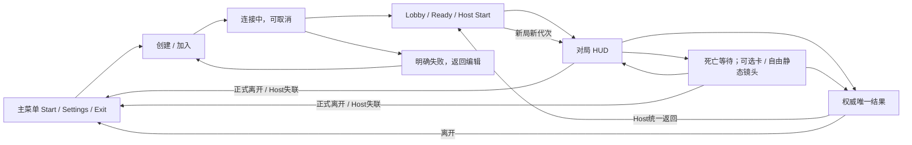

# Demo UI 与本地设置

**目标：v0.10.0 Demo · 职责：M11 · 引擎基线：Unreal 5.8.4**

本报告衔接 [App Spec](../APP_SPEC.md)、[架构审计](ARCHITECTURE.md)、
[共享契约](SHARED_CONTRACTS.md) SC-01–09 和 [实施计划](IMPLEMENTATION_PLAN.md)。
当前组件说明仍以 [视野与 UI](../systems/VISION_AND_UI.md)、
[移动与输入](../systems/MOVEMENT_INPUT_AND_CAMERA.md) 及实际源码为准。
**这是经独立研究与静态审核形成的目标接线设计，不是 Demo 界面已经实现的声明。**
“现有”证据固定于 `fa11d09a762bccadf495191072e222dd158fc014`；研究时文档 HEAD 为
`7e7a40d39ec2f99f18b809b83e89479bd34a823d`，已核对运行目录没有相对基线的变化。
文中的拟建函数、字段扩展、测试和资产工作均未实施；本次只提交本报告。

## 1. 结论、已确认边界与就绪范围

沿现有 **native UMG/Slate、Controller、动态 Enhanced Input、owner 投影和唯一观测 Relay**
收敛一条界面流程，不引入第二套 UI 框架、经济/成长状态、冷却表或视野系统。
一个 Root 管导航与输入层；HUD、属性/选择、商店、设置和小地图各消费窄只读投影。
现有脚手架可复用，但菜单、名单、三选一、两装备、公开击杀、完整结果及设置仍有实质缺口。

以下是本轮由主协调者转达的**用户已确认规则**，不是本文的数值建议：

| 边界 | UI 必须表达的唯一行为 |
| --- | --- |
| 单一流程 | Start / Settings / Exit → Host 或 IP Join → Lobby / Ready / Host Start → 对局 → 唯一结果 → 同房间 Lobby / 新局或离开。最多三真人含 Host、零至三独立 AI，不自动补位。 |
| 战斗入口 | 开局近战单体普攻；装备/属性可以改变普攻范围与群攻。Q/W 仅角色主动，1/2 仅两件装备主动，不合并为六槽，不增加背包。 |
| 同款与冷却 | 两件同款合法，基础属性相加，同名被动只生效一次；两份主动各自独立冷却。出售/遗忘期间继续计时，重新持有继承原结束时刻，UI 换图标/槽位不刷新冷却。 |
| 死亡选择 | 死亡等待可确认原三选一及替换；校验当前 Life 和 `ExpectedLifePhase`。只更新持久构筑，不复活、不治疗尸体，阶段竞争拒绝也不丢 Offer。 |
| 保护与进攻 | 当前身份、请求新鲜性、消息形状及终局闸检查后，**发出进攻意图即解除保护**，之后目标、距离、蓝量或冷却失败也不恢复保护。纯本地 Armed、取消、移动、商店、Stop 不解除。 |
| 资源上限 | 上限变化保持 HP/MP 原百分比，由 Combat 按 `FORMULA.ResourceMaxChange` 做一次最终投影；UI 不再次换算或额外回血，死亡不因此复活。 |
| 可见检查 | 可见对手显示名称、等级、血量/蓝量、获准状态及装备；不显示其技能、冷却、最终属性、金币。观察 DTO 不携带装备实例、私有修订或能力来源。 |
| 失视野与死亡镜头 | 失视野撤销目标并停止该追击订单，不转 LastSeen 移动、不保留单位标记。死亡可自由拖动镜头看静态地图与公共信息，无额外活体视野，不能跟随/观察隐藏玩家。 |
| 结果 | 终局显示所有参赛者名称、击杀、死亡、最终等级，标出唯一赢家，另有原因/本局用时；统计不判胜、不新增局内全员排行榜。Host 主动结束可无赢家。 |
| 死亡与离局效果 | 留在局内的死亡取消未释放动作，已释放独立效果继续；正式离局/断线立即移除身体及未结束独立效果。关 UI 无权回滚已释放效果。 |

本模块此前需要产品选择的界面行为已收口。布局、错误映射和下述本地接口属于工程设计；
首版目录、公式和数值仍以 `CONTENT_AND_BALANCE.md` 的审核状态为准，不能由本报告批准。
完整 M11 仍依赖各域实现、当前内容输入、C3/C4 和真实联机/视觉证据，**不是整体 implementation-ready**。
共享文件若尚含旧 pending 口径，应由集成时统一更新；不在本模块保留旧方案作为备用。

## 2. 已核验现状：可复用不等于已具备

| 现有入口与证据 | 真实能力 | 必须改接的缺口 |
| --- | --- | --- |
| [LDUIRoot.cpp:50–162](../../Source/Lockdown/Private/UI/LDUIRoot.cpp#L50-L162)、[368–387](../../Source/Lockdown/Private/UI/LDUIRoot.cpp#L368-L387) | 原生建菜单/Lobby，Host/Join/Exit 已有调用；Host 固定 `listen?Profile=V05` | 没有目标 Start/Settings/版本/名称、有名 roster、AI 配置和完整连接状态。旧职业选择及 Seal/Heart UI 不能仅改文案。 |
| [LDGameInstance.cpp:8–46](../../Source/Lockdown/Private/Framework/LDGameInstance.cpp#L8-L46) | network/travel delegate 注册解除，WorldContext 过滤，失败返回前端 | 当前忽略网络 Error 的细分文本，无 attempt 序号；满员、已开局、Host 结束、取消后迟到回包需独立处理。 |
| [LDHUD.cpp:44–91](../../Source/Lockdown/Private/UI/LDHUD.cpp#L44-L91)、[110–196](../../Source/Lockdown/Private/UI/LDHUD.cpp#L110-L196) | 本人数据、状态/反馈、结果去重、独立 Minimap | 目前六技能按钮/四物品按钮、旧目标和死亡损失；缺头像/名称，部分分支不显示 XP，无目标圈/击杀/全员终局表。 |
| [LDV08HUDModel.cpp:7–51](../../Source/Lockdown/Private/UI/LDV08HUDModel.cpp#L7-L51) | `LDHUD::Action` 区分技能/装备来源与执行限制 | 六 Actions/十一 Bindings、合并 ItemFamilies 冷却、保护禁用不符合目标。要区分可提交意图与可成功释放，不能只保留 `CanActivate`。 |
| [LDDevelopmentPanel.cpp:29–193](../../Source/Lockdown/Private/UI/LDDevelopmentPanel.cpp#L29-L193) | 可滚动 native Panel、本地预览和确认 | 现在是 `FLDBuildPlan` 加点/训练/读书/职业，不是持久 Offer；旧死亡 gate 禁确认，需原位改为本人属性/三选一。 |
| [LDInventoryPanel.cpp:28–160](../../Source/Lockdown/Private/UI/LDInventoryPanel.cpp#L28-L160)、[LDPlayerVendor.cpp:8–44](../../Source/Lockdown/Private/Framework/LDPlayerVendor.cpp#L8-L44) | 面板/服务页、显式报价、迟到 open token 检查 | 十服务页、背包/重量/quick、书店 Buy；没有目标两装备 Sell。复用确认机制，不保留 Bag 或旧多市场。 |
| [LDPlayerInput.cpp:65–110](../../Source/Lockdown/Private/Framework/LDPlayerInput.cpp#L65-L110)、[192–208](../../Source/Lockdown/Private/Framework/LDPlayerInput.cpp#L192-L208) | 动态 mapping 句柄清理、等待按键释放、受限 inspection | 静态 IA/IMC 与动态入口并存、profile 分派和零散捕获需归一；不另建 UI 默认按键表。 |
| [LDPlayerController.cpp:194–205](../../Source/Lockdown/Private/Framework/LDPlayerController.cpp#L194-L205)、[593–619](../../Source/Lockdown/Private/Framework/LDPlayerController.cpp#L593-L619) | owner 拒旧；GameAndUI 而非暂停世界 | 仅拒旧 State 不保证后续 Reason/toast/pending 无副作用；现开菜单会 ClearControls/Stop，需要区分普通面板与失焦。 |
| [LDControlSettings.h:19–37](../../Source/Lockdown/Public/UI/LDControlSettings.h#L19-L37)、[LDControlSettings.cpp:40–92](../../Source/Lockdown/Private/UI/LDControlSettings.cpp#L40-L92) | 保存按键、edge/follow、文字比例、Zoom；冲突校验；Save 返回 bool | 缺名称/显示/音量/平移速度；Load 对损坏静默回落，多 profile 槽/迁移需删除；恢复绑定不等于恢复全部设置。 |
| [LDMinimap.cpp:21–78](../../Source/Lockdown/Private/UI/LDMinimap.cpp#L21-L78)、[LDWorldViewRelay.cpp:94–169](../../Source/Lockdown/Private/Vision/LDWorldViewRelay.cpp#L94-L169) | 受限动态点、full/conceal 游标、过期清理、雾材质 | 旧 60×40/Explored 与目标稀疏 Units/Footprint 不同；清理须扩至 tooltip、音频、异步加载和旧 camera blendable。 |
| [LDVisionDirector.cpp:240–300](../../Source/Lockdown/Private/Vision/LDVisionDirector.cpp#L240-L300)、[LDCharacter.cpp:17–85](../../Source/Lockdown/Private/Character/LDCharacter.cpp#L17-L85) | Host 已在采样时隐藏非本人 Body，自己不重复生成 proxy | 不是生成时默认不曝光；原生附件/阴影/声音仍须共同核验。不能说 Host 完全没有隔离，也不能说已有隔离已足够。 |

`FLDOwnerState` 是现有反射投影，不是 UI 存档。GameMode 的
[StateFor/ContenderId/SyncOwner](../../Source/Lockdown/Private/Framework/LDGameMode.cpp#L378-L386)
与 Combat 的 [Sync](../../Source/Lockdown/Private/Combat/LDCombatDirector.cpp#L186-L204)
维护本人投影；Controller 的
[OwnerState 复制](../../Source/Lockdown/Private/Framework/LDPlayerController.cpp#L429-L430)
未显式使用 `COND_OwnerOnly`，其连接边界来自拥有者 PlayerController，不能误述为全局 GameState 字段。
当前其他 PlayerState 也非公开 roster；目标名单必须由会话域主动裁剪发布。

UI 树主要由 native `RebuildWidget` 构建：
[Bootstrap:210–226](../../Source/LockdownEditor/Private/ScaffoldBootstrap/LDScaffoldBootstrapCommandlet.cpp#L210-L226)
生成的 `WBP_UIRoot` 以 `ULDUIRoot` 为父类，
[InitializeLocalUI](../../Source/Lockdown/Private/Framework/LDPlayerController.cpp#L89-L108)
加载其生成类。现有 UMG/Slate 已足够，不新增 CommonUI/MVVM 依赖；
配置中的 CommonUI 项是否无消费者仍须 C4 核验，不能仅据 Build.cs 没显式引用就删除。

## 3. 精简屏幕、布局与状态

### 3.1 单一导航



Settings 是当前页面的主面板；属性、Choices、Shop 也各占同一主面板位置。
同一时刻只开一个主面板，允许其一个子确认；切换先结束未提交本地编辑，
不回滚已提交业务。HUD、死亡提示、公共圈/击杀为独立覆盖，不把它们当可 Esc 删除的页面。
终局替代 gameplay UI；没有世界背包、队伍、任务/存档/图鉴、多角色选择或局内全员排行榜。

### 3.2 页面与恢复行为

| 页面/区域 | 必须显示与可执行操作 | busy / 失效 / 返回 |
| --- | --- | --- |
| 主菜单 | Start、Settings、Exit，产品版本同 `DefaultGame.ini` 的 ProjectVersion；一基础角色，不展示职业选择 | Exit 明确确认；Settings 返回原菜单。版本读失败报缺配置，不显示硬编码“正确版本”。 |
| Start | 创建/加入同面板；本人名称；Host 监听端口、Join IP 与端口；返回 | 本地格式校验不代替准入。AI 数仅在 Lobby 修改，不保存第二份建房配置。地址不写跨局战力存档。 |
| Connecting | 当前端点、连接状态、取消；输入框仍可回看 | 同 attempt 禁双击新建；取消使该 attempt 失效。迟到成功清理对应旧连接，迟到失败不能把新世界退出。 |
| 失败 | 名称/端口/地址格式、不可达/超时、RoomFull、MatchAlreadyStarted、产品/协议/内容不兼容、旅行/加载失败分别解释 | 保留本人编辑内容，允许修改后显式重试；不自动重连、不回落旧 profile、不显示空成功 Lobby。 |
| Lobby | 所有已连接真人与实际 AI 的名称、真人/AI、Host、准备；Host 调整 AI 数、全部真人 Ready 后 Start；本人 Ready、离开 | 所有人包括 Host 使用 Ready；AI 无真人准备按钮。结构改变按 RosterRevision 清 Ready；Ready 本身只改 PublicRevision。Start 等权威结果，不能本地切地图。 |
| 自身 HUD | 头像、名称、HP/MaxHP、MP/MaxMP、XP/等级、金币、Q/W、1/2、被动、临时状态、待选次数、设置入口 | Unknown/同步中不填 0；满级显示 MAX，仍显示待选次数。选中别人不改变自身热键所有者。 |
| 可见目标卡 | 名称/等级、适用的精确血蓝、获准状态、两装备定义；目标高亮 | 只在当前观察授权有效时存在；失视野、stale、换 epoch 清全部，不留灰色历史卡/点。NPC 不适用字段与玩家空槽区分。 |
| 公共圈 | 发育期/剩余开放时间、开放无人、独占者名/进度、争夺、清零反馈 | 公开状态不授予观察句柄/坐标；到零等待权威状态，不自动宣布开放/胜利。 |
| 击杀通知 | 去重事件中的击杀者或明确无参赛者击杀者、被击杀参赛者、可理解死因 | 普通打野不全场广播；不由 Actor 消失生成击杀，不附隐藏坐标、技能等级或伤害日志。 |
| 属性 P | 本人所有 Spec 属性；基础、等级成长、永久选择、装备/被动/临时贡献及最终值；相关单位/公式说明 | 原生投影一次计算，UI 只格式化。普通 owner HP 更新不重置滚动/焦点，也不取消无关 Armed。 |
| Shop | 商品名/图标、已批准说明、买卖价格、本人金币、恰两装备、Buy/Sell、回绑冷却说明 | 只消费合法交互区域/距离及存活/进行中条件的 QueryShopEligibility，不额外检查 LOS/个人视野；Pending 不减钱/造物。受伤本身不自动关店；越界失效交易并说明原因，死亡/终局关店。 |
| Choices | 同一持久 Offer 的三张不同合法卡、效果/目标等级、待选次数；先选卡再明确确认；可暂时关闭 | 不自动选择、计时逼选、重抽或消费机会。stale 刷新同卡的保护版本后再次确认；死亡可用当前阶段提交。 |
| 主动替换子确认 | 新技能、Q/W 两旧技能及等级，明确选要遗忘的槽，再“确认替换并遗忘” | 不默认替换第一个槽；取消返回原三卡，无消耗。旧技能/等级/BuildRevision 变化撤销确认，不悄悄替换另一个技能。 |
| 死亡/保护 | 死因、复活等待、保留构筑与待选入口；复活保护图标/期限与“进攻意图即解除，失败亦解除” | 死亡可开属性/Choices/Settings、自由静态镜头；不得战斗/购物。复活由 Life 决定，接回本人新身体，按已保存偏好恢复镜头。 |
| 局内 Settings | 显示/画质、音量、按键、镜头/文字，恢复默认、应用；继续、离开；Host 另有结束本局 | 常驻“对局不会暂停”。离开说明不能重连；Host 离开说明整个房间结束。结束本局与离开房间是不同确认。 |
| Result | 全员名称/Kills/Deaths/FinalLevel，赢家标记、原因、用时；Host 回 Lobby；每人可离开 | 按冻结 roster 顺序，不按击杀产生排名/第二胜者。HostEnd 无赢家。Host 失联且未收合法结果只显示会话中断，不编造全零表。 |

### 3.3 原创线框与可读性

下图是功能布局，不是引擎截图。`名称/数值/时间` 均绑定实际投影，不是运行默认值。
以 1920×1080 为布局样本，另验 1280×720、窗口调整、Windows DPI 和文字缩放；
这些是验证样本，不是宣称已经达到的最低配置。参考样本正文 24px、交互行高至少 44px、
相邻控件 8px 间隔；由统一 DPI/文字规则缩放，窄屏重排/滚动，不靠截断确认按钮适配。

```text
主菜单                       Start：创建 / 加入
┌────────────────────┐       ┌────────────────────────────┐
│      LOCKDOWN      │       │ [创建房间] [通过 IP 加入]  │
│      [Start]       │       │ 名称 [本人名称           ] │
│      [Settings]    │       │ IP   [加入地址           ] │
│      [Exit]        │       │ 端口 [端口]  [创建 / 连接] │
│       <产品版本>   │       │ <错误或连接中> [取消/返回] │
└────────────────────┘       └────────────────────────────┘

Lobby
┌────────────────────────────────────────────────────────┐
│ 名称                 类型        Host       准备       │
│ <本人/其他实际成员>  真人/AI      <标识>     <状态>     │
│ AI 数 [0..3，仅 Host]    <不能开始的具体原因>            │
│ [本人准备/取消准备] [Host 开始]                 [离开]  │
└────────────────────────────────────────────────────────┘
```

```text
对局 HUD（世界中央保持可见；小地图固定右上，目标卡左上）
┌────────────────────────────────────────────────────────────────┐
│ [当前可见目标卡]      [公共圈状态 / 占领者 / 进度]   [小地图]   │
│ 名称/等级/血蓝/状态/装备   [去重击杀通知]            [设置]     │
│                                                                │
│                 世界 / 当前合法范围与方向预览                   │
│                                                                │
│ [角色被动 展开] [头像  本人名称] [装备被动 展开]                 │
│ [临时状态/控制] [HP / MaxHP] [MP / MaxMP] [等级 XP] [金币]      │
│                 [Q][W] 角色主动   [1][2] 装备主动 [待选 N][P]  │
└────────────────────────────────────────────────────────────────┘
```

```text
Shop（普通主面板，不是全视口模态）  Choices（普通主面板）
┌──────────────────────────────┐   ┌──────────────────────────────┐
│ 商店  金币 <实际值>    [关闭]│   │ 待选 <N>   对局不暂停 [关闭]│
│ 槽1 <装备> [卖] 槽2 <装备>[卖]│   │ [卡A]      [卡B]      [卡C] │
│ [商品列表] [说明/价格/冷却债]│   │ 类别/效果/本次等级/替换说明  │
│ [购买]  <本次请求状态/错误>  │   │ <当前选择> [确认本次选择]   │
└──────────────────────────────┘   └──────────────────────────────┘
满 Q/W 的子确认：<新技能> → [Q:旧技能+等级] [W:旧技能+等级]
选定旧槽后：[确认替换并遗忘] [返回三卡]；显示“再学从一级，旧投入不返还”。
```

```text
Settings
┌──────────────────────────────────────────────────────────────┐
│ [显示/画质] [音量] [按键] [镜头/文字]          [继续/返回]   │
│ <当前分区：真实值、冲突/支持状态、应用/保存状态>               │
│ 对局不会暂停。 [恢复默认] [应用] [离开] [Host结束本局]         │
└──────────────────────────────────────────────────────────────┘
Result
┌──────────────────────────────────────────────────────────────┐
│ 对局结束：<原因>                         本局用时 <服务器值> │
│ 名称                  击杀         死亡       最终等级       │
│ <所有本局参赛者>       <值>         <值>       <值> [赢家?]  │
│ [Host带房间返回Lobby]                     [离开回主菜单]     │
└──────────────────────────────────────────────────────────────┘
```

死亡横幅放在圈提示下方，复活倒计时与“选卡不影响复活”分开；不弹遮满地图的死亡模态。
关键状态用文字+形状/图标+颜色，焦点有可见轮廓，不仅靠红绿或声音。长名称省略时能看完整文本，
但 tooltip 仍受同一授权和失效边界约束。角色/装备被动与临时状态分区，列表可展开/滚动，
**UI 行数不是被动数量上限**；同名被动显示一次有效效果，可说明两个本人来源，而非双倍效果。
头像可用 native 原创头肩轮廓；合法 `IconId` 可用类别几何图形与短名作占位，不借用外部游戏素材。
未知定义不是“通用有效图标”：明确报告内容/协议错误，不能猜名称、能力或价格。

## 4. 输入所有权与本地导航状态

采用 `CONTROLS_AND_TARGETING.md` 的唯一接线：
`ULDUIRoot::TopInputLayer/CloseTopPanel` → `ALDPlayerController::CanWorldCommand(const FLDInputContext&)`。
`FLDInputCaptureState` 按设备、键/按钮保存按下消费者和 `CaptureEpoch`，直至释放；
菜单出现/消失、映射重建、焦点变化不把一个手势交给第二个消费者。

| 优先级 | 处理者 | 明确边界 |
| --- | --- | --- |
| 1 | 文本、重绑、局部编辑 | S/Q/W/1/2 只输入文字或捕获绑定，不发世界命令；Esc 结束当前编辑/捕获。 |
| 2 | 子确认、模态、拖拽捕获 | 进入子确认先取消冲突 Armed，期间不创建背后的 Armed；全视口阻挡新世界命令，焦点封闭。拖拽到释放都归原控件。确认只能提交一次，不同时触发 Enter 和 Enhanced Input。 |
| 3 | 命中普通面板 | 只消费实际命中的鼠标/滚轮或已取得的键盘焦点，不因鼠标 hover 商店就封掉 S。面板外仍可操作世界；装饰层不能挡住无关区域。 |
| 4 | Armed | 左键确认对应目标形式；第一下右键只取消，第二下才能下达新的世界订单。Esc 取消预览，不退款、不改变已释放效果。 |
| 5 | 小地图 | 静态相机/合法地面输入；不把公开占领者或地图点变成隐藏单位锁定。死亡只接受相机操作。 |
| 6 | 世界 | 右键地面/可攻击目标/商店由操作域分派，A+左键、S、Q/W、1/2 不在 Widget 另写战斗规则。 |

Esc 也先交唯一当前输入层：编辑/重绑/拖拽捕获 → 顶层子确认/模态 →
未被更高层消费的 Armed → 普通主面板 → 无顶层时打开 Settings。
普通面板未捕获 Back 时允许先取消 Armed，这是普通层的 Back 规则，不能越过模态。
进入子确认时 `CancelArmed` 只清本地预览，并保持原手势释放抑制；不 Stop 已接受订单、不发进攻或消费 Offer。
每个分支返回 Handled，同一个 Esc 不再向下关第二层；在主菜单使用同一 Settings 返回语义，
不隐式退出进程。HUD、死亡、结果本身不能被 Esc 抹除。
打开普通面板清冲突 Armed，**不自动 Stop 已接受订单、不停止其心跳、不暂停/赋无敌**。
OS 失焦才沿 `InvalidateLocalInput(reason)` 一次 Stop 并停旧心跳；恢复需新手势，不自动续走。
换身体/映射清 latch 并等物理释放；来源/相关 build/item 修订变化撤销对应 Armed，
无关 HP/MP 或 owner 发布不应每次清瞄准。

动作与标签只来自 `ULDControlSettings::Bindings/Key/Label`：
`Select, Navigate, AttackMove, Skill1/2, Item1/2, Stop, Attributes,
PanUp/Down/Left/Right, Recenter, Follow, Zoom, Back`。
默认 Q/W、1/2、P 等遵循 Spec；Space 短按回中、按住临时跟随不写偏好，Home 切持久跟随，
依操作域定义。Armed 时不边缘平移；滚轮在可滚动面板上只滚面板，不缩镜头。
死亡镜头复用同一相机入口，仅静态/公共显示，不因 `CanWorldCommand` 需要活 Pawn 而误禁相机，
也不能借 WaitingCamera 指向隐藏对手。

**执行限制不等于禁止发送意图。** `FActionView` 要分开 `CanSubmitIntent` 和 `ExecutionBlocks`：
低蓝、冷却、目标预测失败可灰态并解释，但明确的进攻确认仍沿操作域发送规范化请求。
空槽/过期绑定的显式激活使用 `ActivationSlot` 和 Missing/EmptySource 表示，不伪造 `SourceRef`；
它是可识别的执行失败，不自动归为畸形包来保住保护。纯属性装备仍标“无主动效果”，不假装有技能。
无法取得本人合法上下文、已终局或输入被更高层捕获时，不猜一个请求补发。

## 5. SC-09 A：viewmodel、正式写入者与字段白名单

### 5.1 沿现有组件的拟建 UI 接口

下列均为**拟建/拟改**，不是基线已有 API；只添加本地展示方法，不增加 gameplay 状态所有者。
领域类型由各报告维护，本报告不重复声明一套 Match、Offer、Inventory 或观察协议。

| 拟建接口/所在组件 | 责任与消费者 |
| --- | --- |
| `ALDPlayerController::ReadOwnState() const -> const FLDOwnerState*` | 只返回本 local player 已接受投影；未初始化/失效无有效指针，Root 必须呈现 Loading/Stale/Unavailable 及已分类错误，不把缺失变成全零状态。 |
| `ReadOwnProgression() const -> const FLDProgressionView*`、`ReadOwnEquipment() const -> const FLDEquipmentView*`、`ReadOwnShop() const -> const FLDShopView*` | 是 owner/本人合法报价的 const 访问器，没有可传他人 ContenderId 的参数，不另存可写金币/冷却。 |
| `ULDUIRoot::TopInputLayer() const`、`CloseTopPanel() -> bool`、`OpenMainPanel(ELDUIMainPanel)`、`OpenChildConfirmation(...)` | `ELDUIMainPanel` 仅本地导航枚举；唯一主面板/子确认/焦点状态，Controller 消费输入层。进入子确认先撤冲突 Armed 并保持释放抑制，Back 不越过模态，不反向创造第二栈。 |
| `ULDUIRoot::RefreshFromController()`、`ResetPresentation()` | 从已接受的投影更新；离局/换代解除 delegates、捕获、异步图标回调和旧 Widget 引用。只清本地呈现，不写领域数据。 |
| `ULDHUD::RefreshReadModel()`、`LDHUD::Action(...) -> FActionView`、`LDHUD::Attribute(const FLDAttributeBreakdown&) -> FText` | 纯本人/公共格式化；Action 消费 BindingView 与同步 ServerNowMs，输出意图可提交性和执行限制，不查询敌 Actor 或重算派生公式。 |
| `ULDDevelopmentPanel::Present(...) / PreviewChoice(uint8) / PreviewReplacement(uint8) / ConfirmChoice()` | 行/卡 index 只选择屏幕中的不可变内容；最后发送稳定 OptionId、明确旧技能/槽及版本，不把数组位置当业务身份。 |
| `ULDInventoryPanel::Present(...) / ReviewBuy(uint32) / ReviewSell(uint8) / ConfirmShopCommand()` | 冻结当前所见商品/实例、价格和版本；确认不重新用变化后的 row index 取另一条款。 |
| `ALDPlayerController::SubmitChoice(const FLDChoiceCommand&) / SubmitShopCommand(const FLDShopCommand&)` | 经本人拥有连接转发 `ServerChoice/ServerShopCommand`；服务端调用所属域 Queue 方法。query receipt 同样沿原领域键，不建通用万能 RPC。 |
| `ALDWorldViewRelay::ReadObservedFrame() const` | 返回世界域唯一只读 `FLDWorldView` 与本地 `ViewStatus`，不接受 ObserverId；目标卡/Minimap/世界输入共享它。 |

服务端 `SyncOwner` 才能按真实 caller 调
`ALDDevelopmentDirector::ReadProgression(ContenderId)`、
`ALDInventoryDirector::ReadEquipment(ContenderId)`、
`ALDCombatDirector::BuildOwnerCombatView(const FLDCombatCaller&)`。
**正常 Listen Host 的 Widget 也不得直接调用这些 authority getter**。
更新由 owner/public/frame/receipt/本地映射变化驱动，仅显示倒计时保留轻量 tick；
不为每个 Widget 新加一次世界扫描。关联请求的 pending 和不可变条款必须在 RPC 前写入，
因为 Listen Host 回执可能同调用栈返回。

### 5.2 每个界面元素允许读取什么

| viewmodel / 正式写入者 | UI 白名单 | 版本、缺失与权限 |
| --- | --- | --- |
| 连接 / `ULDGameInstance` 会话接线 | 本人编辑名称/端点、`ConnectionAttemptSerial`、WorldContext 归属、阶段、分类失败 | attempt 与 match 不是同一身份。旧 attempt 回包不得操作新页面；不展示完整引擎日志/内部路径。 |
| `FLDLobbyView` / GameMode → 公共投影 | `Generation, Phase, RosterRevision, PublicRevision, Entries[ContenderId,Name,Human/AI,Host,Ready], AICount, CanStart/Reason` | roster 结构变更与 Ready 变更分修订；无对手 owner 构筑/财产。身份不是显示名或行号。 |
| `FLDPublicMatchView` / 生命周期域 | `Generation, Phase`、同步时钟锚、`OpenAtMs, CircleState, Occupier, CaptureEpoch, SoloSinceMs, DueAtMs, Result` | 公开圈只有状态/公开身份/进度，**无圈内成员列表、隐藏坐标或观察句柄**。错代次拒绝；到零不自行写阶段/胜负。 |
| 最终 `FLDResultView` / GameMode 一次锁定 | `Generation, ResultId, ResultSerial, Reason, OptionalWinner, StartedAtMs, EndedAtMs, DurationMs, Rows`；每个 `FLDResultRow` 为 `ContenderId,Name,uint64 Kills,uint64 Deaths,uint8 FinalLevel` | 只在终局公开统计，LedgerMatch 不发公共 DTO；按锁定 roster 顺序保留离局者，离开不算死亡。K/D 从同一 DeathKey 恰一次派生，Growth 仅供 FinalLevel；用时不能由 OpenAtMs 猜，缺合法结果不填零。 |
| 参赛者死亡公共事件 / Combat 致死事实经生命周期域裁剪 | Generation、事件 ID/序号、公开 killer/victim、已批准死因类别 | 可以明确无参赛者击杀者；仅死亡对象为参赛者时进全场通知。无隐藏位置、私有伤害/来源、实时地图 ping；事件去重不由 UI 生成奖励或最终统计。 |
| 本人生命 / Life → `FLDOwnerState` | `ContenderId, BodyRef/Life, LifeState, LifeRevision, RespawnAtMs, ProtectedUntilMs` | 比较 match/life/生命阶段，不靠 Pawn 地址；死亡持续时间和保护只显示，不触发复活或解除。 |
| 本人 Combat 资源/属性 | `Resources{HP,MaxHP,MP,MaxMP,Shield}` 为 int64 P2；`FLDAttributeBreakdown{AttributeId,Unit,Base,LevelGrowth,PermanentChoice,EquipmentFlat,PassiveContribution,TemporaryContribution,PercentContribution,Final,FormulaId,ClampApplied}` | 本人精确数值和来源分解；P2 为百分之一点，不把编码值直接当点数。UI 不执行第二次百分比/上限投影。 |
| 本人 `FLDCombatBindingView` / Combat 与来源绑定投影 | Q/W 与 1/2 两组；`InputSlot, SourceRef, Rank, HasActive, IssuedCooldownId, ReadyAtMs, AvailabilityFlags, SourceBindingRevision`；`NextAttackAtMs, CurrentActionId/Phase/ActionRevision` | 装备 rank 不伪装角色学习等级；每同款实例各读自己的冷却轨，不取 family max。移除来源清图标/Armed，不清服务器冷却债。 |
| 本人状态 / Combat | `StatusFamily, ExpiresAtMs, ControlBlocks, IsPassive, OwnSourceCount/OwnSourceRefs, AppliedEffectReason` | `ControlBlocks` 明确 Move/Basic/Cast/Gear/Displacement，按内容实际限制显示，不从状态名称猜规则。敌方施加状态不附隐藏 caster 私有构筑/坐标。 |
| `FLDProgressionView` / Development → owner | 当前 Life/选择阶段保护、`Level, CumulativeXP, BuildRevision, PendingChoiceCount`；单一 `OfferId/OfferRevision` 及恰三项 `OptionId/Definition/确切内容/Rank` | 关窗/死亡/购物引起 BuildRevision 变化不改三卡身份正文；只更新确认保护。等级十显示 MAX，不制造十一级阈值。 |
| `FLDEquipmentView` / Inventory + 唯一账本 → owner | `Gold, AccountRevision`、恰两槽 `Instance, Definition, ItemRevision`、`InventoryRevision, SourceBindingRevision`、本人来源/CD 引用 | 实例可不同而 Definition 相同；不是两份金币真相。本人装备视图不能直接复用成敌方视图。 |
| `FLDShopView` / Vendor → 本人合法会话 | `Session, QuoteRevision, CatalogDigest, WorldRevision`、明确 Buy/Sell 价、商品定义说明、重新绑定的冷却债说明 | 与本人装备投影配合。没有合法报价显示“商店不可交易”，不是空成功；范围/生命/阶段由服务重查。 |
| 静态世界 / 世界定义 | MapId/WorldRevision 的坐标变换、地形、固定营地档位/商店/圈位置 | 不持续公布隐藏营地存量、刷新时间、隐藏身体状态；地图平移不增视野。 |
| 本地设置 / `ULDControlSettings` 与 `UGameUserSettings` | §8 的白名单；控制标签只读同一注册表 | 不复制网络，不保存 match/life/成长/候选/装备/CD/结果。 |

本人完整属性覆盖 Spec：物理攻击、法强、护甲、魔抗、攻速、移速、攻击距离、
当前/最大生命法力、生命/法力回复、暴击率及冷却属性。每个可见字段必须有实际派生效果与单位，
不展示无效“纸面属性”；当前普攻范围取 `STAT.AttackRangeCm`，不始终显示初始近战距离。

### 5.3 唯一观察 DTO 与逐字段清除

世界报告 `WORLD_CAMPS_AND_VISION.md` 定义：
`ALDVisionDirector → 有界稀疏 FLDWorldView → ALDWorldViewRelay`。
`FLDWorldView` 是现有类型的一次 schema 改造，不保留 B91 第二身体协议作为 UI fallback。
Envelope 为 `Schema/MatchGeneration/ObserverLife/Generation/Revision`、
`WorldRevision{MapId,LayoutRevision,GeometryRevision}`、`SampledAtServerSec`、
有界 Units 和本人 Footprint；观察 generation 与 match、普通 frame revision 不可混用。

| `FLDObservedUnitView` 字段 | UI 绑定及硬限制 |
| --- | --- |
| `Handle, ObservationEpoch, StateRevision, Kind, Presentation, FeetCm, Facing, Action/StateCue, AuthorizedFieldMask` | 当前观察定位/选中/表现；FeetCm 为量化厘米。句柄不是永久 Actor 或目标生命 ID。StateRevision 仅此 epoch 的展示修订，不发送私有 Build/InventoryRevision。 |
| `PublicIdentity` | ContenderId → 公共 roster 名称，或 CreatureDefinitionId → 公共目录名称；不能据此反查 authority Actor。 |
| `Level` | 参赛者 1..10；无等级模型为显式 NotApplicable，不补 1/0。 |
| `Resources.Health/Mana` | 各自 `Applicability, int64 CurrentP2, MaxP2`，直接沿 Combat 编码，显示精确血蓝与条；无蓝量模型不画假的 0/0 蓝条。 |
| 有界 `Statuses` | 仅公开临时 StatusDefinitionId/cue、适用堆叠/计时毫秒；无内部 CD、施加者私有来源、技能等级或完整 Control 账本。永久学习被动不能借“状态”列泄露。 |
| `FLDObservedEquipmentView` | 两槽 `Slot(0/1), optional DefinitionId`；允许两同款重复。NPC 整字段 NotApplicable 与参赛者空槽不同；只读静态目录图标/名字/说明，**无 Instance/SourceRef/IssuedCooldownId/InventoryRevision**。 |

可见时上述适用字段完整；丢字段不能从本人/对手完整 OwnerState 补，未知目录是显式协议/内容错误。
生产者在序列化前重查观察 epoch，不能只靠客户端最后一刻隐藏本已越权下发的装备/状态。
始终禁止对手 Q/W、冷却、最终属性、金币、XP、候选及本人专用 source refs。
装备 tooltip 可以解释公开静态定义，不能演算对手当前总属性或显示其主动是否 ready。
野怪的反击、回位/受控提示及到家后的血蓝，只显示当前获准的动作/状态/资源投影；
不因看似到家就由 UI 补满血蓝、复活同组死者、生成奖励或添加技能 CD/隐藏刷新计时。

Footprint 由同一 Vision 提供 `SourceStatus=ActiveBody/NoLivingBody` 和当前覆盖；
其固定 bitmap 形状、来源脚点/半径及地图转换沿世界 codec，UI 不新增网格真相/Explored/LastSeen 表。
亮格只用于雾/小地图，**不是单位授权**；Units 单独经真实采样点授权。
NoLivingBody 是有效生命状态，不可由查询失败伪造；死亡无新增活体来源，静态地图/公共圈仍可显示。

`Conceal / FullSetRemoved / Timeout / ObserverReset / MatchReset / Disconnected /
MatchEnded / ProtocolRejected` 必须共同清除：
目标卡、hover/tooltip、高亮/轮廓、锁定/追击、Armed 目标、Minimap 单位点、
代理及独立附属粒子/阴影/灯光/声音、异步图标回调缓存。
隐藏通知不附 Death/新 Life 细因；重现或目标换生命取得新 ObservationEpoch，不能自动续选。
普通 Revision 更新不让仍可见句柄每帧过期；full/conceal 共享接受游标，迟到旧 full 不撤销 conceal。
接收超时用本地接收时钟；显示事件时间用本局服务器时钟，不能把 TTL 或 UI 时间回写 gameplay。

世界提供的 `FLDObservedUnitTermination` 也是只读授权观察结果；UI 只清对应当前句柄的表现。
Conceal、stale、FullSetRemoved、离局不能冒充 ObservedDeath；旧 epoch/迟到终止不驱动新订单。
可见目标结束后的订单处理由服务器绑定原 `MoveIdentity` 后发订单回执，
Relay/Widget 绝不调用 `Navigate/SubmitOrder` 自行续追、重启或转换 LastSeen 移动。

Host 原生非本人身体及附件**从创建起默认不向本机曝光**，授权后仅一个呈现路径输出，
不能等首次 Vision.Sample 才隐藏，也不能靠销毁权威 Actor“解决显示”。
低画质/关闭后处理不应使隐藏单位暴露；这保证正常 Host 体验，不承诺隔离恶意修改的权威进程。

## 6. SC-09 B：命令、回执、版本、错误与去重

### 6.1 命令接线表

下列领域签名来自会话、操作、Combat、成长报告；UI 只是拥有连接的入口。
`FLDMatchContext{uint32 Generation; FGuid LedgerMatch}` 的映射归核心，UI 不传/强转 LedgerMatch。
每族只带其实际需要的字段，不给所有请求套一个巨大公共封包。

| 命令 / 拟建正式入口 | 请求与提交责任 | UI 的确认/重放行为 |
| --- | --- | --- |
| Host/Join/Cancel / GameInstance 会话入口 | 本人名称、有效端点与 ConnectionAttemptSerial/WorldContext；创建和准入归会话域 | 即刻进入 Connecting；取消只处理对应 attempt。新的连接不继承旧 callback；网络失败不能假装房间成功。 |
| `ServerSetReady / SetAICount / StartMatch` | `SessionCommandKey{Generation,RequestSequence}`；`ExpectedRosterRevision`，Ready/Count；caller 从拥有连接解析，Host 权限由 GameMode 验证 | 单连接会话命令单在途。`FLDSessionReceipt` 的 Pending/Committed/Rejected、拒绝码、CurrentPhase/RosterRevision 驱动页面；不能通过改按钮制造 Host 权限。 |
| `EndMatch / ReturnToLobby / LeaveRoom` | 当前 SessionKey；回 Lobby 带 `ExpectedResultReceipt`，只能由真正 Host 在适用阶段执行；旅行和新 Generation 归会话域 | HostEnd 无胜者且可回 Lobby；Host Leave 结束房间。确认弹窗区分后果，不用本地 OpenLevel 假装带房间返回。 |
| `ALDDevelopmentDirector::QueueChoice(ContenderId,FLDChoiceCommand)` | Generation、当前 Life+ExpectedLifePhase、递增 RequestId、OfferId/Revision、OptionId、ExpectedBuildRevision；满 Q/W 加 ReplacementSlot/ExpectedOldSkillId/Rank/明确确认 | 一次原子兑现、遗忘/装槽与机会消费；只有终态和新投影确认后展示完成。旧阶段/修订刷新同卡后新确认，不能改旧请求条款或自动换卡。 |
| `ALDVendorDirector::OpenShop(...) / QueueShopCommand(...,FLDShopCommand)` | Open 使用 ShopId/ExpectedWorldRevision；Buy/Sell 使用 Generation/Life/RequestId、Session/QuoteRevision/CatalogDigest、预期 account/inventory/build/source-binding/world 版本；Buy 商品+显示价，Sell 精确 Instance/ItemRevision+显示卖价 | 事务阶段重查 World.QueryShopEligibility、存活/进行中/余额/容量/所有权，不增加 LOS/个人视野条件；失败不部分改钱物。卖成功后再单独买；后买失败不撤回真实出售。 |
| Combat `SubmitAction(Caller,FLDCombatActionRequest)` | `RequestKey{Generation,Contender,Life,DirectSequence:uint64}`，Contender 必须匹配服务器从 caller 解析的本人；规范化 ActivationSlot/SourceRef、相关 source/build/inventory/item/catalog 版本及目标模式；单位只用当前 handle+epoch，地面/方向/自身分别校验 | 1/2 不含 Shop 参数，满槽、店外/圈内仍可激活。Queued 不等于 Accepted/Released；release 前复验成功才原子提交 MP/CD/effect。 |
| Stop / `CancelAction` / `CancelArmed` | 已发送订单按 `FLDMoveIdentity{Match,Life,Order,Epoch}` 取消；本地 Armed 仅清预览 | 不回滚已释放效果、不退款、不清来源 CD；迟到 ACK 不复活旧订单，普通 panel 关闭不隐式 Stop。 |
| `QueryChoiceReceipt / QueryShopReceipt / QueryActionReceipt` | Choice/Shop 使用 `QueryChoiceReceipt/QueryShopReceipt(ContenderId,const FLDReceiptQuery&)`，分别返回 `FLDChoiceReceiptQueryResult/FLDShopReceiptQueryResult`；query 显式 `Generation:uint32, Family, RequestId:uint64`，先拒旧局再查。Combat 使用原 RequestKey | 查询的 Pending/Final/NotFound/Expired/InvalidContext 分开，不创建操作或占用请求序号；timeout/查无记录不准换新 ID 自动重买/重选。提交的同键重放/异条款冲突和拒旧水位仍由原业务域维护。 |

客户端先记录不可变条款和本地 panel 显示代次再发请求；回包先验 match/life/主体、请求/条款、
本域修订及相应生命阶段，再处理 toast、清 pending 或跳页。不能只让 OwnerState 拒旧，
随后仍用旧 `ClientIntentResult(Reason)` 清新 pending/重开旧面板。
面板关掉后当前域可接收合法新投影，但旧回执不得把面板自动弹回或第二次播成功。

Choice/Shop 的 Queue 结果区分 `AcceptedPending / Final / AdmissionRejected` 与 `SequenceReserved`：
未受理不占序号；已受理后最终拒绝仍占序号；Pending 不改数据。
查询结果明确携 `Generation/Family/RequestId` 与结果标签；Pending 只含 `PendingInfo`，
Final 才含业务 Receipt，NotFound/Expired/InvalidContext 不填伪造的 OriginalLife 或 Applied。
已生成的业务 Receipt 携原 `OriginalLife/OriginalLifePhase`，允许查询同局历史结果，
但不能驱动当前身体/当前确认，只能答复原请求；不能把“旧 life 不可执行”误做“同局不可查询”。
Expired 表示已无可重放回执，不表示操作未发生；NotFound 也不是允许 UI 自动重执行的成功证明。
Offer/Option/ItemInstance/IssuedCooldownId 均为 FGuid，领域修订 uint64；
CatalogDigest 使用统一 32-byte SHA-256，日志为 64 位小写 hex，UI 不另算子摘要。
DefinitionId 的编码与 64-byte 缓冲沿成长/Combat 同一合同，不能截断成另一个有效目录 ID。

Combat 的客户端 DirectSequence 与服务器 `CombatToken:uint64` 是不同身份。
导航内部使用 `MoveIdentity+AttackCycle` 的请求键；完整准入后 Combat 才统一发 authority Token，
ActionId/AttackId 指同一个已接受 Token，不另存一条 UI 攻击序列。
Queued 尚无 ActionId，pending/query/cancel 必须保存原 RequestKey；
阶段沿 `ReceiptRevision` 前进，不能把 DirectSequence 与 Token 比大小。
S 在本地快照已发送 DirectSequence 上界，以 `ThroughDirectSequence` 送 `CancelAction`，
同时导航升 Order/Epoch；不能用服务器已收到上界漏掉在途请求。
关页/重绑不重置 DirectSequence，取消上界也不能和 CombatToken 作数值比较。
Rejected 即使没有 ActionId，也可以携 `ProtectionRemoved + uint64 LifeRevision`。
Combat/成长/会话的领域修订使用 uint64，Generation/Life 为 uint32，
IssuedCooldownId/ItemInstance 为 FGuid；观察 wire 修订仍沿世界的独立 codec。

跨 Actor 的 Owner/Public/Relay 到达顺序不保证事务顺序。回执携带的提交/生命修订是展示栅栏：
依赖投影未到达时显示“已确认，状态同步中”，不把旧数值当新的已确认结果；
较新快照已到则旧回执只能答原请求，不回盖、不反向恢复保护/装备/候选。

### 6.2 必须区分的反馈

| 状态/错误 | 呈现与恢复 | 禁止的假成功 |
| --- | --- | --- |
| Pending / Busy / Queued | 同手势立即显示在途，只限制本域重复提交；可离开面板，仍保留原请求查询能力 | 不用所有服务 Pending 聚合锁死装备主动；不先扣金、消机会、开真实 CD 或播命中。 |
| StaleRoster / Build / Inventory / Item / Binding / Quote / World / Catalog | 指出“内容已更新，请重新确认”，取当前合法投影；保留原 Offer，不按新条款暗中执行旧点击 | 不能把 invalid/未知内容解释为空技能、免费商品或有效 0 值。 |
| OldMatch / OldLife / 阶段不匹配 | 取消相应旧 UI 资格并显示当前状态；死亡选卡取当前 Life+ExpectedLifePhase 再确认 | 不能因为候选跨死亡保留就接受旧 Alive 请求；不能清掉服务器仍保留的机会。 |
| TargetUnavailable / InvalidGround / Direction / OutOfRange / Blocked | 来源按钮附近显示精简原因；TargetUnavailable 不细分隐藏对象是否存在/死亡 | 不沿隐藏位置追踪、不靠服务器错误反查目标；不把路径失败当到达。 |
| NoSource / NoActiveEffect / CD / InsufficientMana / ControlBlocked | 明确空槽、无主动、冷却、低蓝、控制类别；执行限制和意图派发分开 | 不把“保护中”一律禁进攻，不根据本地预测阻断全部无效意图。 |
| `Rejected + ProtectionRemoved` | 同时显示“施法失败：法力不足”等执行结果和“复活保护已解除”；按 LifeRevision 等待/接受相应 owner 变化 | **Rejected 不等于全部状态未变**。目标/资源失败不扣未提交 MP/CD，但真实保护变化不回滚。 |
| InsufficientGold / EquipmentFull / OutsideRange / Dead | 说明不足、先卖后买、返回范围或死亡不可交易；原子失败无钱物变化 | 不自动出售/替换、不免费造物、受伤不套旧书店关店规则。 |
| NumericUnderflow / NumericDomain（成长/交易） | 明确数值域非法、本次业务零提交；保留原候选/钱物并按域结果恢复可操作状态 | 不把下溢/非法结果钳成 0 后显示 Applied，不部分消费机会/金额/装备。 |
| RequestConflict / ReceiptExpired / ServiceUnavailable / AuthorityFault | 明确拒绝、合法重读/查询或返回菜单；内部细节留服务器日志 | 不吞异常、不无限等待按钮；回执缓存清理不能重新执行旧交易。 |
| MatchClosed / LeftMatch / HostLost | 关闭 gameplay 输入/会话，切合法结果或菜单中断原因 | 不把 HostLost 当赢、不伪造终局表、不把普通离开算击杀。 |

进攻保护顺序固定为：本人/Match-Life、消息 shape、新请求/去重、适用写闸 →
识别进攻 → Life `EndProtectionForAggressiveIntent` → 后续执行条件 → 排队/释放复验。
无效执行不替换已有的合法接受订单，但可能解除保护；旧 match/life、重放、畸形消息不改新生命。
本地 Armed 没有发送，不展示“已经进攻/已解除”。客户端到零也不自行移除保护或产生奖励。

## 7. SC-09 C：取消、死亡、离局、终局、新局矩阵

| 事件 | 取消/清理 | 保留与呈现 | 回包/权限 |
| --- | --- | --- | --- |
| 开/关普通主面板 | 清冲突预览，结束其本地焦点；关子确认不向下穿透 | 已接受订单/心跳、HP/MP/CD/Offer/金币继续；无暂停或免疫 | 已提交请求不因关窗回滚；合法结果更新本人投影但不重开旧页面。 |
| Esc / S | Esc 一层取消；S 在未被键盘捕获时 Stop 当前可中断订单 | 不动持久构筑/候选/冷却，不撤已释放独立效果 | 新 order/epoch 拒迟到 ACK；同一个按下/释放不能发两次。 |
| 失焦 / 映射重建 | 失焦一次 Stop 并停旧心跳；两者都撤相应 capture/latch/Armed、等待释放 | 比赛/冷却继续，本地设置按实际应用结果保留 | 回焦/新映射不重播旧按键，不发积攒的攻击。 |
| 本人死亡仍留局 | 清身体相关目标/拖拽/Armed和旧交易资格；未释放动作取消 | 等级/经验/金币/技能/装备/原 Offer/CD 保留；已释放独立效果仍由 Combat 结算；可死时选卡/看属性/静态拖图 | 旧 Alive 阶段选择拒绝但不丢卡；UI 不清域冷却、不治疗/复活。 |
| 复活新 Life | 清旧身体回包/观察/相机目标，接本人新身体 | 同局持久数据、原 CD 截止保留；服务器满血蓝与清临时控制/保护投影 | 旧请求不能操作新身体；选择重读当前 Life/阶段，不能把旧确认自动重发。 |
| 对手 conceal / stale / epoch 改变 | §5.3 全部敏感呈现、锁定和该追击订单清除 | 只剩静态地图与明确公共圈/事件 | 不留 LastSeen，不把 public identity 重新解析成隐藏 Actor。 |
| 终局 | 先权威关写闸，UI 收合法 Result 后按 §8 取消未确认显示试用，再关闭主面板/确认、清实时观察和战斗输入 | 一份冻结结果；仍可设置、合法回执查询、Host 回 Lobby、离开 | 边界前已提交业务保留真实结果，之后未提交拒绝；toast 不重复、旧回包不恢复玩法，关闭设置不是确认试用。 |
| 普通正式离局/断线 | 服务器立即移除身体及其未结束独立效果；客户端清代理/附件/面板/缓存/delegate | 他人继续对局，不自动胜；最终统计由域保留，不保留可操作身体 | 离局不是死亡；失效 request/observer 不能重建幽灵 UI/效果。 |
| Host 结束本局 / 离开房间 | EndMatch 产生无赢家结果；Leave/HostLost 清整个会话 | 前者可同房间回 Lobby；后者回主菜单并说明原因 | 未收到最终统计的断线不能伪造结果；旧 attempt 失败不能退出新房间。 |
| 回 Lobby / 新局 | 旅行前按 §8 收尾显示试用；核心统一推进代次并清旧 Offer/quote/target/result/receipt 执行权；UI 等新合法投影 | 仅名称及已确认应用的本地设置保留；不短暂闪回旧金币/技能/CD | generation、ledger match 映射归核心；不靠 Widget 清数组或世界 checkpoint 假装完成新局，旧显示确认回调也不能确认新试用。 |

## 8. SC-09 D：最小本地设置及保存

继续使用 `ULDControlSettings`，由 GameInstance 持有一份本地偏好对象供 Controller 引用。
显示类值只由 `UGameUserSettings` 管理，不另存一份竞争的 renderer 设置。新增接口均放现有
`LDControlSettings` / `LDControlsPanel` / `LDGameInstance` 文件：
`LoadLocalSettings / ValidateLocalSettings / SaveLocalSettings / ResetLocalDefaults`，
`GetLocalControlSettings / ApplyLocalSettings / FlushLocalSettings`，
以及 GameInstance 的 `BeginDisplayTrial / ConfirmDisplayTrial / CancelDisplayTrial`。
它们的结果区分 Loaded/Missing/UnsupportedSchema/Corrupt/ReadFailed、
Saved/Invalid/WriteFailed 和 Applied/PersistenceVerified，不用 void/空对象伪装成功。

| 分区与存储所有者 | 保留/拟增字段与单位 | 应用、恢复及限制 |
| --- | --- | --- |
| 名称 / `ULDControlSettings` | `PlayerName`，显示使用会话域规范化后的公共名称 | Start 编辑，本机保存；房间公开名称由服务器验证。恢复游戏设置不隐式删名称；不保存 join 密钥、比赛数据或新增账号页。 |
| 按键 / 同类 | `Bindings:TMap<FName,FKey>, Schema` | 单动态 registry；Rebind/Valid 检查重复、reserved Back、设备/轴/滚轮冲突。没有自动抢占另一个动作；改后所有标签同源，旧键释放前不生效。删除 Profile/Hybrid/Tactical 迁移和旧运行槽选择。 |
| 镜头/文字 / 同类 | `bEdgePan, bStartFollowing, Zoom, TextScale`；拟增 `CameraPanCmPerSec, ZoomMinArmCm, ZoomMaxArmCm, ZoomStepCm, EdgePanBandViewportFraction` | Zoom 是厘米臂长，速度 cm/s，边缘带 viewport 比例，TextScale 倍率。有限值/上下界关系沿操作域唯一定义，不从旧 1400/1800/8px 当批准默认。镜头不授予视野。 |
| 显示/画质 / `UGameUserSettings` | 实际支持分辨率、窗口模式、VSync、整体画质预设 | 只有分辨率/窗口模式进入 trial。一起编辑的 VSync/画质留在草稿，确认模式后才应用；单独改后两者用明确 Apply。不建庞大高级渲染中心，游戏仍不暂停。 |
| 音量 / 本地偏好 + Engine 声音分组 | 单一 `MasterVolume`，无量纲 0..1 | 本 Demo 声音统一经 Master SoundClass/SoundMix 生效，不修改共享 CDO；应用后实际音频响应。没有音频消费者时不把滑条当完成。 |
| 恢复默认 | 显示/画质、音量、按键、镜头/文字全部当前定义 | 先显示范围再确认；显示仍需试用/回滚；不清本局进度、身份或姓名。不把 `ResetToCurrentSettings` 当“恢复产品默认”。 |

本地操作明确区分 **EditingDraft → DisplayTrial → ConfirmedApplied → PersistenceVerified**；
不涉及模式改变的本地设置可在明确 Apply 后直接进入 ConfirmedApplied。
草稿不修改已应用偏好，不随通用 dirty flush 落盘；普通返回遇到未应用草稿时提供
“应用并返回 / 放弃草稿 / 继续编辑”。显示 trial 的取消只回滚显示试用及丢弃其未确认显示草稿，
不回滚期间已经明确应用的按键/音量/镜头偏好；尤其不覆盖最后一次合法 zoom/follow。

GameInstance 持有一个短期 `DisplayTrialId`、已确认分辨率/窗口模式恢复快照及本地单调截止时间，
均不序列化为另一份设置存档。试用只调用 `ApplyResolutionSettings`；
VSync/ScalabilityQuality 在确认前不写入 `UGameUserSettings`，也不调用非分辨率应用。
确认当前 TrialId 后才 `ConfirmVideoMode`，应用草稿中的 VSync/画质并 Save；
取消/超时以 `RevertVideoMode` 和实际 apply 恢复模式，其他显示字段仍为原已应用值。
**Confirm/RevertVideoMode 只管窗口模式和分辨率，不宣称它们能回滚 VSync/画质。**
`ApplySettings` 会持久化，不能在试用期间使用。

取消、Esc、主面板强制关闭、终局、HostLost、离局/旅行及正常销毁统一先调用
`CancelDisplayTrial`：失效 TrialId/旧回调 → 恢复未确认模式 → 再拆 UI 和 flush。
超时由 GameInstance 管理的本地生命周期回调/单调时钟检查，不依赖将被关闭的 Widget 或旧 World timer；
意外 Widget 销毁也走同一幂等收尾。正常进程退出在设置 flush 前收尾，
异常硬退出不能执行回调时，未确认试用也从未写盘，下次只加载最后已验证配置。
旧 TrialId 的确认/超时不能操作新试用；恢复失败明确报错并保留最后确认磁盘值，绝不把试用写成成功。

`SaveSettings` 返回 void，不能包装成 `true`；
窄 adapter 从实际目标配置文件重新读盘核对相关字段，非再次读 GConfig 内存，
无法确认则显示“已应用，本地保存未确认/失败”，保留 dirty 和重试入口，不写第二份显示存档。
显示回滚计时是本地 UX 安全计时而非玩法时钟；上述 API 与退出钩子仍需在锁定引擎实证。

已有 [SavePreferences](../../Source/Lockdown/Private/UI/LDControlsPanel.cpp#L54-L64)
在 Save false 时提示本次已改但未保存，这个诚实反馈应保留。
小型本地偏好先复用同步 Save；明确 Apply/离开/旅行/退出只 flush 最后一份
**ConfirmedApplied 且尚未验证持久化**的合格值，不保存 EditingDraft/DisplayTrial。
flush 必须在未确认试用收尾后执行，保留已明确应用的镜头偏好，不依赖滚轮后延迟 tick 恰好触发。
若后续以 hitch 证据改异步，必须单写入串行/合并并按本地修订
接受回调，旧回调不能把新 dirty 值标已存。读损坏或不支持 schema 要提示恢复，
不是静默回默认并覆盖；首次缺文件与损坏不是同一情形。

SaveGame 采用持久字段正向清单：网络身份、owner cache、Gold/XP/Offer/技能/装备、
冷却、结果和输入捕获不得成为普通持久 UPROPERTY。
测试必须显式使用隔离存储且不存在回落真实用户槽的路径：
[LDB86Probe.cpp:165](../../Source/Lockdown/Private/Tests/LDB86Probe.cpp#L165) 的旧视觉路径使用
`LDB86_...` 名称，却不符合
[LDControlSettings.cpp:79–80](../../Source/Lockdown/Private/UI/LDControlSettings.cpp#L79-L80)
接受的前缀，会回落真实 profile8 设置槽。**本次没有运行该探针，不应原样用 CaptureB86UI 验收保存**；
有效断言迁移时修正隔离，随后删旧链，不借文档任务修改用户设置。

## 9. SC-09 E：参数/目录键与单位

本表只引用 `CONTENT_AND_BALANCE.md` 的正式键及其待审状态，不复制数值表，
不把 docs 作为运行输入。批准后仍须同一 SourceData → Sync → Content/contract → native loader。

| 正式键/来源 | 单位/显示转换 | 消费者 |
| --- | --- | --- |
| `MATCH.DevelopmentSec, CAPTURE.HoldSec, LIFE.RespawnSec, LIFE.ProtectionSec` | 内容秒；领域提供本局 int64 毫秒截止。UI 使用同步 ServerNowMs，显示零不改状态 | 圈、死亡、保护；不使用普通 WorldSeconds 或本地墙钟直接相减。 |
| `XP.Start, XP.Threshold[L], XP.MaxLevel` | 有界累计整数；阈值到 L，不是每级增量 | XP 条/等级/满级 MAX。只有显示进度，不自行升级或发机会。 |
| `SHOP.StartingGold, SHOP.SellRatio, FORMULA.SellGold`、`ITEM.<id>.BuyPrice` | 金币整数、出售比例由内容定义；成交价由当前报价给出 | Shop 展示，不在 Widget 按比例再算一份卖价。 |
| `STAT.MaxHP/MaxMP/AD/AP/Armor/MagicResist/AttackSpeed/HPRegen/MPRegen/CritChance/CooldownHaste/AttackRangeCm/MoveSpeedCmPerSec` | 点、点/s、次/s、cm、cm/s、概率/倍率等沿 Unit/FormulaId；资源 P2 格式化不影响结算 | 本人属性/资源、合法瞄准范围。禁止以基础 `UNIT.BasicAttackRangeCm` 替代当前派生射程。 |
| `FORMULA.ResourceMaxChange` 及属性 FormulaId | 运算/取整由 Combat，UI 只展示新 Final/资源 | 不重复缩放 HP/MP、不额外回血。 |
| `ABILITY.<id>.TargetMode/RangeCm/WindupSec/CooldownFamily/Rank[r].ManaCost/CooldownSec` | 来源/等级/目标模式与成本依目录；实时 CD 读 IssuedCooldownId/ReadyAtMs | Q/W、预览、说明；CooldownFamily 不是两同款共享截止许可。 |
| `ITEM.<id>.Stats/Passive/Active`、`CHOICE.<id>` | 目录的确切效果/本次 rank/属性选项 | 两装备、三卡、被动说明；不另填伤害、群攻半径或触发规则。 |
| `SHOP.InteractRadiusCm, VISION.RadiusCm` | 脚点 XY 厘米，World.QueryShopEligibility/观测为最终授权 | Shop 可用性、本人范围表示；镜头移动不改变这些范围。 |
| `DISPLAY.<contentId>.NameKey/DescriptionKey/IconId`、`DISPLAY.character_demo.PortraitIconId` | namespace `DemoContent`，`<id>.name/.description`、`icon_<id>`；头像 `portrait_character_demo`，不假称贴图已生成 | 商品/技能/状态/卡/头像；合法同款各槽同图不同 CD。 |
| 操作域本地设置键 | §8 的倍率/厘米/cm/s/viewport 比例 | 相机/文字/标签；不在内容目录另设一套玩法值。 |

观察 `SampledAtServerSec` 只在边界集中转换；接收 TTL 使用本地接收时钟。
当前可用性时间采用生命周期域的 safe floor/raw now，不把 ceil 到下一时间桶当已经到期；
事件发生时序仍用核心原始时间，不由显示秒数决定。
全部展示取整、数值格式化只影响文字，不修改血蓝、费用、CD、进度或胜负判断。

## 10. SC-09 F：精确复用、删除、新增及闭包顺序

下面是**后续实施清单**，不是本次删除授权。R/D/N 及 C1–C4/P0–P5 沿
[架构审计 §3/§8](ARCHITECTURE.md)。短路径 `Public/Private` 均以 `Source\Lockdown` 为根；
每行只处理写明的文件/符号，非整个目录，Shared 头/配置/二进制先协调所属域。

### 10.1 原生 UI 与调用者

| 精确落点 | 处置与消费者 | 替换前提/顺序 |
| --- | --- | --- |
| `Public\UI\LDWidgets.h`、`Private\UI\LDWidgets.cpp`：`ULDCommandButton/ULDPanel/LDWidgets::Text/Button/Panel/PanelFocusTargets/MovePanelFocus` | R13 局部复用 native 构造/Tab 焦点；改造 capture/子确认；拟增 Portrait/ContentIcon 原创占位绘制 | 各 Panel/HUD 改接唯一 Root 输入层；旧 Trade 唯一消费的 OfferTray 在无新消费者时真删，不留备用。 |
| `Public\UI\LDUIRoot.h`、`Private\UI\LDUIRoot.cpp` | R13/N01/N07 改造根；D01/D16 删除 Laborer/Rogue/Scholar、ToggleSensor/Fixtures/FixtureBack/SeedSeal、Defence 旧函数组及 delegate/UPROPERTY、旧 starters/Heart/work/status 图 | 先接菜单/生命周期与 TopInputLayer；旧反射仍可加载时 C3 重存 WBP，再删旧事件/成员；不留空旧方法。 |
| `Public\UI\LDHUD.h`、`Private\UI\LDHUD.cpp` | 改成二+二、本人状态/圈/通知/唯一结果；删 TradeButton/ContextButton、工作/shortage/source 数、六+四构造及 RulesVersion/profile/map-name 分派 | Controller、Root hit-test、probe 同步改接；来源/结果投影先到，旧计时/死亡税 UI 再真删。 |
| `Public\UI\LDHUDModel.h`、`Private\UI\LDHUDModel.cpp`、`Private\UI\LDV08HUDModel.cpp` | R13 抽取必要 `LDHUD::Action` 到唯一 HUDModel，删除 `LDV08HUDModel.cpp`；删 PublicOpening/EconomyStep 旧规则、手工属性/范围常量和族 CD 合并 | BindingView/属性/公共投影稳定后替换消费者；没有 `LDV08HUDModel.h`，不虚列文件。 |
| `Public\UI\LDDevelopmentPanel.h`、`Private\UI\LDDevelopmentPanel.cpp` | R13/N04 原位 Attributes/Choices；D15/D16 删 `FLDBuildPlan Draft`、SelectedBook、旧训练/准备/读书/职业 Operation、StartConfirm/StopConfirm；改用 CommandButton 后删 `ULDDevelopmentButton::Route` 及旧反射类 | 先 QueueChoice/查询/当前 LifePhase；direct probe Choose/Preview 消费同步迁移；C3 后真删旧类型，不保留第二构筑编辑器。 |
| `Public\UI\LDInventoryPanel.h`、`Private\UI\LDInventoryPanel.cpp` | R09/R13/N05 收敛两装备+Shop；删 Sort/Filter/SearchChanged、Use/AskDrop/ConfirmDrop/HitCell、背包拖拽/quick、十一绑定、所有旧 service tab 字段 | 先领域原子 Buy/Sell/显示条款，后拆旧页/RPC/成员；保留满槽先卖后买，不以拖拽自动替换。 |
| `Private\UI\LDInventoryAcquisitionPanel.cpp`、`LDInventoryBankPanel.cpp`、`LDInventoryCommercePanel.cpp`、`LDInventoryProductionPanel.cpp`、`LDInventoryTradePanel.cpp`、`LDInventoryServices.cpp` | D02/D04/D05/D16 **六文件真删**；包括 Build/Refresh/Review/Submit、ShowService/RefreshServices 及 header 中 AcquisitionPlan/CacheRows/Bank/Commerce/Production/Trade/Services/ServiceTabs | 提取必要报价二次确认/模态焦点到单 Shop；删 Panel 构造、Controller token/cache/pending、RPC/反射引用，而非隐藏页签。B02 可独立，不等平衡值。 |
| `Public\UI\LDControlSettings.h`、`Private\UI\LDControlSettings.cpp`、`Public\UI\LDControlsPanel.h`、`Private\UI\LDControlsPanel.cpp` | R13 复用 Rebind/Valid/Save 职责，补 §8；D16/D24 删 Profile、HybridDefaults/MigrateHybrid/MigrateTactical、旧槽/profile fallback、Rules8 说明和独立导航 bool | 单对象/单 schema 与显式 LoadResult 先接；旧 migration tests 随消费者迁，隔离保存不回落真实槽。 |
| `Public\UI\LDMinimap.h`、`Private\UI\LDMinimap.cpp` | R12/R13/N07 改用 ReadObservedFrame/WorldRevision/Footprint；删旧 60×40/Explored/固定六 site、独立鼠标按键判断 | 世界唯一协议与输入 capture 先到；不增 LastSeen，不凭亮格填单位；death camera 只静态。 |
| `Public\Framework\LDPlayerController.h`、`Private\Framework\LDPlayerController.cpp`、`Private\Framework\LDPlayerInput.cpp` | R02/R13/N01/N06/N07 保留 caller/owner cursor/动态 mappings；改 receipt 和失效；D16/D24/D27 删静态 IA/旧 SkillInputContext、V05/旧 context/ward/fixture 分派、无消费者 flags/RPC aliases；删空 `EndSkillGesture` | 输入、领域回执、Root 同批；保留 Match/Life/Order/Epoch，不用恒真 profile helper。 |
| `Private\Framework\LDPlayerDevelopment.cpp`、`LDPlayerInventory.cpp`、`LDPlayerVendor.cpp` | 原位 Choice/本人装备/Shop/query 转发；删全份 build draft、quick/read/drop/BuyVendorBook、空 `SetInteractionHeld` 与旧调用 | Combat 装备主动仍独立，不把 Vendor Pending 或会话变成其准入；先稳定窄命令，再删旧枚举/成员。 |
| `Private\Framework\LDPlayerBank.cpp`、`LDPlayerCommerce.cpp`、`LDPlayerProduction.cpp`、`LDPlayerTrade.cpp` | D02/D04/D05/D16 **四文件真删**；Controller 相应 include、UFUNCTION、View/cache/token/friend、`InventoryPending` 旧多服务聚合一并去除 | 保留所需事务校验到原 Ledger/Vendor/Inventory，不能留下无服务的 Server 调用静默 return。 |
| `Public\Framework\LDGameInstance.h`、`Private\Framework\LDGameInstance.cpp` | R13/N01 改 attempt/本地偏好 flush；保留 WorldContext/delegate 配对；D12/D27 删除 ResetEvidence/DevelopmentResetEvidence/B90ResetEvidence 旧 probe 依赖 | 生命周期负责 Generation；B03 删世界 checkpoint 不触碰本地设置保存。 |

外围 UI 也属于闭包，不在其他目录留备用入口：
`Private\World\LDB91Controller.cpp/LDB91SourceHUD.cpp/LDB91SourceControls.cpp`、
`Public\World\LDEnvironmentDirector.h` 内 `ALDB91HUD/Controller/GameMode` 的反射/override/RPC，
`Public\Population\LDB92Roster.h`、`Private\Population\LDB92Roster.cpp` 的 HUD/继承选择，
`Private\Economy\LDB92ServiceClient.cpp` 的 `ALDB92HUD::DrawHUD/NotifyHitBoxClick`，
以及 `Public\Region\LDB90Preview.h`、`Private\Region\LDB90Preview.cpp` 的 Preview HUD/Mode，
分别随 D06/D11/D13 和所属领域删除；只抽当前图/输入所需能力，不把旧预览模式改名成死亡镜头。

### 10.2 资产、Input、反射、配置与新增

| 精确资产/生产消费链 | 目标与门槛 |
| --- | --- |
| `Content\Lockdown\Generated\UI\WBP_UIRoot.uasset`；`LDScaffoldBootstrapCommandlet.cpp:210–226` → `LDPlayerController.cpp:104` 字符串 LoadClass | R14 保留当前资产身份和 native 父类；新增页面在原 native 文件，不另造 WBP 页面树。C3 检查父类/事件/CDO/生成类与 delegate，编译重存后才删旧反射方法。 |
| `Content\Lockdown\Generated\Input\IMC_Gameplay.uasset` 及 `IA_Aim/IA_Move/IA_Sprint/IA_Attack/IA_Dash/IA_Assassinate/IA_Interact/IA_Ward/IA_Help/IA_Menu/IA_Zoom.uasset` | D24 最终删除这十二个包；不是只删五个旧技能资产。唯一动态注册接好 → 移除 `InitializeLocalUI/SetupInputComponent` 静态加载/拼接、Bootstrap 274–326 的固定生成/签名检测 → C3 迁移所有引用 → 真删。保留 Space 等现用键，不再造另一 IMC。 |
| `Content\Lockdown\Generated\Materials\M_Character.uasset` | R04/R14 保留身体/授权代理实际消费者；旧 Seal/Grass 引用随 D 删除，不能因“占位”删掉当前材质。 |
| 同目录 `M_Fog.uasset/T_FogClosed.uasset`；Bootstrap 165–209 → Relay AttachFog/UploadFog | R12/R14 改造成世界 Footprint 的显示投影，不保留 60×40 权限假设；换相机/EndPlay 清旧 blendable。C3 材质编译和低画质/无 postprocess 隐私门槛必需。 |
| 同目录 `M_Ground/M_Soil/M_Fuel/M_Metal/M_River/M_Stone/M_Tree.uasset` | 仅 C2 当前地图无用且 C3 无引用的部分删除；不是 UI 可单独按文本命中决定的资产。 |
| 拟新增 `Content\Lockdown\Generated\Audio\SC_DemoMaster.uasset`、`SMix_DemoUser.uasset` | 仅承接 §8 的一个主音量链，由现有 Scaffold Bootstrap 生成/校验，所有保留的 Demo UI/战斗/公共提示音统一接入。不得生成后无声音消费者；音效目录/实际听测/Cook 未完成不称音量可用。 |
| 头像/内容图标 | 本方案在 `LDWidgets.h/.cpp` 增 native Portrait/ContentIcon，占位绘制绑定已知 DISPLAY 键，不要求新贴图/Blueprint 文件。以后改导入素材须补逐 IconId 的资产映射与 C3/Cook，不自动批准额外素材目录。 |
| `Config\DefaultEngine.ini/DefaultInput.ini/DefaultGame.ini`、`Source\Lockdown\Lockdown.Build.cs`、`Source\LockdownEditor\LockdownEditor.Build.cs`、`Lockdown.uproject` | D25/D26 保留当前前端/GameMode/GI、LDGroundAim/LDVision、DPI、EnhancedInput、Runtime/Editor 分离；核对合并后有效值与插件/资产消费后删旧容量/书价/profile/CommonUI 无用项、RuntimeDependencies/AlwaysCook/旧 maps。版本取现有 GeneralProjectSettings section，不新增字面量来源。 |

二进制清理前必须合并 AssetRegistry/Reference Viewer 的 hard/soft/management 引用、
Blueprint/CDO/WorldSettings、native 拼接 LoadObject/LoadClass、ini、Bootstrap、Cook/staging 根。
在旧类仍可加载时迁移存活资产，再重启加载、UHT/Blueprint 编译、Bootstrap Validate、Cook；
生成器不得重新生成已删 IA/旧 UI。`.uasset/.umap` 保持 Git LFS，不文本拼接。
本次没有打开二进制资源或证明这些删除已安全完成。

### 10.3 测试/probe 消费者及实施顺序

| 当前精确入口 | 保留/替换/删除 |
| --- | --- |
| `Private\Tests\LDInputRulesTests.cpp`、`LDHUDRulesTests.cpp`、`LDViewTests.cpp` | 改造 ControlMappings/IssuedCommandLiveness、HUDObservationBoundary、ViewPayload/ViewPrivacySchema；保留拒旧/原子性/隐私，替换旧四技能、八字段/旧公共字段数、60×40 和“敌血蓝永远 Unknown”断言。递归检查嵌套状态/装备，不只数顶层字段。 |
| `Public\Tests\LDInputProbe.h`、`Private\Tests\LDInputProbe.cpp/LDHUDProbeExtension.cpp`；`Scripts\RunInputCheck.ps1/RunHUDCheck.ps1` | 复用真实 EnhancedInput/Slate、full-conceal、重复 toast/旧 ACK 夹具；HUD extension 属 InputProbe，不虚构 ALDHUDProbe。删旧 ward/死亡税/deadline/固定计数与非参赛 Host 拓扑，改 §11 场景。 |
| `Public\Tests\LDViewNetworkProbe.h`、`Private\Tests\LDViewNetworkProbe.cpp`；`Scripts\RunViewNetworkCheck.ps1` | 保留真实 owner 可访问记录/乱序/过期/镜头权限，删旧公共 sensor/ward，增加正常可视 Listen Host 生成当帧及完整嵌套白名单。 |
| `Private\Tests\LDInventoryProbe.cpp/LDVendorProbe.cpp/LDLoadoutRulesTests.cpp/LDV08LoadoutTests.cpp/LDLoadoutProbe.cpp`；`Scripts\RunInventoryCheck.ps1/RunVendorCheck.ps1/RunLoadoutCheck.ps1` | 迁实例/来源/价格复核/创建失败到两装备；删除背包/书籍/准备/旧迁移与六槽/十一绑定专属断言，不保留旧模式只为测试可编译。 |
| `Private\Tests\LDDevelopmentProbe.cpp`；`Scripts\CaptureInputUI.ps1` | 抽焦点/尺寸/截图设施，迁 Start/Lobby/Choices/Replacement/Shop/Settings/Result；去旧授予/死亡税/场景 enum。截图存在不证明视觉/真实输入；offscreen/nosound 不验证声音。 |
| `Public\Tests\LDB86Probe.h`、`Private\Tests\LDB86Probe.cpp/LDB86RulesTests.cpp`；`Scripts\RunB86Check.ps1/CaptureB86UI.ps1/CheckB86Evidence.py` | D27/D31 真删旧链；将有效 owner readiness/来源/CD/几何断言迁当前 HUD/Input 测试，先确保隔离设置存储，不运行旧覆盖真实槽的路径。 |
| `Public\Tests\LDEconomyUIProbe.h`、`Private\Tests\LDEconomyUIProbe.cpp`；`Scripts\RunEconomyUICheck.ps1` | 通用确认/焦点/原子断言迁新场景后整删。旧 Context 重绑断言与当前注册已不符，不能把这个静态发现记为本次测试失败。 |
| `Private\Tests\LDTradeRulesTests.cpp`、`Public\Tests\LDTradeProbe.h`、`Private\Tests\LDTradeProbe.cpp`；`Scripts\RunTradeCheck.ps1`、`RunTests.ps1` 的 TradePrivacy 强制项/旧计数 | B02 同批迁必要 Shop/Choice 隐私/模态/重放断言后真删 Trade；RunTests 按当前必要用例集合核对，保留 failed/notRun/inProcess/缺报告失败，不是单纯降数量。 |

顺序按每个闭包的 P0–P5：先列生产消费/反射 → 原领域/窄投影与唯一输入改接 →
迁移存活资产/生成配置 → 真删旧文件/字段/RPC/页签/探针 → 当前断言/手册同步 →
本批验证与最终总门禁。B01 可先做菜单/准入失败合同，B02/B03 不等无关平衡参数；
完整 UI 随 I1–I7 各域接线，I8 复核全链，不等最后才做 HUD，也不要求先可玩旧模式才能删闭包。
本方案不新增运行源文件/模块，新增职责落在上述现有文件；本次实际新增只有本报告。

## 11. SC-09 G：正反验收与证据边界

以下是**后续必须新增或替换的用例**，不是已运行测试名/通过结果。
身份/容量/次数取 Spec，玩法时长/距离/公式用批准的内容键；网络同时观察服务器回执和受限拥有端，
不能只在 Host 调 `_Implementation`、写 OwnerState 或把 nullrhi 截图当真实交互。

| 用例组 | 正例 | 反例与精确断言 |
| --- | --- | --- |
| 菜单/连接/准入 | Start/Settings/Exit 可用；正常 Host+两个 owning client、零/三 AI；单人同规则 | 双击/取消后新 attempt、旧成功/失败、错端口/地址/版本/内容、第四真人、late join 分别反馈；没有幽灵连接/旧失败退出新世界。 |
| Lobby | 全真人包括 Host 准备，Host Start；AI 数不补位 | Ready 更新不清他人 Ready；成员/AI 结构变化清准备；非 Host 伪造开始服务器拒绝，不只按钮不可见。 |
| 手势与捕获 | 文本/重绑/面板/模态/拖拽/Armed/小地图逐层响应；已开 Shop/Choices，在面板外 Armed 后进入子确认再按 Esc | 在 UI 按下世界释放及反向、关闭时仍按键、Enter+OnClicked 同帧，只一个消费者/提交；进入子确认撤 Armed，Esc 只关子层不再关主层/发 RPC/Stop/消费 Offer；hover 普通面板不吞 S，滚轮不同时 scroll+zoom。 |
| 面板与失焦 | 已接受导航中打开属性/Shop/Choices/Settings，世界继续 | 开普通面板不 Stop/停心跳，不暂停/免疫；失焦一次 Stop，回焦不重播；映射重建无累积 action/旧键命令。 |
| 四来源/保护 | Q/W 与两件同款主动独立；A/普攻/确认/自施放发送意图 | MP/CD/目标/距离失败、EmptySource/过期绑定仍按规范意图解除保护，Rejected 携 ProtectionRemoved+LifeRevision；不付未提交 MP/CD、不替换旧合法订单。Armed/Move/Shop/Stop不解；旧代次/畸形/重放不解新生命。 |
| 冷却债 | 用其中一件同款后另一件仍按独立 readiness；卖/遗忘再持有、换槽、升级、死亡 | UI 重建不改 deadline、不取 family max；原截止前不得洗成 ready，到零不自动执行。1/2 店外/圈内/两槽满且无 ShopSession 仍走 Combat。 |
| 被动/属性 | 同款属性相加，同名被动一次且可解释来源；完整属性分解/单位 | 超过单屏行数仍生效可读；来源效果不能按 UI 行重复计算；MaxHP/MP 变更只由一次 Combat 投影保比例，死者不回血/复活。 |
| Offer/替换 | 连升逐组、三不同合法卡、最多九机会/十级/技能三级；死时可选 | 关窗/重复/购物/死亡不重抽；旧 LifePhase/BuildRevision 拒绝不丢卡。满 Q/W 无默认遗忘，旧技能/等级改变撤销确认；取消无消耗。 |
| Shop/原子性 | 普攻正常收益买两件同款，先卖再买；合法区域/距离内，即使 LOS/个人视野不满足也不额外阻止交易 | 第三件、金币不足、越界/死亡/终局、各 revision/catalog 冲突、实例创建失败均无部分钱物提交；Sell 已成功而后 Buy 失败不回滚 Sell；伤害本身不关店。 |
| 回执与重放 | 同键同 payload 只回原结果，合法查询不再提交 | 异 payload 冲突；过窗拒旧；新 snapshot 先到/旧 receipt 后到不回盖；关窗/重生/新局不清新 pending、重弹旧面板或重复 toast。Host 同栈回包不被随后写 pending 覆盖。 |
| 查询结果形状/数值失败 | Choice/Shop 分别返回 PendingInfo 或 Final 业务 Receipt；同局可查历史、当前身体不受旧 Receipt 影响 | NotFound/Expired/InvalidContext 无伪造 OriginalLife/Applied，不自动重执行；旧 Generation 先拒。NumericUnderflow/NumericDomain 零业务提交，不消费钱物/机会或制造成功默认值。 |
| 可见目标 | A 可见 B 时名称/等级/精确血蓝/状态/两装备实时授权更新；NPC 不适用字段正确 | 技能/CD/最终属性/Gold/XP/私有实例/版本从不入对手 DTO；隐藏后变化不再更新任何缓存/附件；停原追击无 LastSeen移动。 |
| 观察传输 | 同帧/epoch 合法增量表现与可靠 conceal | 旧 full 不能撤 conceal，旧 conceal 不擦新重现；普通 revision 不错误撤锁；wrong schema/world/observer life、超容量/非法数值明确拒绝。未知定义不造默认有效对象。 |
| 正常 Host | 不带诊断特免，非本人出生当帧/首采样前、隐藏/重现、相机切换 | 本体/代理不双画；附件/阴影/灯光/声音/提示无旁路；关后处理/低画质不显示隐藏单位。观察只读表本身也无未授权字段。 |
| 死亡/离局 | 死亡自由静态平移/缩放/公共圈、选卡；已释放独立效果继续 | 无新 Footprint/隐藏跟随/游戏移动；离局立即去身体/未结束效果，旧 FX 不重生。离局不增加死亡/击杀、不使他人自动胜。 |
| 终局/新局 | 连续独占唯一结果，全员 Name/K/D/FinalLevel+winner/reason/duration；HostEnd无winner，回Lobby新局 | 统计不判胜，正常局不发布全员表；终局后无新交易/选择/战斗提交，旧包只读重放；新局无旧 Offer/财产/CD/结果闪回，合法缺数据先同步而非填旧值。 |
| 本地保存 | 隔离存储下应用、重新启动、旅行前最后一次 zoom、恢复默认 | Missing/损坏/不支持schema/非法键/NaN/越界/写失败各自反馈；无真实槽 fallback；没有局内数据入 SaveGame；失败不宣称持久成功。 |
| 显示试用 | 同时编辑模式/分辨率及 VSync/画质，分别确认、取消、超时；另测只改 VSync/画质 | 确认前后两者不应用，取消/超时恢复原模式且四项均为原已应用值；确认后才共同应用并验证保存。不能把 RevertVideoMode 当全设置回滚器。 |
| 试用中断/保存 | trial 中终局、HostLost、旅行/Widget 销毁、正常退出；期间另有已明确应用的 zoom/follow | 旧试用先收尾不落盘，旧确认/超时不能确认新 TrialId；flush 排除草稿/trial，保留最后合法镜头值。异常硬退出后从最后已验证配置启动；回滚/写失败不宣称成功。 |
| 声音/布局 | 实际渲染有声包，Master静音恢复；小/大窗口、DPI、长名/长卡/多被动 | 全部关键按钮/原因可读有焦点，不仅靠颜色；未应用草稿普通返回可选择应用/放弃/继续编辑。nullrhi/nosound/offscreen均不能替代相应证据。 |
| 删除/资产 | 当前 Editor/Game/UHT、Blueprint、Bootstrap Validate、唯一包加载 | 旧 UI/RPC/IA/IMC/profile/探针无存活消费，生成不会复活它们；缺 WBP/必要材质/定义明确失败，不用兼容 UI 或旧值兜底。 |

当前可复用 `RunInputCheck/RunHUDCheck/RunViewNetworkCheck/RunVendorCheck/CaptureInputUI` 的工具能力，
但这些 runner 仍有旧地图/profile/数量/诊断 Host 条件，**没有现成通用 Demo selector**。
先迁场景/断言/拓扑再解释结果；文档任务不运行它们。
运行层最低覆盖正常可视 Listen Host+真实远端 owning client，另测三真人+三 AI 满规模；
LAN 与正确配置可达公网分别记录，loopback 不证明公网/NAT。
所有后续输出进忽略的 Artifacts；本次只做文档/引用核对，未生成或替换 known-working 发布构建。

## 12. 专家闭环、公开依据与限制

| 独立角色 | 真实 agent 身份 | 本模块交付 |
| --- | --- | --- |
| MOBA UX/信息呈现研究 | `demo-ui-ux-expert` · `b8df29a8-89fd-445e-94bb-65601430a7a7` | 完整屏幕/状态、原创线框、输入/失败/权限与公开 UX 研究已完成；未审计 native 实现，未兼任 QA。 |
| UE UI/输入/复制/设置工程研究 | `demo-ui-unreal-expert` · `eb9e3b78-1233-42bb-8bee-2d68532861cf` | native UI、DTO/RPC、设置、生成资产/调用者/探针静态研究完成；核对 139 处源码引用范围，未改运行文件，未兼任 QA。 |
| 独立 UX/权限/生命周期 QA | `demo-ui-qa-auditor` · `a57db409-324a-4e3b-9a56-83f39b5f893a` | 在两份研究和整合稿齐备后独立全文审核，并对显示试用/中断收尾、Esc/模态组合修订作同人定点复核。最终静态文档审核通过，无剩余高置信度必须修订项；未兼任作者。 |

原始研究仅在会话工件保存，不把聊天、逐轮更正或弃用备选方案复制进仓库。
本次完成文档相对链接/源码行号、明确列举的文件路径、表格结构与 diff 检查；
三位实际 agent 的研究及审核闭环均已完成，结论仅限此模块文档。
整合采用工程证据与最终产品约束：例如 Shop 是普通面板、不因受伤自动关闭；
进攻执行限制不能吞规范化意图；visible 并不天然阻止世界输入，仍须 Handled/capture 合同。

公开资料核验日期 **2026-11-01**。两位研究者均实际检索/读取；UE 资料经 Context7 官方文档集合
及 Epic 原文交叉核对。下列只支撑机制/UX 理由，不批准游戏数值，不证明 5.8.4 补丁已编译通过。

| 来源 | 本报告采用边界 |
| --- | --- |
| [Game Accessibility Guidelines：不只靠固定颜色传递重要信息](https://gameaccessibilityguidelines.com/ensure-no-essential-information-is-conveyed-by-a-fixed-colour-alone/) | 文字/形状/图标与颜色共同表达状态，不复制其他游戏美术。 |
| [Nielsen Norman Group：Progress Indicators](https://www.nngroup.com/articles/progress-indicators/) | 输入后立即给在途反馈，长等待有明确状态/恢复路径；不是“取消可以回滚任何已提交操作”。 |
| [Epic：Enhanced Input](https://dev.epicgames.com/documentation/en-us/unreal-engine/enhanced-input-in-unreal-engine) | LocalPlayer 动态 context、action 生命周期；支持保留现有动态注册，不证明项目已无穿透。 |
| [Epic：SetInputMode_GameAndUIEx](https://dev.epicgames.com/documentation/en-us/unreal-engine/API/Runtime/UMG/UWidgetBlueprintLibrary/SetInputMode_GameAndUIEx?application_version=5.6) | UI 未处理输入可下探 controller；确切 API 原文为 5.6，不能充当锁定引擎测试。 |
| [Epic：Actor Owner and Owning Connection](https://dev.epicgames.com/documentation/en-us/unreal-engine/actor-owner-and-owning-connection-in-unreal-engine)、[Replicated Object Execution Order](https://dev.epicgames.com/documentation/en-us/unreal-engine/replicated-object-execution-order-in-unreal-engine) | owner 连接与跨 Actor/OnRep 到达限制；不把可靠 RPC 当业务恰一次，不把 relevancy 当 Host 本地视野。 |
| [Epic：Saving and Loading Your Game](https://dev.epicgames.com/documentation/en-us/unreal-engine/saving-and-loading-your-game-in-unreal-engine)、[SaveGameToSlot](https://dev.epicgames.com/documentation/en-us/unreal-engine/API/Runtime/Engine/UGameplayStatics/SaveGameToSlot?application_version=5.6) | bool/失败处理、非 transient 字段保存边界；小 save 可同步，异步仍需项目处理乱序。 |
| [Epic：UGameUserSettings](https://dev.epicgames.com/documentation/en-us/unreal-engine/API/Runtime/Engine/UGameUserSettings?application_version=5.6) | 应用/保存、确认/回退的职责和 void 保存结果；运行 API/配置文件行为仍需 5.8.4 实证。 |
| [Epic：Sound Classes](https://dev.epicgames.com/documentation/en-us/unreal-engine/sound-classes-in-unreal-engine)、[UMG Optimization Guidelines](https://dev.epicgames.com/documentation/en-us/unreal-engine/optimization-guidelines-for-umg-in-unreal-engine) | 真实主音量分组、投影事件驱动；不凭通用建议声称本项目性能或声音通过。 |

本报告没有运行引擎、构建、UHT、Sync、Bootstrap、Cook、真实连接、声音或视觉验收，
也没有加载二进制 Blueprint/地图证明可删。静态方案和独立文档审核不能替代这些后续门槛。
