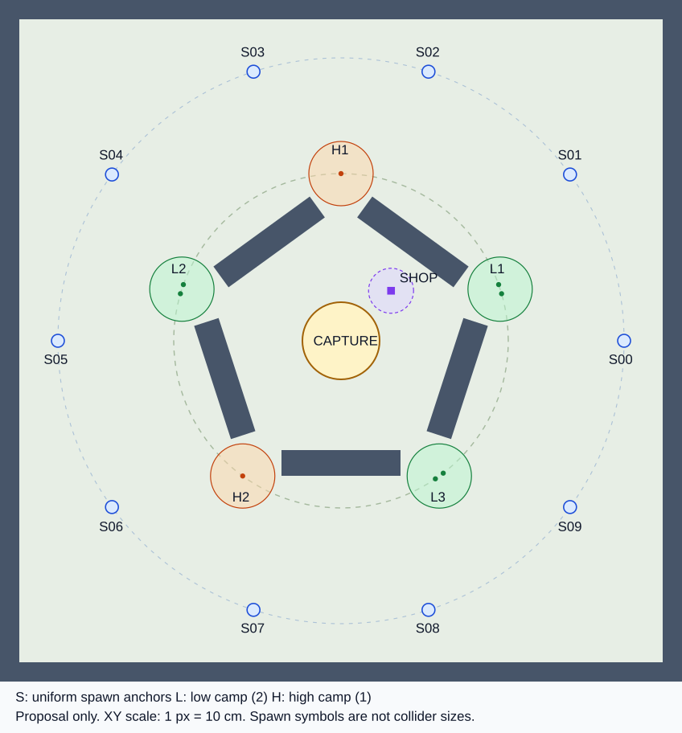

# Demo 世界、营地与视野实施准备报告

本文服务于 [App Spec](../APP_SPEC.md) §2、§6、§7、§9 的同一个 Demo。
**布局、数值引用和新增接口都是本 PR 的待审设计，不是已经批准的产品规则或已经完成的实现。**
本轮只研究、审核和编写文档，没有修改 Source、Config、Content、SourceData 或 Scripts。

源码证据基线为 `fa11d09a762bccadf495191072e222dd158fc014`。
先读取 README、App Spec、AGENTS、DEVELOPMENT 及相关系统手册，再核对实际实现；
文中“现有”指该基线的事实，“拟新增／改造”指后续任务。
联合身份、事务和时序以 [共享契约](SHARED_CONTRACTS.md) SC-02、SC-03、SC-05、SC-07、SC-09 为边界；
本模块不另建世界时钟、战斗生命、奖励账本或占领胜负状态。

## 1. 结论与唯一实施方向

必须保持一张地图、一个占领点、五组两档野怪、一个商店、十个出生锚点。
开局和每次复活对同一十点等概率、有放回抽样，允许重复；
不得按敌距、视野、危险程度、胜率、初始点或剩余空闲点重新加权。
重复落点只在已经抽中的锚点附近做必要的合法落地和防重叠。
静态地点公开不等于其隐藏单位、存量、刷新进度或占领者的精确坐标公开。

**终态只采用以下一条链，不保留备用旧模式：**

```text
唯一 Demo 世界输入 + CONTENT_AND_BALANCE 参数引用
  -> 确定性编译 / closed schema / payload + contract
  -> 改造 ULDMapDefinition + ULDMapRegistry / 唯一地图 Builder
  -> 同一静态地面、阻走、阻视线与公开地点定义
  -> CharacterMovement + LDNavigationComponent / Combat 身体
  -> ALDWorldDirector 的营地职责 / 核心生命与死亡事实
  -> ALDVisionDirector 的每观察者授权
  -> 一版有界稀疏 FLDWorldView + LDWorldViewRelay
  -> 本人原生身体、他者观察代理、HUD、小地图、AI 受限投影
```

采用稀疏世界坐标并不是要求大地图，而是避免继续维护旧 `uint8 Site` 地址、
60×40 格中心判定和 B91 第二套身体观测的平行边界。
保留现有可靠 conceal、不可靠全量快照与接受游标机制，**不直接把 B91 的 RPC 数组改名后当成新协议**。
迷雾纹理／小地图栅格只是表现分辨率，不拥有单位观察权限。

| 现状核验 | 实施判定 |
| --- | --- |
| 前端 Host 仍到 `L_DevelopmentRegion?listen?Profile=V05`；GameMode 按旧 profile 建服务 | 不能通过换标签声称 Demo 已接通。`Source\Lockdown\Private\UI\LDUIRoot.cpp:368-371`；`Framework\LDGameMode.cpp:145-180,214-277` |
| `ULDMapDefinition` 锁定 96 POI、24 出生、144 建筑、11 城镇等旧完整图结构 | 保留闭合导入、稳定 ID、反射回核，删除旧数量／城市语义；不是把旧地图缩放。`Source\Lockdown\Private\Region\LDMapDefinition.cpp:112-157` |
| Registry 仍限制 B90 standalone；旧 Region 为固定服务地址 | Registry 必须接服务器世界与新地点种类。`Source\Lockdown\Private\Region\LDMapRegistry.cpp:14-61`；`Region\LDRegionDefinition.cpp:17-38,43-68` |
| 原生导航已有地面查询、agent 投影、拒绝 partial path、合法接近点和取消身份 | 核心复用，拆掉地图分支和 Site／B91 Cast；不新增位置积分器。`Source\Lockdown\Private\Navigation\LDNavigationComponent.cpp:70-94,154-193,237-306` |
| `ALDWorldPawn/ALDWorldDirector` 确有营地战斗，当前为三组、每组同时一只、十二次生命预算 | 改造为五组、两档、逐成员生命、清空后整组刷新；不能称“完全没有可复用营地”。`Source\Lockdown\Private\World\LDWorldDirector.cpp:36-112` |
| 当前两个身体 DTO 都不含目标 HP/MaxHP；旧视野还有 public/ward/Heart/tower 来源 | 明确字段白名单与唯一身体来源，不能用 Host 的 Combat 全表补 Tooltip。`Source\Lockdown\Public\Vision\LDViewTypes.h:18-47`；`Public\World\LDEnvironmentDirector.h:27-45` |
| B92 无 UI 席位关闭 Tick，居民日程不是自主发育对手 | 仅抽取合适的权威入口；不继承居民、24 席位、离线接管。`Source\Lockdown\Private\Population\LDB92Roster.cpp:29-33,119-143`；`LDB92Routines.cpp:37-101` |

上表中未重复根路径的 `Framework`、`Region` 等路径均位于 `Source\Lockdown\Private`；
下文证据继续使用仓库相对路径，行号对应上述基线，不对应未来重构后的行号。

## 2. 首版空间方案与参数责任

### 2.1 数值唯一来源

[内容与数值报告](CONTENT_AND_BALANCE.md) 维护唯一参数表。
本报告拥有坐标、障碍、连接、地点/地面查询和模型测量，不复制一份可独立调参的战斗表。
空间验算引用以下稳定键；任何参数修改都必须重新核对其影响的空间约束。

| 参数键 | 世界侧消费与反向约束 |
| --- | --- |
| `UNIT.CollisionRadiusCm` | 玩家与野怪的实际 capsule、NavAgent、出生预约和障碍外扩必须一致，不能只改配置 |
| `UNIT.MoveSpeedCmPerSec`、`TIMING.DefendRouteBudgetSec` | 比较基础速度下的合法回防路线；装备加速不能放宽基础回防验收 |
| `UNIT.BasicAttackRangeCm`、`STAT.AttackRangeCm` | 初始值与当前派生值分开；订单/接近/释放读取当前攻击范围，脚点 XY 中心距不重复加减碰撞半径 |
| `VISION.RadiusCm` | 身体来源范围；镜头、公开地点、占领提示不增加来源 |
| `SHOP.InteractRadiusCm` | 脚点至固定商店交互锚点的 XY 中心距；本体占地内不能强塞寻路目标 |
| `CAPTURE.RadiusCm`、`CAPTURE.HoldSec` | 脚点是否进入闭圆盘和连续独占时长；脚点入圈不等于整胶囊入圈 |
| `MATCH.DevelopmentSec`、`LIFE.RespawnSec`、`LIFE.ProtectionSec` | 发育、死亡和复活资格由核心控制；保护可以主动解除，不能当作固定额外回防延迟 |
| `CAMP.Low/High.CountPerCamp`、`HP/Armor/Attack/RewardXP/RewardGold` | 世界只绑定内容定义及成员；血量和奖励不在营地管理器另存另一真相 |
| `CAMP.Low/High.RespawnSec/LeashRadiusCm/LoseTargetGraceSec` | 清营计时、活动域与失目标等待；源参数变化须重算回位、出生和争圈关系 |
| `CAMP.ResetArrivalRadiusCm` | 成员真实脚点至其固定MemberHome的归位区域；不加减胶囊半径，不强snap被占中心 |
| `CAMP.AggroTrigger=ConfirmedCombatHit`、`CAMP.GroupRetaliation=true`、`CAMP.ResetPolicy` | 用户已定的仅受击触发/同营共同反击及回营重置规则，不是可切换模式；不保留自动获取半径或关闭值 |

正式距离口径为厘米、单层脚点 XY 中心距；地面支持、身体碰撞和路径是另外的检查。
`FindApproach` 的范围由服务器当前合法属性／地点参数提供，不信客户端自报 Range 或 Capsule。
路径长度量到**合法圈边／合法商店交互边界**，不以去中心的距离冒充到达时间。
坐标表、阻挡表及其模型证据与原生验收的边界必须同时保留。

### 2.2 唯一坐标源与布局理由



**此处整数坐标表是唯一几何输入，不再用另一组三角函数坐标覆盖它。**
图是同一输入的示意，不是引擎截图、已生成资产或比例之外的碰撞依据。
全部脚点 Z=0；内部地面 `X,Y ∈ [-5000,5000] cm`，即 **100m×100m**。
外围墙厚300cm，内/外表面分别为±5000/±5300。
采用单层静态平地和一个 NavMeshBounds，不加入坡地、城市、河流、楼层、可破坏建筑、梯绳或隐身地形。
地面、占领标记和出生/营地标记不挡视线；占领圈不是实体碰撞体。

五营地在约2600cm环上，每个正对一个入口；十出生点在约4400cm外环上。
外部连通环带可以绕行侦察，内侧五墙提供绕角、追击/脱离及视野取舍；
**环带连通不代表任意两点之间都能走直线**，跨对侧可能穿入有墙的核心区，必须查完整路径。
五入口角度为18°/90°/162°/234°/306°，270°处是墙，不是额外入口。
十点抽中概率相同，但整数坐标、商店偏置和三低两高不保证每点经济收益完全相同；
不能用几何近对称冒充六人公平性或胜率验证。

| SpawnId | X | Y | SpawnId | X | Y |
| --- | ---: | ---: | --- | ---: | ---: |
| S00 | 4400 | 0 | S05 | -4400 | 0 |
| S01 | 3560 | 2586 | S06 | -3560 | -2586 |
| S02 | 1360 | 4185 | S07 | -1360 | -4185 |
| S03 | -1360 | 4185 | S08 | 1360 | -4185 |
| S04 | -3560 | 2586 | S09 | 3560 | -2586 |

| 地点 | 锚点 XY（cm） | 成员0 XY | 成员1 XY | 功能 |
| --- | --- | --- | --- | --- |
| L1 | (2473,803) | (2450,874) | (2496,732) | Low，两只；入口18° |
| H1 | (0,2600) | (0,2600) | 无 | High，一只；入口90° |
| L2 | (-2473,803) | (-2496,732) | (-2450,874) | Low，两只；入口162° |
| H2 | (-1528,-2103) | (-1528,-2103) | 无 | High，一只；入口234° |
| L3 | (1528,-2103) | (1589,-2059) | (1467,-2147) | Low，两只；入口306° |
| SHOP | (778,778) | 不适用 | 不适用 | 唯一不可攻击商店；非安全区 |
| CAPTURE | (0,0) | 不适用 | 不适用 | 唯一自动占领圆圈；半径引用内容表 |

Low成员位置已收敛为整数厘米，组内实际中心距分别为149.265、149.265、150.426cm，
不是声称取整后仍“精确150cm”。当前角色/野怪半径候选40cm，三组均不重叠；
也为内容候选180cm余波提供同组两个合法受害生命的正例。
营地预留500cm半径的静态清空地面，但这不是自动警戒范围或Leash的新上限，更不是安全区。
高档增加风险/收益来自内容和战斗，不靠额外封锁道路或隐藏地点。
开局同样允许多人竞争同一 Low；本图不为每名玩家分配专属营地。

### 2.3 阻挡与连接表

| 对象 | 原始 XY 顶点/范围（cm） | BlocksMove | BlocksSight | 拟定高度 |
| --- | --- | --- | --- | --- |
| MIDWALL_054 | (1748,832), (1983,1155), (486,2243), (251,1919) | 是 | 是 | Z=0..600 |
| MIDWALL_126 | (-251,1919), (-486,2243), (-1983,1155), (-1748,832) | 是 | 是 | Z=0..600 |
| MIDWALL_198 | (-1903,354), (-2283,231), (-1711,-1529), (-1331,-1405) | 是 | 是 | Z=0..600 |
| MIDWALL_270 | (-925,-1700), (-925,-2100), (925,-2100), (925,-1700) | 是 | 是 | Z=0..600 |
| MIDWALL_342 | (1331,-1405), (1711,-1529), (2283,231), (1903,354) | 是 | 是 | Z=0..600 |
| WALL_N / WALL_S | X=[-5300,5300]；Y分别[5000,5300]/[-5300,-5000] | 是 | 是 | Z=0..600 |
| WALL_E / WALL_W | Y=[-5300,5300]；X分别[5000,5300]/[-5300,-5000] | 是 | 是 | Z=0..600 |
| SHOP_STALL | (718,718), (838,718), (838,838), (718,838) | 是 | **否** | Z=0..80，低台面 |
| 地面/圈/营地/出生标记 | 由上述地点和合法地面派生 | 否 | 否 | 地面/叠加表现 |

商店低台面是首版“阻走但不阻视线”的明确实例，不增加可攻击/可破坏能力。
建议身体视线采样面为脚点上120cm，墙挡该射线而台面不挡；
这些高度同属待审几何/表现建议，须与实际Character和镜头在锁定引擎验证。
无“仅阻视线”的产品对象，不为凑分类新增烟雾/草丛。

| 入口 | 两侧墙 | 原始点模型净宽 cm | 40cm miter外扩后保守净宽 cm | 连接 |
| --- | --- | ---: | ---: | --- |
| G018 | 342 / 054 | 502.503 | 390.828 | L1方向外环 ↔ 核心 |
| G090 | 054 / 126 | 502.000 | 390.295 | H1方向外环 ↔ 核心 |
| G162 | 126 / 198 | 502.503 | 390.828 | L2方向外环 ↔ 核心 |
| G234 | 198 / 270 | 501.858 | 390.149 | H2方向外环 ↔ 核心 |
| G306 | 270 / 342 | 501.858 | 390.149 | L3方向外环 ↔ 核心 |

核心地面连通，所有入口通向圈和商店，不要求沿唯一预置路线移动。
路径图只为核验连接，不作为第二套位置/导航系统。
从入口向核心的视线可以合法穿过空隙；不能笼统说“外环永远看不到圈”。
例如 `(0,1500)` 至 H1 的1100cm射线穿 G090；
`(0,-1650)` 至 `(0,-2150)` 虽仅500cm，却被270°墙阻视线。
同一几何分别给出范围内可见/范围内不可见，公开占领提示不改变这两个结果。

### 2.4 等概率出生与局部落地

一次新生命请求先抽一个 SpawnId 并固化，之后才做落地预约。
使用服务器无偏有界整数抽样；不得直接用有偏的随机数取模，也不能把“剩余空闲点”作为抽样池。
重放同 `(Match,Contender,待提交Life,SpawnRequest)` 返回同一选点；
相同请求不同条款拒绝。统计频率只是诊断，代码路径和RNG夹具还必须证明未读取危险度或移除点。

每个锚点使用同一组**全局XY整数偏移**，不另做旋转/三角取整：

| 局部槽 | 0 | 1 | 2 | 3 | 4 | 5 | 6 |
| --- | --- | --- | --- | --- | --- | --- | --- |
| 偏移cm | (0,0) | (100,0) | (50,87) | (-50,87) | (-100,0) | (-50,-87) | (50,-87) |

七槽最小中心距100cm；离锚点最远100.344cm。
先尝试中心，确有重叠时才使用局部槽；同批按核心稳定参赛ID/请求序号确定预约顺序，不按安全性排序。
七槽可在静态模型中容纳同点六人，不表示动态占用时总能成功。
200cm包络只供落地验证，**不授权任意扩环或新增更近圈的落点**。
本次70候选的距离证据仅适用于这七槽；改变偏移/横向投影必须重新计算。

新增内部接线：`DrawSpawnAnchor(...) -> SpawnSelection`、
`ReserveSpawnPlacement(Selection, FLDVictimKey, Capsule, WorldRevision) -> Reservation`，
核心成功提交 Spawn/Possess/新生命后 `FinalizeSpawnPlacement`；
仅在核心commit前的准备失败时释放预约并保留选中锚点。
地图/局部 ground 投影不应偷偷改变候选XY；不合法应拒绝并诊断。
检查真实 capsule、支撑面、完整路径、当前物理占用及同批预约，排除观察代理。
当前 Pawn 对 Pawn 为 Ignore，不能仅依赖引擎阻挡替代显式出生防重叠
（`Source\Lockdown\Private\Character\LDCharacter.cpp:25-30`）。

七槽都不合法时返回 `SpawnBlocked`，不增加Life、不发初始奖励、不出现部分成功。
按同一选中点进行有界重试并显示/记录受阻状态，不重抽另一“更安全”点。
世界只处理位置/预约，何时复活、成功生命递增和终局闸由核心负责。
`Reserve` 必须在核心生命commit之前完成所有必需分配、身体构造准备、注册资源、
碰撞/几何检查和同批占位预留；临时身体不可战斗、观察或占点，不触发奖励。
commit与Finalize在同一权威提交作用域完成，中间不异步让出并重新使用未保护的落点。
**核心生命commit后的Finalize没有正常失败分支**，不能此时再分配可能失败的Pawn或重新寻路。
若必要不变式被破坏，进入显式 `AuthorityFault` 并阻止错误继续发布，
不回滚已公布Life、不重抽点、不返回假成功。
整组营地刷新采用同一“全部预留完成→核心生命/组提交→无正常失败Finalize→一次发布”边界。
参赛者的 `Respawned` 原子携带Alive与复活保护，不先发布短暂的未保护Alive。
即使新身体位置先到，核心仍将该生命视为不具资格，直到完整复活事件提交；
世界几何就绪不是恢复占领/战斗资格的替代信号。

### 2.5 可复算路线表

下表是**40cm保守凸多边形外扩模型内的最短路径**，单位cm，四舍五入到0.001cm仅为复算核对。
外围合法脚点边界内缩到±4960；最终商店坐标为(778,778)。
不是未膨胀点代理，不是UE NavMesh测量，也不包含动态拥挤、加速度、刹车、控制或网络校正。

营地中心仅是公开测距参考，不是实际攻击订单终点：
High中心有怪物，Low中心到两个成员约75cm，也不能当作40+40cm身体的合法站位。
真正订单须用成员句柄和 `FindApproach`，不能把这张测距表变成走入怪物中心的许可。

| 出生 | 到有效圈边 | 到Shop合法范围边界 | 到L1中心 | 到L2中心 | 到L3中心 |
| --- | ---: | ---: | ---: | ---: | ---: |
| S00 | 3875.255 | 3354.614 | 2087.615 | 6923.428 | 3559.634 |
| S01 | 3875.436 | 3183.627 | 2088.219 | 6516.459 | 5110.357 |
| S02 | 3875.833 | 3479.117 | 3560.434 | 5111.733 | 6515.950 |
| S03 | 3875.833 | 3672.275 | 5111.733 | 3560.434 | 6923.191 |
| S04 | 3875.436 | 4718.133 | 6516.459 | 2088.219 | 6922.817 |
| S05 | 3875.255 | 4886.361 | 6923.428 | 2087.615 | 6515.710 |
| S06 | 3875.554 | 5224.744 | 6923.400 | 3559.057 | 5110.874 |
| S07 | 3875.820 | 5202.690 | 6516.137 | 5110.667 | 3560.234 |
| S08 | 3875.820 | 4647.008 | 5110.667 | 6516.137 | 2088.767 |
| S09 | 3875.554 | 4386.503 | 3559.057 | 6923.400 | 2088.615 |

| 营地 | 到有效圈边cm | 到Shop合法边界cm | 当前基础近战候选下的一个合法攻击接近脚点 |
| --- | ---: | ---: | --- |
| L1 | 2000.103 | 1345.505 | (2616,849)，距两成员167.872/167.598cm |
| H1 | 2000.000 | 1640.297 | (0,2800)，距成员200cm |
| L2 | 2000.103 | 2901.504 | (-2616,849)，距两成员167.598/167.872cm |
| H2 | 1999.499 | 3340.230 | (-1646,-2265)，距成员200.420cm |
| L3 | 1999.499 | 2631.535 | (1616,-2224)，距两成员167.194/167.720cm |

这些接近点在当前基础范围候选220cm内、不重叠且射线不穿静态墙；
这里只证明一个合法几何机会，**不证明普通攻击已实现或基础角色一定打得过**。
每个Spawn均有合法低档路径；最近Low中心距离2087.615..3560.434cm，
以内容基速候选600cm/s恒速计算名义约3.479..5.934s。
出生到圈名义约6.459s，营心到圈约3.333s，Shop因偏置为不等长路线。
营地清理时间、六人分配、升级/金币与购物机会必须使用内容表实际战斗/收益模型，不从路径长度猜收益。

### 2.6 最远发育区、回防上界与最快返场下界

不能只测营地中心而忽略拉怪活动区，更不能用模型“最短路上界”冒充最快返场的严格下界。

本次完整模型具有可复算的**构造路径上界**：
从任一合法脚点向圈边连最短径向线段；外扩五墙的角域互不重叠，最小角间隙11.662°，
所以该直线至多穿一段中墙，另可能穿商店底盘。
所有外扩障碍彼此分离、在边界内且不接触圈；将被挡弦替换为该凸障碍两交点间的较短边界弧，
增加长度不超过该障碍半周长。由此
`D_any <= sqrt(2)*(5000-40) - 600 + max(中墙半周长) + 商店半周长 = 9224.661cm`。
以基础候选600cm/s恒速计算名义上界15.374435s，小于16s对应的9600cm几何预算。
它覆盖地图任意合法模型脚点，包括从远处用成长射程打野的人，不只覆盖Camp中心。
**不是实际原生回防时间上界**；动态单位、加速/制动和操作成本另测。

作为边界诊断，四个合法角点±4960的模型圈边路径为6418.536..6589.882cm；
这些样本不是“仅查四角就证明全图最大”的替代论证。
在各营心的Leash圆内，任一点回营心的直线至多遇到两段相邻墙，
再接营心到圈路径的同类构造上界为 Low 7719.206..7719.972cm、High 7919.206..7920.323cm。
这些是活动域内路径上界，不把Leash改为路径距离规则，也不声称整圆没有墙。
**Leash仍按营心XY半径；实际追击/返回必须另走合法完整路径。**

本次70个精确出生候选均合法且连到各自锚点，圈边模型路径最短3775.611cm、最长3976.064cm。
其严格欧氏下界为 `min(|SpawnCandidate|-CAPTURE.RadiusCm)=3700cm`，
由S00向内100cm偏移等点取得。偏移使最快距离不同于只算十个中心点。
内容已按用户确认采用两份独立装备主动，最多两次450cm/0.25s位移；
最大常态移速候选744cm/s与最大射程候选660cm是**分别合法的构筑包络**，不声称同一套装备能同时达到二者。

对已确认的两次位移，用内容包络的理想表达
`T_optimistic(D) = min(D,900)/1800 + max(0,D-900)/744`：
代入3700cm欧氏下界得 **4.263441s**；
代入实际模型路线得名义 **4.365069..4.634495s**。
所有70条模型路线的最短第一直段为2455.545cm，足够容纳这两段位移；
是否原生可连续执行、碰撞截短/冷却来源正确仍须实测。
这里不计敌方协助位移，不借前端回执、换槽或卖出重买制造第三次额度。
保护可以提前解除，**不能在最短返场时间后再加3s保护**。

内容候选 `LIFE.RespawnSec=26 > CAPTURE.HoldSec=25` 的作用仅是：
最后阵亡者不能单靠复活返场这一途径，否决一段已经开始且无人争夺的完整占领。
这不是保证多人对抗必然在固定时间结束，也不排除存续效果、其他存活者和合法争夺造成中断。
无需为了该条件扩大地图或改变十点抽样。

### 2.7 成长射程与群攻的空间接缝

用户已确认初始近战单体普攻，装备/属性可提供群攻与射程成长。
世界订单读取当前 `STAT.AttackRangeCm`，不能永久用初始 `UNIT.BasicAttackRangeCm`。
内容候选的最大派生范围660cm、180cm余波只作为本次几何覆盖输入，权威数值仍在内容表。
Low组内149.265..150.426cm间距提供两名受害者均可被合法余波覆盖的正例；
500cm隔墙样例提供“在660cm距离内但不可穿墙命中/观察”的反例。

群攻从已接受 `AttackId` 的权威效果上下文进入 `QueryCombatContacts`，
复用Combat同一Bodies，每名受害者仍有独立生命、命中和DeathKey；
次击目标过滤、逐目标LOS、伤害与不递归由Combat/内容确定。
不能让UI/AI获得次击候选表、隐藏受害者位置或全局受伤回执。
未受攻击的野怪不因玩家走近而获取目标；成长射程内的合法攻击事实按同一受击入口触发反击，
不再经过自动获取半径门槛。反击仍不得读取视线外的实时目标。

### 2.8 本轮机械依据与剩余误差

本轮实际用无额外依赖的Python模型执行：
凸多边形按角色半径向外平移支撑边、相邻边交点作miter封角；
在起点/外扩顶点间做不穿障碍内部的visibility graph，Dijkstra求路；
终点是合法圈/交互盘的可达边界，不先去被阻挡中心再盲减半径。
矩形/旋转凸障碍、穿越/沿边/切角和圆目标的10个独立算例通过；
本表75项锚点查询、70个出生候选、八成员合法性/分离、五个近战接近点、五入口净宽、
Shop/圈相离和上述构造上界均已复算。
一条可人工复核的S03路径为
`(-1360,4185) -> (-195.147540,1910.122766) -> (-60.981526,596.893000)`，
长度3875.833cm，末点到圈心600cm。

精确复现只需§2.2/§2.3的整数几何、§2.4七个偏移、内容参数快照以及上述算法；
不得取SVG标记半径或旧三角函数坐标作为第二输入。
miter角比真实圆胶囊的圆角更保守，沿边切线允许于该理想模型；
原生碰撞skin、地板间隙、NavMesh离散化、动态占位和视觉可读性尚未测。
静态图形和Python结果不证明UE路径、Host表现、AI行为或人类游玩已经通过。

## 3. SC-07 查询契约与共享责任

以下名称是**拟实施的唯一适配接口，不是当前已存在的 C++ API**。
函数落在保留的 MapRegistry、Ground、Navigation、Vision、WorldDirector 和 Combat 边界，
不要求为每一行新增一个 Manager、Actor、缓存或可写状态表。

### 3.1 值、身份与调用权限

| 值 | 含义与约束 |
| --- | --- |
| `FLDMatchContext` | 直接引用已审核心合同的局身份类型；提交期从借用Permit的Boundary.Match取得，不另造核心Context或客户端自填调用上下文 |
| `FLDVictimKey` | 生命身份统一为核心的Kind/EntityId/Life；不以原生Combat Identity的FGuid冒充Life，也不另建营地生命计数 |
| `FLDCombatBodyRef` | 需要对应实际身体时使用核心的Victim+BodyIdentity；OwnerState uint32 Life与Combat FGuid Identity的映射由核心维护 |
| `FLDGameplayWritePermit` | 核心为当前提交调用栈签发的借用许可，绑定Boundary/Phase/GateRevision；不含调用者所有权证明，不得复制、保存、网络传入或自行构造 |
| `FLDWorldRevision`（其他世界签名简写为`WorldRevision`） | 世界域拟建纯值：`FName MapId; uint32 LayoutRevision; uint32 GeometryRevision`；不是核心Context，不替代Match/Life/Order/Epoch/ViewRevision/schema |
| `GroundedFootSample` | 从当前权威身体和原生 walkable floor 取得的脚点、支持面/连续地面 patch、grounded 事实；不是把任意点击投影到地面后的“假落地” |
| `ObserverContext` | 服务器绑定的真人拥有连接、对应参赛AI，或仅供营地反击校验的CampMember上下文；无身体／新生命／换局须更新。营地成员不创建参赛席位/PlayerState/钱包或另一网络视图，不能给玩家或同营共享视野 |
| `ObservedHandle` | 观察者局部的 opaque token 与观察 epoch；服务器映射到目标共同生命，客户端不能用 Actor 指针、公开参赛 ID 或 CampId 代替它 |
| `ObservedFrame` | 当前授权字段及 generation/revision；快照不是永久命令授权，合法的新帧不应使仍可见的旧句柄每帧无故失效 |
| `AuthorityEffectContext` | 仅 Combat 已接受效果的 ID、实际归属、来源生命、定义/权限与求值时刻；不能由 UI 或 AI 请求获得此权限 |

核心已收敛的拟建类型如下，正式定义归
[会话与对局报告](SESSION_MATCH_LIFECYCLE.md)，本报告只引用，不再定义同义类型：

```cpp
// Proposed shared core types; not existing source declarations.
FLDMatchContext { uint32 Generation; FGuid LedgerMatch; }
FLDVictimKey { ELDVictimKind Kind; FGuid EntityId; uint32 Life; }
FLDCombatBodyRef { FLDVictimKey Victim; FGuid BodyIdentity; }
FLDDeathKey { FGuid LedgerMatch; FLDVictimKey Victim; }
```

`Kind` 区分 Contender/CampMember。参赛者 EntityId 为 ContenderId；
营地在新局注册时为固定 `(CampId, MemberSlot)` 建一次稳定 EntityId 映射，跨整组刷新保留该实体 ID，
只在成功新生命提交时递增同一 `Victim.Life`。
每次原生 Combat 注册产生的 `BodyIdentity` 与该 Victim 精确绑定，重绑/回位不额外增 Life。
地图重载、失败出生、旧 Actor 回调都不能自行构造或强转这份映射。

身体脚点统一为直立 capsule 的权威位置减 scaled half-height。
导航仍以原生 `GetNavAgentLocation` 工作，接线时核对二者支持面和技术容差，
不保存另一份可修改的人物位置。
现有先例：`Source\Lockdown\Private\Region\LDMapSurfaceSubsystem.cpp:25-36`、
`Combat\LDRiverEnvironment.cpp:131-139`、`Navigation\LDNavigationComponent.cpp:83-89`。
技术 floor gap 容差须在 UE 5.8.4 校准，不在文档中编造跨楼层容差。

### 3.2 正式适配签名

`Result<T>` 表示“有值成功或有类型的错误”；不是建议用默认 `T` 冒充失败，
也不要求引入新的通用结果库。网络命令仍使用现有回执与身份机制。

| 拟实施签名 | 生产者、结果和接受条件 | 消费者／失效点 |
| --- | --- | --- |
| `QueryGround(WorldRevision, FootCm, Capsule, SurfaceHint) -> Result<LegalGround>` | World/Ground；有限坐标、边界、支持面、完整占地；计划投影须显式报告位移与同层结果 | 点击、导航、出生；不能用规划投影结果替代交易/圈内的当前身体位置 |
| `QueryCompletePath(WorldRevision, FromGround, ToGround, Capsule) -> Result<CompletePath>` | Navigation；正确 native agent、两端合法、完整路径、对应 GeometryRevision | 移动与离线/原生路线检查；partial、无 nav data、失配或长期无进展必须拒绝/停止 |
| `ResolveObservedUnit(ObserverContext, Handle, Purpose) -> Result<AuthorityTargetSample>` | Vision；重查观察者/目标生命、epoch、当前可见和用途；返回只在当前权威阶段有效的样本 | Inspect/Attack/TargetCast；调用时重新授权，不把样本缓存成跨帧真相 |
| `EnumerateVisibleUnits(ObserverContext, Purpose) -> Result<ObservedFrame>` | 同一 Vision 生产者；只输出当前授权目标及已批准字段 | UI、攻击移动候选和 AI 策略；禁止返回 canonical Bodies 或隐藏目标路径 |
| `FindApproach(ObserverContext, Origin, UnitHandle or PublicPOI, RangeCm, Capsule) -> Result<Approach>` | 单位先重新解析；固定地点从地图注册表取；在碰撞外、范围内找合法完整路径 | 攻击接近/商店接近；单位失明不更新真实隐藏坐标，路径成功不授予交易权 |
| `TraceSight(SourceGround, TargetSample, WorldRevision) -> Result<SightResult>` | World/Vision；有限、同层与固定 eye/target sample、范围及阻视线几何；与阻走分开 | 授权层与 Combat 几何；公开地点/静态 ray 结果不是单位锁定权限 |
| `QueryShopEligibility(Permit, BuyerBody, ShopId, ExpectedWorldRevision) -> FLDShopEligibilityResult` | 下方唯一四参类型；Transactions借用作用域内按当前实际子时刻验证身体/世界、合法脚点/区域与中心距；不增加LOS条件 | Vendor绑定真实调用者与BuyerBody，最终安装前仍核permit/生命/会话/quote/余额/槽位/revision；结果不是长期交易授权 |
| `QueryCircleMembership(CaptureId, GroundedFootSample, WorldRevision) -> Result<CircleGeometry>` | 同一合法地面 patch、实际脚点、闭圆盘内、完整身体站位不穿阻走体 | 只产生几何事实；是否有效参赛、连续独占和唯一胜负归核心，不受观察权限影响 |
| `ExtractCircleCrossings(CaptureId, ActualMotionSegments, WorldRevision) -> Result<GeometryTransitions>` | 对实际提交的连续运动片段求圈内转换；不连续 placement 只取实际前/后状态 | 生产者封装实际身份/序号/时间；最终水位须等同批晚因果工作闭合后Sealing，不能随首段运动提前发布；不从代理或末帧补历史 |
| `QueryCombatContacts(AuthorityEffectContext, BoundedShape, WorldRevision) -> Result<BoundedVictimSamples>` | 仅权威 Combat 执行器；用现有 Combat 身体注册表加世界静态几何/楼层裁剪，无第二 Bodies 表 | 覆盖内容许可的普攻派生群攻、地面范围及释放后效果；隐藏受害者查询结果不进入 UI、AI、公共消息或命中预览 |

`QueryShopEligibility` 是拟建在现有MapRegistry边界的服务器提交期只读查询，唯一实参类型如下：

```cpp
FLDShopEligibilityResult QueryShopEligibility(
    const FLDGameplayWritePermit& Permit,
    const FLDCombatBodyRef& BuyerBody,
    FName ShopId,
    const FLDWorldRevision& ExpectedWorldRevision) const;
```

`FLDShopEligibilityResult` 是本世界域原有“ShopEligibilitySample或类型错误”结果形状的具体拟名，
不是新增核心封包/状态。成功样本只含对应ShopId/WorldRevision、实际采样时刻、合法脚点/支持面及距离；
非成功没有可当作通过的默认样本。此处声明尚未实现，不创建新Manager或时钟。

| 检查层 | 当前调用/阶段的确切责任 |
| --- | --- |
| Vendor/事务受理入口 | 从真实拥有连接或经过同一验证的AI服务器入口绑定当前参赛者，并通过核心取得其当前`FLDCombatBodyRef`；请求不能任意指定BuyerBody/Permit。匹配调用者与`BuyerBody.Victim.EntityId`是这一层的责任，不能从permit推导所有权 |
| 核心签发与World查询入口 | 核心只借出当前调用栈的permit；World调用`ValidateWritePermit(Permit, ELDCommitPhase::Transactions)`核当前Match/批次/阶段/GateRevision/写闸，再核Buyer是当前有效Contender身体且Victim/Life/BodyIdentity映射未变、WorldRevision匹配 |
| World几何取样 | 局身份取`Permit.Boundary.Match`；实际子时刻取核心`GetAuthorityNowSeconds()`及其覆盖的真实运动/支持面证据。不能用`Boundary.AtMs`封桶上界、Step.End、帧末Actor姿态或旧FindApproach结果冒充当前交易姿态；必要证据缺失明确失败 |
| Vendor最终安装 | 查询通过后仍按同一不可跨回调保存的借用作用域准备买卖，在最终安装点再次验证permit及当前生命/会话/quote/余额/容量/版本；World只重查几何，不提交钱/装备，也不替代这些检查 |

导航/展示预览继续走公开静态查询和自身只读投影，不向UI或策略AI发放该permit或新增authority getter。
已提交交易的只读回执重放沿原事务协议处理，不因重放再执行首次交易或把旧资格样本重新当授权。
权限/阶段拒绝沿核心`ELDCommitReject`契约处理，几何拒绝沿§3.3；不得补空Context、假Body或默认permit填平调用。

`QueryGround` 的第四参 **`SurfaceHint: FName` 必填**，表示该WorldRevision中已注册的稳定SurfaceId，
不是Actor名称、组件指针或“默认地面”。没有默认值或三参重载；
`NAME_None`/未知ID返回 `InvalidSurface`，实际支持面不匹配返回 `WrongSurface`。
地面点击由当前公开地图的地面trace取得注册SurfaceId随意图提交；
服务器仍重新验证地面/完整capsule，客户端hint只是期望面，不是接地或权限证明。
当前身体调用由权威CMC.CurrentFloor的walkable支持面经Registry映射取得；
无合法floor应报告NotGrounded/圈几何不具资格，不以空hint向下投影伪装已落地。
出生/营地/Shop/圈的规划点使用该静态地点已注册SurfaceId。
各调用者必须显式供给来源，不能以零值/最近另一层/Guild填平接口差异。
合法编码下的InvalidSurface/WrongSurface/NotGrounded是语义结果，不伪装为Malformed或被客户端吞掉；
当前身份的进攻意图已通过核心前置时，后续地面失败不撤销已发生的解除保护。

`TraceSight` 里的观察范围与 Combat 的攻击/技能范围不是同一个参数。
单位新锁定必须可见；效果接受、释放、命中哪些阶段重查视线/目标生命，由战斗与内容定义逐类明确。
空间层不擅自令所有范围伤害只能命中可见单位，也不据此允许 AI 盲读隐藏身体。

`Purpose` 必须区分 `NewAttackOrder/AttackMoveCandidate`、`AttackStart` 与 `Inspect`。
前者检查当前观察、存活/关系/targetability和合法候选搜索范围，**不要求已进入普攻射程**，
否则右键远处可见目标无法发出接近命令。`FindApproach`用当前派生范围规划，
真正AttackStart由Combat复验真实射程、LOS、状态和冷却；Inspect不附加攻击距离条件。
用户已确认失视野即取消锁定并停止该追击订单，不自动转成前往最后已知位置的地面订单，
也不保留LastSeen单位静态标记。AI只能依据新的合法观察、静态地点或公共圈状态另作决策。

用户已确认商店**不额外检查视线**：满足合法区域与真实交互距离即可，不附加个人当前视野或LDVision直线资格。
固定商店可公开，存活、进行中、真实位置、合法接近区及交易版本检查保持不变。
地图须保证交互盘除本体外是同一合法接近区；隔墙或跨楼层口袋是生成/几何错误，
不是扩大半径、自动搬移锚点或沿用路径票据的理由；Vendor不调用单位观察解析或额外LOS来添加购物条件。
装备 1/2 主动只走 Combat，不依赖商店查询。

### 3.3 错误、回执与撤销

| 内部结果 | 调用方处理 |
| --- | --- |
| `DataNotReady / StaleContext / StaleWorld / UnknownSite` | 不接受命令、不变更资源；地图初始化错误阻止开局，记录具体 ID/修订 |
| `InvalidPoint / InvalidSurface / InvalidGround / NotGrounded / WrongSurface / Blocked` | 不把 ZeroVector、空SurfaceHint、Guild、旧目标或最近另一楼层当成功 |
| `NoCompletePath / OutsideRange / InvalidApproachRegion` | 区分“无合法路”和“未在范围”；导航停止并明确反馈，交易不部分提交 |
| `TargetUnavailable` | 对外合并隐藏、过期、已销毁/换生命等原因，避免探测隐藏存在性；服务端诊断保留详细原因 |
| `CapacityExceeded / InvalidPayload` | 解码/生成失败显式诊断；关闭未授权呈现，不能静默漏掉可见单位后继续声称完整 |
| `SpawnBlocked / ConflictingTerms / UnregisteredLife` | 不重抽安全点、不造新生命/奖励；同请求重放原结果，异条款拒绝 |

请求仅携带该领域实际所需身份，不给所有函数机械套一份庞大网络封包。
当前取消身份仍为 `FLDMoveIdentity.Match/Life/Order/Epoch`；
观察快照游标、交易回执和地图 revision 各管自己的失效条件。

### 3.4 圈边界与实际事件时间

圈内谓词使用 `DistanceSquaredXY(Feet, CaptureAnchor) <= CAPTURE.RadiusCm^2`，
同时要求当前 grounded、可走支持面、同一连续 capture patch 和合法 capsule 站位。
边界包含等号；脚点在圈外但胶囊擦圈不计入，脚点已在圈内且站位合法则不要求整胶囊入圈。
公开圆盘内不得被墙、楼上平台或不可达地面切成多个“可计入区域”；生成器须拒绝这种坏布局。

运动提供者提交实际 accepted sweep 子片段，不能只把 `OnMovementUpdated` 的旧位置至最终位置连成一条弦：
滑墙、折返、短弦穿圈可能在同帧进入又退出。
每次转换有独立本流序号；切线/同刻入出保留，不能按最终 bool 合并。
root motion 从实际运动采集；碰撞截短不能按请求距离产生虚假进圈。
仅当首版选定效果需要不连续 placement 时才接其原子提交；失败回滚不发布临时位置，瞬移连线不虚构途经圈。

| 现有接点 | 后续责任 |
| --- | --- |
| `Source\Lockdown\Private\Character\LDCharacterMovementComponent.cpp:69-101,129-141,159-160` | 复用 saved move/原生运动；在项目子类核验并实现 UE 5.8.4 的实际子片段采集，不修改共享引擎 |
| `Source\Lockdown\Private\Combat\LDTacticalFields.cpp:37-54` | Push 的实际/截短 sweep 接同一采集作用域；若底层已捕获，不双重发事件 |
| `Source\Lockdown\Private\Combat\LDContentGeometry.cpp:23-44` | 保留效果的 atomic placement 成功才提交；未选旧技能直接删除，不为其保留事件平台 |
| `Source\Lockdown\Private\Framework\LDGameMode.cpp:363-378,388-452` | 核心/生命周期提供离开、死亡、复活与保护资格变更；失败出生不产生成功进圈 |
| `Source\Lockdown\Private\World\LDWorldClock.cpp:9-28` | 旧临时回拨 `World.TimeSeconds` 的路径必须解除；不能以当前姿态或补算时间给新事件伪造旧时间戳 |

共同事件引用核心的 `FLDMatchContext + FLDCombatBodyRef + ProviderId + ProviderSequence + OccurredAtSec + 变化`；
其中生命身份就是BodyRef内的`FLDVictimKey`，不另定义生命键别名。
命中前只需确认该真实子时刻、相关身体的实际运动/几何证据齐备，**不等待整批最终Fence**。
核心随后按真实子时刻处理Effects/DeathsAndRewards及后续世界/事务工作；
由这些工作产生的晚因果位移、落地和生命/资格变化全部纳入原流后，Sealing才接受最终提供者水位。
**Capture阶段**才等待该边界必需的最终Fence，归约所有中间圈/资格事件并判定连续性。
不能先等最终Fence才执行会产生其后续证据的命中/死亡，否则构成循环前置条件。
Capture仍缺必需最终水位、或出现已消费边界之前的新事件时，按核心故障合同处理并阻止错误判胜；
不能回滚物理世界“补证明”，也不能把Sealing之前尚未产生最终Fence本身当作命中故障。
世界不决定最终同刻事务次序；核心先锁定结果、关闭写闸，再取消/清理。
只保存有界待消费事件，不建立永久运动日志或第二套占领状态。

时序适配采用核心的服务器**游戏模拟step时间**，不是另一个墙钟。
`Occurred` 按核心规则入毫秒桶；`ThroughMs` 只能取已完整处理的精确整数 `Boundary.AtMs`，
不能ceil任意完成秒数：完成到1.0002s不足以封住1001ms，后续1.0008s仍属于该桶。
用于“截止是否已到”的 `NowMs` 按核心safe-floor可用性规则取得，不能把尚未完成的时间ceil成已到期；
它与事件入桶的checked ceil、Fence的实际闭合整数边界是三个不同用途。
首次Motion结束只报告 `CompleteBodyMotion`，Effects/Respawn/事务派生位移与落地仍要纳入同流；
Capture前Sealing阶段才 `PublishThrough`，最终退休事件所在桶闭合后才退役。
已有整数毫秒期限不经double往返再ceil。
显示用 `SampledAtServerSec` 只在适配器从核心时间转换一次，不能反向生成事件时间/水位。

最新核心交付类型仍由生命周期域定义：
`FLDAuthorityStep{Match, uint64 StepSerial, double StartServerSeconds, EndServerSeconds}` 给原生运动；
共同Stamp带 `Generation/Provider/StreamId/uint64 ProducerSequence/double OccurredAtSeconds/int64 OccurredAtMs,RecordedAtMs/uint64 CommitOrdinal`；
Fence带 `Generation/Provider/StreamId/int64 ThroughMs/uint64 ThroughSequence`；
Boundary带 `Match/uint64 BatchSerial/int64 AtMs`。
世界返回真实子段的转换时刻，由单点 `AuthoritySecondsToEventMs` 做checked `ceil(sec*1000)`，
不能floor把截止后的进出事件挪到截止前，也不能给已有毫秒期限再次换算。
核心顺序为
`Session -> Motion -> Actions -> Effects -> DeathsAndRewards -> RespawnsAndWorld -> Transactions -> Capture -> Close -> Publish`。
这是生成/提交阶段责任，不能把不同实际时刻的事件按phase倒序。
共同归约先比较保留下来的 `OccurredAtSeconds`，真正同刻才用核心已生成的 `CommitOrdinal`；
消费者不能再各自按phase或接收顺序重排同刻事件。
毫秒只用于ceil桶和Fence，不能丢掉真实秒数后把同桶不同时间视作同时。
保护到期在其t本身生效；中间进出不能因最终死亡/离开而删除。
例如保护者在1000.8ms已离圈、保护在1001ms到期，不能因同属1001ms桶而倒排成先到期再离圈，
制造一次不存在的争夺；整桶晚离局也不能因Session阶段而抢在较早的死亡之前。
实际运动段序与发布事件序分开：一段可产生零、一或两个圈边界事件，
每条事件独立递增 `ProducerSequence`，不能用段序去重而吞掉第二个交点。
Motion按每Body封流，世界参与营地/刷新流封闭；`PublishCapturePresence/Eligibility` 与 `PublishThrough` 归核心，
Combat边界pose和Capture均消费后才 `AckConsumed` 释放暂存数据。

已知真实“圈外/不grounded”是可报告的几何不具资格状态，不等于数据查询失败；
不能把空中身体投影进圈，也不能为正常离地丢掉资格变更。
同XY重新取得合法floor也必须发布占用/几何资格变化，不能只监听位置位移；
错误目标SurfaceHint只拒绝该目标请求，不代表本人真实离圈或失去支持面。
真正的地面/修订/身体查询失败不能封水位，必须明确故障而非伪造Outside成功。
这里的阻塞指必要权威证据缺失、无法判断真实边界；已确定的InvalidSurface请求、
OutsideRange/NoCompletePath/NotAtHome或旧请求拒绝只结束该业务，不能借客户端错误参数冻结整局水位。
正常不具资格/尚未到家也要完成已处理边界，只有证据缺失故障才阻止对应流封闭并明确报错。
同世界Lobby/Results重置时，本域必须退役旧流/ticket/观察绑定并参加新Match初始化，
不能只重置UI或局部生成计数。

用户已确认**进攻意图即解除复活保护**，即使随后目标无效、距离不足或资源不足也解除。
因此资格提供者必须在当前局/生命/调用权限验证后，按接受到的合法进攻意图提交保护结束事件，
不能只监听成功AttackStart/命中。旧Match/Life或未授权包先拒绝，不能改变新生命。
同刻保护解除可能让已在圈内的人开始占领或打断他人，须纳入同一Sealing前的资格流，
不能因Combat最终回了失败就漏掉这一真实资格变化。

## 4. 营地生命周期与每生命奖励

### 4.1 真实复用点及必须移除的旧政策

`ALDWorldDirector::Prepare` 现有寻敌、`ALDWorldPawn` 的 Combat 注册与原生 AI 移动可以改造；
当前重新扫描所有 Controller、最近目标、直接追加 Hit 和物种特判不能原样成为 Demo AI。
无目标时立即回满血、未真正到家就重置、忽略 MoveTo 返回值、有限 `CampIds[3][12]` 都需改掉。
刷新当前在上次生成时设置截止，不是最后一名成员死亡后计时。
证据：`Source\Lockdown\Private\World\LDWorldDirector.cpp:36-87`、
`Source\Lockdown\Public\World\LDWorldDirector.h:20-35,47-93`。

旧 `ALDWildSentinel` 按本批贡献最多者发奖且每人最多两次，不符合最后一击独占。
旧 Camp 的空归属致死可能保留先前 `LastOwner`，回位也未完整清理归属。
这些是静态确认的迁移风险，**不是本轮已运行复现的 bug 结果**。
证据：`Source\Lockdown\Private\Region\LDRegionDirector.cpp:98-108`；
`Source\Lockdown\Private\World\LDWorldDirector.cpp:68,90-110`。

### 4.2 唯一身份映射

```text
静态 CampId + MemberSlot + CampGeneration
  -> 世界成员索引
  -> 核心同一个 FLDVictimKey + FLDCombatBodyRef
  -> Combat 唯一致死事实
  -> FLDDeathKey{LedgerMatch, Victim{Kind, EntityId, Life}}
  -> 成长/经济域一次 XP + Gold 提交及回执
  -> 营地消费该事实，更新存活成员集合与清营时间
```

`MemberLife` 只是共同 `FLDVictimKey.Life` 的引用，不是另一个自增计数。
当前 Combat `FLDBodyCombatState::Identity` 为 FGuid，`FLDCombatHit` 已有
`TargetLife`、`SourceIdentity`、`CreditOwner`、`Periodic`：
`Source\Lockdown\Public\Combat\LDCombatDirector.h:16-30,129-152`。
与 OwnerState `uint32 Life` 的映射由核心保持，不能把两者强转或用 CampSlot 推导生命。

CampId/Slot/Generation 是索引和回核元数据，**不能加入奖励主键以令同一死亡有多把可领奖键**。
Hit 使 HP 从正转零时固化那次实际拥有者；无主致死记录已处理的零奖励，不沿用最后一个曾经有归属的攻击者。
用户已确认：正常死亡后，已成功释放的独立效果继续到原定结束，仍在本局的实际所有者保留归属；
不能因来源Pawn移除便全部取消，也不延长原定时限或重建效果预算。
目标绑定的旧命中仍检查其TargetLife；范围效果的新合法接触由Combat按原效果定义绑定当前受害生命，
不能把“源已死亡”误作所有独立效果失效，或让旧目标绑定伤害新生命。
金币与经验由同一已提交死亡事实幂等落账，不由营地分别发放。
已成立的DeathFact冻结 `CreditOwnerEligibleAtDeath`，不能在较晚结算时按当前Pawn/离局状态重新归因。
核心保留的settlement-only记录只用于完成该既成事实，不恢复身体、碰撞、占领资格或视野；
它也不授权离局后的新命中、效果或奖励请求。
账本同 receipt/同条款重放、异条款拒绝可复用：
`Source\Lockdown\Private\Economy\LDEconomyLedger.cpp:36-84`；
不能把现有有限 B76 来源预算当作无限局刷新的去重机制。

### 4.3 用户已确认的反击、回位与重置规则

首版固定为**仅受攻击后反击、同营共同反击但不共享隐藏位置、Returning可正常受伤/控制且不回头追击、
成功回营重置存活成员满已定义血蓝/清临时效果与仇恨/技能就绪**。
这些行为不再是待选方案；具体内容数值与空间尺寸仍须PR审查。
不保留居民日程、自动近距警戒、回位无敌或旧有限生命预算作为运行模式。

| 状态/事件 | 拟实施行为 | 不能出现的结果 |
| --- | --- | --- |
| 组生成 → IdleAwaitAttack | 全部成员完成ground/nav/capsule预约后一次发布整组，每名成员独立生命/Combat状态；未受攻击不先手 | 两只Low叠点、半组可战斗/可领奖、仅因玩家走近/路过就获取目标 |
| 已确认受击 → 同营反击评估 | Combat已提交敌对接触事实通知同一Camp；所有仍存活且不在Returning的成员各自验证合法目标/视线/来源生命后发意图 | 用无效攻击意图/Miss/TargetUnavailable触发；共享隐藏坐标/Actor；把无主伤害指给最近玩家 |
| 共同反击 | 只共享攻击事件及来源身份/因果，每名成员从自身合法观察取得目标；有控制/无合法目标者不能绕过规则动作 | 同营共同反击变成共享视野、全地图警戒或邻营连锁；旧源重生身体自动成为报复目标 |
| 接近/攻击 | 同一导航/CharacterMovement 路径和 Combat 动作执行器；接近到对应中心距，检查状态/冷却/视线 | 另写位置积分或直接扣 HP，忽略 partial path、MoveTo 失败或攻击前摇 |
| 失去目标/失去视野 | 即刻取消锁定和原追击订单；`LoseTargetGraceSec` 只决定无目标等待到返回的阶段，不继续追踪 | grace期间继续读隐藏Pawn、自动续走LastSeen坐标或恢复过期句柄 |
| 超 Leash / grace 到期 → Returning | Leash 统一以 Camp 锚点的脚点 XY 距离判定；合法路径回各 MemberHome，取消未来追击/攻击 | 用整个 Leash 圆当无障碍直线区；被反复攻击就无限重置 leash、拖离营地 |
| Returning | 正常可受伤/控制/杀死，不新开目标/不攻击/不回头追击；受击不取消返回，受控制时尊重同一移动限制 | 回位无敌、受击重开追逐、把回位途中死亡丢成普通reset |
| 成功回营 → Reset | 同刻先见已到期命中/死亡；只对真实合法到家且仍存活的成员，满已定义HP/MP、清临时效果/仇恨与目标、该怪技能就绪 | 抢先回血覆盖死亡、远处重置、复活死组员、增加Life、清Hit/Death拒重、发奖励或刷新玩家CD |
| 成员真实死亡 | Combat 结束一次生命，奖励域处理一次死亡事实；营地只标该成员死亡 | 一名成员死亡就重刷它、把两只 Low 合并成一个奖励源 |
| 最后一名死亡 → WaitingRespawn | 固化 ClearAt；按该档 `RespawnSec` 生成一次组刷新 ticket | 从上次生成时间计算，或每个死亡回调重复创建 ticket |
| ticket 到期 | 重查 Match/终局闸、CampGeneration 和全组落点；成功后全组绑定新共同生命 | 旧弹道命中新生体，旧 death/ticket 重放，生成失败留下半组或静默跳过 |
| 局结束/重开 | 先关闭写闸再取消目标、行为/ticket与观察；新局重新初始化成员索引 | 清理回调发奖、上一局 ClearAt 触发新局刷新 |

Low 部分清理后，已死亡成员保持死亡，直到该组真正清空再整组刷新；
回位仅重置已成功到家的存活成员，未到家的成员继续自己的Returning，已死亡成员不复活。
没有MP资源定义的怪物保持NotApplicable，不为“满蓝”补一份临时Mana默认值。
回位无路／无进展必须停止不合法动作并报 `NoCompletePath`/诊断，
按有界重试策略处理；不得通过穿墙、瞬移回家或静默永久悬挂伪装成功。
刷新落点被动态占用时保留同一 ticket，在原营地局部合法落点处理，不随机换营地。
无法完整生成的状态不公开成“已刷新”。

攻击事实重复或失视野后的隐藏伤害不能无限重启LoseTargetGrace；没有新合法观察时，只等待到期后回位，
不盲追最后位置。Returning收到新受击/同营通知也不转回追逐，回营重置后不重放旧通知重开仇恨。
旧自动获取扫描、`CAMP.Low/High.AggroRadiusCm`及其别名/开关从有效实现与schema删除，
不能设为0后保留另一模式；只保留已确认规则和真实使用的Leash/等待/刷新/归位参数。
SpawnBlocked、动态占位、回位失败的原子性/反馈/恢复属于工程合同和验证风险，
不是仅因存在错误码就待定的玩法。若解决方式要重抽出生点、改变分布或增加玩家能力，必须另报。

### 4.4 与Combat共用的受击事实与原子回营重置

下列为与战斗域收敛的**唯一拟建内部接口**，不是当前已存在的API，更不是客户端RPC：

| 交接 | 正式契约 |
| --- | --- |
| 受击事实 | `FLDCombatHostileContact` 在内部ApplyHit成功提交后生成：`HitKey, VictimBody, ReleasedSourceRef, SourceBodyAtRelease, CreditOwner（可空）, EventStamp, 已提交敌对接触/控制结果` |
| 世界消费 | `ALDWorldDirector::OnCombatHostileContact(const FLDCombatHostileContact&, Permit)` 幂等消费，只改变合法反击意图，不伤害/发奖 |
| 重置准备 | `Combat::PrepareCampReset(const FLDCampResetInput&, const FLDGameplayWritePermit&) -> FLDCampResetPrepareResult` |
| 同次安装 | `Combat::ApplyCampReset(FLDPreparedCampReset&&, Permit)` 与世界成员状态安装同次提交；可失败检查在Prepare，安装无正常失败路径 |

触发必须是内容认可并已经成功作用于该野怪的敌对接触/控制结果，不把玩家解除保护用的
`AggressiveIntent`、未命中、不可达或资源不足请求当成怪物受击。
也不以“HP必须下降”为唯一判断替代Combat对护盾吸收/控制等合法敌对接触的判定。
击杀一名成员的攻击仍可通知其存活同伴；死亡/PendingDeath成员不能发反击动作。
World先按VictimBody验证本营成员与代次，再给同营投递最小攻击身份/因果通知，
不把完整ReleasedSourceRef中的私有来源、攻击者位置或Actor传给策略。
每个成员复用同一授权服务/TraceSight与观察上限独立重查；营地成员的观察不向真人/对手AI共享。
目标只能来自已实际攻击本营地且当前合法可见/有效的来源，不能从全Controller表补一个近敌。
重复事实幂等；早于该成员已完成reset/已消费水位的旧通知不能重开仇恨。
来源新生命不能替换事实中的旧来源生命；真正较晚发生的新合法接触则按其新HitKey/实际时刻处理，
不能只因独立效果释放较早就误丢掉后续合法命中。
反击进入现有Combat动作链与前摇，不能回填到触发命中之前的Actions阶段，也不能在通知里直接追加第二套Hit。

`FLDCampResetInput` 由世界提供 `CampId/MemberId`、当前 `FLDCombatBodyRef`、
Returning与真实 `HomeProof`、当前ReturnOrder、World/Member/Resource/CombatState修订及 `ReturnEpoch:uint64`。
这里MemberId是本营稳定成员序号，不是观察句柄或新的生命编号。
`HomeProof` 必须来自实际回位订单与当前权威脚点/支持面/完整capsule，
在同一WorldRevision下证明脚点至固定MemberHome中心距不超过 `CAMP.ResetArrivalRadiusCm`。
该参数当前候选100cm：按原八个home和40cm外扩静态模型，整个100cm脚点归位区域均无静态阻挡，
最小额外余量401.769409cm；这不是原生或多人动态围堵已经通过。
不能让导航的agent-overlap自动再加半径而停在范围外，也不强snap被占中心、穿人或漂移MemberHome。
两个Low的归位区域可以重叠，实际实体仍须合法动态站位；近家不等于无条件通过HomeProof。

重置键固定为 `ResetKey={LedgerMatch, 完整FLDVictimKey, ReturnEpoch}`。
ReturnEpoch只在进入新的Returning周期时递增，路径重算/普通受击不重启它；
受击只更新相应Resource/CombatState修订并使过期prepared结果失效。
Prepare先查已完成键：已执行只读重放原结果，绝不再次Apply；
新遭遇之后的新Returning用新epoch，晚到旧key不能在新伤害后补满HP/MP或刷新技能。
`RespawnsAndWorld`按真实子时刻、在同刻Effects/DeathsAndRewards之后检查HP>0、非PendingDeath、
当前生命/BodyIdentity/HomeProof/所有修订/写许可，再联合提交Combat和世界状态。
World不得直接写Combat资源或先清仇恨再让Combat失败。
Prepared结果先移除应清临时状态并投影重置后的最终资源上限，再将HP/MP恢复到该最终Max；
不能用清除前的临时增益上限造成超上限，也不能因上限回升而只补到旧Max。

成功只恢复该存活CampMember已定义资源、清其临时受体效果/仇恨和适用未提交动作、
让该怪物技能来源重新就绪；清除的Root/盾等旧回调不得复生，也不能按状态种类误删后来新施加的效果。
不改变Entity/Body/Life，不清Hit/Death拒重，不复活死者，不发奖励；
不提供玩家调用入口，不改变参赛者的IssuedCooldownId或死亡/换装冷却规则。
外部已成功释放的独立效果不因野怪回营而被全局抹除，之后新合法接触仍在同一Life正常验证；
它不同于被重置清除的旧临时效果/回调。

## 5. 视野、字段、提示与 Listen Host

### 5.1 一个来源与一种授权

首版建议仅以每名存活参赛者的身体为该参赛者提供局部视野，真人和对手 AI 使用相同来源/几何。
死亡无活体视野来源；相机移动、自身设置、静态营地/商店/圈标记均不提供额外视野。
用户已确认死亡时可以确认三选一；这只更新自身持久构筑，不复活、不治疗、不恢复身体视野，
也不让关闭/重开选择面板重抽候选。世界只提供空活体来源，选择资格/提交由成长与生命域负责。
死亡镜头允许自由拖动静态地图，但不跟随/观察隐藏玩家，不因镜头所在位置新增活体视野。
保留身体位置、视距、固定 eye/target 样本和阻视线射线；不继承旧高地、隐身、探测器、ward、塔或 HeartSensor 玩法。

现有 `SourcesFor` 会加入 public/ward/塔/Heart 来源，
`CanSee` 还同时要求格中心与实际位置都能 Ray：
`Source\Lockdown\Private\Vision\LDVisionDirector.cpp:63-149`。
拟改成世界坐标上的当前授权，栅格/遮罩仅派生显示；
不将 cell-center 误差变成“脚点可见但网格中心不可见”的未批准玩法。
视線与行走能力独立：`LDGroundAim`、`LDVision` 已是不同通道，
但旧 Builder 默认 BlockAll/Floor 二分仍须改造。
证据：`Config\DefaultEngine.ini:9-11`；
`Source\LockdownEditor\Private\ScaffoldBootstrap\LDRegionBootstrap.cpp:44-49`；
`LDB90BootstrapCommandlet.cpp:70-82`。

### 5.2 字段权限矩阵

| 投影 | 可包含 | 不可包含／失去权限后 |
| --- | --- | --- |
| 静态地图 | 地形、阻走/阻视线分类、固定 Camp/Spawn/Shop/Capture ID与坐标 | 不广播营地剩余怪数、HP、刷新倒计时、隐藏占位者 |
| 自身 | 自身血蓝、等级/经验/金币、技能/装备/冷却、状态和合法回执 | 不通过其他参赛者的账本/构筑补全信息 |
| 当前可见单位 | opaque Handle、类别/外观、获准位置/朝向、合法动作表现；名称/等级/血量/蓝量/状态/两件装备 | 无技能清单、CD、其他最终属性、金币/经验进度、实例/来源/库存版本；失明清目标、停追击、撤销实时更新与依附呈现 |
| 公共占领 | 开放/发育信息、当前占领者公开身份、进度、争夺和唯一结果 | 不附隐藏 Pawn 位置/速度/血蓝、圈内名单/精确人数、观察句柄或公共视野来源 |
| 全场击杀 | 击杀者、被击杀参赛者、获准的可理解原因 | 普通打野不发全场横幅，不附隐藏坐标/构筑；无主死亡不凭空指派击杀者 |
| AI 决策 | 自身投影、同授权 ObservedFrame、静态地图、公共占领/击杀信息 | 不访问 UWorld/Combat::Bodies/Controller/Roster全表来补全迷雾情报 |
| 权威效果查询 | 已接受效果在定义允许范围内的静态/身体交集 | 只供 Combat 结算；不能反流成 AI 侦察、客户端命中列表或精确伤害来源坐标 |

**已确认的对手字段范围**：用户要求“名称等级血量蓝量状态装备，不显示技能/冷却/属性/金币这些”。
由此统一为名称、等级、HP/MaxHP、MP/MaxMP、可见状态及两个装备槽的公开定义；
不保留LastSeen单位标记。
装备tooltip只引用公开静态catalog的名称/图标/说明，不演算目标最终属性或展示技能/来源CD。
观察字段必须经授权DTO生产，不能因现有DTO缺字段而令Host直接查询Combat/Inventory补值。
普通野怪未定义的MP、等级或装备明确为NotApplicable，不伪装成0资源、1级或两个空装备槽。

公开占领允许 AI 向固定圈位置移动来阻止对手，**不允许获得该占领者的隐藏精确坐标或单位锁定**。
自己受到伤害的获准反馈不自动成为隐藏来源的持续追踪。
自动 Footstep、Trail、声音、弹道、场效、伤害数字也须审查产生端和发布端，
不因其名称叫“提示”就变成公共例外。

### 5.3 唯一有界稀疏视图与失效

现有小图 `FLDWorldView` 为固定 60×40、2400 cells，Current/Explored 各300 bytes，
实体 count 上限512，含自定义有界编解码；
B91 身体/门数组上限128是在 RPC 解码后检查，没有等价的数组解码前上限。
`Source\Lockdown\Public\Vision\LDViewTypes.h:10-16,171-180`；
`Private\Vision\LDViewTypes.cpp:3-26`；
`Public\World\LDEnvironmentDirector.h:185-198`；
`Private\World\LDB91Controller.cpp:27-52`。

后续保留一个经 schema 更新的 `FLDWorldView`：
世界坐标量化、地图修订、观察者生命/视图 generation、revision、
当前单位列表、必要且有界的效果/覆盖表现。
显示覆盖可以由公开静态几何和已授权身体来源派生；不能以另一全局单位表补纹理。
同步修改生产者、NetSerialize、接收游标、代理、雾材质参数、小地图、HUD、AI 及测试。
不能只扩大数组/修改坐标而保留旧60×40 `AttachFog/UploadFog`。

UI的拟建读取口为 `ALDWorldViewRelay::ReadObservedFrame() const`：
返回只读 `FLDWorldView` 与本地 `ViewStatus`，不接受任意ObserverId，不提供authority getter。
同一schema建议字段为 `uint32 Schema/MatchGeneration/ObserverLife/Generation/Revision`、
`WorldRevision`、`double SampledAtServerSec`（本局服务器秒）、有界Units与本人来源Footprint。
单位条目 `FLDObservedUnitView` 是该帧内的拟建record，不是第二条协议；字段为
`FGuid Handle`、`uint32 ObservationEpoch/StateRevision/AuthorizedFieldMask`、
明确编号的Kind/Presentation、`FVector_NetQuantize10 FeetCm`、量化Facing、获准Action/StateCue。
`StateRevision`只描述该观察epoch内获准呈现的变化，不直接复制私有Build/Inventory/ItemRevision。

| 单位字段 | 正式形状/单位与来源 | 禁止混入 |
| --- | --- | --- |
| `PublicIdentity` | Contender用公开ContenderId关联Roster名称；Camp用公开CreatureDefinitionId关联catalog名称，不传canonical BodyIdentity | 隐藏身体、技能来源、任意Actor指针 |
| `Level` | 参赛者为`uint8`且1..10；无等级定义的NPC为显式NotApplicable | 用Camp档位冒充成长等级、用缺值默认1 |
| `Resources.Health` | `Applicability + int64 CurrentP2/MaxP2`，直接复用Combat投影，P2=百分之一点 | 重新计算HP、浮点往返/重复取整 |
| `Resources.Mana` | 同一P2配对；角色读取MP/MaxMP，无此资源定义的NPC为NotApplicable | 把缺失MP写0以伪装已定义/已同步 |
| `Statuses` | 有界公开StatusDefinitionId/cue、适用堆叠；可见计时状态的期限为服务器毫秒，统一显示控制/保护等实际状态 | 技能表、能力/物品CD、内部被动触发计时、私有来源引用、最终属性/修正器表 |
| `Equipment` | 参赛者使用同一`FLDObservedEquipmentView{Slots[2]: Slot(0/1), optional DefinitionId}`；NPC无装备模型则NotApplicable | InstanceId、IssuedCooldownId、SourceRef、Item/Inventory/BuildRevision、金币/XP |

两个装备槽可含相同DefinitionId；空槽与整个字段NotApplicable是两种状态。
DefinitionId用匹配的公开catalog解析名称、图标和静态说明，未知/不匹配catalog必须显式拒绝/反馈，
不能用“默认装备”填洞。协议的presence/applicability和成对资源字段必须闭合；
必需数据暂不可用是查询/协议错误，不是合法NotApplicable。
HP/MP比例由P2只读值在显示侧格式化，UI不再次投影战斗属性。
新增不在此白名单内的字段仍须重新审查，不能借“状态”输送私有CD或构筑。

可见Returning统一使用同一 `Statuses` 中拟注册的公共显示定义
`StatusDefinitionId=camp_returning`（“回位中”）。
它仅由发布端在当前获准可见的CampMember确处于Returning时派生，
无堆叠、到期倒计时、Home/路径目标、仇恨或内部phase字段；不是第二份可写Combat状态或Buff。
被控制而暂停移动时仍显示Returning，退出该状态/失视野时移除，不在隐藏期间继续更新。
该cue不增加无敌、不可攻击或玩家追击限制；AI可据它按自身当前视野/射程/投入预算做止损，
但不能读取Camp运行表或把自己的策略限制写成玩家规则。

Vision在当前授权的同一发布阶段才调用Inventory内部
`ProjectObservedEquipment(ContenderId) -> FLDObservedEquipmentView`，
从Ledger活实例占位派生仅公开定义；该函数不向客户端或AI策略开放任意目标查询。
序列化前绑定仍须属于同一Match/目标生命/观察epoch并合法可见；
交易提交后的可见装备在后续合法视图更新，失视野期间不因私有账本变化继续推送。
UI和AI均只消费同一record；Q/W与自身属性面板的所有者始终是本人。
对操作域另提供同一观察路径内的有界 `FLDObservedUnitTermination`：
`Handle + ObservationEpoch + Generation + TerminationSequence + OccurredAtServerMs + Kind=ObservedDeath`。
只有该观察者在死亡发生时获准观察该目标，且绑定仍对应当时生命，才能产生此终止事实；
死亡见证使用实际事件时刻的合法pose/权限，不从服务器隐藏Death表或旧快照推断。
可靠终止/撤销传输及全量恢复须保留该事实的去重/因果关联；
`Conceal/stale/TargetUnavailable`、普通FullSetRemoved、离局清理均不是ObservedDeath。
消费者仅可让**尚未取消且仍绑定同句柄/epoch的当前订单**消费已观察死亡并取得新合法候选；
迟到终止、重新可见或公共击杀通知不能恢复被失视野/S/新订单取消的旧A目的地。
新的动作决定由服务端操作域绑定事件发生时的当前 `FLDMoveIdentity` 后走原命令/回执路径；
终止事件早于新订单接受时不能驱动该新订单，客户端不能仅凭此显示消息重启导航。
事件流保留核心真实发生秒数用于时序；本条目的毫秒仅供显示/归档，不取代该顺序。
该消息不带隐藏坐标、canonical生命键、装备实例或私有构筑，不是第二身体协议。
本地Clear理由为 Conceal/FullSetRemoved、Timeout、ObserverReset、MatchReset、
Disconnected、MatchEnded、ProtocolRejected；隐藏移除不附目标死亡/换life细因。
超时stale按本地接收时钟判定，不通过客户端显示服务器时间倒流恢复过期权限。

为避免消费者各造一份Footprint，**同一schema的覆盖字段**建议定为：
`SourceStatus`（ActiveBody/NoLivingBody）、仅Active时存在的量化本人脚点/有限RadiusCm，
以及固定128×128的 `CurrentBits[2048]`，按 `index=y*128+x`、字节内低位优先编码。
这是工程显示分辨率提案，不是另一个平衡参数或第二网络协议。
原点/范围从匹配的MapId/WorldRevision读取，本图每格78.125cm；
Active帧必须完整解码2048字节，不能接收任意数组长度。
无存活身体时明确为NoLivingBody、单位集合和当前覆盖为空；数据未就绪/查询失败不能伪装成此成功状态。
覆盖由同一授权服务对格中心按获准遮挡几何生成，仅用于雾/小地图显示；
**单位权限仍用真实单位采样点独立计算，绝不要求所在格中心也可见，更不能由亮格推导隐藏单位**。
静态地形可以一直显示；不再传另一份旧60×40 Explored协议或LastSeen单位集合。
格边/细遮挡的显示近似须原生视觉验收；本地接收者不能用全局Actor或自己重建的隐藏对象来“修正”遮罩。

三低各两只、两高各一只的候选共有八只野怪，加最多六参赛者共十四身体，
单观察者排除自身后至多十三个**当前身体**；这不包含未定尸体寿命/独立场效等全部表现预算。
正式编码容量必须由最终内容的同时存活/可见上限推导，分别验证单位、效果、覆盖数据和总字节数，
不照抄512/128，更不能静默丢掉合法可见单位。
同一个可见集合内 GUID/Handle 不重复，位置有限且在合法地图范围，枚举/schema/计数拒绝非法输入。

| 事件 | 必须一起失效的内容 |
| --- | --- |
| 失去视野 | 取消锁定并停止该追击订单；清目标解析权限、实时位置/资源/装备更新、选中面板、小地图单位点、依附特效/声音/轮廓；不留LastSeen单位标记 |
| 再次出现 | 重新授权观察 epoch；旧失明前命令不能借再现偷恢复，仍可见时正常新帧不强制重建目标 |
| observer 或 target 换生命 | 旧生命句柄和命中/订单引用失效；自身新生命重新绑定来源 |
| 换局/离开/终局 | 旧 Match/通道、快照/回执游标、私有缓存与待处理呈现按共同生命周期清理 |
| 丢包/乱序/超时 | 可靠 conceal 不被晚到旧 full 撤销，旧 conceal 不删除更新再现；stale 清代理/合法动态记录，不无限外推 |

正文的失明清理指单位及其依附表现，不意味着结束服务器上仍合法存在的独立效果。
独立弹体/范围/持续效果有自己的空间授权与有界呈现记录：来源正常死亡或来源身体不可见时，
其他观察者仍可在自己的合法视野内看到该效果，但不能由它获取来源的隐藏实时位置。
观察者本人死亡后没有活体来源，其动态单位/效果呈现同样清空；自身回执和公共信息仍走各自读模型。

**正式退出/断线离局与正常死亡不同**：在实际离局事件处先撤销参赛/圈资格，
立即移除身体的可攻击性、碰撞及注册/观察绑定，并取消该所有者未结束的独立效果及未来命中。
不能留下可攻击或阻挡路径/出生的弃置身体，不能制造离局死亡奖，不能误取消其他所有者的效果。
营地立即使该目标无效并停原追击；独立cue/音源/光源随对应效果撤销，
其他客户端及Host通过同一撤销路径清理，不能只清来源mesh而留下伤害/碰撞/声音。
离圈资格事件在销毁/解绑前发布，不能因之后查不到Pawn而漏事件；
旧match/life或离局后迟到回调不能恢复效果/目标/圈人数。

现有 `Sample` 以 revision 与 revision+1 区分 conceal/full，
`FViewCursor` 拒旧，Relay 超时清代理；这些机制可复用：
`Source\Lockdown\Private\Vision\LDVisionDirector.cpp:234-326`；
`Source\Lockdown\Public\Core\LDRules.h:71-87`；
`Source\Lockdown\Private\Vision\LDWorldViewRelay.cpp:89-125,160-169`。
现有 `EndLife` 主要清 ward，**不等于观察者死亡已旋转全部句柄**；
`Ids` 离开视野后还可保留同 GUID，必须补上观察 epoch/身体生命绑定与接收端检查。
`Source\Lockdown\Private\Vision\LDVisionDirector.cpp:150-178,328-329`。

### 5.4 普通 Listen Host 的呈现门槛

Host 同时持有权威世界与本地玩家画面，owner-only replication 不会自动隐藏该进程内的原生身体。
现有两个发布器在采样时隐藏非本地原生 Body，并排除自身代理；
这只证明已有局部保护，**没有证明新生命生成到首次采样之间不会闪现**。
证据：`Source\Lockdown\Private\Character\LDCharacter.cpp:20-30,77-87`；
`Vision\LDVisionDirector.cpp:238-246`；
`World\LDEnvironmentDirector.cpp:249-254`。

目标是本人只用原生预测身体，他者只用当前授权观察呈现；
原生他者及附属表现必须从出生起默认不向本地普通观察者暴露，不等第一次采样才隐藏。
代理不复制、不碰撞、不参与导航、伤害、奖励或圈人数。
不得为了隐藏 Host 画面去关闭权威身体碰撞、暂停其 AI 或修改共享死亡状态。
独立 Niagara/decals/光源/影子/空间音频/选中轮廓均绑定同一呈现权限，不仅是 mesh visibility。

Host 的 Widgets、目标解析与 AI 也只能读自己的授权投影；
PlayerState 或 GameState 不可因“公开名字”顺便广播全部私有资源。
验收必须包含**可见的本地 Listen Host 主画面和两个真实拥有远程连接**，
不是 headless Host 加一个渲染客户端。
这不承诺隔离或防作弊保护拥有服务器进程的恶意 Host。

## 6. 具体复用、删除、新增与依赖顺序

本节是后续实施清单，**本轮没有执行删除或二进制改动**。
只删除失效职责，必要机制先抽取；不会为了删河流而误删首版已选战斗效果真正依赖的通用状态/去重代码。

### 6.1 复用与新增

| 处理 | 文件/符号或资产组 | 真实依赖与改造点 |
| --- | --- | --- |
| 原机制保留 | `Character\LDCharacter`、`LDCharacterMovementComponent`；`Navigation\LDNavigationComponent` | saved moves、Match/Life/Order/Epoch、完整路径与 AddMovementInput；去旧地图/Cargo/第二surface分支，不新建运动系统 |
| 改造保留 | `Region\LDMapDefinition.h/.cpp`、`LDMapRegistry.h/.cpp`、`ALDMapAnchor` | GameMode、Ground、Navigation、Builder和旧B91都引用；解除96/24/城市/standalone限制，绑定唯一地图/地点/支持面 |
| 抽取算法 | `Region\LDMapApproaches.cpp:10-31` | 真实路径 Length/Tail/AtRemaining 可保留；旧 Collect 的 ruin/boss/heart/forge目标与固定测距不保留 |
| 保留设施 | `Region\LDRegionNavBounds.h/.cpp` | 两类Builder与GameMode都使用；Configure 的 cooked envelope 不是旧城市玩法，不能随 RegionDefinition 一起删 |
| 抽取改造 | `Core\LDGroundQueries.h/.cpp` | 去掉“是否存在 EnvironmentDirector”选择世界规则的分支；局部地面、capsule和阻视线不混用 |
| 改造保留 | `World\LDWorldDirector.h/.cpp` 中营地索引、`ALDWorldPawn` | 迁移为共同 Combat 生命、行为phase与组刷新；删除塔/boss/旧Heart、LastOwner兜底和有限预算 |
| 改造保留 | `Vision\LDVisionDirector`、`LDViewTypes`、`LDWorldViewRelay`、`ALDObservedEntityProxy` | 代理定义就在Relay文件中；无单独 `LDObservedEntityProxy.cpp`。统一稀疏codec、字段、生命周期与Host呈现 |
| 拟新增 | `SourceData\World\demo_world.json`、对应 closed schema、`Scripts\SyncDemoWorldData.py` | 复用确定性编码/哈希校验；只引用内容定义，不在世界输入复制战斗数值。这些路径/脚本当前不存在 |
| 拟新增 | `Content\Lockdown\Data\Demo\world.json`、`Private\World\LDDemoWorldContract.h` | 由Sync产生，不手写hash；运行模块声明准确 payload 依赖，不把整份SourceData打包 |
| 唯一终态根，待生成 | `Content\Lockdown\Generated\Maps\L_Demo.umap`、`Content\Lockdown\Generated\Data\DA_DemoWorld.uasset` | 工程命名/根已固定，资源尚未创建或验证；一个资产负责人在锁定UE中生成，唯一Anchor/默认类/加载路径/签名一致 |
| 共享表现保留/改造 | `M_Character`、`M_Ground/M_Stone`、`DA_PrototypeTuning`、`WBP_UIRoot`、保留输入动作、`M_Fog/T_FogClosed` | Character、代理、PlayerController、Bootstrap字符串和Blueprint默认值仍引用；雾栅格改造不等于可以删全部材质/UI/Input |

本表简写原生路径均对应 `Source\Lockdown\Public` 的头或 `Source\Lockdown\Private` 的实现；
Builder 位于 `Source\LockdownEditor\Private\ScaffoldBootstrap`。
拟新增类型可集中于一个纯值头 `Public\World\LDWorldQueryTypes.h`，不拥有 Tick/世界状态；
若现有共同类型已容纳字段，则直接扩展，不为文件数量而拆分。

### 6.2 必须退出终态的职责与闭包

| 删除/拆除组 | 具体对象 | 删除前必须迁移的真实调用 |
| --- | --- | --- |
| 旧区域/服务地址 | `Public\Region\LDRegionDefinition.h`、`Private\Region\LDRegionDefinition.cpp`、`LDRegion::*`、旧RegionAnchor | `Objectives\LDObjectiveDirector.cpp:14,71-75,224-227`、`Navigation\LDNavigationComponent.cpp:15,77,168-173`、`Inventory\LDVendorDirector.cpp:13,19-33`、`UI\LDMinimap.cpp:25-28,46-78`、`Framework\LDGameMode.cpp:187,227,275,418` |
| 居民/哨卫/WatchControl | `Region\LDRegionDirector.h/.cpp`；`LDCharacter.h:35-44` 与 `.cpp:98-123` 的 `ALDResident`，而非整个Character | Combat/Sentinel特判、GameMode居民生成、Vision分类、角色Tick回调；`Private\Combat\LDCombatDirector.cpp:106-107,159-161,303,349,375` |
| 旧营地预算及Heart | `CampIds[3][12]`、`ULDWorldCatalog`、固定Kind/Immune、自动近距获取扫描及对应半径/开关、discovery/PvP上限、TowerSight、`Private\World\LDWorldLeases.cpp`、`LDWorldClaims.cpp` 旧授权规则 | Combat、Objectives、Inventory、Production与Vision仍调用 WorldDirector；反击改接唯一HostileContact事实，旧自动获取字段从有效schema删除而非置0；`LDWorldClock.cpp`通用到期函数先归置 |
| 独立B90模式/第二surface | `Region\LDB90Preview.h/.cpp`、`LDMapSurfaceSubsystem.h/.cpp` 的preview wet/frozen切片 | Registry/CMC、B90 probes与旧脚本仍依赖；保留所需几何测试后删模式，不保留F9/F10旧玩法入口 |
| B91第二观测与室内/门 | `Public\World\LDEnvironmentDirector.h` 中B91 GameMode/Controller/HUD和旧DTO/RPC；`Private\World\LDEnvironmentDirector.cpp`、`LDB91Controller.cpp`、`LDB91ObjectsClient.cpp`、`LDB91SurfaceClient.cpp`、`LDB91SourceControls.cpp`、`LDB91SourceHUD.cpp` | 先将Ray/当前授权/稀疏坐标接唯一Vision；Ground、Movement、Navigation中的Cast及B92继承类必须替换；不能只删cpp留UHT父类 |
| 可搬运/森林/工具/恢复 | `LDWorldObjects`、`LDPortableTools`、`LDB91Forest`；Private World下 `LDWorldTools/Traversal/Forestry/Ignition/Grass.cpp`、`LDSaplings.cpp`、`LDWorldCheckpoint.cpp`、`LDCheckpointGeometry.cpp`、`LDB91Checkpoint.h/.cpp` | `LDWorldObjects.cpp:144-166,361-389` 依赖全套Objects/Tools/Traversal/Forest/人口服务；Combat命中/ForceDrop、Movement cargo与client代理先摘除 |
| 人口/日程/接管席位 | `Population\LDB92Roster`、`LDB92Routines`、对应contract及旧population/schedules输入 | GameMode、Combat RoleDied、WorldObjects经济、Environment SealedCargo、Inventory pre-consume同步；与经济域共同抽取事务，不删除共享Ledger |
| 插眼/公共传感器/提示旁路 | `ALDWard/PlaceWard/SetPublicSensor`、HeartSensor/TowerSight、未选Footstep/Trail自动泄露路径、`IA_Ward`及IMC绑定 | `LDVisionDirector.cpp:88-116,150-211,328-329`、PlayerController RPC、Input/UMG、Combat目标种类、Bootstrap动作生成；UENUM保留项编号不能因删除中间项静默漂移 |
| 旧地图资产 | Generated Maps下 `L_MigrationSandbox/L_FunctionalTests/L_DevelopmentRegion/L_RegionAlternate/L_V07Region/L_V08Region.umap`；V09 `L_V09Full/DA_FullMap`及144块旧terrain、旧river材质实例 | 必要测试迁到唯一Demo夹具；Frontend仍需保留/更新。Package、Open脚本、地图默认GameMode、Bootstrap生成/校验清单先替换 |
| 旧世界DataAsset/配置 | `DA_CivicRegion/DA_AlternateRegion/DA_TacticalRegion/DA_ElementalRegion`、`Generated\V07\DA_WorldCatalog`；`RegionLayout/V07RegionLayout/V08RegionLayout.json` 的旧输入 | 旧map Anchor强引用、LoadObject测试、Bootstrap；`BootstrapLayout.json` 原始文本签名还影响共享材质/Input/UI，不能无分析整份删除 |
| 旧world生成链 | `SyncV07WorldData.py` 及 world专用JSON/payload/contract；`SyncV09Data.py` 旧城市/河流输入；`SyncB91Data/Objects/Tools/Traversal/Forestry/Grass/Forest.py`；`SyncB92Population.py` | 各消费者改接唯一世界后删除；`SyncB92Economy.py` 与经济域共同处理；V07/V08通用enum/catalog按真正保留战斗内容处理，不全库替换Bxx/Vxx编号 |
| 第二动态surface发布 | `Private\Combat\LDFullMapSurfaces.cpp` 的第二观测流、B90静态河流来源 | 若首版效果确实需通用有界状态，保留其付款/来源/life去重后并入唯一授权；不用“地图没河流”误删选定技能结算 |
| 相关技术手册 | 实施后校准 `docs\systems\WORLD_AND_DATA_PIPELINE.md`、`VISION_AND_UI.md`、`MOVEMENT_INPUT_AND_CAMERA.md` 的生成/查询/观测/运动入口 | 保留仍准确的组件知识，删除已经失效的段落/重复旧模式说明；不先把当前真实实现写成已迁移，也不为Demo另建版本文档树或把报告当生成输入 |

生成依赖不是一排独立脚本：
`SyncV07WorldData.py:4-25` 还读取 `Config\RegionLayout.json` 并硬编码三营地点；
`SyncV09Data.py:9-13,20-128` 消费旧World JSON及 `travel_table.csv`；
`SyncB91Forestry.py:10-25,30-49` 读取**已生成** map_b90 和 Traversal contract，
Grass 再依赖 Forestry，Forest 再依赖 Grass；
`Private\World\LDWorldObjects.cpp:73` 的 ActiveContract 最终取 ForestWorld hash。
必须按依赖向上解除并同步删除，不能篡改一个最终宏跳过断言。

### 6.3 唯一终态世界根与生成/加载/Cook改接

**工程终态固定为 `L_Demo.umap + DA_DemoWorld.uasset`，不是待用户二选一的命名。**
架构、核心与构建清单均使用下表；`L_DevelopmentRegion/DA_CivicRegion`只作为迁移/删除对象，
不保留为并行根、兼容壳、重定向玩法或缺新资产时的回退。
这里确定的是根和依赖归属，不代表新资源已生成；布局/数值仍按本文候选接受PR审查。

| 对象 | 唯一最终标识与责任 |
| --- | --- |
| 战局地图 | 包名`/Game/Lockdown/Generated/Maps/L_Demo`；UWorld对象路径`/Game/Lockdown/Generated/Maps/L_Demo.L_Demo`；磁盘`Content\Lockdown\Generated\Maps\L_Demo.umap` |
| 世界定义 | 对象路径`/Game/Lockdown/Generated/Data/DA_DemoWorld.DA_DemoWorld`；类型为改造后的`ULDMapDefinition`，不是把旧`ULDRegionDefinition`或Civic包改成空壳 |
| 场景绑定/运行读取 | L_Demo恰有一个`ALDMapAnchor`，其Definition引用上述DataAsset；GameMode/MapRegistry/世界查询统一读取并校验该绑定、根身份及payload/contract，不另保留Civic/FullMap加载回退 |
| 前端与对局阶段 | 保留`L_Frontend`作为菜单入口；Host进入`L_Demo?listen`，Lobby/Match/Results按核心在同一战局世界切阶段，不新增另一Lobby/结果玩法根或旧Profile |

以下列的是本次静态研究已定位的**当前引用/生成入口**及后续改接责任，
不是声称该基线已实现新根：

| 引用入口 | 必须改接到唯一根的内容 |
| --- | --- |
| `Scripts\BootstrapAssets.ps1:1-14`；`Source\LockdownEditor\Private\ScaffoldBootstrap\LDScaffoldBootstrapCommandlet.cpp:270-326,330-405` | 保留统一Bootstrap门面，Generate/Validate均生成或校验L_Demo、DA_DemoWorld及必要共享资产；不再默认生成/要求旧Region地图与Civic资产 |
| `Source\LockdownEditor\Private\ScaffoldBootstrap\LDRegionBootstrap.cpp:79-94`；`LDB90BootstrapCommandlet.cpp:42-45,234-298` | 将需要的MapDefinition、mesh/nav、保存/签名机制归入上述Demo生成路径，移除旧四Region/完整城市根与独立生成清单；不留另一B90发布根 |
| `Source\Lockdown\Private\UI\LDUIRoot.cpp:368-371`；`Scripts\OpenStandalone.ps1:2-8`及旧OpenB90/OpenB91 URL入口 | 前端Host与正式启动指向L_Demo；删除`L_DevelopmentRegion?Profile=V05`、旧`?game=`世界跳转/兼容启动分支；无Profile启动前端仍合法 |
| `Source\Lockdown\Private\Framework\LDGameMode.cpp:145-180,214-277`；`Region\LDMapDefinition.cpp:275-281`、`LDMapRegistry.cpp:14-61` | 唯一战局初始化、Anchor/Definition查询和Registry绑定使用新根；解除旧profile/standalone/城市数量门槛，不以旧目录填充缺失定义 |
| `Config\DefaultEngine.ini:4-7`；`Source\LockdownEditor\Private\ScaffoldBootstrap\LDB90BootstrapCommandlet.cpp:236` | 前端默认入口可保留；仍指旧地图的Editor启动配置改接Demo根；新图WorldSettings绑定唯一核心`ALDGameMode`，不保存旧Preview/B91/B92模式作为默认类 |
| `Source\Lockdown\Lockdown.Build.cs:8-22` | Stage唯一世界payload `Content\Lockdown\Data\Demo\world.json`及实际保留内容；同步生成`LDDemoWorldContract.h`，移除旧world载荷依赖，不将SourceData整包运行时分发 |
| `Scripts\PackageWin64.ps1:7-19`；`Config\DefaultGame.ini:25-29` | 发布map清单只有前端与L_Demo所需入口，DataAsset经新根引用/明确Cook闭包纳入；收窄Generated的宽Cook规则，不让旧地图/DataAsset因残存引用或CookAlways混入 |
| 旧LoadObject/LoadClass、Blueprint默认值、地图Actor/WorldSettings、测试地图与启动脚本 | 原生替换引用并重存；保留测试机制但改用唯一Demo夹具，C3完成后移除旧包及专用入口，不用空类、旧名包或永久redirector维持假兼容 |

缺少新根、绑定不唯一、类型/摘要/反射值不符时，初始化/Bootstrap明确失败；
不尝试旧L_DevelopmentRegion、DA_CivicRegion或DA_FullMap作为第二候选。
C3先完成新根生成、真实引用替换与必要原生验证，再退旧包和生成/加载/校验入口；
迁移中为替换引用存在的旧资产不构成可发布模式，终态不能保留双根。
再次运行Generate不得把已删除旧包重新造回，最终Cook/Stage/包内注册表还须核对无旧根。
这不改变共享技术标识保留原则，也不以工程命名为理由全库替换Bxx/Vxx或重写资产哈希。

### 6.4 二进制和 Cook 的硬门槛

本轮没有反序列化/编译任何 uasset/umap，**静态研究不能证明资产已无引用**。
地图默认GameMode、Blueprint父类/GeneratedClass、USTRUCT/UENUM默认值、材质纹理、
IMC InputAction、DataAsset UPROPERTY 和字符串 LoadObject/LoadClass 都可能留下真实依赖。
没有文本 `FSoftObjectPath` 命中也不证明无 soft 引用或运行时拼接加载。

| 入口 | 必查内容 |
| --- | --- |
| `Source\Lockdown\Lockdown.Build.cs:8-22` | 明确 runtime JSON清单；旧路径删除与新载荷 Stage 同步，不能把缺文件当自动剔除 |
| `Config\DefaultGame.ini:25-29` | 当前 CookAlways 覆盖 Generated 资产根；这不等价于任意非资产 JSON 都被 Stage，也不能只靠显式map列表证明旧图不进包 |
| `Scripts\PackageWin64.ps1:7-19`、`OpenStandalone.ps1:2-8` | Bootstrap、七张旧map列表和profile，替换为Frontend菜单与L_Demo战局闭包；Lobby/Match/Results在该同一战局世界，不另留Lobby地图根 |
| `ScaffoldBootstrap\LDScaffoldBootstrapCommandlet.cpp:118-126,166-237,270-326,330-405` | 整体配置MD5影响共享材质/Input/UI；生成/Validate必须不再重建已删除旧地图/动作 |
| `ScaffoldBootstrap\LDB90BootstrapCommandlet.cpp:236,283-298` | 旧umap保存的默认类及NavAgent参数；不是只改全局DefaultGameMode就完成迁移 |

删除顺序：锁定共同契约/参数及资产负责人 → 抽取必要算法/回执/授权 →
所有消费者改接单一世界 → 更新编译输入/签名/默认类/Stage清单 →
原生生成新资产、编译Blueprint并保存 → 用 Reference Viewer/Asset Registry 导出剩余引用 →
实际删除旧类、输入、资产、profile和无效测试 → Editor/Game构建、Bootstrap、唯一地图与拥有连接验收 →
Cook/Stage、包内注册表与加载核验。

Reference Viewer 必须核对单资产/文件夹及 hard/soft/manage/searchable 依赖；
多个选中资产的共同引用视图不能证明每个资产无人引用。
Asset Registry 初始异步扫描必须完成，仍需对照 native字符串/脚本URL、实际包加载与警告。
这两个工具也不能发现所有动态拼接路径，不能代替构建/Cook。
`.uasset/.umap` 通过锁定 Unreal 与 Git LFS 处理，不文本合并冲突。
只保留一个已确认可用发布构建，新交付成功前保留它，失败候选不作为可用版本。

## 7. 可分派实施任务

| 任务与责任 | 先决条件 | 明确完成出口 |
| --- | --- | --- |
| W1 世界数据/Builder负责人 | 审查本报告单一布局、内容参数键与几何分类 | closed schema、数量/ID/成员/范围拒绝、payload/contract一致，唯一地图/Anchor/支持面 |
| W2 导航/操作负责人 + 世界负责人 | W1、实际Capsule/NavAgent统一 | QueryGround/完整路径/Approach；十点及全部成员/商店/圈真实可达，Stop和旧life拒绝，无第二运动系统 |
| W3 生命周期负责人 + 世界负责人 | W1/W2、核心FLDVictimKey/FLDCombatBodyRef | 一次均匀选点、局部预约/原子出生、同点并发、blocked反馈，旧请求不重抽/重复出生 |
| W4 营地负责人 + Combat/奖励负责人 | W1/W2、已确认反击/重置规则、两档有效内容/数值、共同HostileContact/DeathKey/ResetKey | 仅真实受击触发、同营独立观察、Returning正常受伤控制、幂等Prepare/Apply回营重置；无新生命/重复奖励 |
| W5 Vision/表现负责人 | W1、字段权限审查、身体/效果同时量上限 | 一个稀疏codec和接受游标，逐观察者撤销、stale、Host原生/代理清理、小地图覆盖一致 |
| W6 操作/位移 + 生命周期负责人 | W2、SC-03实际时间/水位契约 | 真实运动中间圈事件、资格事件、同刻完成竞争；不以末帧快照或回拨时间判胜 |
| W7 AI负责人 | W2/W4/W5、成长与Shop同一命令入口 | 只用自身/授权/公共投影完成打野、成长、购物、战斗、复活和争圈；不继承居民日程 |
| W8 资产/集成人 | W1-W7必要替代已可加载、各域删除闭包确认 | 真正删除旧模式/数据/资产/无效文档，Blueprint/构建/Bootstrap/Cook/包加载不留悬空依赖 |
| W9 独立QA/玩法评审 | 单一Demo路径已接通 | 本文验收矩阵 + 正常完整对局，区分机械、引擎、网络、表现与人类游玩证据 |

共享接口名与元数据由世界统一交付，调用命令、生命/回执与实际时序由各拥有者落实。
任务分派不表示可以并行编辑同一地图资产、反射核心或参数表；共享文件先协调负责人。

## 8. 验收、机械依据与证据等级

### 8.1 必须覆盖的用例

| 用例 | 可机械检查的判定 | 仍需原生/连接/人类验证 |
| --- | --- | --- |
| 数量/目录 | 1圈、5组且恰两档、1店、10唯一锚点、成员数引用合法；重复/未知ID、NaN、错单位/层拒绝 | 生成地图实际Actor/资产无重复或缺失 |
| 可走/视线 | 障碍分类、地面/路径/LOS独立；几何模型路径不穿外扩障碍 | Recast agent与真实capsule一致，墙角/地板接缝、实际行走和视效可辨 |
| SurfaceHint | 第四参必填注册FName；None/未知InvalidSurface，支持面不符WrongSurface；无三参/空值兜底 | 点击来源与服务器重查、当前CMC floor/POI供给，同一面绑定与实际接地不混用 |
| 十点公平 | 抽样仅使用同十点无偏有放回；确定性RNG夹具证明不会移除点或读危险度；分布统计只作诊断 | 服务器开局/每次复活和真实并发接线确实走同函数 |
| 同点重叠 | 六人同时抽同点、重复请求、动态占用、全局部落点不可用；保留选中ID且不部分成功 | native ground/nav/capsule/预约、同帧并发与拥挤恢复 |
| 原子复活 | Respawned同时携Alive+保护；位置先到的新生命仍不具资格 | 不出现未保护Alive中间态，Finalize不在生命commit后正常失败 |
| 攻击/Shop接近 | 中心距刚内/等号/刚外；本体中心阻走；部分路径/另一层/已失明句柄拒绝 | 真实命令、原生位移、UI点击不穿透及交易提交期重查 |
| Shop无额外LOS | 合法区域/距离/生命/进行中成立时，观察/LOS不可见夹具不阻止交易；此查询不调用单位可见性门槛 | 不增烟雾/隐身玩法来造场景，使用查询隔离夹具；越界/非法地面仍拒绝，公开标记不扩大交互范围 |
| 圈边界 | 脚点内/等号/外、胶囊擦圈、墙后/空中/错patch、保护无效 | 真实短弦穿越、滑墙折返、被截短位移、同刻死亡/离开/保护变化和水位 |
| 证据与最终Fence顺序 | 有对应实际运动证据但尚无最终Fence时可处理命中；Effects/Deaths/世界/事务的晚因果工作完成后才能Sealing；Capture才等待最终Fence | 防止命中等待自身后续工作才能产生的Fence；晚因果位移不被首次Motion完成漏掉，缺实际运动证据不能伪造Miss |
| 进攻意图解除保护 | 当前身份的无效目标/不足射程/没蓝仍先解除；旧局/旧生命/未授权包不解除新生命 | 失败回执与圈资格事件同刻一致，不能等成功攻击；死亡选卡不恢复身体/视野 |
| Camp组生命周期 | 两Low成员单独死亡；幸存回位不复活死者；最后死亡才计时；ticket重放/旧局/半组失败拒绝 | 合法回位路、动态占位、基础普攻起步和高档风险价值 |
| 仅受击/同营反击 | 未受攻击路过不先手；无效意图/Miss不触发；合法接触/控制唤起同营，死亡/Returning成员不发新追击；重复事实幂等 | 首次攻击前摇不得早于英雄首个合法作用，不能把通知当第二Damage路径；一名可见一名不可见时不共享隐藏坐标 |
| 成功回营重置 | 真实HomeProof/当前归位范围、HP>0非PendingDeath；满定义血蓝/清临时仇恨/该怪技能就绪，不改Life/Hit/Death水位、不奖/复活死者 | 控制下回位、到家同刻先死亡；旧Root/盾回调失效，旧ResetKey在新伤害后不重复Apply，玩家CD债务不受影响 |
| Returning展示 | 仅当前合法可见成员有camp_returning；无Home/到期/仇恨/隐藏phase，失明删除 | cue不授无敌或禁止玩家追杀；AI只消费公开当前状态并按自身预算决策 |
| 奖励 | 无主致死不继承LastOwner、来源先死后合法DoT、重复回调/提交、旧生命命中、零奖励终态；既成DeathFact冻结归属资格 | XP/金币联合结果、死亡后离局与延后结算、settlement-only不恢复身体/视野、交易/终局竞争 |
| 视图/句柄 | full/conceal乱序、丢包/stale、observer/target换life、epoch、错误schema/枚举/计数/重复handle | Host与两客户端可访问记录/画面均不泄漏、无原生/代理双显 |
| 可见对手字段 | 名称/等级/P2血蓝/状态/两槽定义完整；同款两件合法；NPC NotApplicable；无实例/私有版本/技能/CD/最终属性/金币 | 交易后可见装备更新、失明立即停更/清目标停追击；死亡自由静态平移无活体来源或隐藏跟随 |
| 可见死亡与离局 | ObservedDeath须实际可见见证；Conceal/stale不能当死亡；正常死亡独立效果到原期限，离局立即取消并去身体碰撞 | 终止乱序不恢复旧A订单，断线无残体/隐形阻挡/残留伤害cue；只撤对应所有者 |
| 提示例外 | 公共占领/击杀DTO字段白名单；隐藏单位坐标/构筑/动态营地状态不存在 | 空间音源、阴影、特效、选中轮廓与远处相机不泄漏 |
| 同规则AI | 固定自身/公共/可见投影，扰动隐藏世界后策略输入不变；命令仍验证资格 | AI实际通过同一规则完成发育、购物、争圈、死亡与重新参与 |
| 删除闭包 | 文本/生成/Stage清单无旧模式入口，保留符号仍可解析 | Asset Registry/Blueprint默认值/构建/Bootstrap/Cook/实际包加载 |
| 唯一世界根 | 仅L_Demo/DA_DemoWorld作为战局根，Frontend为菜单；新根缺失明确失败，无Civic/Development回退 | C3引用替换/退旧后再次Generate不重造旧包，Cook/Stage和包内Registry无双根、兼容壳或旧默认类 |

连续占领必须额外测试：一段实际运动首尾都在圈外但穿过短弦；
同帧入圈后离圈；完成时刻恰好发生争夺/死亡；同刻回位不能发奖；
原子placement失败回滚不产生圈转换；缺提供者水位不提前判胜。
不能把纯圆交点计算、host-only调试、传送授予或旧报告当正常完整对局。

### 8.2 已核对的最小检查入口

以下是**现有入口与覆盖边界**，不是已存在的 Demo 场景或本轮已运行的引擎命令。
新世界compiler/对应负向测试尚待实施；不要编造 `-Profile Demo` 参数。

| 命令/测试 | 证据与限制 |
| --- | --- |
| 对应Sync `--check` + 单一受影响 `Test*Import.py` | 数据变更先查确定性、来源/contract及拒绝输入；旧World JSON一致不证明新布局可达 |
| `.\Scripts\BootstrapAssets.ps1 -Mode Validate` | `Scripts\BootstrapAssets.ps1:1-14`；当前Scaffold入口不自动替代B90 Builder，也不创建缺失资产 |
| `.\Scripts\BuildB90Map.ps1 -Validate` | `Scripts\BuildB90Map.ps1:1-16`；仅记录现有完整图原生检查，不支持 `-Mode Validate`；机制迁入统一Demo Bootstrap后删除旧专用入口，不保留独立根或兼容启动壳 |
| `.\Scripts\RunNavigationCheck.ps1 -Region -RoundTripMs 100 -JitterMs 10` | `Scripts\RunNavigationCheck.ps1:1-32`；独立连接框架可复用，现有V05/无可见Host夹具不能证明Demo Host |
| `.\Scripts\RunViewNetworkCheck.ps1` | `Scripts\RunViewNetworkCheck.ps1:1-35`；只支持其现有参数，旧ward/public sensor/小图场景须改；没有任意RTT参数 |
| `.\Scripts\RunCombatNetworkCheck.ps1 -RoundTripMs 100 -JitterMs 10 -Rendered -RenderRole B` | `Scripts\RunCombatNetworkCheck.ps1:1-38`；复用真实连接传输框架，不自动覆盖新Camp/Shop/圈 |
| `Lockdown.Rules.ViewOrdering / ViewPayload / ViewPrivacySchema` | `Private\Tests\LDRulesTests.cpp:64-79`；`LDViewTests.cpp:8-69`；codec/游标/字段检查不证明Host画面、继承字段或AI策略 |
| `Lockdown.Rules.B90ApproachPaths / B90Map` | `Private\Tests\LDB90RulesTests.cpp:10-68`；路径数学/导入检查可抽取，旧城市数据和目标集合不作为Demo依赖 |
| Editor/Game构建、唯一Bootstrap、Cook/Stage/包加载 | 原生接口/资产变更的必要后续门槛；精确参数/环境按DEVELOPMENT，锁定UE5.8.4，不改共享引擎掩盖失败 |

**检查器迁移风险**：当前 `FLDEnvironmentViewEntry` 反射包含10字段，
`Private\World\LDB91NetClient.cpp:94-101` 会输出它们，
而 `Scripts\CheckB91Network.py:16-20` 只接受旧7字段或加 Light 的8字段。
这是静态集合比较确认的漂移，不是本轮跑出的引擎失败日志。
迁移到单一schema时须逐字段审查并更新生产/检查双方，不删除断言、不隐藏真实字段、不拿旧报告充数。

## 9. 独立研究、审核结论与仍有效风险

本模块实际使用三个独立agent上下文：两位先分别研究，整合后由未参与研究写作的第三位QA审阅；
后续用户定案沿同一专家上下文核对，没有重启相同研究或让研究作者兼任独立QA。
下表是最终研究/审稿结论，不是逐轮讨论记录。

| 角色 | 实际工作与最终结论 | 证据边界 |
| --- | --- | --- |
| 关卡/PVE/空间体验研究 `world-level-pve-expert` | 提出单层外环/五入口、十点、三低两高、中央圈与唯一商店；给出障碍和成员布局基础 | 空间提案，不批准战斗数值，不证明原生可达或可玩平衡 |
| Unreal世界/导航/观测研究 `world-unreal-engine-expert` | 追踪真实Map/Builder/Ground/Nav/Combat/Camp/View与生成依赖，收敛单一世界/稀疏观测及实际删除顺序 | 静态源证据与旧生成一致性；未反序列化资产或运行引擎，不宣称二进制删除闭包已证明 |
| 独立关卡/网络可见性QA `world-network-qa-expert` | **可集成准备文档；未发现阻塞稿件的高置信错误。** 独立重建几何算法，核对整合稿、两份研究相关章节、模型/SVG和高风险源码接点；用户定案后的字段/失明/死亡-离局/时序、营地反击/重置、Shop、SurfaceHint和Returning cue亦完成定点审查 | 只批准文档在该研究/模型范围内可供实施审查；不是原生验收、数值批准或全库逐行审计 |

独立QA确认全图构造上界约9224.660907cm，70候选的模型圈边距离约
3775.610821..3976.064482cm，欧氏下界3700cm及4.263441s理想返场下界的口径正确。
它另以独立内存脚本重算75项锚点查询，报告打印的60个距离均符合三位小数舍入，
最大差约0.000463cm；核对表/JSON/SVG一致，并在保守固定成员占位排除下核验十点到五个近战接近点的50条路线。
这不同于只重跑作者脚本后声称独立验证。
对八个既有MemberHome的100cm归位区域，独立QA另确认最小额外静态余量约401.769409288cm；
此项仅复用未改变的几何输入做圆区净空检查，没有把动态占位、联合安装或原生回位记成通过。

| 验证层 | 本轮状态 |
| --- | --- |
| 文档/范围 | HEAD基线、两份独立研究、关键源引用、相对链接与SVG坐标已核对；本分支只交付本文与设计图 |
| 离线几何 | 作者与独立QA均完成10项基础几何自测及本布局审计；独立实现另核验路线/上界和近战接近 |
| 当前旧数据一致性 | 工程研究执行 `SyncV07WorldData.py --check`、`SyncV09Data.py --check`、`SyncB91Data.py --check` 通过；只证明旧输入/输出一致，绝不是Demo新生成链已完成 |
| 未实现 | 本文拟建查询/DTO接线、唯一Demo输入/生成资产、完整营地/对手AI与相关新场景；本轮没有写入这些实现 |
| 未运行 | UE启动、Editor/Game构建、Bootstrap、原生NavMesh、真实Listen Host/两个拥有客户端、AI/人类完整对局、Reference Viewer/Asset Registry、Cook/Stage/包加载 |
| 已确认、待实现 | 仅受击后同营反击且不共享隐藏位置、Returning正常伤害/控制不重新追击、成功回营满定义资源/清临时仇恨/技能就绪且无新生命/奖励、Shop无额外LOS；可见字段/失明停追击/死亡镜头/独立效果规则亦不再待选 |
| 待PR审查 | 布局/高度/显示分辨率、内容候选数值及具体工程实现方案；SpawnBlocked/动态占位/重试原子性是工程合同与验证风险，不泛列为未决玩法 |

仍有效的风险必须随任务分派保留：

| 风险 | 后续必过门槛 |
| --- | --- |
| 模型40cm不等于原生身体/NavAgent已统一；旧构造/Tuning/Nav资产有不同尺寸，旧Sprint校验也不能直接承接新MoveSpeed | `Source\Lockdown\Private\Character\LDCharacter.cpp:25-35,63-74`、`Source\Lockdown\Private\Core\LDPrototypeTuning.cpp:10-25`、`Source\LockdownEditor\Private\ScaffoldBootstrap\LDB90BootstrapCommandlet.cpp:283-293` 的真实接线、重生成与原生行走 |
| 七局部候选可能被动态占位封锁；准备/commit/Finalize、组刷新和控制下回位还只是契约 | 并发占位/碰撞/故障注入、显式SpawnBlocked、无正常失败Finalize、无幽灵生命或半组、Returning受控期间正确暂停与恢复 |
| 现有CMC回调不能自动证明采到全部子段，且旧WorldClock有回拨路径 | UE5.8.4扩展点核验；短弦/滑墙/截短位移、真实秒排序、同桶事件/水位/退休/新局压力场景 |
| 新P2/装备/状态/死亡终止/覆盖codec及附属效果存在跨消费者泄露面 | 预分配前有界解码、完整字段白名单、未知/不适用区别、丢包/乱序/旧epoch、Host首次生成与视野外效果/音源/碰撞实测 |
| 文本删除清单不能覆盖全部Blueprint/默认类/动态加载与Cook闭包 | 资产引用扫描、Blueprint编译/保存、Editor/Game、唯一Bootstrap、Cook/Stage与实际包加载；不通过删断言或保留旧模式兜底 |
| 名义路程/单怪几何不证明六人经济分配和正常完整对局 | 与内容表一起做无调试授予的低档起步、成长群攻/射程、购物、争圈及实际人类游玩，分别记录通过/失败/未运行 |

## 10. 一手公开资料与适用边界

资料于本轮实际检索/读取；Epic 当前文档可支持机制与检查方法，
**不是项目锁定 UE 5.8.4 补丁的实际构建/运行证明**。
源码基线、资料机制、模型计算和原生验收不能互相替代。

| 已核验资料 | 支持的结论 |
| --- | --- |
| [Epic Navigation System](https://dev.epicgames.com/documentation/en-us/unreal-engine/navigation-system-in-unreal-engine) | NavMesh 从碰撞几何生成；Static/Dynamic/Dynamic Modifiers Only不同，路径模型不能代替原生网格 |
| [UNavigationSystemV1](https://dev.epicgames.com/documentation/unreal-engine/API/Runtime/NavigationSystem/UNavigationSystemV1) / [ARecastNavMesh](https://dev.epicgames.com/documentation/unreal-engine/API/Runtime/NavigationSystem/ARecastNavMesh) | 投影成功只说明投影；agent半径/高度、NavData与query filter仍须一致 |
| [Epic Collision Response Reference](https://dev.epicgames.com/documentation/en-us/unreal-engine/collision-response-reference-in-unreal-engine) | Query/Physics参与、对象响应和trace响应独立；阻走不自动等于阻视线 |
| [Epic Actor Relevancy](https://dev.epicgames.com/documentation/en-us/unreal-engine/actor-relevancy-in-unreal-engine) | relevancy按连接控制复制，不是Host本地权威Actor的渲染隐私保证 |
| [Epic Networking Overview](https://dev.epicgames.com/documentation/en-us/unreal-engine/networking-overview-for-unreal-engine) | 服务器权威与客户端表现分工；本地和真实网络世界不能视为同一证据 |
| [Epic Reference Viewer](https://dev.epicgames.com/documentation/en-us/unreal-engine/reference-viewer-in-unreal-engine) | 资产引用者/依赖查看，选择和过滤方式影响可见关系，需关注script objects |
| [Epic Asset Registry](https://dev.epicgames.com/documentation/en-us/unreal-engine/asset-registry-in-unreal-engine) | 可查询未加载资产，初始异步发现和需保存的标签有边界，不等于证明所有动态加载无引用 |
