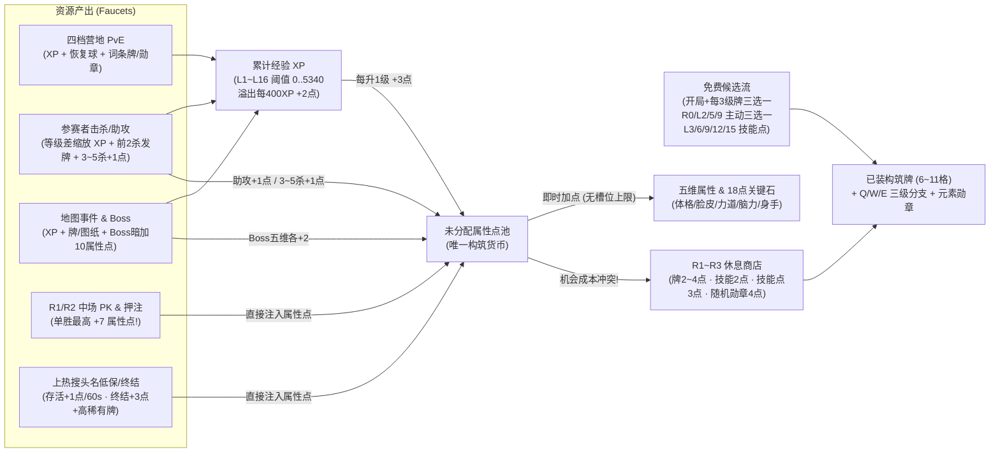

# Lockdown 局内经济、发育、PvE 与滚雪球研究报告 (Economy, PvE & Progression Report)

**基线版本**：`v0.14.2` · Commit `e62ff30473ce02d73761aadaea092d8a7e965248` · Catalog Root `fc05a7db4abf...`  
**核验范围**：`docs\APP_SPEC.md`、`docs\demo\CONTENT_AND_BALANCE.md`、`SourceData\Demo\content.json`、`SourceData\World\demo_world.json`、`Content\Lockdown\Data\Demo\world.json`、`Artifacts\20261128-130116-389-Bootstrap-Validate\DemoWorld.json`（真实保存关卡 `L_Demo.umap` 投影快照）、`Artifacts\20261128-123211-963-Packaged-Interactive\Game.log`（真实打包版交互对局）、Issue `#353` 导航审计、C++ 权威实现（`Source\Lockdown\Private\{World,Region,Framework,Development,PK,AI}\*`）及 `Scripts\GameplayResearchLab.py` 确定性模拟。

---

## 1. 核心诊断摘要

Lockdown 当前局内经济与地图生态并非简单的“数值没调平”，而是存在 **四处结构性断裂与三处严重实现/资产分裂**：

1. **世界数据与真实关卡“脑裂”（存在实现与规格冲突 / 严重缺陷）**：规格与 `world.json` 定义全图 `34` 处营地（`80` 只野怪）与 `2` 处躺平角；但真实运行的 `L_Demo.umap` 因 `World.bSceneLayout == true`（`LDCampLifecycle.cpp:41-46`）直接忽略 `CampIds` 名单，实际生成 **`64` 处营地、`166–168` 只野怪**（含单营 `22` 只怪的 `instance_LDLayoutPoint_207`、单营 `6` 只大野的 `e05`、坐标间距仅 `72.7 cm` 重叠刷新的 `e04/h07`）以及 **`8` 处躺平角**（其中 `5` 个出生点直接叠在躺平角回血圈上）。
2. **固定不刷新营地导致人数生态两极坍塌（存在设计缺陷）**：按规格的 `34` 营地不刷新规则，三段野外全图营地总经验仅 `11,524 XP`。**8 人局人均上限仅 `1,440 XP`（卡死在 L8，连 L9 第三次主动候选与 L12/L15 技能点都摸不到）**，且每段前 `60–70 秒` 清空小野/中野后全图陷入近 `100 秒` 的“空图荒漠”；而在 **2 人局**（或当前 `64` 营地的 `L_Demo` 5 人局）则变成零冲突单机刷图直奔 L16。
3. **单一货币悖论（属性点兼作商店金币 = 关键石惩罚税，存在设计缺陷）**：未分配属性点同时承担“实时五维属性 + `18` 点关键石门槛 + 休息商店唯一货币”。因为野外随时允许秒加点（`LDProgressionRules.cpp:587`），AI 每升一级 `0.25s` 内就花光点数，全员带着 `0` 点进商店；而理性的真人玩家为了保住 F1 末的第一个 `18` 点关键石与 F2 末的双 `18` 点关键石，最优解是**全程零购物、全点属性**（真实试玩 Match 1 冠军 `81` 属性点、`0` 次主窗口商店购买、`10/0/1` 碾压夺冠）。
4. **领先者正反馈叠加器失控（存在设计缺陷 + 未文档化实现）**：AoE 高移速刷野领先 $\rightarrow$ 无等级平权的 R1/R2 中场 PK 连拿 **`+14` 属性点**（相当于白送 `4.67` 级！）$\rightarrow$ 领先 `3` 级后触发 AI `LeaderHuntMaxLevelGap = 2`（`LDOpponentPolicy.cpp:344`）获得全 AI 免追杀特权，白嫖“上热搜”每 `60 秒 +1` 属性点 $\rightarrow$ 单刷或尾刀无脱战半径的 `画饼老板` 再拿 **代码隐藏的 `+10` 属性点（全五维各 `+2`，`LDProgressionRules.cpp:2267-2275`）+ 传说三选一 + 双勋章 + 第四张终局改装**。所有设计的“追赶机制”在运行态全部反转成了“头名低保”。

---

## 2. 真实运行基线与差异登记表（Economy & World Discrepancy Register）

| 编号 | 模块 | 文档 / `world.json` 声明 | C++ / `L_Demo.umap` 真实运行事实 | 状态分类 |
| --- | --- | --- | --- | --- |
| **EC-01** | 地图营地规模与编制 | `APP_SPEC.md:96` & `demo_world.json`：固定 `34` 处营地（`18×3` 小、`10×2` 中、`4×1` 大、`2×1` 远古 = `80` 怪），`2` 处躺平角 | `LDCampLifecycle.cpp:41-60` 在 `L_Demo.umap` 下加载全部场景点，实跑 **`64` 营地 / `166` 怪**（含 `22` 怪异常营、`6` 大野营、`3` 远古营、`72.7 cm` 重叠营）与 **`8` 处躺平角**（`Game.log` & `DemoWorld.json`） | **存在实现与规格冲突** |
| **EC-02** | 营地可达性与视野高差 | `APP_SPEC.md:95-99`：全图营地可正常交战；`StaticScene.MapTraversal` 通过 | `LDMapRegistry.cpp:419-444` 无条件承认悬崖/地下网格为合法地面；`LDMapTraversalAuditTests.cpp:52-60` 对 `!field_path` 仅记 `Info` 不报错。`#353` 证实 `11` 个落点不可达，怪在高台可单向白打台下玩家 | **已确认运行缺陷** |
| **EC-03** | F2 中心擂台与 F3 小迷你旗 | `APP_SPEC.md:43`：F2 第 `100s` 开放 `40s` 擂台，F3 第 `100s` 开放 `30s` 小迷你旗 | `LDFieldPacing.cpp:88-100` 每帧从 `Segment = 0` 重跑并判断 `View.Serial != Segment + 1`，导致 `NowT >= 250s` 起**每帧清空擂台伤害与迷你旗读条**，Match 1 刷出 `22,335` 行日志且 `0` 人可获奖 | **已确认运行缺陷** |
| **EC-04** | 画饼老板击杀奖励 | `APP_SPEC.md:44` & `CONTENT_AND_BALANCE.md:747`：`320 XP` + 构筑奖 + 必掉勋章 + R3 第四张改装 | `LDProgressionRules.cpp:2254-2275` 除上述外，**额外暗加五维各 `+2`（共 `+10` 可洗点属性点）**，且同时发 5 选 1 勋章与 `100%` 随机勋章（共 **2 枚勋章**） | **存在实现与规格冲突** |
| **EC-05** | 技能点获取上限 vs 可花上限 | `APP_SPEC.md:75` & `4.5`：升级 `5` 点 + 审计营地 `1` 点 + 商店限购 `2` 点 = 单局最多 `8` 点 | 3 个主动槽升满 3 级最多只能花 **`6` 点**（`LDProgressionRules.cpp:1049-1060`）。前期花 `3–6` 属性点买商店技能点的玩家升到 L15 时会卡死 **1–2 个永远花不掉的废技能点** | **存在设计缺陷** |
| **EC-06** | 野怪经验随阶段成长公式 | `CONTENT_AND_BALANCE.md:835` 文字写“每段乘以 `1.35` 后向上取整” | `content.json` `CAMP.GrowthRewardXPRatioPerStage = 0.06`；`LDCampGrowth.cpp:69-74` 为每阶 `+6%` 向下取整（F1 `1.00×`、F2 `1.18×`、F3 `1.36×`） | **存在实现与规格冲突** |

---

## 3. PvE 刷野与地图策略深度分析

### 3.1 野怪机制审计：12 种野怪是否检验了不同构筑能力？

核对 `SourceData\Demo\content.json` 与 `LDCombatMonsters.cpp` 后结论明确：**当前野怪仅检验“AoE 清场倍率”与“基础移速”，几乎不检验构筑机制差异。**

- **同档数值 100% 克隆**：
  - 小野（HR / 地推 / 骑手）：全为 `90 HP`、`14 AD`、`8 护甲 / 8 魔抗`、`15 XP`（×3 = `45 XP`）。
  - 中野（私教 / 中介 / 保安）：全为 `315 HP`、`50 AD`、`20 护甲 / 20 魔抗`、`44 XP`（×2 = `88 XP`）。
  - 大野（导师 / 审计 / 甲方）：全为 `1350 HP`、`126 AD`、`30 护甲 / 30 魔抗`、`196 XP`（×1）。
  - 远古（总监 / 终审甲方 / 物业主任）：全为 `2100 HP`、`182 AD`、`40 护甲 / 40 魔抗`、`405 XP`（×1）。
- **护甲恒等于魔抗、零回血、零护盾**：全图 12 种野怪加 Boss 全部满足 `Armor == MagicResist`、`hp_regen == 0`、`shield == 0`。这意味着物理/魔法自适应、破甲（`Breach`）、碎盾（`Y06`）、减疗（`馊` / `发酵`）在 PvE 中没有差异化克制对象。
- **行为同质化与 Boss 机制缺失**：11/12 野怪均为“平 A 两下接一次 `0.8–1.0s` 固定朝向预警”，玩家只需每 `4.5s` 横移两步（或按 `D` 白嫖 `+20` 劲）；而中心首领 **画饼老板（`2800 HP, 180 cm/s, 250 cm` 普攻，0 技能，无脱战半径）** 比普通小野还呆板，任何远程技能或一张 `隔空抽你`（`+330 cm` 射程）即可无伤风筝拉到角落独吞。

### 3.2 四档营地效率矩阵与“大野数值陷阱”

```chart
{
  "data": {
    "values": [
      { "tier": "小野 F1 (Stage 0)", "xp_per_kehp": 154.3, "duelist_xps": 40.6, "aoe_xps": 102.7 },
      { "tier": "中野 F1 (Stage 0)", "xp_per_kehp": 116.4, "duelist_xps": 30.6, "aoe_xps": 55.3 },
      { "tier": "大野 F1 (Stage 0)", "xp_per_kehp": 111.7, "duelist_xps": 29.4, "aoe_xps": 31.9 },
      { "tier": "远古 F1 (Stage 0)", "xp_per_kehp": 137.8, "duelist_xps": 36.2, "aoe_xps": 39.3 },
      { "tier": "大野 F3 (Stage 6)", "xp_per_kehp": 80.7, "duelist_xps": 21.2, "aoe_xps": 23.0 },
      { "tier": "远古 F3 (Stage 6)", "xp_per_kehp": 100.2, "duelist_xps": 26.3, "aoe_xps": 28.6 }
    ]
  },
  "semantic_types": {
    "tier": "Category",
    "xp_per_kehp": "Score",
    "duelist_xps": "Rate",
    "aoe_xps": "Rate"
  },
  "chart_spec": {
    "chartType": "Bar Chart",
    "title": "未标记大野经验效率最低，且后期刷野收益随阶段倒挂衰减",
    "subtitle": "每 1000 有效生命产出经验 (XP / 1000 EHP)",
    "encodings": { "x": "tier", "y": "xp_per_kehp" }
  }
}
```

- **高阶营地收益倒挂**：野怪每阶生命 `+12%` 且双抗 `+2`（乘算放大 EHP），而经验每阶仅线性 `+6%`。到 F3（Stage 6），单只大野高达 `3,297 EHP` 却只给 `266 XP`（`80.7 XP/kEHP`，比 F1 小野低 **47.7%**），单挑耗时 `12s+`、损血过半，且清完掉落的恢复球与秒清 `292 EHP` 小野完全相同（`15% MaxHP + 60 HP + 25 劲`）。
- **尾刀独吞与拉脱白打**：由于野怪/Boss **最后一击独拿 100% 经验与掉落**，且隔着矮墙不挡视野与远程弹道（`APP_SPEC.md:96`），先手开大野/远古/Boss 的玩家承担全部战损，尾刀偷猎者零成本截胡。同时拉脱回位野怪（`Returning`）虽取消攻击却仍可被定身与全额打伤（`LDCampDirector.cpp:1120`），可被远程卡 `1050 cm` 边缘无伤白嫖。
- **词条风险失衡**：`加班`（`+30%` 攻速）与 `裁员`（同伴死亡 `+30%` 攻击，在单怪大野/远古上更是纯空壳词条）增加战损却 **0 额外奖励**；而 `团建`（多 1 只怪且全营经验 `×1.5` = 中野暴涨 `+125%` 经验）与 `奖金`（五选一牌）则是纯福利大奖。

### 3.3 参赛人数适应性与空间路径成本

- **慢移速下的事件失灵**：基础移速 `240 cm/s` 下，横跨 `demo_world` 半径（`5,592 cm`）需 `23.3s`，在当前 `L_Demo.umap` 最远营地（距中心 `10,552 cm`）直线需 **`44.0s`**（含绕墙坡道 `55s+`）。而空投仅提前 `15s` 预告、小迷你旗仅提前 `10s` 预告（持续 `30s`），远端玩家物理上不可能赶到——**地图事件退化为“刷在谁脸上归谁”的位置彩票，而非全图路线博弈**。
- **9 套野外事件并发过载**：`480s` 野外同时塞入空投（6 次）、标记中野（3 次）、标记大野（3 次）、小迷你旗（2 次）、中心擂台（1 次）、外卖柜（4 次）、二手贩子（1 次）、上热搜（每 10s 刷新）、画饼老板（与 F2 擂台在中心同坐标重叠！）。事件过多反而分流了玩家，削弱了核心冲突密度。

---

## 4. 局内经济模型：单一货币、机会成本与滚雪球

### 4.1 局内资源流向全景图



### 4.2 买牌 vs 直接加点：为什么理性的玩家与 AI 都不逛商店？

在 L8 中期基准（`1735 HP, 92.4 AD, 32 双抗`）下：
- **1 点五维属性的确定性收益**：`+70 HP`（体格）或 `+3.5 AD + 0.6% 暴击`（力道，约 `+4.4%` 普攻 DPS）或 `+6 AP + 1 急速`（脑力）或 `+2% 攻速 + 0.5% 移速`（身手），**外加向 `18` 点关键石（价值约 `7–9` 额外属性点的质变被动）推进 `1/18`**。
- **商店消费的三重隐性税**：
  1. **关键石断档税**：F1 结束正常发育约 L5–L6（`15–18` 点），恰好卡在第一个 `18` 点关键石阈值；F2 结束约 L10–L11（`30–36` 点），恰好卡在第二个关键石阈值。此时花 `3–4` 点买一张稀有/传说牌或随机勋章，等于**自废关键石去打下一轮 PK 和野外**。
  2. **免费牌饱和**：玩家通过升级（`R0, L3, L6, L9, L12, L15` = 6 次）+ 击杀/空投/营地词条自然获得 `8–13` 张免费牌，早已填满 `9–11` 格工坊容量；花永久属性点再去买占格子的普通牌（`2` 点）边际收益极低（除非叠同名核心卡）。
  3. **随机勋章盲盒税**：花 `4` 点属性（等于 `280 HP` 或 `1.33` 级成长）只买到 **`20%` 概率对口**的随机元素勋章（限购 1 枚）。

### 4.3 等级差压制与翻盘空间验证

由 `GameplayResearchLab` 确定性对抗与 FFA 锦标赛测得：
- **等级差硬数值碾压**：每升 1 级自带 `+125 HP, +3.2 AD, +2 双抗, +2% 攻速, +4% 技能基数` 外加 `+3` 属性点（约再 `+210 HP` 或 `+10.5 AD`）。同流派镜像对决中，**`+2` 级（L8 vs L6）胜率已接近 `100%`（平均 `4.97s` 击杀），`+6` 级（L16 vs L10，即 Match 1 真实差距）仅需 `2.31s` 蒸发对手**。
- **PK 与热搜反向放大雪球**：中场 PK 不做任何等级/属性归一化，F1 刷野王在 R1/R2 PK 稳拿 `+14` 属性点；领先 3 级后 AI 放弃追猎热搜，头名每分钟再白拿 `+1` 点。落后玩家既无野怪可刷（60s 后空图），又无法单挑终结头名，只能寄希望于终局混战搅局或机制型终局改装偷鸡。

---

## 5. 实验重构方案矩阵（Options A / B / C / D）

| 方案 | 核心假设与机制改动 | 预期游戏性改善 | 实现复杂度与依赖 | 风险与验收标准 |
| --- | --- | --- | --- | --- |
| **A：最小止血修复**<br>*(Bugfix + 关卡对齐)* | 1. 修复 `LDFieldPacing.cpp:93`（`View.Serial < Segment + 1`）恢复 F2 擂台与 F3 迷你旗；<br>2. 清理 `L_Demo.umap` 对齐 34 营地/2 躺平角，修复 `#353` 11 处不可达落点并将 `MapTraversal` 升级为 `AddError`；<br>3. 移除 Boss 隐藏 `+10` 属性点并加 `1400 cm` 脱战圈；技能点超 `6` 自动转 `+3` 属性点；<br>4. 修复 AI `EstimateCampCost`（计入技能/AP）与热搜追猎等级上限；PK 胜者池下调至 `+2` 点。 | 消除不可达野怪、坏死事件、废技能点与 `+24` 属性点极端滚雪球。 | **低**（仅修局部 C++ 条件、关卡点位同步与 `content.json` 常数）。 | **风险**：仍未解决 8 人局后半段空图饥荒与商店零消费。<br>**验收**：`MapTraversal` 全绿；F2 擂台正常决出胜者；AI 终局均等升至 L11+。 |
| **B：中等结构重构（推荐）**<br>*(人数自适应刷新 + 商店津贴 + 平权 PK)* | 在 A 基础上：<br>1. **小/中野按人数动态段内刷新**（8 人局 `62s/76s` 刷新，2 人局 `95s/115s`），大野/远古保持每段 1 次作战略争夺点；小地图记忆已目击空营地；<br>2. **大野/远古/Boss 60/40 伤害贡献分账**（明确定义：最高伤害贡献者 `>=45%` 拿 `60%` XP，尾刀者拿 `40%` XP + 道具）+ 拉脱野怪 `60%` 减伤免控防白嫖；<br>3. **每轮休息发放 `2` 点当轮专属商店津贴（`RestShopCredit`）**（打折日向上取整最低消耗 `1` 点津贴，满格购牌弹出原子替换框），彻底激活商店且不卡关键石；<br>4. **PK 临时拉平竞技等级**（R1 统一 L6 模板、R2 统一 L10 模板，保留构筑牌与加点比例）。 | `GameplayResearchLab` 单因子阶梯验证：8 人局平均等级从 **`8.86` 提升至 `11.30`**，第三方偷袭占比从 **`42.7%` 降至 `17.6%`**；每轮商店人人有真实购买决策；PK 真正成为落后者的技术翻盘舞台。 | **中**（复用 `ALDCampDirector`、`FLDProgressionView` 与 `SetPKBody` 现有事务边界，无需新增第二套常驻 HUD 货币）。 | **风险（Agent 6 反证护栏）**：动态刷新可能进一步利好 AoE 刷野流——需同步给中野/大野单怪提高孤立决斗增伤或下调小野刷新经验系数。<br>**验收**：8 人局平均等级落入 `[11.0, 13.5]`；人均每局商店主动购买 `>= 2.5` 件。 |
| **C：激进双轨经济重构**<br>*(属性点与“饭票”彻底解耦 + 四类机制野怪)* | 1. **属性点 100% 绑定等级**（L16 恒定 `48` 点，彻底消灭 `81 vs 25` 属性崩盘）；<br>2. 新增独立商店货币 **饭票（Vouchers）**，由清营、击杀/助攻、终结热搜、PK 产出，专用于买牌、定向选勋章、扩容牌格；<br>3. 将 12 种数值克隆野怪重做为 **重甲盾卫 / 读条法系 / 群聚虫群 / 孤立决斗猎手** 四类差异化生态（单挑流打猎手野怪享 `+35%` 孤立增伤，追平 AoE 刷野效率）。 | 彻底根除“买卡亏关键石”的心理痛点；让单挑刺客、破甲物理、打断控制与 AoE 法师在野区拥有各自的最优生态位。 | **中高**（需扩展 `FLDProgressionView` 字段、底栏/工坊零滚动角标、`content.json` 野怪抗性与词条及 AI 商店估值）。 | **风险**：双资源理解成本小幅上升。<br>**验收**：单挑流与 AoE 流 F1–F3 发育经验差 `< 15%`；商店构筑成型率由 `24%` 提升至 `> 50%`。 |
| **D：事件精简合并**<br>*(9 套并发微事件 $\rightarrow$ 3 个高光焦点)* | 1. **删除** `外卖柜` 与 `二手贩子`；<br>2. 将 `小迷你旗` 的 `2.5s` 独占圈规则 **合并进 `天降外卖`**（替代现有的 0 秒碰瓷秒捡，提前演练终局争旗）；<br>3. 将 `标记营地` **合并进公开金词条大野**（裁撤独立 `LDGameModeFieldMarkers`）；<br>4. 将 `画饼老板` 与 `F2 擂台` **合并为“老板摆擂”中心首领混战事件**（按圈内对人+对 Boss 总绩效发奖，消除 1 血尾刀全抢）。 | 大幅降低新玩家小地图信息噪音，将分散在角落开柜子的孤狼重新聚拢到可预期的街区大战焦点。 | **低中**（净删代码与冗余状态机，复用现有空投、词条与擂台归约）。 | **风险**：角落探索随机惊喜略减（由金词条营地承担）。<br>**验收**：每次核心事件吸引 `>= 3` 名参赛者同屏博弈。 |
