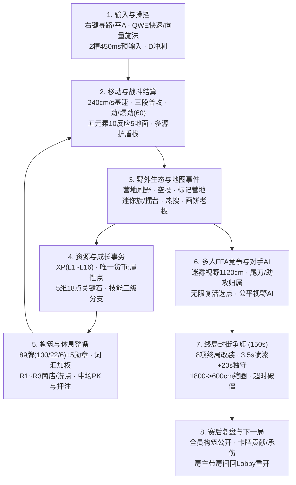

# Lockdown 全面游戏性审计报告 (Comprehensive Gameplay Audit)

**项目**：Lockdown（对外标题：《谁是雾港最强淫人王》）  
**代码与数据基线**：`v0.14.2` · Branch `main` · Commit `e62ff30473ce02d73761aadaea092d8a7e965248`（Clean Working Tree 起始）· Catalog Digest `fc05a7db4abfe62ebc956fdf2e0167a508c91048e529471c8b36623defd3c142`  
**证据来源**：`docs\` 全套规格与系统手册、`SourceData\Demo\content.json`、`Content\Lockdown\Data\Demo\*`、`Source\Lockdown\**` 原生 C++ 实现、今日打包版实机日志 `Artifacts\20261128-123211-963-Packaged-Interactive\Game.log`、原生无头评估 `Artifacts\BuildEvaluation\20261128-131440-p3-breakout-samples`、8 席加速遥测 `Artifacts\GameplayResearch\telemetry_7ai_excerpt.log`、Issue `#353` 导航审计及 `Scripts\GameplayResearchLab.py`。

---

## 1. 核心命题裁决：Lockdown 现在真正好玩吗？

**诚实的回答：Lockdown 拥有一个极具潜力的“街头无厘头动作构筑混战”骨架与一批真正有想象力的单卡机制，但在当前 `v0.14.2` 运行态下，它被严重的系统性自相矛盾、关键路径代码缺陷和割裂的节奏设计扼杀了核心爽感——目前处于“能跑通全流程、局部连招有趣，但整局博弈失真且难以产生长期复玩成瘾性”的状态。**

### 1.1 为什么它“本该好玩”（必须保留的核心灵魂）
1. **鲜活接地气的雾港大学城题材与动作直觉**：用篮球手运球/投掷承载“甩拖鞋捡鞋减 CD、占座书包砌墙、电风扇吹毒雾、板砖糊脸、扯嗓子开麦”的市井混战，题材辨识度远高于传统奇幻/科幻吃鸡；双槽 `450ms` FIFO 预输入、快速施法与向量施法（电风扇/封条）的底层操控响应扎实。
2. **真正能改变操作形态的高光构筑原语**：89 张构筑牌并非全是“攻击力 +10%”的数值垃圾——诸如 `隔空抽你`（近战拳变可被拦截的远程弹道）、`千斤重锤`（锁死 `0.75` 攻速把溢出攻速全转成第三拳必暴重锤击退）、`撞着就刷新 + 穿人而过`（无限穿人刷新冲刺）、`挪地盘`（冲刺把陷阱拖到脚下）、`反应装甲 + 壳碎了也崩你`（护盾叠层迸射）具备纯正的独立游戏涌现基因。
3. **严格的权威架构与公平迷雾视野**：服务器唯一写闸（`SC-01..SC-06`）、回执幂等去重、高差缩放迷雾与墙后半透剪影，为真正的竞技博弈打下了罕见干净的工程底座。

### 1.2 什么地方“不好玩”（扼杀乐趣的六大结构病因）
1. **构筑潜力被抽牌概率断崖与商店“关键石惩罚税”双重锁死**：传说催化卡单抽权重仅 `6 / 6994 = 0.086%`（普通牌占 `94.4%`）；同时未分配属性点既是 `18` 点关键石门槛又是商店唯一货币，导致买牌直接自废关键石，真实对局中玩家与 AI 最优解竟是 **全程 `0` 购物、无脑堆属性点**。
2. **PvE 刷野既单调又按人数两极崩盘**：同档 3 种野怪血量/攻击/双抗 100% 克隆（且全图 `护甲 == 魔抗`），大野经验效率（`80.7–111.7 XP/kEHP`）甚至低于小野（`154.3 XP/kEHP`）；按规格 34 营地不刷新算，8 人局人均野区经验上限仅够升到 **L8**（后 90 秒全图空旷），而当前 `L_Demo.umap` 又因未同步塞入 `64` 处营地导致单机刷野膨胀。
3. **两大核心动作系统（爆劲与精准闪避）体验负反馈**：`240 cm/s` 移速过慢导致走不出 `0.8s` 板砖预警圈；爆劲按住 `0.35s` 期间右键走位直接取消施法、满劲时拖慢瞬发防反手感、对高频技能流反降 `31.7%` DPS；精准闪避因五重判定缺陷全场 69 条命仅触发 `6` 次。
4. **12 分钟自由构筑撞上 2 分钟“单圈独处”终局死锁**：终局缩圈至 `600 cm` 时，`450 cm` 喷漆圈占去 `56.25%` 面积，而第 2 个人踩边即冻结全部进度，废掉了远程风筝与游走流派，逼迫对局退化为肉盾站桩、`私人旗杆/篡位` 逃课或超时判分。
5. **心流被过长的休息窗与脱节的中场 PK 反复切断**：前三段野外仅占全场的 `56.9%–61.8%`；两次中场休息+PK 最长各中断主地图 **2 分 09 秒**（无观众时仍傻等 `10s` 押注）。
6. **一批尚未暴露给测试门禁的严重运行态 Bug 正在直接破坏对局**：包括 **休息室假人 `越打越上头 × 手快有手慢无` 指数级帧卡死（单次平 A 产生 `111,846+` 次命中写爆 1.2GB 日志挂死服务器）**、**F2 擂台与 F3 迷你旗每帧重置清零完全无法领奖**、**`c001` 种子出生点寻路死锁 90 秒**、**`气短` 爆劲倍率写反成 `0.875×` 削弱** 等。

---

## 2. 全链路 Gameplay System Map 与状态核验

严格区分六种实证状态：**`已确认运行`**、**`已实现但未验证`**、**`仅存在于规格`**、**`存在实现与规格冲突`**、**`存在设计缺陷`**、**`尚无足够证据`**。

| 链路环节 | 子系统 | 核验状态 | 证据与关键事实 |
| --- | --- | --- | --- |
| **1. 输入** | 快速施法 (`<0.18s`) / 向量施法 / 2 步 `450ms` 预输入 | **已确认运行**（局部**存在设计缺陷**） | `LDPlayerOrders.cpp` 实跑顺畅；但满 60 劲时按住爆劲拦截导致瞬发 `Self` 技能退化为松键触发，且右键移动直接打断 `Alt+技能` 爆劲栓锁（`LDPlayerInput.cpp:314`）。 |
| **2. 移动与闪避** | `240 cm/s` 移动、`450 cm` 冲刺、`135 cm` 贴脸停步、精准闪避 | **存在实现与规格冲突** + **存在设计缺陷** | `LDCombatPreInput.cpp:54` 仅在起手距敌 `<=220cm` 且锁定时才停在 `135cm`，中距冲刺直接穿头越过；弹道闪避按终点判 `300ms` 导致近身闪避失败（`LDCombatBranchDirector.cpp:708`）；AI 缺失 22/24 技能预警。 |
| **3. 战斗与元素** | 伤害管线、控制递减、10 反应、5 地面状态、三阶勋章 | **存在实现与规格冲突** | 基础伤害/抗性/护盾栈已确认运行；但 `Y11 气短` 写反为 `×0.875`（`LDCombatCards.cpp:2084`）、`S09.3A2/S10.3A1` 双元素分支失效（`LDCombatElementsDirector.cpp:173`）、Ⅲ阶勋章副元素实为随机（`line 113`）、击退未进控制递减、地面状态严重断供。 |
| **4. 卡牌连锁** | 89 张构筑牌触发器与属性重投影 | **存在实现与规格冲突**（含 **P0 死锁缺陷**） | 实机捕获：`A12 越打越上头` + `A09 手快有手慢无` 在休息室打不死假人触发指数级额外打击风暴（`t=739650` 单击 `111,846` 次命中挂死服务器，`LDCombatCards.cpp:695,1460`）；`D10+D11` 顺序写反自吞陷阱；`U05` 射程截断空放。 |
| **5. 地图与刷野** | 营地生成、导航可达性、野怪战斗与拉脱 | **存在实现与规格冲突** | `world.json` 写 34 营地，正式图 `L_Demo.umap` 实刷 64 营地/166 怪 + 8 躺平角；`#353` 证实 11 个野怪点不可达；`BuildEvaluation` Seed `c001` 实测捕获 `(-4772,-3546,502)` 参赛者出生点寻路死锁 90 秒。 |
| **6. 地图动态目标** | 空投、标记营地、上热搜、画饼老板、F2 擂台、F3 迷你旗 | **存在实现与规格冲突** | 空投/标记/热搜已确认运行；**F2 擂台与 F3 迷你旗因 `LDFieldPacing.cpp:88-100` 每帧重置 `View.Serial` 完全损坏（0 人可获奖，每局刷 2.2 万行日志）**；画饼老板隐藏多发 `+10` 属性点与双勋章。 |
| **7. 成长与构筑** | XP 升级、五维关键石、技能点、选牌词汇加权、休息商店 | **已确认运行** + **存在设计缺陷** | 升级与原子事务稳健；但词汇加权忽略已分配属性点且 14/30 词汇在技能上为孤儿词；技能点可拿 `8` 点却只能花 `6` 点；野外换招 UI 被 `LDChoicesPanel.cpp:121` 误清确认框导致真人无法野外换招。 |
| **8. 中场 PK** | R1/R2 报名、赛制抽取、押注、缩圈对决、场外投掷 | **已确认运行**（部分**仅存在于规格** + **存在设计缺陷**） | 仅实现单挑/混战/双队（系统手册写的“车轮战”不存在）；0 观众时仍强等 `10s` 押注；无等级归一化导致头名两轮稳拿 `+14` 属性点滚雪球。 |
| **9. 对手 AI** | 公平视野感知、刷野评估、选牌加点、终局争旗 | **存在实现与规格冲突** | 严守迷雾无作弊已验证；但 `EstimateCampCost` 只按平 A 算战损导致法系/中期 AI 拒打大野/远古、从不捡恢复球、进休息室 0 点数不逛商店、`电风扇/警戒封条/刺猬/鬼影` 0% 施放率、终局无视缩圈烧死。 |
| **10. 终局裁决** | 主旗杆/私人旗杆、棘轮、缩圈、8 改装、150s 超时判胜 | **存在实现与规格冲突** + **存在设计缺陷** | `SHOWDOWN.GuardRatchetSec [7s,14s]` 因喷漆易主直接清零沦为数学空操作（`LDCaptureReducer.cpp:583`）；超时判胜漏读历史 `BankedGuard` 与 `CompletedSprays`（`LDGameModeShowdown.cpp:181`）；`600cm` 终圈与 `450cm` 独处圈造成多人死锁。 |
| **11. 赛后复盘** | 全员构筑查看、承伤明细、Top-3 贡献、重回 Lobby | **已确认运行** + **存在设计缺陷** | 结算流转稳定；但左侧卡牌贡献混合了大量打野伤害（刷野 AoE 霸榜，掩盖真正赢下 PvP 的核心牌），且无法一眼看出对手关键协同链路与自身败因。 |
| **12. 跨机真实多人** | 4–8 名真实人类玩家跨局域网/公网打包版博弈与主观趣味性 | **尚无足够证据** | 目前仅有同机回环自动化与单人+AI 试玩日志，跨机延迟手感、真人合谋/第三方体感与复玩意愿必须经真人试玩验证。 |

---

## 3. 核心乐趣、系统存废拷问与三套核心循环方案（Workstream A & L）

### 3.1 六大灵魂追问与“产生乐趣 vs 仅走流程”系统剥离

| 追问 | 理想设计答案 | 当前 `v0.14.2` 真实运行答案 |
| --- | --- | --- |
| **玩家为什么刷野？** | 快速凑齐关键等级节点，并根据流派挑选克制营地抢夺稀有词条/勋章。 | 因为刷野每秒经验是找人打架的 **`8–18 倍`** 且零死亡风险；不刷野就会在等级上被碾压。 |
| **玩家为什么主动 PvP？** | 抢夺稀缺战略点、叠永久成长卡、削弱竞争对手、打断热搜头名。 | **在 4–8 人局早期几乎没有正收益去先手开团**：打赢残血容易被黄雀收割，每段超过 2 杀连牌都不发，不如等别人打残再去一发远程抢尾刀。 |
| **玩家为什么争夺地图资源？** | 高风险高回报的构筑质变催化剂（定向勋章、传说卡、技能突破）。 | 空投预告仅 `15s`、跑图要 `30s+`，顺路才捡；F2 擂台与 F3 迷你旗当前因代码 Bug 根本发不出奖。 |
| **玩家为什么期待下一次成长？** | 拿到一张彻底改写技能形态或打通无限连招闭环的质变牌/三级分支。 | 94.4% 概率抽到平庸普通牌，导致大部分升级只是“点 3 下属性点涨面板”。 |
| **玩家为什么想再玩一局？** | “上局差一张卡就能凑成冰刀电扇流，或者看到冠军用重锤防反一拳秒人，这局我想试试！” | 目前 AI 流派残缺、自然抽卡极难凑齐质变流派、终局常被肉盾或私人旗杆闷死，内在探索驱动力不足。 |
| **删掉哪个系统乐趣不降反升？** | — | **删除** `外卖柜`、`二手贩子`、`1 点卖图纸`、`随机盲盒买勋章`、**删除独立休息室 PK 等待阶段（合并进野外实景擂台）**：对局立刻紧凑 3 分钟且零核心乐趣损失！ |

### 3.2 三套具有实质差异的核心循环方案

#### 方案一：精炼现行“三段街区发育 + 拔河争旗”循环（低风险演进）
- **结构**：`R0(25s)` $\rightarrow$ `F1(150s)` $\rightarrow$ `R1(30s 整备+商店津贴)` $\rightarrow$ `F2(150s 含实景中心老板擂台)` $\rightarrow$ `R2(30s 整备)` $\rightarrow$ `F3(130s 高潮抢夺)` $\rightarrow$ `R3(20s)` $\rightarrow$ `终局封街拔河争旗(135s)`（全长精准控制在 **10.5–11.5 分钟**）。
- **核心改动**：砍掉独立休息室 PK 漫长排队与空等，把擂台与押注融进 F2 中心街区；小/中野按人数动态刷新消除空图；每轮休息送 `2` 点专属商店津贴盘活买牌；终局扩圈至 `950 cm` 并采用 1v1 圈内压制慢速推进。
- **适用定位**：保留 100% 现有资产与规则认知，最快验证核心构筑+混战乐趣。

#### 方案二：连续无间断“昼夜封街升级”循环（中度重构 · 类 *Eternal Return / Supervive* 节奏）
- **结构**：**取消全部全员强制传送回休息室的硬切场**！整局为一条连续 **10 分钟无缝街区时间线**（第 1 街区期 `0–3:30` $\rightarrow$ 第 2 街区期 `3:30–7:00` $\rightarrow$ 封街决战期 `7:00–10:00`，外圈街区随阶段逐步拉起警戒线封锁，自然把 8 名玩家向中心街区挤压！）。
- **整备如何完成**：躺平角升级为街区 **“便利店安全屋”**（每阶段每人享有一次进店 `8s` 免伤购物/洗点/换招权，或死亡复活期间直接在工坊购物）。
- **核心优势**：**0 秒全员等待垃圾时间**！彻底消灭“1 个慢吞吞看牌的人卡住 7 个人干等 65 秒”的多人联机顽疾，空间随时间自然收缩，冲突密度从头到尾平滑递增。

#### 方案三：“街头霸主锦标”双轨对抗循环（激进替代 · 类 *LoL Arena × Power Stone* 高频爽感）
- **结构**：缩短单局至 **8–9 分钟**。砍掉 70% 分散小营地刷野，改为 **3 轮 90 秒高密度“街区抢劫/乱斗回合” + 每轮必得高纯度构筑成型包 + 终局“金麦克风皇冠持有战”**。
- **核心优势**：把玩家时间从 `28%` 枯燥打木桩野怪彻底解放到 **`75%+` 纯粹的高能构筑碰撞与多人动作博弈**，开局第 1 分钟即进入流派质变，单晚可连玩 6–8 局不疲惫。

---

## 4. 新手学习曲线与赛后复盘诊断（Workstream L）

### 4.1 必要深度 vs 寄生复杂度（Parasitic Complexity）
- **必要深度（保留并强化视觉可读性）**：五维 18 点关键石取舍、主动技能三级 A/B 质变分支、卡牌宿主槽位（Q/W/E/D/本体）协同、高地视野差与矮墙弹道博弈、五元素核心控制/增伤反应。
- **寄生复杂度（建议直接修剪）**：
  1. **隐藏的 30 词条加权黑盒**：玩家在 UI 上看不到词汇标签，却受其控制抽牌概率，且 14 个标签在技能上根本不触发。**应精简为 8–10 个玩家可见的清晰流派徽记（如【连击】【冷却】【冲刺】【护盾】【元素】【重击】【召唤】【狂暴】）直接印在牌角！**
  2. **12 种数值完全相同的换皮野怪名称 + 9 种并发地图微事件**：合并为 4 种一眼看懂外观与抗性倾向的野怪原型 + 3 类核心地图事件。
  3. **首屏教学文案错误**：主菜单“怎么玩”第 2 张卡仍写着 `技能键加左键确认`（`LDTerms.h:269`），而游戏默认开启 `<0.18s` 松键秒放快速施法，新手第一局就会按错。

### 4.2 赛后复盘（Post-Match Recap）能否教会玩家“下一局玩什么”？
核对 `ULDResultReport` 与 `SHARED_CONTRACTS.md`：
- **已做到的亮点**：赛后冻结公开全部 8 名参赛者的最终技能分支、已装构筑牌槽位、五维加点与终局改装，支持点击切换查看冠军怎么配装。
- **当前三大盲区（阻碍复玩转化）**：
  1. **伤害贡献榜被 PvE 刷野污染**：当前左侧 Top-3 贡献把打野怪的 10 万伤害算进总贡献，导致 AoE 清野技能永远霸榜，真正帮你在决战反杀的 `死扛`、`撞着就刷新` 或 `铁刺猬` 反伤看不出价值——**必须默认只统计“对参赛者有效战斗贡献（含伤害/护盾抵扣/控制时长/治疗）”**。
  2. **缺少致死与败因归因摘要**：终局惜败的玩家看不到“我是输在魔抗太低吃了冠军 `42%` 元素反应伤害，还是输在圈内被击退打断了 3 次喷漆”。
  3. **缺少“一键设为下局构筑蓝图目标”闭环**：仓库已有 `LDBuildBlueprint` 数据边界，若在结算页看到冠军的酷炫流派能一键收藏为下局高亮提示（不自动代点，仅在三选一时给星标提示），将极大提升新手留存与流派传播！
