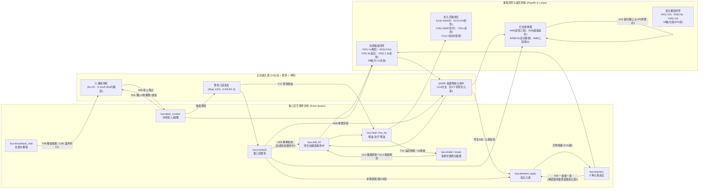

# Lockdown 卡牌与跨系统交互图谱分析 (Gameplay Interaction Graph & Emergent Loops)

**机器可读图谱数据**：[data/interaction_graph.json](data/interaction_graph.json)（由 `Scripts\GameplayResearchLab.py` 直接从 `SourceData\Demo\content.json` 提取生成：`133` 个机制节点、`542` 条有向触发/放大/转化边）  
**C++ 结算核验源码**：`Source\Lockdown\Private\Combat\{LDCombatCards.cpp, LDCombatEffects.cpp, LDCombatElementsDirector.cpp, LDCombatSkillDirector.cpp, LDTacticalRules.cpp}`

---

## 1. 全系统事件总线拓扑图（Trigger → Bus → Payoff）

不同于仅按表面词汇（`vocab`）连线的伪协同图，下图仅绘制 **经 C++ 运行时确认真实结算** 的事件生产与消费链路：

---

## 2. 六大核心反馈环与实机触发风暴（含 P0 级指数爆炸实证）

### 2.1 【P0 实机捕获】`A12 越打越上头 × A09 手快有手慢无` 指数级同帧触发风暴（挂死服务器）
- **实机证据**：`Artifacts\GameplayResearch\telemetry_7ai_excerpt.log`（8 席加速遥测，`AI 对手 2` `87F7357C` 在 R3 休息室打训练假人 `961C33DA`）。
- **精确 C++ 机制链路**：
  1. `A12`（`FocusAttackSpeed`，`LDCombatCards.cpp:1460-1469`）：每次普攻命中同一目标（含不死训练假人！）令 `++Source->FocusHits`（每层 `+4%` 攻速，**无层数上限**，且 **未排除 `bExtraStrike` 额外打击**），并在每一次额外打击内同步调用完整属性重投影 `RefreshTemporary(*Source, ...)`！
  2. `A09`（`OvercapExtraHit`，`LDCombatCards.cpp:695-720`）：不读取封顶 `5.00` 的最终攻速，而是直接读取 **未封顶的 `Uncapped = Flat * Ratio` 原始攻速**，每超出 `1.35` 攻速 `0.1` 即叠加 `+18%` 必出额外普攻打击（`OutExtra.Add`）！
  3. **数学爆炸**：第 $k$ 次挥拳（间隔 `200ms`）命中后产生 $\approx 0.0612 \times 2 \times S_k$ 次额外普攻，每次额外普攻又给 `FocusHits` `+1` 层！实测日志每隔 `200ms` 单帧命中数按 **`1.1223×` 严格指数暴涨**：
     - `t = 738.65s`：单次出拳触发 **`62,808` 次命中**
     - `t = 739.05s`：单次出拳触发 **`79,113` 次命中**
     - `t = 739.65s`：单次出拳触发 **`111,846` 次命中 + `111,846` 次全属性重投影**
     - `t = 740.04s`：服务器在单帧 `[420]` 内彻底卡死，8 分钟狂写 `1.20 GB` 日志！
- **设计级解法（不粗暴删掉爽感，用机制边界解决）**：
  1. **修复语义边界**：`A12` 仅在 **主普攻起手命中（`!Hit.bExtraStrike && !Hit.bSweep`）** 时叠层（1 秒最多叠 5 层线性增长，彻底切断同帧自指指数倍增！），且在休息室训练假人死而复生时重置 `FocusHits`（模拟实战目标死亡换人）。
  2. **保留爽感上限但消除死机**：`A09` 单次挥拳额外追击上限设为合理物理帧预算（如最多追加 `4` 拳，超出部分按 `U03` 思路折算为追击伤害倍率），既保留“一拳变五连残影”的破格爽感，又把单次出拳复杂度严格锁在 $O(1)$！

### 2.2 桥接奇点：`A03 拳拳到肉 × 3×K01 打完换下一招` 三技能扇出刷新环
- **真实 C++ 行为**（`LDCombatCards.cpp:1400-1413`）：第三段普攻命中时，`A03` 遍历玩家身上 **全部已学主动 Q/W/E**，为每个技能伪造一次宿主直接命中事件。若 Q、W、E 各装 1 张 `K01`（减其他两技能 `1.0s` CD），**一记第三段平 A 瞬间给 Q、W、E 各削减 `2.0 秒` 冷却（合计削减 `6.0 秒` CD！）**。
- **评价与边界**：这是**极其优秀的涌现设计**！它要求玩家贴身打满三段平 A（承担近战风险窗口）并投入 3 个技能牌槽位，有明确的反制手段（缴械、拉开距离断 `2.5s` 连击窗），**应当完整保留并作为标杆流派宣传**。

### 2.3 零成本穿人无限冲刺环：`D01 撞着就刷新 + D06 穿人而过 + D08 冲刺耗劲`
- **真实 C++ 行为**（`LDCombatSkillDirector.cpp:745-752`）：`D08` 将冲刺冷却缩至 `40%` 但耗 `15` 劲；而 `D01` 在撞到参赛者时不仅 **100% 刷新 `D` 冷却**，还隐藏执行了 **`GrantMomentum(PaidMomentumP2)` 全额退还 `15` 劲**！搭配 `D06` 取消 `135cm` 停步穿过身体，只要鼠标精准穿过敌方胶囊体即可 **0 冷却、0 净劲耗无限来回穿刺**，再配 `D02` 每次穿人减全技能 `1.5s` CD。
- **设计调节（风险窗口法）**：无需加硬冷却上限——因为一旦冲偏空放一次立刻进入 `3.6s–9.0s` 真空期，且任何 **定身 (`Root`)** 或 **`警戒封条 (N6.2A)`** 都能当场截停反杀。只需修正文档写清退劲规则，并将击退纳入控制递减防止连环撞墙无限晕即可。

### 2.4 `N5 疯狗乱拳` 独立波次触发器漏洞环
- **真实 C++ 行为**（`LDCombatActions.cpp:1357-1393`）：`N5` 持续期间每次平 A 挥出的拳风都分配全新的 `EffectId` 且 `CastLedger = nullptr`。装上 `K01 + K02` 后，攻速 `2.5` 时每秒白削其他技能 `2.5s` CD、穿透群怪每波狂回 `15–25` 劲；但装上 `K09/K16/K18` 增伤卡却全部失效（`+0%`）。
- **设计调节**：为同一次 `N5` 施放共享同一个 `CastLedger`（让增伤乘区卡正常生效），同时对持续多波次技能的 `K01` 触发设“每次施放最多减 `2` 次或折半为 `-0.4s`/波”，消除隐晦规则割裂。

### 2.5 `Y29 烧着还挺扛揍 × U12 反应装甲` 半秒脉冲护盾环
- **真实 C++ 行为**（`LDCombatCards.cpp:2002-2016`）：`Y29` 漏掉了文档规定的 `30% MaxHP` 同源护盾上限，导致挂上灼烧后每 `0.5s` 生成一层微型新护盾，若身上已有护盾则 **每 `0.5s` 自动触发一次 `U12` 周围 `260cm` 物理弹片爆炸**（受 `CHAIN.MaxDepth = 16` 防同帧死循环保护）。
- **设计调节**：补齐 `Y29` 的 `30% MaxHP` 同源护盾上限，并为 `U12` 增加“单次新获护盾量至少达 `3% MaxHP` 才迸射弹片”的最小能量门槛，让大额开盾爆发更有分量，避免 1 点微盾高频白嫖音效与特效污染。

### 2.6 `Y05 一波接一波` 双重反应豁免环
- **真实 C++ 行为**（`LDCombatElementsDirector.cpp:225, 432-436`）：当首次反应本身在目标身上残留了元素（如 `沼气爆` 留 2 层火、`发酵` 留 8 秒馊），`Y05` 紧接着挂上的异色随机元素有 `75%` 概率 **当帧豁免 `0.5s` 反应锁直接引爆第二次反应**，连拿两份反应伤害与回劲。
- **设计评价**：作为 `drop_weight=6` 的传说级元素核心，双响连爆极具惊喜感！问题不在于 `Y05` 太强，而在于 `drop_weight=6` 让玩家 30 局见不到它一次，而 **Ⅲ阶勋章** 却抢走了“单键自触发反应”的生态位。

---

## 3. 总线供需失衡与“伪协同标签”审计

基于 `data/interaction_graph.json` 的入度/出度统计，当前卡池存在明显的 **“窄门寄生”** 与 **“标签欺诈”**：

| 事件总线 (`bus`) | 主动技能生产源数量 (`/24`) | 消费卡牌数量 (`/89`) | 结构健康度诊断 |
| --- | --- | --- | --- |
| `bus:basic_hit` / `combo3` | 全角色原生支持 (`100%`) | `22` 张 | **极其充沛**：但前期易演变为无脑右键数值流。 |
| `bus:skill_hit` | `19 / 24`（`S14/S15/S16/S17/N2` 除外） | `18` 张 | **隐藏陷阱**：5 个非直伤技能可合法挂载技能命中卡却 `0` 收益。 |
| `bus:element_apply` / `reaction` | 仅 **`6 / 24`** 原生带元素（另有 8 个需点到 L3 特定子分支） | `14` 张 + `5` 勋章 | **供给头重脚轻**：75% 技能初始无元素，导致前期抽到元素/反应牌经常空转。 |
| `bus:ground_state` / `ice_surface` | 冰面仅 `N1.2A` 1 个技能分支；火场仅 `N4.3B2`；电场 `0` | `6` 张（含 `U08 冰刀`、`Y23 地头蛇`、`D11 挪地盘`） | **严重断供**：`S08 脚底开锅` 属于 `Zone` 不算 `GroundState`，导致地面系卡牌大面积陷阱化。 |
| `bus:construct`（书包/风扇/陷阱） | 仅 **`3 / 24`**（其中 `N2` 与 `S19` 开局还抽不到！） | `2` 张（`U15 违章工事`、`Y12 双摊位`） | **词汇污染**：`U15` 绑死 `ground + max_hp + element` 宽泛标签，导致体格/元素流在商店频繁刷出根本不能用的废卡！ |
| `bus:perfect_dodge` | 仅 `D` 通用冲刺（`9.0s` CD） | `3` 张（`D04/D09/U07`） | **触发率饥荒**：实机每条命仅 `0.09` 次完美闪避，成长卡 `D09` 形同虚设。 |
| `bus:overdrive` | 爆劲系统 | 仅 **`1` 张**（`Y11 气短`，且代码算成负增伤！） | **孤岛系统**：爆劲与构筑牌几乎完全脱钩，没有“爆劲流”一说。 |
