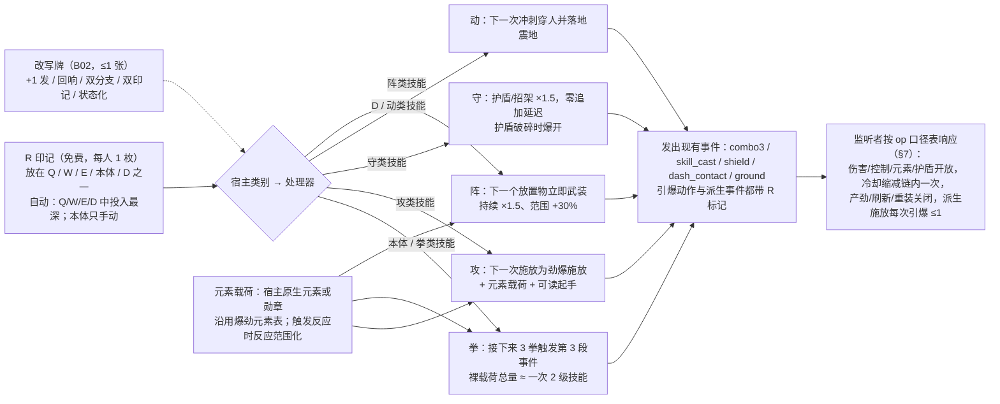

# R 与构筑融合研究（S4 · Build Integration & Emergent Design）

> 研究候选，**不是实施授权**。前提：M-01…M-08（删除通用长按爆劲与精准闪避、冲刺多用途、移速 240、Simple Controls / Complex Builds / Deep Decisions）；P-3.2 属性点是唯一货币。
> 本文只回答“R 的构筑权从哪里来、现有牌/技能/关键石怎样驱动 R”。R 的按键规则以 S3 [`R_ARCHITECTURE.md`](../r-architecture/R_ARCHITECTURE.md) §7 与 §13（§13 优先）为准；劲的来源与价格以 S2 [`MOMENTUM_LEDGER.md`](../momentum/MOMENTUM_LEDGER.md) 及其研究为准。
> 证据分级：L1 源码/配置/数学；L2 离线模拟；L4 原生整局；L5 真人单局。本文主体为 L1 + 设计推断，**没有 L2 以上的新证据**。
> 复现：`python -B r_build_integration.py`（只读 `SourceData\Demo\content.json`，输出 `r_build_integration.json`；分类表为人工设计判断，已在脚本中标注 `DESIGN`）。
> 勘误（L1）：旧图谱 `data/interaction_graph.json` 的 `loop_cd_engine` 注释称“技能基础不耗劲”，与源码不符——劲不足时施放被拒（`LDCombatSources.cpp:280` `MomentumShort`），技能耗 20–35 劲。

## 0. 摘要

1. **构筑权最适合放在“宿主”上，而不是新卡牌或关键石上。** 现有构筑已经按宿主组织：Q/W/E 各有技能牌与元素槽，D 有冲刺牌，本体有本体牌与元素槽。让玩家把一枚免费的“**R 印记**”放到一个宿主上（自动模式只在 Q/W/E/D 中选投入最深的；本体只能手动选，见 §2.2），R 引信就装在这个宿主的动作上。
2. **现有内容不需要新增就能驱动 R，但需要一次性的监听者审计。** 规则是：引爆载荷**发出现有事件**，而不是乘现有数值；引爆动作与它派生的所有事件**继承 R 标记、不继承载荷**（§2.2）。例如本体印记的 R = “接下来 3 拳按第 3 段结算”，第 3 段监听者、力道关键石与本体勋章接上；但各监听者对派生命中的现行处理逐张不同（A01/A02 不排除 A09 复制品），首版必须按 `op` 审计（§7 表，59 个 op 中 18 个待审计）。
   - 按 `op` 的候选接入（监听事件 ∩ 处理器发出的事件）：拳 24、攻 30、守 10、动 24、阵 25 张；阵专属（`ground`）**只有 6 张、0 稀有**。
   - R 本身只有 **5 个处理器 × 6 种元素载荷 ≈ 30 种行为**；具体样子由宿主技能现有的分支与元素决定（24 技能 × 7 分支路径），这部分不需要新内容。
3. **这是 S3 推荐的 R4 引信的一个具体化，不是另一个架构。** S3 已在 `R_ARCHITECTURE.md` §13 采纳三处主张：口由印记选、8 口折叠为 5 处理器（拳/攻/守/动/阵）+ 元素载荷、引爆算一次正常施放。保留分歧：拳处理器的**裸载荷总量**按一次 2 级技能定预算（本文采纳，§2.1）。
4. **R5 回响的构筑权天然来自 C3（技能与分支）**，几乎零成本；但它对没有对应技能的流派（重锤、纯冲刺）几乎无身份，对护盾/工事过强（与 S3 L1 数据一致）。建议作为 B02 的一张“回响”改写牌进入 R4，而不是独立方案。
5. **关键石不应成为 R 的形态来源（C2 否决）。** 理由是经济原则 P-3.2：属性点同时是属性与商店货币，任何让关键石“额外解锁”新能力的设计都会进一步抬高“堆点不买牌”的收益。18 点占 L16 公式点数 48 的 37.5%，占真人实际 81 点（EXP-01，L5，n=1）的约 22%；单局“冠军 0 次购物”只作旁证。关键石通过它们**已有的效果**参与 R。
6. **最大风险**：①阵处理器在 B01 只能交付“结构完整、不会成长”的一档（§2.1）；②派生施放牌与拳印记是固定 ×3，需技术护栏“每次引爆每张最多 1 次”；③冲刺穿人按人数线性放大，需递减；④高频施法成型（高急速）后在 M1 下 R 与技能抢劲（急速只放大支出，S2 L1）；⑤冲刺印记若给“立即就绪一次冲刺”会触及 M-07。

## 1. C1–C6：R 的构筑权来源比较

### 1.1 关键数据（L1，`r_build_integration.py`）

| 指标 | 值 | 含义 |
| --- | --- | --- |
| C1 新增 6 张形态牌（普通 100 权重）时，指定一张在 L3 / L6 / L9 前至少出现一次 | 8% / 16% / 23%（稀有 2% / 4% / 6%；传说 0.5% / 1.0% / 1.6%） | 由牌决定形态 = 由运气决定身份 |
| C2 关键石 | 全投一维最早 L6 达 18 点；占 L16 公式点数 48 的 37.5%，占真人实际 81 点约 22%（L5，n=1）；可同时激活多块 | 否决理由是 P-3.2（见 §0.5）；多关键石还要另立优先规则 |
| C3 开局可得性（15 选 3，超几何近似） | 攻 92%；守 / 阵 / 拳 各 37%；动 20% | 技能类别由开局抽到什么决定；本体与 D 宿主人人都有，可补足 |
| C5 涌现积分需打标签的组件 | 89 牌 + 24 技能 + 5 关键石 = 118 | 现有 vocab 太宽（`area` 挂在 16/24 技能），不能直接复用 |
| 双分支可同时生效（候选改写牌） | 15 / 24 技能的 2A+2B 无冲突 | 9 个冲突：拉/推、增/减倍率、跟随/一次性 |

### 1.2 比较

| 来源 | 可预测 | 易理解 | 组合深度 | 组合爆炸 / 维护 | 早期锁定 | 对买牌吸引力 | 结论 |
| --- | --- | --- | --- | --- | --- | --- | --- |
| C1 卡牌驱动 | 中（看工坊即知） | 高 | 高 | 中：约 12 张 R 牌；形态牌互斥规则 | 低 | **提高** | 适合**修饰与改写**；不适合决定形态（运气决定身份） |
| C2 关键石驱动 | 高 | 高 | 低（5 形态） | 低，但多关键石需优先规则 | **高**（18 点沉没成本） | **降低**（P-3.2 下额外解锁抬高堆点收益） | 否决作为形态来源；关键石只以已有效果参与 |
| C3 技能/分支驱动 | 高 | 高 | 高（分支自动带入） | 逐类别低；逐技能 24、逐分支 168 份内容 | 低（换技能全额退技能点） | 中性 | 采用“逐类别”：类别决定处理器，分支自动改变载荷 |
| C4 显式原型 | 最高 | 最高 | 低–中 | 低，但新增成长节点 | **高** | 中性 | 不新增成长节点；保留“显式选择”的优点，做成免费印记 |
| C5 涌现积分 | **低**（换一张牌 R 就变） | 低 | 最高 | 高：118 个标签 + 并列抖动 | 低 | 中性 | 不作为形态来源（与 S3 §6 一致）；只用来给印记**选默认值** |
| **C6 宿主印记（推荐）** | 高（R 按钮显示宿主图标） | 高（一句话：R 强化你印记所在的那个动作） | 高（现有牌经事件接入） | 5 个处理器，0 必需新内容，无跨来源冲突；**一次性按 `op` 审计 59 类监听者** | 低（印记随时可换） | 提高（宿主上的牌直接变成 R 的内容） | 推荐 |

PO 提问的直接回答：
- **C1 多张 R 牌叠加怎样避免冲突**：分两层。改写牌（改变 R 的种类、发数、状态化）同一时刻只生效 1 张，工坊里拒绝第二张并说明原因（S3 K8）；修饰牌数值相加，沿用现有“同源相加、异源相乘”。
- **C2 是否让关键石过于重要**：是。在 P-3.2（属性点同时是属性与货币）下，让 18 点再解锁 R 形态，等于给“堆点不买牌”再加一份收益。L5 单局“冠军 0 次购物”只是旁证。
- **C3 能否让技能选择形成完整身份**：能，而且免费——宿主技能的分支直接决定引爆的样子；遗忘/替换技能全额退技能点，转型成本低。
- **C4 是否增加系统、过早锁定**：独立成长节点会；免费印记不会。
- **C5 是否可预测、可数据驱动**：纯积分涌现不可预测；“事件驱动”的涌现（载荷发出现有事件，由现有牌响应）可预测，且完全由数据驱动（牌的 `op` 已在 `content.json` 中）。

### 1.3 各 R 架构最适合的构筑权来源

| R 架构（S3） | 最适合的来源 | 原因 |
| --- | --- | --- |
| R1 上劲 | C3 | 强化哪一招 = 技能本身；成长需要 C1 修饰 |
| R2 招牌大招 | **C4**（经现有主动机会发放“R 图纸”），而不是 C2 | 原型需要显式选择；关键石作开关会压制买牌 |
| R3 爆气状态 | C1（状态子句写在牌上） | 状态内容 ≈ 牌的数量，维护成本最高（S3 同意） |
| **R4 引信** | **C6 宿主印记** = C4（免费显式选择）+ C3（类别与分支）+ C5（事件涌现）+ C1（改写/修饰） | 本文推荐 |
| R5 回响 | C3 为主，C1 改“从哪回响、回响什么” | 回响的内容就是技能与分支；没有对应技能的流派缺身份 |

## 2. 推荐：宿主印记（R4 的构筑权方案）

### 2.1 五个处理器（载荷数值都是示意，预算按 S3 K3“一次引爆 ≈ 一次 2 级技能”）

| 处理器 | 宿主 | 引爆动作 | 载荷（示意） | 接入的现有内容（举例；按 `op` 的确数见 §7） | 颜色族 |
| --- | --- | --- | --- | --- | --- |
| 拳 | 本体；拳类技能（贴脸补一拳、左右开抽、疯狗乱拳） | 下一次普攻起 3 拳（拳类技能：本次强化拳全部） | 3 拳都**触发第 3 段事件**（重击停顿、本体勋章元素）；**3 拳裸载荷总量 ≈ 一次 2 级技能**（采纳 S3 §13.1），按次数不按时长 | 第 3 段监听者 A01/A03/A04/A06/A07/A08、千斤重锤、吨位碾压、力道关键石；本体勋章 | 攻击 |
| 攻 | 9 个攻类技能 | 下一次施放 | 劲爆施放：伤害提高（**加法预算**，§3.9）+ 元素载荷（现行烫 +3 层、湿 45%、麻 0.5R、冻 0.6 s 定身、馊 ×2）+ 0.15 s 金光起手 | 宿主的全部技能牌（K 系 20 张）、技能暴击、技能吸血 | 攻击 |
| 守 | 拧你手腕、锅盖挡脸、来打老子啊、顶着揍、扯嗓子喷你 | 下一次**自己施放**守类技能 | 护盾/招架/减伤的量与持续 ×1.5，零追加延迟；护盾被打破时向周围爆开 | 反应装甲、壳碎了也崩你、憋着的气、挨揍起硬皮、铁刺猬、体格/脸皮关键石 | 防御 |
| 动 | D；掏蛋子、蛮牛顶 | 下一次冲刺 / 冲刺技能 | 穿过敌人，落地小范围震地减速；**接触类效果按人数递减**（示意：首人全额、之后每人 50%、最多结算 3 人） | D01/D02/D03/D06/D07、失控列车、一路结冰、身手关键石 | 机动 |
| 阵 | 脚底开锅、踩一脚试试、电风扇、占座书包、警戒封条 | 下一个放置物 | 立即武装、持续 ×1.5、范围 +30%。**B01 只有这一档**：结构完整、可用，但不随构筑质变（阵专属牌 6 张、0 稀有），质变内容依赖 B02 | 双摊位、违章工事、挪地盘、地头蛇 | 阵地 |

S3 的 8 个口与本文的对应：技能口 → 攻/守/动/阵（按技能类别）；连招口 + 普攻口 → 拳；冲刺口 → 动；反应口 → 元素载荷（任一宿主）；护盾口 + 受击口 → 守；工事口 → 阵。

### 2.2 构筑相关的规则（补充 S3 §7，不重复）

| 问题 | 规则 | 理由 |
| --- | --- | --- |
| 印记默认放在哪 | 自动模式只在 Q/W/E/D 中选：得分 = 宿主上牌数 + (技能等级 − 1) + 勋章阶数；并列取 Q→W→E→D；没有已学技能时才落在本体；引信装着时不重算。**本体只能手动选**（本体牌占 56/89，按牌数打分会让本体成为默认；9 个代表构筑中原打分本体当选 3/9，修订后 0/9，脚本 §8） | C5 只用来省去新手的选择；默认值不把多数人推向同一个 R |
| 手动换印记 | 任何时候可换（与装卸牌一致），装着引信时不能换；手动后不再自动 | 免费、可逆 → 不锁流派 |
| 宿主冷却中按 R | 允许；引信等到宿主就绪（仍受约 6 s 上限与 S3 §13.2 的过期冷却）；R 按钮显示宿主图标与冷却 | 不让 R 变成刷新键 |
| 换技能 / 遗忘 | 印记跟“槽”走，换上的新技能按它的类别决定处理器 | 与“兼容技能牌留在原槽”一致 |
| R 标记 | **引爆动作本身与它派生的所有事件**（追加打击、扫击、穿人普攻、反应、区域跳伤、派生施放、反伤）都带 R 标记；派生事件**不继承载荷** | A09 整份复制主命中（`LDCombatCards.cpp:713-716`）；不靠标记就无法统一 A01/A02 这类不排除追加打击的监听者 |
| R 标记事件的监听口径 | 按牌的 `op`（不按 vocab）：伤害、控制、元素、护盾、额外打击**开放**；冷却缩减（`hit_haste_other`、`basic_cooldown_cut`）**一条引爆链合计一次**；产劲、偷劲、刷新或返还冷却（含 `dash_contact_reset`、`reaction_haste`、`takedown_reset`）、重新装填 R **关闭**；永久/临时成长（`hit_growth`、`focus_attack_speed`、`skill_growth`、`heal_growth`）**只算引爆动作本身** | 与 S3 §13.3 口径表一致；完整表见 §7 |
| 引爆动作本身 | 算一次正常施放/普攻：宿主上的牌照常触发一次（受上行口径约束） | 否则技能牌在 R 上全部失效 |
| 派生施放（`combo_cast` 拳里带招、`auto_recast` 再来一遍、`combo_skill_hit` 拳拳到肉的扇出） | **每次引爆、每张牌最多触发 1 次**；派生施放不消耗引信、不继承载荷 | 拳印记 3 拳 × 拳里带招 = 固定 ×3，是结构乘法，先用技术护栏消除，再由 PO 定传说牌能否超预算 |
| 冲刺接触（`dash_phase`、`dash_ram`、`runaway_train`、`D03`） | 一次引爆中按人数递减（示意：首人全额、之后 50%、最多 3 人）；R 标记的接触**不刷新冲刺** | 8 人混战中线性放大与“一次引爆 ≈ 一次 2 级技能”冲突 |
| 改写牌 | 同时只有 1 张生效，工坊拒绝第二张；修饰牌相加 | S3 K8 |
| 关键石 | 与 R 无显式规则 | §1.2 |

## 3. 代表构筑（9 个）

每个构筑先给 R4（宿主印记）的完整 12 项，再给 R5 回响下的对照。劲：按 S3 §7“引爆时扣 R 价、过期不扣”，价格和 M 架构由 S2 定。时间轴是示意。

### 3.1 普攻攻速 ·「千厘加特林」

组件：左右开抽（2A 多抽两下）、手快有手慢无、越打越上头、隔空抽你、熟能生巧、身手 18、本体麻勋章。

| # | 项 | 内容 |
| --- | --- | --- |
| 1 | 组件 | 如上；自动印记落在左右开抽（拳类技能 → 拳处理器：本次 5 次强化拳都触发第 3 段事件）；手动放本体则是“接下来 3 拳” |
| 2 | 普通战斗 | 580 cm 远程飞行普攻走 A；左右开抽开节奏；本体勋章让第 2、3 段挂麻，每第 3 次直击额外电 0.5R |
| 3 | R 获得/演化 | L1 就有；牌越多，被强化的拳带的东西越多 |
| 4 | 按 R | 脚下红环（攻击族），等待下一拳 |
| 5 | 接下来 | 继续走 A：强化拳都触发第 3 段事件、都挂麻 → 麻在第 3 次直击时额外电一下；手快有手慢无的追加拳带 R 标记、不继承载荷、不算引信次数 |
| 6 | 劲 | 引爆扣 R 价。S2 L1：攻速本身不多产劲，“溢出”来自便宜的自身增益技能；此构筑在任何 M 下都付得起 |
| 7 | 识别 | 红环 + 拳套亮起；重击停顿 |
| 8 | 反制 | 普攻是锁定（Type1）：拉开距离、站到书包/高墙后挡飞行拳、缴械、冻疮（攻速 −40%）、铁刺猬反伤（每一下都吃反伤）；硬控泄劲 |
| 9 | 未成型 | 强化拳的裸载荷总量 ≈ 一次 2 级技能，平分到各拳；攻速高低不改变总量 |
| 10 | 成型质变 | 加左右开弓：每拳变两下，全部挂麻 → 一次 R 触发多次额外电；R 从“加一点伤害”变成“一串连电” |
| 11 | 破格 | 拳里带招（传说）：**每次引爆只放 1 次** 45% 的 Q（技术护栏，§2.2）；拳拳到肉：每次引爆扇出 1 次，下游打完换下一招链内合计一次 |
| 12 | 风险 | A01 第三拳回口气、A02 边打边想现行**不排除** A06/A07/A09 复制品（`LDCombatCards.cpp:1381-1402`）：R 标记下 A01 关闭、A02 链内一次；越打越上头无层数上限（T01-05 转 B02），A09 复制品不叠 A12/A13 已在集成分支修复（`3f22d22e`） |

R5 对照：回响左右开抽 = 再给 3 次强化拳，价值不错；但**没有拳类技能的纯普攻构筑在 R5 下 R 就是别的技能的回响**，身份断裂。

### 3.2 慢速重击 ·「千斤重锤推墙」

组件：千斤重锤（稀有）、慢工出细活、第三拳滚蛋、拿你当球踢、拧你手腕（2A→3A2 卸腕连锤）、力道 18。

| # | 项 | 内容 |
| --- | --- | --- |
| 1 | 组件 | 如上；自动印记落在拧你手腕（3 级，守处理器）；手动放本体则是“3 拳推墙”（见 10） |
| 2 | 普通战斗 | 0.75 次/秒；每第 3 段必暴击并推人 150 cm+，撞墙眩晕 0.8 s；招架成功后 3 拳全是第 3 段 |
| 3 | R 获得/演化 | 开局即有；千斤重锤到手那一刻 R 质变 |
| 4 | 按 R | 自动位置：绿环；手动本体：红环 |
| 5 | 接下来 | 自动位置：劲爆招架（×1.5 持续、零延迟）→ 成功后照常接卸腕连锤 3 拳。手动本体：3 拳都触发第 3 段事件（千斤重锤必暴、第三拳滚蛋推开），沿墙推、撞墙晕、再推；力道关键石对被击退/受控目标 +14%，第 3 段追加目标当前生命 4%（每目标 1.5 s，主命中才触发） |
| 6 | 劲 | 引爆扣 R 价；技能少、劲宽裕 |
| 7 | 识别 | 绿环（等你先出手）或红环 + 每拳 1.33 s 的慢起手 |
| 8 | 反制 | 绿环：别往招架上打，等它过期；红环：拉开 250 cm 风筝、远离墙；眩晕计入递减（0.8→0.48→0.24 s）；脸皮关键石 35% 延缓流血；硬控泄劲 |
| 9 | 未成型 | 劲爆招架，或 3 拳（裸载荷总量 ≈ 一次 2 级技能） |
| 10 | 成型质变 | 同一套牌两种 R：防反重锤（印记在招架）与推墙重锤（印记在本体）——印记是选择，而不是默认的“3 拳” |
| 11 | 破格 | + 左右开弓：每次第 3 段两下都暴击；+ 吨位碾压：每拳追加额外生命 3.5% |
| 12 | 风险 | 两面墙之间来回撞；击退本身不计递减（只有眩晕计）。需要验证“3 次击退 + 2 次眩晕”在 S3 的 1 s 峰值伤害预算内 |

R5 对照：回响拧你手腕 = 第二次招架（S3 尚未定回响招架的规则）；重锤在 R5 下价值偏低（S3 L1：5.2%，与技能循环并列倒数第二），**R4 明显更适合重击流**。

### 3.3 技能循环 ·「技能永动机」

组件：甩你一鞋（2B→3B2 接住再抽）、电你个哆嗦（2A 多弹两下）、板砖糊脸（2A 连环砖）、打完换下一招 ×2（鞋、电）、一招接一招（板砖）、边打边想、脑力 18。

| # | 项 | 内容 |
| --- | --- | --- |
| 1 | 组件 | 如上；鞋与板砖同为 3 分，自动按 Q→W→E 取鞋；本例手动放板砖（收尾砖） |
| 2 | 普通战斗 | 鞋→电→砖轮转，每次命中减其他技能 1 s；板砖每有一个 4 s 内放过的其他技能 +20% |
| 3 | R 获得/演化 | 开局即有（“强化下一招”）；成型后变成“收尾砖” |
| 4 | 按 R | 红环 |
| 5 | 接下来 | 鞋 → 电 → 劲爆连环砖（+40% 来自一招接一招，0.15 s 金光起手，两砖） |
| 6 | 劲 | 原生交战中约一半时间劲 ≥60（S2 账本 §3.2），当前不缺劲；风险在**高频施法成型后**：急速只放大支出、不放大收入（S2 L1），M1 下 R 与技能抢劲。M2/M3 下无此问题 |
| 7 | 识别 | 红环 + 金光起手 + 板砖 0.55 s 落点预警 |
| 8 | 反制 | 走出 200 cm 落点（走位不够时需冲刺，S4 L1）；沉默断轮转；硬控泄劲 |
| 9 | 未成型 | 劲爆板砖（无元素） |
| 10 | 成型质变 | R 从“下一招更痛”变成“一轮连招的终结技”；轮转顺序成为决策 |
| 11 | 破格 | 再来一遍（传说）装在板砖：劲爆砖之后 0.6 s 再落一次 60%（不继承载荷，每次引爆最多 1 次）；B02“双分支”改写：连环砖 + 精准砖同时生效（板砖在冲突表中，需单独设计） |
| 12 | 风险 | 打完换下一招在引爆链里合计一次；冷却下限 0.3 s 仍是最终闸门 |

R5 对照：**R5 最适合这一流派**——回响上一招 = 把刚才的砖再落一次，分支自动带入，几乎零内容。若 PO 偏好 R5，技能循环是它的主场。

### 3.4 元素反应 ·「湿麻冻导电」

组件：滋你一脸（湿；2A→3A2 带电水枪）+ 湿勋章（同色Ⅱ阶）、冰可乐摇一摇（冻；2A 喷地成冰）、电你个哆嗦（麻）+ 炸了接着放、炸得更响、反应回本、脑力 18。

| # | 项 | 内容 |
| --- | --- | --- |
| 1 | 组件 | 如上；自动印记落在滋你一脸（3 级 + Ⅱ阶勋章 = 4 分）；也可手动放电 |
| 2 | 普通战斗 | 滋（湿、拉近）→ 冰可乐（冻住 1.2 s）→ 电（碎冰：下一次技能伤害 +50%）；每次反应回劲、电冷却 −3 s |
| 3 | R 获得/演化 | 开局即有；勋章与反应牌越多，引爆的反应越大 |
| 4 | 按 R | 红环 |
| 5 | 接下来 | 印记在滋：劲爆滋一条线（湿减速 45%），3A2 拉近后挂麻 → 自触发导电，**反应范围化**，450 cm 内其他湿的敌人一起导电。手动放电：先用滋打湿人群，再放劲爆电（麻载荷 +0.5R），电弹到湿的人同样导电并范围化 |
| 6 | 劲 | 收入最高的流派（反应 10、反应回本 15、脑力关键石返还），任何 M 都够 |
| 7 | 识别 | 红环；所有人头顶的“湿”图标就是危险提示 |
| 8 | 反制 | 别带着湿靠近他（湿 4 s 后消失）、散开、堆魔抗；0.5 s 反应锁防同目标连爆；锅盖挡脸解定身 |
| 9 | 未成型 | 劲爆滋（湿减速 45%）或劲爆电（+0.5R） |
| 10 | 成型质变 | R 从“单体加电”变成“对一群湿身对手的群体导电”——混战中的阵型威胁 |
| 11 | 破格 | 一波接一波（传说）：反应后再挂异色元素并豁免一次锁；电风扇 3A2“带料的风”把麻吹给一排人后再 R |
| 12 | 风险 | 反应范围化只在一条引爆链内结算一次；R 标记的反应不产劲，**脑力关键石的返还也不触发**；Ⅲ阶勋章自触发 + 范围化需验证不连锁 |

R5 对照：回响滋你一脸 = 再泼一次水（重新挂湿），是“补元素”而非“引爆”；S3 L1 元素流在 R5 下最低（4.5%）。

### 3.5 冲刺机动 ·「穿人列车」

组件：撞着就刷新（稀有）、穿人而过、蹿过去抡一拳、撞着了再撞、失控列车（稀有）、身手 18、贴脸补一拳（2B→3B1 穿身而过）。

| # | 项 | 内容 |
| --- | --- | --- |
| 1 | 组件 | 如上；D 上 5 张牌 → 印记默认 D |
| 2 | 普通战斗 | D 穿过敌人、每人吃一次普攻；撞到参赛者刷新 D；每次接触所有技能 −1.5 s；身手关键石：D 冷却 −40%、冲完下一拳强化、移速 +25% |
| 3 | R 获得/演化 | 开局即有（任何人都能把印记放在 D） |
| 4 | 按 R | 蓝环（机动族） |
| 5 | 接下来 | 选一条能穿过 2–3 人的线冲：劲冲穿人 + 落地震地减速 → 减速让下一次（普通、可被撞着就刷新刷新的）冲刺更容易再穿一次 |
| 6 | 劲 | 中等；冲刺耗劲（D08）与 R 抢劲，是这个流派的真实取舍 |
| 7 | 识别 | 蓝环；冲刺只有 0.18 s，**预警只能靠蓝环** |
| 8 | 反制 | 定身 100% 禁冲；警戒封条 2A 撞线眩晕；别扎堆；站在空地（失控列车撞墙返还冷却） |
| 9 | 未成型 | 一次带震地的冲刺 |
| 10 | 成型质变 | R 从“冲刺加个减速”变成“一条穿 3 人的轨道 + 震地减速”的开团；接触类效果按人数递减（首人全额、之后 50%、最多 3 人），撞着了再撞的全技能减冷却链内只算一次，R 标记的接触不刷新冲刺 |
| 11 | 破格 | 一路结冰 + 冰刀割裂：震地落在自己的冰带上，击退 ×1.5；两段冲刺（传说）：只有第一段引爆 |
| 12 | 风险 | **PO 决策**：若印记在冷却中的 D 上按 R 让 D 立即就绪，相当于构筑专属的第二次冲刺（M-07 禁止通用双充能，此处是构筑专属）。本文默认不刷新。撞着就刷新对 R 标记的接触关闭（与 §2.2 一致）；引爆之后的普通冲刺照常可刷新 |

R5 对照：回响上一招只能回响冲刺类**技能**，D 不在范围 → 纯 D 流在 R5 下没有身份，需要一张“回响上一次冲刺”的牌。

### 3.6 护盾防反 ·「锅盖反应装甲」

组件：锅盖挡脸（2A→3A1 锅反弹）、扯嗓子喷你（2B→3B2 破嗓爆盾）、反应装甲、壳碎了也崩你（稀有）、挨揍起硬皮、憋着的气（装在扯嗓子）、体格 18。

| # | 项 | 内容 |
| --- | --- | --- |
| 1 | 组件 | 如上；自动印记落在扯嗓子喷你（3 级 + 憋着的气 = 3 分） |
| 2 | 普通战斗 | 叠盾：已有盾再获盾 → 反应装甲弹片；盾碎 → 壳碎爆炸；扯嗓子 3B2 主动引爆自己的盾 |
| 3 | R 获得/演化 | 开局即有（若开局拿到锅盖或扯嗓子：37%；否则先放在攻类技能上） |
| 4 | 按 R | 绿环（防御族） |
| 5 | 接下来 | 先开普通锅盖挡第一波（解减速/定身、反弹 20%）→ 按 R → 劲爆扯嗓子：震退周围、盾 ×1.5 叠在锅盖上（反应装甲弹片），憋着的气把 50% 护盾转成伤害；3B2 破嗓爆盾引爆现有护盾，大盾破碎时额外向周围爆开 |
| 6 | 劲 | 中等 |
| 7 | 识别 | 绿环；护盾条公开 |
| 8 | 反制 | 馊/发酵（护盾 −25% / −60%）；别往反弹盾上打；等盾过期（锅盖 4 s）；离开 300 cm 爆炸圈；硬控泄劲 |
| 9 | 未成型 | 1.5 倍扯嗓子盾 |
| 10 | 成型质变 | R 从“更厚的盾”变成“一颗由对手伤害喂大的炸弹” |
| 11 | 破格 | 憋着的气：扯嗓子命中时把 50% 护盾变伤害，R 盾越大打得越痛；烧着还挺扛揍 + 反应装甲：灼烧转盾触发弹片（Y29 上限已修 `398d2928`） |
| 12 | 风险 | “每打空一层计一次打破” → 多层同时碎可能连环触发壳碎；护栏：壳碎与反应装甲对同一伤害/施放事件只触发一次（§7 链内一次） |

R5 对照：回响锅盖 = 第二面盾（60–70%），S3 L1 护盾流在 R5 下最高（10.3%）——**R5 对防守流过强**。

### 3.7 召唤与工事 ·「书包封点」

组件：占座书包（2A→3A1 书包连墙）、电风扇（3A2 带料的风）、违章工事、双摊位、脚底开锅（烫）、体格加点（书包继承 35% 生命上限）。

| # | 项 | 内容 |
| --- | --- | --- |
| 1 | 组件 | 如上；印记默认书包 |
| 2 | 普通战斗 | 放两个书包连成墙封路；风扇吹过自己的火场刮出元素风暴 |
| 3 | R 获得/演化 | 开局拿到书包或脚底开锅（37%）；电风扇、陷阱、封条都不在开局池 |
| 4 | 按 R | 黄环（阵地族） |
| 5 | 接下来 | 先放一个普通书包，按 R，第二个书包作为劲爆书包落在旗杆另一侧 → 墙立即成形、持续 6 s、爆炸半径 +30%；在墙后开锅、开风扇 |
| 6 | 劲 | 低频技能，中等 |
| 7 | 识别 | 黄环；放置物公开 |
| 8 | 反制 | 远程先拆劲爆书包（但它更厚）；绕路；等 6 s；离开爆炸圈 |
| 9 | 未成型 | 一个更大、更久的书包 |
| 10 | 成型质变 | B01：不质变——阵处理器只有“立即武装 + 持续/范围”一档，构筑成长体现在书包连墙、风扇等技能分支本身；“在关键 6 秒封住一个点”的战术价值来自分支，不来自 R 的成长。B02 补阵地内容后才可能质变 |
| 11 | 破格 | 双摊位 ×2：三个书包两道墙；摇头扇 + 违章工事：元素风暴扫过整个阵地 |
| 12 | 风险 | 封点影响终局（Batch 04 范围）；**内容断供**：阵专属牌仅 6 张、0 张稀有；陷阱/风扇/封条不在开局池。按 `op` 的候选接入有 25 张，但其余 19 张是任何技能都能接的技能命中/施放类牌，不构成阵地身份 |

R5 对照：回响书包 = 多一个 60–70% 的书包，绕过“同时存在上限 / 充能”规则，需要额外规则；S3 L1 工事在 R5 下偏强（8.6%）。

### 3.8 混合 ·「文武魔剑」

组件：脑转手快、咒刃回响、读书人打架、文武双全（稀有）、拳里带招（传说，破格）、甩你一鞋（Q）、过期外卖（W）、本体烫勋章、脑力 + 力道。

| # | 项 | 内容 |
| --- | --- | --- |
| 1 | 组件 | 如上；自动印记落在甩你一鞋（本体只手动）；手动放本体可得拳的那一半 |
| 2 | 普通战斗 | Q–A–W–A：施法后两拳挥出剑气；普攻带法强与灼烧 |
| 3 | R 获得/演化 | 开局即有；成型的关键是拳里带招 |
| 4 | 按 R | 红环 |
| 5 | 接下来 | 自动位置：劲爆鞋（加法伤害 + 烫载荷），咒刃回响的两拳剑气照常（引爆动作算一次正常施放）。手动本体：先放鞋，再 3 拳劲拳（剑气、灼烧）；有拳里带招时**本次引爆只放 1 次** 45% 的鞋 |
| 6 | 劲 | 文武双全每次技能命中后下一拳偷 8 劲——在“R 用劲”的世界里，偷劲 = **压低对手的 R**；但 R 标记的命中不偷劲 |
| 7 | 识别 | 红环；拳上挂鞋 |
| 8 | 反制 | 缴械（印记在本体时 R 停在引信上，过期不扣劲）；堆魔抗；硬控泄劲 |
| 9 | 未成型 | 劲爆鞋，或 3 拳带火 |
| 10 | 成型质变 | “印记在鞋”与“印记在本体”给出两种完全不同的 R：前者是劲爆鞋 + 剑气，后者是拳中带招的连段 |
| 11 | 破格 | 拳里带招 + 左右开弓：第 3 段变两下，派生施放每次引爆仍只 1 次 |
| 12 | 风险 | 技术护栏（每张派生施放牌每次引爆 ≤1）先消除固定 ×3；剩下的 PO 问题只是“传说牌能否在可读攻击上超出预算”；派生施放是否触发咒刃回响按 §7 口径（`spellblade_echo` 开放，但派生施放不继承载荷） |

R5 对照：回响甩你一鞋；失去“拳”的身份，只剩技能那一半。

### 3.9 原创 / 压力测试 ·「憋一发板砖」

组件：板砖糊脸（2B→3B1 砸晕）、攒够一顿狠的（稀有）、憋着一发狠的（传说）、攒个大的（传说）、技能也能暴击（稀有）、力道。

| # | 项 | 内容 |
| --- | --- | --- |
| 1 | 组件 | 如上；印记默认板砖 |
| 2 | 普通战斗 | 不出手攒乘区（最高约 12.6×），开战第一砖 |
| 3 | R 获得/演化 | 开局即有 |
| 4 | 按 R | 红环——**这是它唯一的预警** |
| 5 | 接下来 | 劲爆精准砖：金光起手 + 0.55 s 落点 |
| 6 | 劲 | 一次引爆就够 |
| 7 | 识别 | 红环 + 金光 + 落点圈 |
| 8 | 反制 | 必须冲刺躲（240 cm/s 走不出最坏落点，S4 L1）；死扛；拧你手腕 |
| 9 | 未成型 | 劲爆板砖 |
| 10 | 成型质变 | R 成为秒杀开关 |
| 11 | 破格 | 所有空闲乘区 × 暴击 × R |
| 12 | 风险 | **证明攻类载荷不能是乘法**：必须是加法固定预算，或与空闲类乘区互斥；否则需靠 `DAMAGE.FactorTechCap`（×1000，只是技术上限） |

R5 对照：回响砖不重新攒乘区，天然更温和——R5 在“乘区堆叠”上反而更安全。

### 3.10 小结

| 构筑 | R4 宿主印记 | R5 回响 |
| --- | --- | --- |
| 普攻攻速 | 好（自动落在拳类技能） | 依赖拳类技能 |
| 慢速重击 | 好（招架 / 本体两种位置） | 弱 |
| 技能循环 | 好（高急速成型后 M1 下抢劲） | **最好** |
| 元素反应 | 好 | 弱 |
| 冲刺机动 | 好（接触按人数递减；M-07 边界待定） | 无身份（需新牌） |
| 护盾防反 | 好 | 过强 |
| 召唤工事 | B01 只有一档，不质变 | 需额外规则，偏强 |
| 文武混合 | 最有趣；派生施放每次引爆 ≤1 | 失去拳的一半 |
| 憋大招 | 必须用加法载荷 | 天然温和 |

## 4. 组合潜力、扩展性与内容生产成本

| 维度 | 宿主印记（R4） | 说明 |
| --- | --- | --- |
| R 本身的行为 | 5 个处理器 × 6 种元素载荷（无 + 五元素）≈ **30 种** | 玩家要学的只有“R 强化我印记所在的那个动作” |
| 由宿主带来的变化 | 宿主技能的分支与元素（24 技能 × 7 分支路径）、本体的第 3 段牌、D 的冲刺牌 | 这是**技能本身**的多样性，不是 R 的；优点是 R 不需要新教学 |
| 接入的牌（按 `op`，§7） | 开放 28、链内一次 6、关闭 8、每次引爆 ≤1 3、按人数递减 3、只算引爆动作 4、派生生产 4、非 R 事件 6；不监听（静态/转换）24；精准闪避 3 张另行迁移 | 按处理器的候选接入：拳 24、攻 30、守 10、动 24、阵 25（阵专属仅 6） |
| 新牌的 R 成本 | 每张新牌在审计表中登记一行 `op` 口径；改写牌每张 1 份规则 | 与 S3 K6 一致 |
| 新技能的 R 成本 | 填 1 个类别字段 | 新类别才需要新处理器 |
| **首版必需工作** | 5 个处理器 + 元素载荷复用；R 标记在全部派生路径上的传递（A06/A07/A09 复制、D06 穿人普攻、反应、区域跳伤、派生施放）；**59 个 `op` 的监听者审计**（18 个的派生命中处理尚未核对）；印记 UI 与 R 按钮宿主图标；4 色引信环与 2 个音效；AI 选印记与用 R；`LD_R` 遥测 | 不是“零成本”：没有“R 牌 × R 牌”矩阵，但有“处理器 × 监听者”（约 5 × 59）回归面 |

对比：R5 回响的生产成本最低（复用 `auto_recast`），但冲刺、护盾、放置物各需一条回响规则；R2 每个原型一套大招；R3 每类牌一条状态子句。

## 5. 无限循环与不公平机制（汇总）

| 组合 | 机制 | 护栏 |
| --- | --- | --- |
| A01 / A02 × A06/A07/A09 复制品 × 拳印记 | 复制品段数仍为 3，A01 每个复制品回劲、A02 每个复制品减冷却（现行行为，`LDCombatCards.cpp:1381-1402`） | 复制品继承 R 标记：A01 关闭，A02 链内一次。现行规则层面（与 R 无关）是否算缺陷交 S1 |
| 拳拳到肉 + 打完换下一招 ×3 + 拳印记 | 3 拳 × 3 技能扇出减冷却 | 拳拳到肉每次引爆 ≤1；下游冷却缩减链内合计一次 |
| 拳里带招 / 再来一遍 + R | 派生施放固定 ×3 | **每张派生施放牌每次引爆最多 1 次**（技术护栏）；派生不继承载荷 |
| 撞着就刷新 + 动印记 | 刷新冲刺 | R 标记的接触不刷新冲刺；R 不再装填 |
| 穿人而过 / 闷头撞到底 / 失控列车 / 蹿过去抡一拳 + 动印记 | 按穿过人数线性放大 | 一次引爆中按人数递减（示意：首人全额、之后 50%、最多 3 人） |
| 人头刷新（劲回满）+ R | 击杀后立刻再 R | R 标记的击杀不触发刷新与回劲（S3 K5） |
| 文武双全 / 扒裤子 3B1 偷劲 | 压制对手 R | 普通命中偷劲是可读反制，保留；R 标记命中不偷 |
| 空闲乘区 × R | 秒杀 | 攻类载荷用加法预算 |
| 多层护盾同时破碎 × 壳碎、反应装甲 | 连环爆炸 | 同一伤害/施放事件只触发一次 |
| 脑力关键石返还 | R 反应回劲 | R 标记不产劲 |
| 越打越上头 / 熟能生巧 / 越用越顺手 | R 加速叠层 | 成长类只算引爆动作本身；层数上限 B02（T01-05） |
| 封点书包墙 | 终局僵局 | Batch 04 |

## 6. 缺失组件

| # | 缺失 | 影响 | 归属 |
| --- | --- | --- | --- |
| G1 | 阵地内容断供：阵专属 6 张牌、0 张稀有；电风扇/陷阱/封条不在开局池 | 开局三选一有 63% 见不到阵地技能；阵处理器在 B01 只有一档、不质变 | B02 内容 + 开局池 |
| G2 | 印记数据与 UI：工坊里的印记位、R 按钮显示宿主图标与冷却、自动/手动切换 | 方案前提 | 实施（批准后） |
| G3 | R 标记在全部派生路径上的传递 + 按 `op` 的监听口径（§7） | 防递归；“经事件接入”成立的前提 | 实施（复用 `bAutoRecast`、`ChainAllows`） |
| G4 | 4 色引信环、装载/引爆音效、观察帧字段（替代 `NS_LDOverdriveCharge`） | 反制可读 | 实施 + S3 RV1–RV7 |
| G5 | AI：选印记（可用自动模式）、何时按 R；质变样板加印记 | AI 能用 | B01 S2 / 实施 |
| G6 | 遥测：`LD_R`（宿主、处理器、引爆/过期/泄劲、载荷伤害、派生次数），`LD_MOMENTUM` 的 R 支出 | 后续验证 | 实施 |
| G7 | 词汇：印记宿主的词汇参与选牌加权；属性点与关键石至今不进词汇 | 引导构筑 | B02 |
| G8 | 无直接命中的技能（锅盖、来打老子啊、顶着揍、左右开抽、电风扇）不能用技能命中类牌 | 守/拳类宿主的技能牌空转（既有问题） | B02 |
| G9 | 疯狗乱拳缺 `CastLedger`（T02-14 待批） | 印记在疯狗乱拳上时牌失效 | B01 S1 |

## 7. 监听者审计（按 `op`，首版必需）

规则：引爆动作本身与它派生的所有事件都带 R 标记，派生事件不继承载荷。下表按规则归类 59 个 `op`；逐行的监听事件与派生命中现状见脚本输出 §7（`r_build_integration.json` 的 `listener_audit`）。

| R 标记下规则 | 牌数 | `op` |
| --- | --- | --- |
| 开放 | 28 | `combo_knockback` `basic_ap_rider` `breach` `setup_mark` `control_amp` `skill_ad_rider` `shield_spend` `skill_lifesteal` `idle_ready_amp` `recent_cast_amp` `empower_basic` `dash_ice` `ground_relocate` `knockback_impact` `lifesteal_skills` `lifesteal` `overheal_shield` `kill_growth` `idle_charge` `ground_growth` `tally` `spellblade_echo` `skate_blade` `tonnage_crush` `fuel_the_fire` `rogue_works` `martial_scholar`（偷劲部分关闭） |
| 链内一次 | 6 | `basic_cooldown_cut` `hit_haste_other` `reaction_element` `shield_burst_break` `reactive_plating` |
| 关闭 | 8 | `combo_momentum` `skill_hit_momentum` `takedown_reset` `reaction_haste` `dash_contact_reset` `reaction_momentum` `haste_momentum` |
| 每次引爆 ≤1 | 3 | `combo_skill_hit` `combo_cast` `auto_recast` |
| 按人数递减 | 3 | `dash_phase` `dash_ram` `runaway_train` |
| 只算引爆动作本身 | 4 | `focus_attack_speed` `hit_growth` `skill_growth` `heal_growth` |
| 派生生产（产生的事件继承 R 标记） | 4 | `combo_double` `combo_sweep` `overcap_extra_hit` `dash_split`（只有第一段引爆） |
| 非 R 事件（受击、低血、受控触发） | 6 | `thorns` `last_stand` `triggered_shield` `control_growth` `element_aura` `iron_hedgehog` |
| 不监听（静态、改造、转换） | 24 | — |

L1 已核对的派生命中现状（`LDCombatCards.cpp`，基线 `e62ff304`）：
- A06、A07、A09 的追加打击整份复制主命中，包括段数（`:672-680`、`:741-755`、`:713-716`），只清击退。
- 排除追加打击的：A03（`:1406`）、A08（`:2174`）、力道关键石（`:1424`）、文武双全（`:1343/1364`）。
- **不排除的**：A01（`:1381`）、A02（`:1384-1402`）；A12/A13 在主干不排除，集成分支 `3f22d22e` 已排除 A09 复制品。
- 59 个 `op` 中 18 个的派生命中处理尚未核对，标为“待审计”。

## 8. Batch 02 依赖清单

| 依赖 | 内容（只记录需求，不定设计） |
| --- | --- |
| R 改写牌（≤8 张，建议稀有而非传说） | +1 发、回响（R5 作为改写）、双分支（15/24 兼容）、双印记、状态化（R3 作为改写）、预装（开战带入）、R 价（气短迁移） |
| 爆劲关联内容 | 气短 → R 价牌；拳里带招“不触发爆劲” → “派生施放不引爆、每次引爆 ≤1”；勋章“无元素技能爆劲读勋章元素” → 元素载荷规则；`OVERDRIVE.*` 元素参数 → R 元素载荷参数 |
| 精准闪避牌（闪完就打、越躲越快、幻影脱壳） | 迁移由 S1 清单与 PO 决定；本文只确认：它们都不需要成为 R 的来源，也不建议改成“每次冲刺触发” |
| 劲相关牌 | 再来一下别喘、拿命换、冲刺耗劲的代价在 M2 下失效（脚本 §5）；与劲研究的迁移表由 S0 合并 |
| 阵地内容与开局池 | G1；阵处理器的质变层 |
| 稀有度断崖 | R 相关核心牌若放在传说（权重 6），L9 前见到指定一张仅 1.6% |
| 越打越上头 / 手快有手慢无上限 | T01-05 |
| 终局中的 R | Batch 04 |

## 9. 推荐、反对意见与需要 PO 决定的问题

**推荐**：R4 引信 + 宿主印记（C6）。理由：
- 基础操作不变（只多一个 R 键），R 本身只有 5 种行为；
- 构筑身份来自玩家已经在做的事（往哪个宿主上堆牌、点哪个分支）；
- 现有牌不需要新增就能经事件进入 R，代价是一次性的监听者审计与 R 标记传递（§7）；
- 维护按 5 个处理器 + 审计表增长，没有“R 牌 × R 牌”矩阵。

**反对意见（自我反证）**：
1. 印记是一个新概念。自动模式能让大多数玩家不碰它，但“换印记”本身是新的决策负担；本体只能手动选，会让纯普攻玩家多一步操作。
2. 事件驱动的载荷让 R 的价值**随宿主上的牌增长**。这是“构筑驱动”的本意，但构筑间的 R 价值不再相等（S3 K3 的预算只能约束裸载荷）。
3. 即使自动模式排除本体，第 3 段牌与力道关键石仍是拳处理器的最大受益者；手动选本体可能成为高手默认。需原型验证。
4. 阵处理器在 B01 只有一档。
5. 本文没有 L2 以上证据；可读性与“是否好玩”要等原型和真人。

**PO 需要决定的问题（建议并入总决策单）**：
1. R 的构筑权主来源：**宿主印记（玩家选位置，构筑决定内容）**，还是 **卡牌开口**（S3 原案，S3 已同意改为印记），还是 **关键石定原型**？
2. 关键石是否与 R 显式挂钩？（本文建议否，依据 P-3.2。）
3. 冲刺印记能否在 D 冷却中让 D 立即就绪一次？（触及 M-07。）
4. 在“每张派生施放牌每次引爆 ≤1”的技术护栏之上，传说牌能否在可读攻击上超出“一次引爆 ≈ 一次 2 级技能”的预算？
5. B01 是否接受阵处理器只交付一档（结构完整、可用、不质变），质变内容放到 B02？若不接受，B01 可先把阵类技能并入攻处理器。
6. 若选择 R5 回响：防守/工事流过强、重击/冲刺流无身份，是否可以接受用改写牌补齐？

## 10. 反证后修订

输入：S5 [`../critique/MR-08_BUILD_CRITIQUE.md`](../critique/MR-08_BUILD_CRITIQUE.md)；S3 [`R_ARCHITECTURE.md`](../r-architecture/R_ARCHITECTURE.md) §13。

| # | 反证 | 处理 | 位置 |
| --- | --- | --- | --- |
| ① | “经事件自动接入”不统一成立：A09 整份复制主命中，A01/A02 不排除追加打击，会随复制品扇出 | **采纳**。新增规则：引爆动作与派生事件继承 R 标记、不继承载荷；按 `op`（不按 vocab）给出 59 个 `op` 的口径表，已核对现状的写出行号，18 个标“待审计”；审计与 R 标记传递计入首版成本。vocab 映射降级为“候选接入” | §0.2、§2.2、§4、§7 |
| ② | 本体印记会成默认（本体牌 56/89） | **采纳**。自动模式只在 Q/W/E/D 中选，本体只能手动；9 个代表构筑中原打分本体当选 3/9，修订后 0/9。同时采纳 S3 保留意见：拳处理器 3 拳裸载荷总量 ≈ 一次 2 级技能 | §2.1、§2.2、§3.1/3.2/3.8、脚本 §8 |
| ③ | 阵处理器断供，B01 只能交付半成品 | **采纳**。阵处理器标为“结构完整、可用、B01 不质变，质变内容依赖 B02”；它不是失效构筑（有确定效果），但新增 PO 问题 5，并给出“并入攻处理器”的退路 | §2.1、§3.7、§6 G1、§9 Q5 |
| ④ | 派生施放与拳印记是固定 ×3；穿人接触按人数线性放大 | **采纳**。技术护栏：每张派生施放牌每次引爆 ≤1；接触类效果按人数递减。PO 问题 4 收窄为“护栏之上能否超预算” | §2.2、§3.5、§3.8、§5 |
| ⑤ | “约 1,000 种 R 形状”高估 | **采纳**。改为“R 只有约 30 种行为，具体样子由宿主技能现有的分支与元素决定” | §0.2、§4、脚本 §9 |
| ⑥ | C2 否决的算术与依据 | **采纳**。18 点 = 公式 48 点的 37.5%、真人实际 81 点的约 22%；否决理由改为 P-3.2，单局数据只作旁证；删除“推迟关键石 1.3 级”的推论 | §0.5、§1.1、§1.2、脚本 §3 |
| ⑦ | §2.2 与 §5 刷新护栏矛盾；引用已撤回的 17–32 | **采纳**。统一为“R 标记的冲刺接触不刷新冲刺”；17–32 删除，改为“原生交战约一半时间 ≥60，风险在高急速成型后” | §2.2、§3.3、§3.5、§5 |
| — | S5 §7：守处理器只在自己施放时引爆 | **采纳**（S3 §13.2 同口径） | §2.1 |
| — | S3 §13.1 保留意见：拳裸载荷按一次 2 级技能定预算 | **采纳** | §2.1 |

仍不同意或保留：
- “本体只能手动”会让纯普攻、无拳类技能的玩家多一步操作。若 PO 更看重零操作，可改为“本体参与自动，但只计本体上的牌数的一半”；两种做法需原型对比，本文默认只手动。
- A01/A02 不排除追加打击在现行规则（不涉及 R）下是否算缺陷，不在本文判断范围，交 S1。
