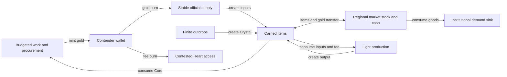

# Macro accounting
## Scope and flow
Track every player wallet/bank, resident and institutional gold balance and every item state. An official infinite catalog is a paid source of items, not a free source of gold. Market cash is finite wealth endowed at match start. Never confuse circulation with minting.

## Gold ledger
| Event | Classification |
| --- | --- |
| Initial resident purses, market cash, any actual starting cash | Endowment, counted once at reset |
| Paid courier 25; up to eight per contender | Mint; bounded 200 per contender |
| Sentinel 25; up to two paid defeats per contender | Mint; bounded 50 per contender |
| Procurement 80; up to three per contender | Mint; bounded 240 per contender |
| Supply endorsement order: 50, once per contender | Mint, bounded 50 per contender |
| Shared shortage order: 40, once globally | Mint, bounded 40 globally |
| Official supply payment, craft fee, bank fee, Charter fee, abstract producer payment | Burn |
| Retained death tax ceil(15 percent) | Burn |
| Regional Buy/Sell, peer exchange, successful theft | Transfer; zero aggregate change |
| Institutional stock consumption, ordinary item drops | No gold effect |

For N locked contenders, these proposed maximum new reward mints total 540*N+40. Initial markets add 450 gold. Eight residents at 36 add 288 only if that actual baseline population/purse was delivered; record actual counts and other starting balances. Do not treat respawn as a fresh endowment. Procurement budget is 3*N accepted rewards globally and three per persistent contender; withdrawals do not recalculate N.

`goldEnd = goldStart + minted - burned` across ALL wallets. Transfers cancel. Aggregate must match exactly after every transaction batch; market purchases do not burn payment and market sales do not mint proceeds. Official purchases do burn payment, rather than also crediting a spendable supplier wallet.

## Item ledger
Initial market stocks and actual carried supplies are endowments. Official paid purchases and gathering create instances. Recipes consume inputs and create one output with lineage. Book read, successful ward consumption, Core procurement, institutional demand and registered Charter activation (no physical item) are explicit sinks/transformations according to actual retained behavior. A ward charge becomes one timed world-source entity, whose expiry is recorded; do not count the same charge as still carried.

Market/peer transfer, theft of an existing dropped item, pickup, voluntary drop and death drop transfer location only. Corpse cleanup does not destroy dropped goods. No expiry/cleanup of economy goods in this sprint; if an existing cleanup policy removes one, record it as an explicit sink and identify why. Match reset closes the ledger and destroys match state under a named Reset event, excluded from in-match conservation.

For each definition: `end = start + created - consumed - explicitlyCleaned`, counting carried, reserved-owned, market-held and dropped instances. Crafting has per-definition consumption/creation and parent IDs. Reservations add no extra copy.

## Bounded sources and recovery
Six Crystal charges are a global free item source. Initial Crystal stock is 14; maximum ordinary Core demand is 3*N at N<=4, or 12 Crystal. Enough total exists in the proposed profile, but rivals can hoard/drop it: this is contestable scarcity, not guaranteed personal access. Stable Fiber/Ore keep basic inputs accessible when markets empty; seed work remains available up to its budget. Books/crafting/Charter fees and death loss compete with reinvestment.

Procurement mints are deliberately separate from regional liquidity; no hidden bank credit/refill. An exhausted local market can reopen by collecting gold from player purchases. Fees can be reduced only by the explicit coupon, still recorded at the actual paid amount. No XP is awarded for circulating gold/items.

## Model checks and telemetry
Produce time series for minted/burned/circulating gold, stock/cash, price/spread, new/consumed/dropped instances, production fees, coupons, distinct endorsements and access times. Record margin after input cost/fees separately from gross sale value, along with travel/death loss. A static arithmetic example is not a simulation of player behavior.

Enumerate every same-market legal buy→resell cycle in the configured stock range; require loss. Check supply→craft→regional sale margins and cross-region routes as intentional bounded opportunities, not automatically bugs. No automatic long-run equilibrium is claimed. Test low population, four contenders, exhaustion, hoarding and wallet theft. Full 60–90 minute macro calibration remains pending.

## Revised accounts after the complete source
Include player bank balances in total gold. Deposit/withdrawal transfers cancel in aggregate; a deposit fee is a burn. Bank funds are not included in carried-wallet theft/death loss.
The two-Toolkit endorsement order adds at most 50 gold per contender, alongside the three Core payments (240), courier (200) and sentinel (50). Thus maximum reward mints are **540*N + 40** including the one global shortage order. All five reward budgets are counted once; transfers are excluded.
Background producer payments burn at most 8*2 + 8*3 = 40 gold globally if all execute. City/West/East final consumption burns items, not money. Book/raw supply, craft, deposit fee, death tax and Charter payment are separate sinks. There are no unlogged exchange fees beyond the bid/ask spread; the spread itself transfers cash, it does not destroy gold.
At reset default eight resident purses and three markets give 288+450=738 tracked initial gold, plus actual other adopted endowments; player wallets/banks start zero. Endowments are not repeated reward faucets.
Measure median total player wealth (wallet+bank), richest share, activity income/minute, stockouts, contract completion, cargo loss/death and first Charter time. Keep zero-/low-population cases defined and report denominators. No infinite equilibrium claim.

Outcrop charges are unrealized resource capacity, not already-created item instances. Gathering creates one Crystal and consumes one charge; counting both as live items would double-count supply. Node charge ledgers are reconciled separately.
