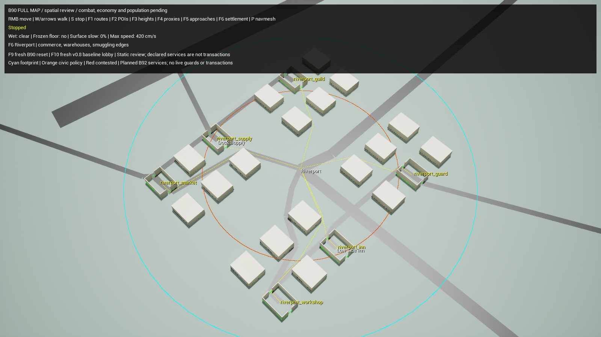

# B90 completion — full-map world skeleton

Native source commit **7e96ececba518ec830baddc00bc6504ad8f37cbc** closes the stage-owned spatial work in
[the B90–B94 implementation contract](09_IMPLEMENTATION_STAGES.md).
The [portable evidence bundle](evidence/B90Completion/README.md),
[twelve-case summary](evidence/B90Completion/StageSummary.json) and
[provenance audit](evidence/B90Completion/Audit.json) retain exact commands,
source/asset hashes, raw native reports, traces and screenshots.
Earlier foundation, traversal, river and approach reports remain historical
records with their own source/asset hashes. The supplied specification, atlas,
catalogs and original blank acceptance templates remain unchanged.

## What the final B90 build provides

The full-map definition retains all 96 POIs, 117 strategic edges, 144 building
footprints, 24 spawn pads, 11 settlement identities, 36 service/building bindings
and 16 legacy aliases. Every spatial address binds to a live native floor
component and native navigation. Aliases resolve to the same canonical address;
they do not instantiate another actor, source, market or reward pool.

Five cities each have six service districts and 24 building footprints. Each of
the six towns has one service building among four footprints. City service POIs
coincide with their selected buildings. Town hubs retain their authored route-hub
positions; the separate service seat uses the selected building's authored
position. This is an explicit hub-to-building binding, not a second town or an
unrecorded move of the POI.

The 36 service declarations preserve their exact functions and B92 execution
stage. **B90 enables no transactions or reward/source executors.** F6 shows public
settlement identity, service locations and native hub paths, the civic policy
core/edge and capital contested override. These policy outlines grant no live
sight, protection or guard knowledge. B91 owns observation geometry/audiences;
B92 owns officials, guards and real service transactions.

The structural shells expose 72 ground-floor doorway openings. All 216 native
capsule lanes across them pass, including two lateral lanes spanning 296 cm of
the authored 300 cm opening. All 108 closed interiors reject navigation. Seventy-
two actual journeys reach every mapped service from its settlement hub and walk
through each selected shell from front to rear. These are physical shell tests,
not finished B91 interiors, interactive doors, upper floors or stairs.

Road presentation now clips against actual structural wall bounds. A broad road
tile that intersects a wall is subdivided deterministically; overlapping pieces
are omitted. This tapers visible paint at doorways and removes paint beneath
closed shells without changing collision, terrain, permanent routes or walking
speed. The saved level contains 38,780 road-paint instances with zero structural
wall overlaps. The underlying 3 m doorway floor remains walkable even where its
paint is narrower.

Fitter revision **3** records the metadata/binding and street-presentation change.
Seed 9001, authored layout revision 1 and source coordinates remain unchanged.
The compiled payload SHA256 is
`87730ff8db760b3854e8959aa423f11b4a5d8e0ccc59ffec2a2534fe9873d342`.
The importer also rejects reflected saved-asset data that disagrees with the
checksum-closed source; a valid checksum string beside altered coordinates or
service data is insufficient for admission.

## Native results

| Check | Result |
| --- | --- |
| Compiler rejection/import tests | 13 pass |
| Native rules | 51 pass; zero failures/incomplete |
| Editor and Game Development targets | Both build successfully |
| Required native paths | 2,559 complete; 120 fitted pads; 31,909 ground samples |
| Ground and bridge fit | Zero missing ground; maximum sampled grade 24.0617%; eastern edge walked in 2.5833 s |
| Settlement/service structure | 11 settlements, 36 bindings, 16 aliases; 216 clear door lanes; 108 closed shells rejected |
| Actual structure walks | 72 pass; 944.867 aggregate simulation seconds; zero falling/replans |
| Road presentation | 38,780 instances; zero structural wall overlaps |
| Travel and physical boundaries | 31 journeys plus 15 boundary cases pass; zero falling/replans |
| Rivers and contact | 55 cases pass; dry decks and dry Heart circle verified |
| Key-target approaches | 23 local walks; 33/36 distinct branch pairs; each of seven targets has alternatives |
| Reset/profile isolation | Three real B90 worlds → v08; generations 1/2/3/4; original source ledger reconciles |
| Reproducibility | Two independent generations plus retained saved reopen have identical canonical geometry/pads |
| Rendered review | Native 1600×900 capital, Riverport and Oakmere F6 views inspected |

The [travel heat figure](evidence/B90Completion/traversal/TravelHeat.png) derives
from 6,150.234 aggregate native walking seconds over 31 separate fixtures.
Elapsed time weights each trace segment into 50 m cells; the hottest cell holds
105.567 summed fixture seconds. The gate independently recomputes those weights.
The figure shows actual corridors and geometric POI-anchor gaps, not a predicted
player distribution. [Raw measured travel](evidence/B90Completion/traversal/MeasuredTravel.csv)
keeps walked results separate from graph/native estimates.

## Reset and profile isolation

F9 reloads a fresh B90 world; F10 opens the original v0.8 lobby. The native reset
fixture performs real non-seamless level travel through three B90 worlds and
then starts the existing v0.8 Sources fixture in that same process. It does not
simulate reset by zeroing selected counters.

Each B90 world imports twice, rebuilds the registry twice, preserves canonical
bindings and tagged geometry, rejects the previous generation, and has one map
anchor, 24 unique spawn actors and no economy director, physical items or legacy
world director. The fixture seeds live diagnostic Wet/frozen contact before
each travel; the next world's field cells are empty and prior actor weak handles
are invalid. Authority generations advance 1 → 2 → 3 → 4.

After the switch, the full-map registry/contact subsystem is disabled and its
map anchor is absent. The original schema8 world and three market definitions
run alone. Independent ledger replay reports 76 receipts, nine accounts,
114 unique items and 1,052 gold. This proves spatial-profile isolation and the
unchanged baseline sources; full-profile five-market accounting is a B92 gate.

## Acceptance scope and remaining game work

The twelve B90 rows are evaluated at their stage-owned spatial boundary. Their
source files remain unmodified. The ledger records the precise evidence rather
than treating every later dependency in a composite sentence as a B90 gameplay
implementation.

| Case | B90 evidence | Later-stage boundary |
| --- | --- | --- |
| T01 | Repeat full spatial import/registry, real world resets, unique actor/site IDs | B92 full-profile resource initialization/accounting |
| T02 | Complete native spawn/target and declared-route path matrix | B92 service execution, B94 population planning cost |
| T03 | Native thawed/frozen crossings and dry decks | B91 paid item/spell and observation integration |
| T04 | Ground, grade, step and capsule diagnostics | B91 future vertical/traversal geometry |
| T05 | Seven targets, 23 walked local branches and static sightline classification | B91 ledges, smoke, concealment and authorized audiences |
| T06 | Actual antechamber-to-Heart walk within 15 s; dry claim circle | B93 physical earned claim integration |
| T07 | All 11 settlements, exact service/building identities and policy core/edge | B92 officials, witnessed security and live services |
| T08 | Independent deterministic generations and saved reopen | B91/B92 mutation/source persistence |
| T09 | 144 primitives, 72 doorway openings, closed-shell rejection and clipped roads | B91 completed interiors/doors/stairs/furniture |
| T10 | Native walking/dash/push at perimeter and terrace fixtures | Later competitive action/cost/control dispatch |
| T11 | Prescribed walked trips, estimates separated from measurements and derived heat trace | B91 functional-density fitting; B94 human pacing |
| T12 | Actual fresh v08 switch and native source-ledger replay | B92 comparison against initialized full-profile economy |

There are no invented vendors, free objective grants, decorative interaction
verbs or cosmetic-only substitutes for those later systems. The full-map mode
remains an explicitly labelled standalone spatial review. B90 completion does
not mean v0.9 is a complete competitive game or packaged full-match release.

The measured 339-second POI-anchor gap and open rare-target approaches remain
explicit design risks. They do not invalidate measurement completion or prove
finished pacing. B91 should fit the authored functional environment along actual
native corridors, preserve permanent access, and remeasure before B94 human
acceptance. No speed, warning-window or victory tuning was changed to conceal
those findings.

## Reproduction

Run native operations sequentially with Source/Config frozen during each run.
The plot additionally needs `Scripts/requirements-b90-plots.txt`; install those
dependencies in a local virtual environment or scoped runtime. The portable
acceptance checker uses only Python's standard library.

~~~powershell
python -B Scripts/TestV09Import.py
python -B Scripts/SyncV09Data.py --check
./Scripts/BuildEditor.ps1 -MaxParallelActions 3
./Scripts/BuildB90Map.ps1
./Scripts/BuildB90Map.ps1 -Validate
./Scripts/RunB90Structure.ps1
./Scripts/RunB90Structure.ps1 -Capture -Settlement capital
./Scripts/RunB90Structure.ps1 -Capture -Settlement riverport
./Scripts/RunB90Structure.ps1 -Capture -Settlement oakmere
./Scripts/RunB90Closure.ps1
./Scripts/RunB90Traversal.ps1 -Lane All
python -B Scripts/PlotB90Travel.py <full-traversal-run>
./Scripts/RunB90Traversal.ps1 -Lane Approaches
./Scripts/RunB90River.ps1
./Scripts/RunTests.ps1
./Scripts/BuildGame.ps1 -MaxParallelActions 3
python -B Scripts/CheckB90Completion.py docs/v09/evidence/B90Completion
~~~
