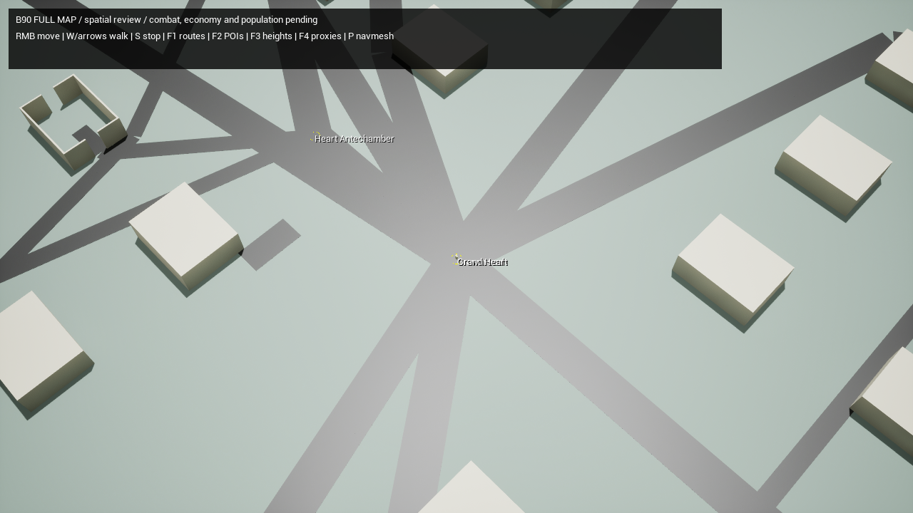

# B90 — full-world spatial implementation

27 October 2026 · Native spatial foundation implemented; broader stage acceptance remains partial.

Implementation source: **96caff1**. Starting source: **ebc19a5, v0.8 B86**. See [baseline review](B90_BASELINE_REVIEW.md)
for the repository/architecture audit, actual zero-wallet/empty-inventory starts,
working Witness operation and inherited limits. The supplied v0.9 specification
is adopted with hashes in SOURCE_MANIFEST.json; original prose/data/templates
and historical v0.8/v0.7 assets/evidence remain unchanged.

## Implementation

SyncV09Data.py compiles the B90 spatial subset into checksum-closed staged
`Content/Lockdown/Data/V09/map_b90.json`. It records seven source JSON hashes and
the prescribed travel-table hash. Unknown spatial fields, duplicate IDs,
noninteger/out-of-range coordinates, missing route endpoints, wrong profile seed
and unsupported shapes/counts reject before import. Native import checks its
compiled SHA256 before parsing or building. Repeat import replaces arrays.

ULDMapDefinition is independent of the small-map region's uint8 service addresses
and fixed 60×40 view grid. It preserves all **96 POIs, 117 route edges,
11 settlements, 144 building blocks and 24 spawn identities**. It does not claim
to replace full-profile combat, economy, NPC or observation services.

LDB90Bootstrap creates saved assets under `/Game/Lockdown/Generated/V09/`:

- DA_FullMap with source/seed/layout/fitter identity.
- 144 native 200 m terrain tiles, sampled at 4 m, with three height bands,
  fitted pads, connected terrain ramps and permanently walkable river floors.
- Four dry bridge decks with fitted ramps over their still-walkable lower floors,
  a capital wet inset and noncolliding instanced river/road presentation.
- All 144 settlement blocks. The 36 selected interior footprints have structural
  walls/openings; interactive doors, upper floors/stairs/furniture belong to B91.
  The other 108 are closed collision/sight shells.
- 24 saved PlayerStarts, perimeter safety collision and a saved Recast mesh.

The native fitter widens bank transitions where needed to satisfy the 25% grade
contract. First-demo bank aprons are at least 30 m and scale with height; source
river widths/floors are unchanged. Three lowland bridge target pads fit roughly
2 m above their source reference points onto the dry deck; source and final
navigation positions remain separately recorded. Garden bridge retains its
authored raised deck. These are explicit fitter-revision-1 choices, not silent
edits to the source atlas.

Full-map Recast uses 4,096 cm tiles, 40 cm cells, a larger bounded search pool
and conservative two-voxel clearance. The actual character capsule stays
28/90 cm, ordinary step height 35 cm and walking 420 cm/s. Long-distance path
queries no longer fail solely because of the small default search budget.
This is a spatial baseline; hierarchical planning and full-population query cost
remain subsequent integration/performance work.

## Native review mode

OpenB90.ps1 launches L_V09Full with an explicitly labelled standalone spatial
mode. It reuses ALDCharacter/CharacterMovement and native Recast paths. Right
click walks; W/arrows offer manual review; S stops; F1 routes, F2 POIs, F3 terrain
heights, F4 structural proxy boxes and P native navigation support inspection.

The mode accepts the explicit v09_full map profile and rejects listen/dedicated
preview admission. It does not instantiate ALDGameMode's legacy economy,
population, inventories, objective actors or rewards. Full-match admission
requires B91–B93 rather than a silently mixed short-map match. Normal v08
selection and its saved map/catalog payloads remain unchanged.

## Validation and evidence

Portable selected results are under [evidence/B90](evidence/B90/). Local complete
logs/build outputs remain in ignored Artifacts. Test source/content hashes and
commands are recorded in the portable audit. Earlier failed development runs
remain local and are not counted as passing evidence.

| Check | Observed result |
| --- | --- |
| Editor / Game native builds | Passed on pinned Win64 Development toolchain |
| Native rules / source-import rejection tests | 49 / 7 passed |
| Preserved specification/model validation | 2,212 passed; not native acceptance |
| Native path matrix | 2,559 complete queries; 120 fitted pads; zero path failures |
| Route ground/grade | 31,909 samples; zero missing ground; maximum 24.0617% |
| Conservative capsule diagnostics | One candidate edge contact, corroborated by the actual bridge walk; zero unresolved contacts |
| Actual Heart / bridge-entry walks | 10.7000 s / 2.5833 s at 420 cm/s |
| Determinism / saved reopen | Two full generations and reopened/refreshed map have identical semantic transforms and fitted pads |
| v0.8 Sources regression | Passed independent replay: 76 receipts, 9 accounts, 114 unique items, 1,052 gold |
| Render | 1280×720 offscreen capital; isolated instancing-enabled material variants; placeholder visual readability remains open |

The static Editor query p95 was 0.2846 ms in the final recorded matrix. This
does not establish full-population planning, client FPS, server tick or B94
performance. The overview uses a diagnostic 18,000 cm camera distance.



The native path matrix includes every one of 24 spawn pads to all 96 POIs, both
directions of all 117 declared route edges, all 20 prescribed atlas journeys and
the short Heart journey: **2,559 queries**. Coincident spawn/hub locations are
valid zero-distance arrivals. Final counts and sampling outcomes are in Summary.

Route samples project onto local native navigation before ground traces and
28/90 capsule sweeps. Walkable floor contact is distinguished from a blocking
wall/ceiling. A candidate step tests bounded 35 cm up/forward/down capsule sweeps,
matching ordinary step capacity. The conservative sweep retains one Garden bridge edge contact; a separate actual
CharacterMovement fixture completes that approach in 2.5833 seconds. The
independent checker requires that corroborating run and rejects other unresolved
contacts. This is collision evidence, not a claim that
an actual body has walked every long route. The dedicated antechamber probe uses
ordinary CharacterMovement after a labelled initial placement, without abilities.

NativeTravel and TravelComparison separate graph estimates, native path lengths,
420 cm/s estimates and actual walked time. Empty intervals, stop/hazard delays
and human travel experience are still unmeasured. Semantic regeneration compares
saved actor labels/transforms and fitted pads, not nondeterministic package GUIDs.

## Commands

```powershell
python -B docs/v09/tools/validate_spec.py
python -B Scripts/TestV09Import.py
python -B Scripts/SyncV09Data.py --check
python -B Scripts/SyncB84Data.py --check
./Scripts/BuildEditor.ps1 -MaxParallelActions 3
./Scripts/BuildB90Map.ps1
./Scripts/BuildB90Map.ps1 -Validate
# Refresh isolated material variants without rebuilding collision/navigation:
./Scripts/BuildB90Map.ps1 -PresentationOnly
./Scripts/OpenB90.ps1 -CheckWalk
./Scripts/OpenB90.ps1 -CheckWalk -WalkCase BridgeEntry
./Scripts/OpenB90.ps1 -Capture
./Scripts/RunTests.ps1
./Scripts/BuildGame.ps1 -MaxParallelActions 3
# Independent evidence replay, with actual directories returned by the scripts:
python -B Scripts/CheckB90Evidence.py <map-run> --walk <walk-run> --compare <regeneration-run> --bridge-entry <bridge-walk-run>
```

Run native operations sequentially and keep Source/Config frozen during them.
Use BuildB90Map for this new region; do not regenerate historical maps. Preview
and evidence commands require the editor; no new cooked full-match package or
dedicated-server acceptance is claimed.

## Remaining stage gates

The [working ledger](FeatureLedger.csv) records all 62 cases separately from the
blank supplied templates. B90's structural native access is implemented; the
complete B90 release gate is **not closed**. Its cases also request Wet/frozen
contact, services, actual long travel/empty-interval traces, border push/dash
receipts and full-profile reset/accounting checks. These need further native
scenarios and some dependent B91/B92 integration. Two usable approach branches
are supported by native paths; full sightline/occlusion encounters remain B91.

B91–B94 are not implemented by this change. There are no functional prop verbs,
full NPC routines, five-market economy, full-profile earned victory routes,
restricted-client mutations, full-duration scenarios or human balance results
in the B90 preview. Preserve all named inherited deferrals. Continue the B90
remaining cases and then B91's Riverport reference encounter; do not infer a
complete playable full-map release from the saved geometry or model validator.
