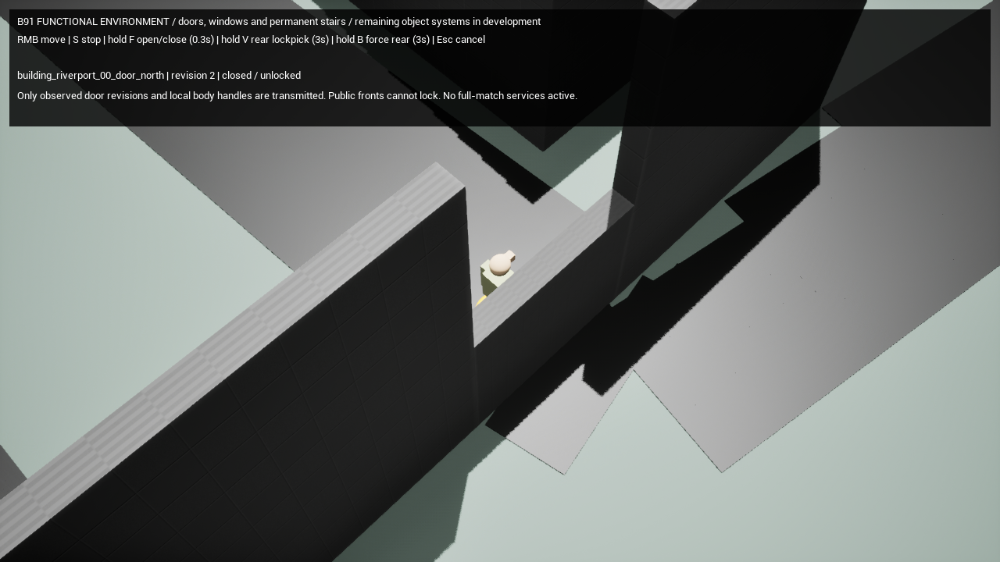

# B91 structural/door increment — portable evidence

The stage remains **in progress**. This bundle covers B91-T01–T03. Read
[the implementation report](../../B91_IMPLEMENTATION.md),
[increment summary](IncrementSummary.json) and [audit](Audit.json).

| Path | Evidence |
| --- | --- |
| `structural/` | 75 native checks, 36 actual interior walks, 16 stair ascents, raw positions/times and collision/sight checks |
| `network/A/` | Two independent remote owners; A rendered, B headless; received snapshots, motion, replay/race receipts, timestamped A video |
| `network/B/` | Same scenario in a separate run; B rendered, A headless; B native doorway travel and timestamped B video |
| `regression/` | Three actual B90 reloads → v08 in one process, stale-generation/field cleanup, original native source report and independently replayed ledger |
| `NativeRules.json` / `Automation.log` | All 51 native rule tests, including both approved observed-view schemas and full-map pose quantization |
| `BuildEditor.log` / `BuildGame.log` | Successful native Development builds |
| `limitations/` | Raw failed client logs from simultaneous dual-rendering attempts at default and reduced settings |

[Client A video](network/A/A.mp4) · [Client B video](network/B/B.mp4)

These are actual offscreen native frames, sampled around 5 Hz and encoded with
their recorded timestamps. Each run has one renderer and a real headless peer.
They are not a simultaneous dual-render or frame-rate/performance claim. Setup
placements are diagnostic; B's doorway journey uses normal native movement.
Render-only cutaways preserve authority collision and sight.

The audit pins source, compiled contracts, unchanged B90 assets, unchanged supplied
inputs, raw reports and portable output bytes. Raw PNGs remain local; their hashes
and frame-time CSVs are preserved beside the videos.

~~~powershell
python -B Scripts/CheckB91Increment.py docs/v09/evidence/B91
~~~

The combined checker validates this increment only. It leaves B91-T04–T15 open
and does not imply full-map economy, population, earned victory or full-session
acceptance. Earlier failed development attempts remain in local Artifacts.
